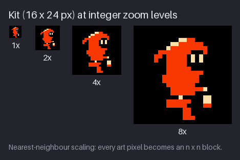
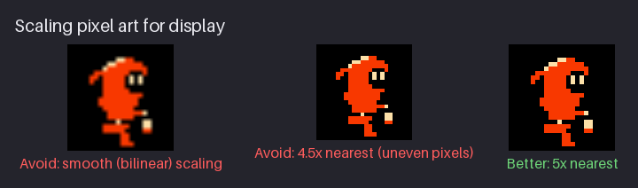
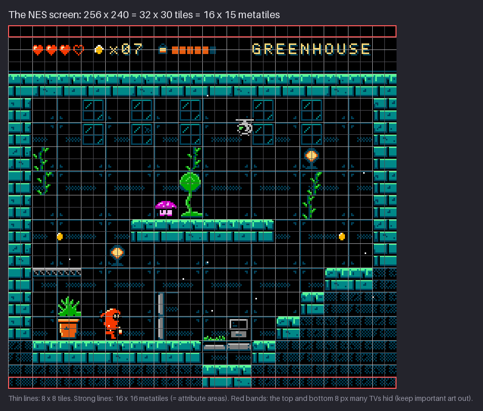
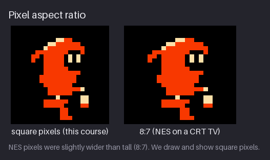
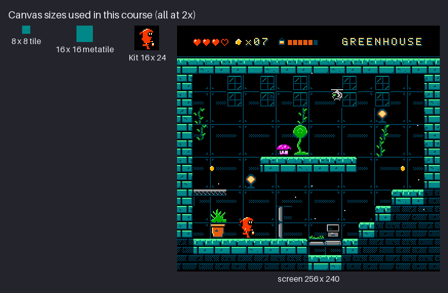
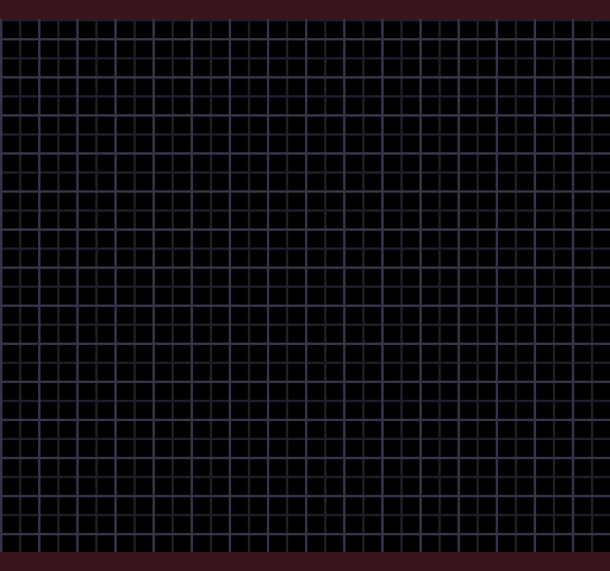
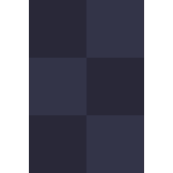
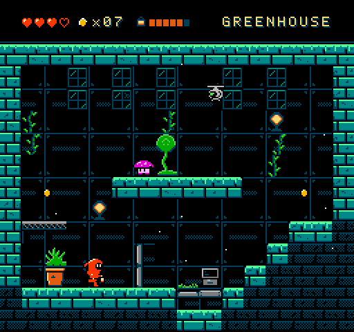

# Chapter 1 — Pixels, Tools, and the NES Screen

Pixel art is the craft of drawing on a small, fixed grid with a limited set of colours, where
every pixel is placed on purpose. This course teaches it in the style of the Nintendo
Entertainment System (NES): a fixed master palette, 8×8 tiles, four colours per tile and small
sprites. Those limits are not nostalgia. They force the clear decisions that make pixel art read
well, and they are the same discipline behind Mega Man, Kirby's Adventure and, decades later,
Shovel Knight, which chose to work inside a slightly relaxed version of them.

Over the course you build `hollow-vault`, an original NES-inspired asset pack for a small
exploration game. A sealed underground seed vault has been abandoned for a century and plants
have overgrown the machinery. The hero, **Kit**, is a small vault keeper in a hooded suit who
carries a lantern. The pack covers Kit, three creatures and four areas: the Greenhouse, the
Cistern, the Furnace and Antenna Ridge on the surface. Its mood comes from *Environmental Station
Alpha*: a tiny explorer in a quiet, colour-coded world full of black voids. Its resolution comes
from the NES.

This chapter explains what pixel art is in practice, helps you install and set up an editor,
introduces the generic tools the whole course uses, and teaches two habits that matter more than
any brush: judging your work at 1×, and only ever scaling it by whole numbers. Then it describes
the NES screen and records it in a one-page spec. That spec, the palette files and two canvas
templates are the first milestone of `hollow-vault`.

Previous: [README](README.md). Next: [Chapter 2](02-lines-and-curves.md).

## How this course works

Each chapter explains an idea, shows it in figures, and moves the project one step forward.

- **Figures** are the examples. Each lives in `images/` and is enlarged by a whole number so you
  can count pixels. Many come as pairs: a caption in red marks the version to avoid, a caption in
  green marks the better one.
- **Try it** boxes are 2–5 minute drills to do in your editor right away. They are small on
  purpose: the aim is to feel the idea in your hand, not to make finished art.
- **The project** is `hollow-vault`. `project/chNN/` is the complete pack as it stands at the end
  of chapter NN, with a `README.md` that lists what changed. Later chapters revise earlier art:
  Kit begins as a white silhouette in Chapter 3 and ends up shaded, animated and exported as NES
  data.
- **Exercises** are drawing assignments. Each has a "What to look for" list so you can check
  your own work, and a collapsed example solution.
- **NES rule** boxes state one hardware limit, why it existed, and whether the course keeps it
  exactly or relaxes it. Where we relax a rule we say "NES-inspired" rather than "NES".

Every figure and project file is made by a small Python toolkit in `tools/`. You never need to
run it. It exists so the pictures are reproducible and honest: what you see in a figure is a real
image file, checked against the same NES limits the text describes.

## What makes it pixel art

Any image on a screen is made of pixels, so "pixel art" needs a narrower meaning. The useful one
is this: **pixel art is drawn at its final resolution, one deliberate pixel at a time, with a
small, fixed palette.** Nothing is left to a resampling filter or a soft brush. The artist
decides what every pixel is.

Here is where the course is going: the finished Greenhouse, the first area of `hollow-vault`,
shown at 2×.


The whole screen is 256×240 pixels. It uses 16 colours, all from one fixed palette, and every
8×8 block of the background uses at most four of them. The animation is 24 frames of 100 ms, a
2.4 second loop: the background tiles cycle through four frames, the creatures and Kit play short
idle loops, and a few spores drift through the air. None of it is painted; all of it is placed.

That last point is the core trade of the medium. You give up subtle gradients, and in return
every pixel can carry meaning. Kit is 16 pixels wide. At that size one pixel is more than 6% of
the width: moving one pixel of an eye changes the expression, adding one pixel to the hood
changes the silhouette. Low resolution is a *design* constraint, not only a technical one. It
forces you to decide what matters and leave out the rest.

You control three things, and the course is organised around them:

1. **Placement**: where pixels go. Lines, shapes, silhouettes, clusters (Part I).
2. **Colour**: which colour each pixel is. Value, palettes, ramps, shading (Part I, then applied
   to tiles and backgrounds in Part III).
3. **Timing**: when pixels change. Animation (Part II).

> **Try it (2 min).** Open any image editor, make a 16×16 canvas, and draw a ball with exactly
> three colours: one for the outline, one for the body, one for a highlight. Zoom out to 100%.
> You can read it as a ball even though it has no gradient at all.

## Install an editor

You need far less software than you might think. A pixel-art editor must do a handful of things
well:

- draw single hard pixels with no smoothing (a **pencil**);
- zoom in by whole steps and show a **pixel grid**, ideally two grids at once;
- hold a **palette** you can import, and lock the image to it (**indexed mode**);
- stack **layers**, so construction lines and colour can live apart;
- arrange 8×8 tiles on a grid and reuse them (**tilemap layers** or a tile mode);
- show **onion skin** and a **timeline** for animation (from Chapter 8);
- **export PNG** (and, later, sprite sheets and GIF previews).

Many free editors do all of this. The course names tools by what they do ("fill", "indexed
mode", "onion skin"), never by a menu path. The mapping from these generic names to each
editor's menus, plus full install notes, is in [Appendix B — Tools](appendix-b-tools.md).

If you have no preference, use this short list:

- **Start here: Pixelorama.** Free and open source (MIT). Use version **1.1 or newer**: 1.1 added
  the two features this course leans on, indexed mode and tilemap layers. It also has layers,
  a timeline, onion skin, symmetry, a tile mode for seamless tiles, `.gpl` palette import and
  sprite-sheet export. On Debian it installs from Flathub.
- **If you want the Aseprite workflow for free: LibreSprite.** A GPL-2.0 fork of the last open
  source version of Aseprite. Older and smaller, but the same way of working.
- **If you already own Aseprite, use it.** It is the industry reference for game sprites, with
  indexed mode and tilemap layers. It is source-available under a proprietary licence, not open
  source.
- **If you already know a general paint program:** Krita and GIMP both work once you switch them
  to hard pixels. GIMP is also good at converting images to a fixed palette.
- **For an old or slow machine:** GrafX2 (a Deluxe Paint-style editor that is always indexed) or
  mtPaint. Both are tiny and in Debian.
- **For zero install:** Piskel runs in a browser and covers sprite animation, but has no tile
  mode.

For maps (Chapters 15 and 16) the course also uses **Tiled**, a free tile-map editor. You do not
need it yet.

| Editor | Licence | Install on Debian | Best at |
|---|---|---|---|
| Pixelorama | MIT | Flathub `com.orama_interactive.Pixelorama` | All-round drawing, tiles and animation |
| LibreSprite | GPL-2.0 | AppImage from its releases page | Aseprite-like workflow |
| Aseprite | proprietary EULA | buy, or build from source for personal use | Industry-standard sprites |
| Krita | GPL-3.0 | `sudo apt install krita` | Painted backgrounds, animation |
| GIMP | GPL-3.0-or-later | `sudo apt install gimp` | Palette conversion, batch scaling |
| GrafX2 | GPL-2.0 | `sudo apt install grafx2` | Indexed-palette drawing |
| mtPaint | GPL-3.0-or-later | `sudo apt install mtpaint` | Light indexed editing |
| Piskel | Apache-2.0 | none (browser) | Quick animated sprites |
| PixiEditor | LGPL-3.0 | Flathub `net.pixieditor.PixiEditor` | Modern toolset, animation |
| Tiled | GPL-2.0-or-later | `sudo apt install tiled` | Tile maps (later chapters) |

The "start here" set-up on Debian is three commands:

```console
$ sudo apt install flatpak tiled
$ flatpak remote-add --if-not-exists flathub https://dl.flathub.org/repo/flathub.flatpakrepo
$ flatpak install flathub com.orama_interactive.Pixelorama
```

Optional extras: `sudo apt install krita gimp grafx2 mtpaint`.

Two NES-specific editors exist as well. **NEXXT** and its ancestor **NES Screen Tool** draw
directly in the NES's own tile, map and palette formats and enforce the hardware limits by
construction; **YY-CHR** is the classic viewer for NES tile data. All three are Windows programs
that run under Wine. They are optional: the course never requires them, and Chapter 24 returns to
them for readers who want real NES data.

Do not spend long on this choice. The skills transfer completely: a clean 2:1 line, a readable
silhouette and a good walk cycle are the same in every program. Pick one, learn its pencil,
eraser, zoom and undo, and move on.

> **Aside: general paint programs.** In Krita, choose a pixel-art brush preset or set a 1 px
> brush with anti-aliasing off. In GIMP, use the Pencil tool (not the Paintbrush), and choose
> "Interpolation: None" whenever you scale. In both, any soft brush, smudge or blur creates
> in-between colours you did not choose, and those colours are not in the NES palette.

### Day-one settings

Whatever editor you picked, change these settings before you draw anything. Each one prevents a
specific, common mistake.

- **Pixel grid at 8 px, with a major line every 16 px.** The NES builds every background from
  8×8 tiles, and colours are assigned per 16×16 block (you will see why below). With both grids
  visible you always know which tile and which colour block you are drawing in. Most editors
  call the second grid a "major", "secondary" or "tile" grid; if yours has only one, set it to 8.
- **A per-pixel grid at high zoom.** Many editors can also outline each pixel from about 400%
  zoom. With it you can count runs and spot stray pixels; without it, you guess.
- **Checkerboard transparency.** Transparent pixels should show as a grey checkerboard, not as
  white. Sprites on the NES have a real "transparent" colour, and you must be able to see it.
- **Zoom by whole steps.** Use 100%, 200%, 300%, 400%, 800% and so on. At 250% some pixels are
  drawn 2 screen pixels wide and some 3, and your lines look uneven when they are not.
- **A 1× preview.** Open a second, small view of the canvas at 100% (editors call it a preview,
  a second canvas or a mini-view) and park it in a corner. You will glance at it constantly.
- **Pencil, 1 px, hard.** No anti-aliasing, no pressure-to-opacity, no smoothing. A pen tablet
  is welcome, but switch pressure off for opacity.
- **Undo is your eraser.** Learn the undo shortcut on day one. Pixel art is a game of trying a
  pixel, looking, and taking it back.

> **Try it (3 min).** Make a 64×64 canvas. Set the grid to 8 px with 16 px major lines, turn on
> the checkerboard and open the 1× preview. Draw a few random pixels at 800% and find them in the
> preview. Count how many 8×8 tiles the canvas holds (64).

## The generic tool set

These are the tool names used in the rest of the course. Every editor above has most of them,
sometimes under another name ([Appendix B](appendix-b-tools.md) lists the names per editor). You
do not need to master them now; this is a map of what is coming.

| Tool | What it does | First needed |
|---|---|---|
| **Pencil** | Sets one pixel to the current colour, with no blending. Your main tool. | Now |
| **Eraser** | Sets pixels to transparent. | Now |
| **Palette** | The fixed set of colours you draw with, imported from a file. | Now |
| **Indexed mode** | Each pixel stores a palette *number*, not a colour. | Now; Chapter 5 |
| **Pixel-perfect mode** | A pencil option that removes the extra corner pixels of a freehand stroke. | Chapter 2 |
| **Line** | Draws a straight pixel line between two points. | Chapter 2 |
| **Rectangle / ellipse** | Draws outlined or filled boxes and ovals. | Chapter 2 |
| **Layers** | Stacked transparent canvases: construction on one, ink on another. | Chapter 2 |
| **Fill (bucket)** | *Contiguous* fill stops at other colours; *global* fill changes every pixel of a colour. | Chapter 3 |
| **Selection + move** | Selects pixels and moves, copies or flips them. | Chapter 3 |
| **Symmetry** | Mirrors your strokes across an axis while you draw. | Chapter 3 |
| **Colour picker** | Picks a colour from the canvas, keeping you inside the palette. | Chapter 4 |
| **Replace colour** | Swaps one colour for another everywhere: the fastest palette swap. | Chapter 5 |
| **Lock alpha** | Paints only over pixels that are already filled. | Chapter 6 |
| **Tile mode / offset** | Repeats the canvas around itself, or shifts it with wrap-around. | Chapter 7 |
| **Onion skin** | Shows the previous and next frames as faint ghosts. | Chapter 8 |
| **Timeline** | Frames in order, each with a duration in milliseconds. | Chapter 8 |
| **Tilemap layer** | Places 8×8 tiles on a grid; edit one tile and every copy updates. | Chapter 14 |

Two tools in that list matter more for NES work than for pixel art in general:

- **Indexed mode** is how the NES thinks. The hardware never stores "red"; a tile stores the
  numbers 0–3 for each pixel, and a separate palette says which colour each number means. In an
  indexed image you can change one palette entry and every pixel that uses it changes with it.
  That is how NES games recoloured the same enemy for a harder level, and how Chapter 5 tests
  whole palettes in seconds. It also stops you from drawing with a colour that is not in the
  palette, because there is no such colour to pick.
- **Tilemap layers** (or tile mode) mirror how the NES draws backgrounds: a small set of 8×8
  tiles placed on a grid, each one reused many times. Drawing this way shows you, at every
  moment, how many unique tiles a room costs. The NES could hold only 256 background tiles at
  once, so that number matters (Chapters 14 and 15).

Two tools are conspicuously missing: soft brushes and blur. You will not use either. Every
soft-looking effect in this course (smooth curves, glows, gradients) is built from deliberate
pixels in later chapters.

## Work zoomed in, judge at 1×

You draw pixel art zoomed in, because at 100% a pixel is too small to hit with a mouse. But
nobody plays the game at 800%. The player sees the art at its native size, scaled up by a small
whole number. This creates a trap: **the sprite you look at while you draw is not the sprite the
player sees.**



Look at Kit at four zoom levels:

- At **8×** every pixel is a distinct square. You notice the two cream eyes, the black belt row
  with its one cream buckle pixel, the lantern and the hood tail. At this size it is easy to
  believe that detail is what makes the sprite good.
- At **1×** those details merge. What you read is a red hooded shape with a dark face, a light
  spot where the lantern is, and dark legs. Shape and contrast carry the sprite; single pixels
  almost do not.
- **2×** and **4×** are close to what players see. The NES screen shown on a modern monitor is
  usually enlarged three or four times (more on that below).

This is why the habit matters. At high zoom you over-value detail, put in pixels that vanish or
turn into noise at 1×, and miss problems that only appear small: two areas of similar value
merging, a limb that disappears, a face that reads as a smudge. The fix is simple: keep the 1×
preview open and look at it every few strokes. Many artists also flip the canvas horizontally
from time to time; a fresh view exposes lopsided shapes the same way.

Kit uses 239 of the 576 pixels in a 24×24 cell, in three colours plus transparent. Everything you
will learn to see in Kit (hood, face, mantle, belt, lantern) is made from that budget.

> **Try it (3 min).** Open `project/ch20/scene/greenhouse.png`, the finished Greenhouse, at 1×
> and at 4×. At 4×, find three small details (a crack, a leaf, a rivet). Then look at 1× and
> decide which of them you can still see. Note what *does* read at 1×: lit edges, the black
> voids, the red hero.

> **Try it (2 min).** Draw a 16×16 face at 800%: eyes, eyebrows, nose, mouth, ears. Look at the
> 1× preview. Usually the eyes and the head outline survive, and the nose and eyebrows do not.
> Delete what does not survive.

## Integer scaling

Pixel art is drawn small and shown big. The NES screen is 256×240; a modern monitor is ten times
larger. How the image is enlarged matters as much as how it was drawn.

The rule is short: **scale by whole numbers, with nearest-neighbour sampling.** At ×3, every
pixel becomes a crisp 3×3 block and the art looks exactly as drawn, only bigger. Anything else
damages it.



- **5×, bilinear (left).** A smoothing filter (bilinear, bicubic) blends neighbouring pixels.
  Every hard edge becomes a gradient, and three hand-picked colours become dozens of in-between
  colours that are not in the palette.
- **4.5×, nearest (middle).** Nearest-neighbour keeps the colours, but a pixel cannot become 4.5
  screen pixels wide. So some pixels become 4 wide and some 5, in an alternating pattern. Look
  at the eyes and the belt: one-pixel features turn thin or fat depending on where they fall. In
  motion it shimmers, because a pixel changes width as it moves.
- **5×, nearest (right).** Every pixel is a 5×5 block. Nothing is lost.

For the NES screen, use the largest whole factor that fits your monitor and fill the rest with
black bars:

| Monitor | Factor | NES screen becomes |
|---|---|---|
| 1366×768 laptop | ×3 | 768×720 |
| 1920×1080 (1080p) | ×4 | 1024×960, with black bars at the sides |
| 2560×1440 (1440p) | ×6 | 1536×1440 |

Scaling happens in more places than you might expect, so watch for it:

- **Export.** When you export a preview or a screenshot, scale by 2, 3, 4… with "nearest"
  (also called "none", "box" or "pixel" interpolation). On the command line, ImageMagick does it
  with `convert in.png -filter point -resize 400% out.png`.
- **The game engine.** Engines have a "pixel-perfect" or "integer scaling" setting. Chapter 20
  covers it.
- **Your desktop and browser.** A desktop set to 125% or 150% scaling, or a web page that resizes
  images, will blur or distort your art when you view it. When something looks wrong, check the
  zoom first.

> **Try it (3 min).** Export any small sprite three times: at ×3 nearest, at ×2.5 nearest, and
> at ×3 with smooth interpolation. View the three files at 100%. In the ×2.5 file, find one pixel
> that is two screen pixels wide and another that is three.

## The NES screen

Before you draw a single asset, you need the grid that everything obeys. On most modern projects
you choose it. On the NES, the hardware chose it for you, and this course adopts its choices.

The NES picture processor always produces a **256×240** image. It does not store that image
pixel by pixel; it builds it from **8×8 tiles**. A full screen is a grid of 32×30 tiles, and the
tile grid is fixed: every background tile starts at a multiple of 8.



The figure lays the grids over the finished Greenhouse:

- **Thin lines: the 8×8 tiles.** 32 across, 30 down, 960 tiles in all. Each background tile can
  use at most 4 colours (Chapters 5 and 14 explain why).
- **Strong lines: the 16×16 blocks.** The NES assigns colours to the background in 16×16 areas,
  not per tile. A screen is 16×15 of these blocks. The course calls a 16×16 block of four tiles a
  **metatile** and builds every room from metatiles, so a colour block and a building block are
  always the same thing. Look at the platforms and walls: their edges sit on the strong lines.
- **Red bands: overscan.** Old televisions drew the picture slightly larger than the screen, so
  the top and bottom rows were often hidden behind the bezel. Most TVs showed only about the
  middle 224 lines. Keep anything important (the hero's path, the HUD, doors) inside the middle
  **256×224**, 8 px clear of the top and bottom. In the figure the HUD starts just below the top
  band; only wall and floor fill reaches into the bottom one, never anything the player must see.

Kit and the creatures are not part of the tile grid. They are **sprites**: small, separately
moving 8×8 tiles that the hardware draws on top of the background at any pixel position. Kit is
16×24, a block of 2×3 sprites moved together. Chapter 3 counts them.

### Square pixels and the 8:7 question

On a 1980s television the NES's pixels were not square. The picture was stretched to fill a 4:3
screen, which made each pixel about 8:7, a little wider than tall.



The difference is visible but small: Kit looks slightly wider and stockier on the right. This
course draws and shows **square pixels**, as nearly every modern NES-styled game does. It is the
first of a few deliberate relaxations, so from here on the course calls its art "NES-inspired"
wherever one applies. If you ever target real hardware, test your art on an 8:7 preview too;
circles drawn for square pixels become slightly wide ovals.

### The canvases you will use

Almost every file in `hollow-vault` is one of four sizes, all multiples of 8.



| Canvas | Size | Used for |
|---|---|---|
| Tile | 8×8 | The unit of all background art (Chapters 7 and 14) |
| Metatile | 16×16 = 2×2 tiles | Building blocks of rooms; also enemies and most props |
| Kit | 16×24 = 2×3 sprites | The hero, drawn in a 24×24 cell for room to move |
| Screen | 256×240 = 32×30 tiles | One room, one finished scene |

Because everything shares one grid, any asset can be placed next to any other with no resizing,
and they look as if they belong to one world. Mixing pixel sizes (a sprite drawn at 32×32 and
shrunk, next to tiles drawn at 1×) is the most common way pixel art stops looking like one game.

> **NES rule: the screen.** The NES draws a 256×240 picture built from a fixed 32×30 grid of 8×8
> tiles, and assigns background colours per 16×16 area. TVs hid roughly 8 lines at the top and
> bottom. **Kept authentic:** every screen in the course is 256×240, background art is made of
> 8×8 tiles grouped into 16×16 metatiles, and key art stays inside 256×224. **Relaxed:** we show
> square pixels instead of 8:7.

### Where *Environmental Station Alpha* fits

ESA, the game whose mood this course borrows, runs at only 160×120 with a hero about 5×8 pixels.
That is a wonderful size for atmosphere and a hard one for learning sprite craft: a 5 pixel hero
has no room for a face, shading or a readable run cycle. So `hollow-vault` takes ESA's *mood*
and the NES's *resolution*. From ESA it keeps a small hero in a large quiet space, black voids,
one hue family per area, a warm hero against cool worlds, and bright 1 px rims on walkable edges.
Chapter 25 goes down to 160×120 and teaches micro-resolution as a style of its own.

## The spec

Every project needs a one-page spec: the numbers every asset obeys. Changing them late means
redrawing everything, so they are fixed now. The `hollow-vault` spec is `project/ch01/spec.md`;
here it is in full.

| Item | Value |
|---|---|
| Screen | 256×240 (keep key art inside 256×224) |
| Tiles | 8×8, 4 colours each (2 bits per pixel) |
| Metatiles / attribute areas | 16×16; one screen = 16×15 metatiles |
| Palette | NES master palette, Lospec "Nintendo Entertainment System" rendering |
| Backdrop | $0F black, shared by all background sub-palettes |
| BG sub-palettes | 4 per area: backdrop + 3 colours |
| Sprite sub-palettes | 4 per area: transparent + 3 colours |
| Kit | 16×24 = 2×3 sprites of 8×8, drawn in a 24×24 cell |
| Enemies | 16×16 = 2×2 sprites |
| Limits | 8 sprites per scanline, 64 on screen, 256 BG tiles + 256 sprite tiles per pattern table |
| Display | integer scale only: ×3 = 768×720, ×4 = 1024×960 |

You have met the first three rows. The rest are introduced where they matter, but here is why
each one is there:

- **Palette.** The NES could not show any RGB colour, only entries from a fixed master palette
  of 64 slots, of which about 54 are distinct colours. Its colours were generated as a TV
  signal, so every RGB version is an interpretation. The course uses one popular rendering, the
  Lospec "Nintendo Entertainment System" palette, with 55 colours including black. Colours are
  named by their hardware number in hex: `$0F` is black, `$16` is the red of Kit's suit, `$30`
  is the project's white. Chapter 5 tours the palette.
- **Backdrop.** One colour is shared by every background tile on screen. In `hollow-vault` it is
  always black `$0F`, which is where the ESA-style black voids come from: every room's empty
  space is the same black.
- **Sub-palettes.** A background tile picks one of four small palettes, each the black backdrop
  plus 3 colours. A sprite picks one of four sprite palettes, each 3 colours plus transparent.
  This is the "4 colours per tile" rule from the other side (Chapter 5).
- **Kit and enemies.** Their sizes are whole numbers of 8×8 sprites, because the hardware moves
  sprites in 8×8 pieces.
- **Limits.** At most 64 sprites on screen and 8 on one horizontal line; at most 256 unique
  background tiles and 256 sprite tiles loaded at a time. These shape the enemies and rooms of
  Chapters 12–20.
- **Display.** Integer scaling only, as above.

The spec ends with two lines that matter as much as the table. "Never use `$0D`": that palette
slot produced a signal darker than black, which confused some televisions, so NES developers
avoided it and so do we. And the relaxations, stated once: square pixels; scrolling tricks are
described but not coded. The course also ignores processor time and the memory tricks of
scrolling, and lights scenes only by swapping whole palettes, which NES games really did.

> **NES rule: the relaxations.** Everything in the main project is checked against the limits in
> the spec, and the figures show the checker's output. **Relaxed, and said so:** square pixels,
> no processor or memory budgets, no scroll seams. Shovel Knight is the well-known precedent: its
> artists relaxed several NES limits on purpose (more colours, larger sprites, no flicker) and
> explained why. Chapter 24 discusses when breaking a rule is worth it.

## Files and formats

Pixel art lives or dies by exact colours, so file formats matter.

- **Your editor's native format** keeps layers, frames and settings. Save your working files in
  it (`.pxo` for Pixelorama, `.ase` for Aseprite and LibreSprite, `.kra` for Krita, `.xcf` for
  GIMP).
- **PNG** is the delivery format. It is lossless: every pixel comes back exactly as you saved
  it. All `hollow-vault` assets are 1× PNGs.
- **GIF** is for previews of animations. It holds at most 256 colours, which is plenty for NES
  art, and it stores a duration per frame.
- **Never JPEG.** JPEG is lossy: it blurs hard edges and invents new colours around them. A JPEG
  of pixel art is damaged for good.
- **Palette files** list colours, not pixels. `.gpl` is the GIMP palette format, a plain-text
  list of RGB values with names, which almost every editor imports. `.hex` is one hex colour per
  line, which Lospec and some editors use. A 1-pixel-high PNG strip with one pixel per colour is
  a third option that any editor can read.

A naming habit helps from day one: native assets are 1× and have plain names
(`props/pod.png`); enlarged copies live in a separate `preview/` folder and carry their factor in
the name (`preview/pod-8x.png`). Then you never draw over a scaled copy by mistake.

## Project: palette, templates and spec

The first milestone sets up the workspace that every later chapter uses. Open `project/ch01/`;
its `README.md` lists the files. Here is what each one is and how to make your own.

### The NES palette files

`palette/nes.gpl` is the palette to import into your editor. It holds the 55 colours of the
Lospec rendering, in hardware order: `$0F` black first, then `$00`–`$0C`, `$10`–`$1C`,
`$20`–`$2D` and `$30`–`$3D`. Each colour is named by its number (`$16`), so the editor's palette
panel shows you the name you will read in the text.

`palette/nes.hex` and `palette/nes.png` hold the same 55 colours in Lospec's own order, for tools
that prefer those formats.

`palette/nes-grid.png` is a 16×4 image with all 64 hardware slots in their real layout: column
is the hue, row is the brightness, and the empty slots repeat black. Enlarge it to check a
colour's number at a glance. Chapter 5 reads this grid in detail.

To make your own: download the "Nintendo Entertainment System" palette from Lospec as `.gpl`, or
import `project/ch01/palette/nes.gpl` directly. If your editor has indexed mode, switch your
canvas to it with this palette.

### The screen template



`templates/screen-256x240.png` is a black canvas with three guides drawn into it:

1. The backdrop is `$0F` black, the colour every room shares.
2. Faint lines on every multiple of 8 mark the tiles; brighter lines on every multiple of 16 mark
   the metatiles and colour areas.
3. Dark red bands cover rows 0–7 and 232–239: the overscan, where nothing important goes.

To make it yourself: create a 256×240 canvas, fill it black, set the grid to 8 px with a 16 px
major line, and draw two 256×8 rectangles in a dim red on a guide layer. Use it as the bottom
layer of every room you block out, and hide the guide layer before export. (The project file has
the guides baked in so you can open it anywhere; the guide colours are not NES colours and never
end up in an asset.)

### The sprite template



`templates/sprite-24x24.png` is Kit's working cell. It is 24×24 and transparent, with a faint
checker of six 8×8 boxes over columns 4–19, the full height. Those six boxes are Kit's six
hardware sprites. The 4 spare columns on each side give room for poses that reach out (a
swinging lantern, a leaning run) without changing the canvas size between frames. The anchor,
the point the game places on the floor, is the bottom centre of the cell at (12, 24).

To make it yourself: a 24×24 transparent canvas, and a guide layer with 8×8 boxes starting at x
= 4. Chapter 3 draws Kit's silhouette in it.

### The spec sheet

`spec.md` is the table from the previous section. Copy it into your own project folder, and keep
it open when you start a new asset. When a later chapter says "check the spec", this is the file.

## Exercises

1. **Set up.** Make a 256×240 canvas in your editor. Set the grid to 8 px with a major line every
   16 px. Import `project/ch01/palette/nes.gpl` and open a 1× preview.

   What to look for:
   - the palette panel shows 55 swatches, `$0F` black first;
   - grid lines fall on multiples of 8, stronger ones on multiples of 16;
   - the screen is 32 tiles across and 30 down;
   - the 1× preview updates while you draw.

   <details><summary>Example solution</summary>

   

   The course template is `project/ch01/templates/screen-256x240.png`. Your editor draws its own
   grid instead of baking it into the image, but the layout should match: 32×30 tiles, 16×15
   strong squares. If your grid looks offset, check that it starts at (0, 0).

   </details>

2. **Scale test.** Draw an 8×8 smiley with two colours. Export it at ×1, ×3 and ×2.5, all with
   nearest-neighbour, and view the three files at 100%.

   What to look for:
   - at ×3 every pixel is the same 3×3 block;
   - at ×2.5 some pixels are 2 wide and some 3, so the eyes or the smile look lopsided;
   - the ×1 file is tiny but still reads as a face.

   <details><summary>Example solution</summary>

   

   The figure shows the same effect on Kit. The middle panel is the ×2.5 problem: pixels of two
   widths alternate, so 1 px features change thickness. Only the whole-number factor on the
   right keeps every pixel identical.

   </details>

3. **Count a screen.** On the screen template, block out a room using 16×16 squares only: a
   floor, two platforms at different heights and a door. Use three flat colours.

   What to look for:
   - every edge snaps to the strong 16 px grid;
   - nothing important sits in the red overscan bands;
   - the room is 16 squares across and 15 down, and the floor leaves room for the hero above it;
   - the open space is mostly backdrop black.

   <details><summary>Example solution</summary>

   

   The finished Greenhouse grew from exactly this kind of block-out:
   `project/ch16/rooms/greenhouse-blockout.png` is the same room as a 16×15 image, one pixel per
   metatile. Its top two rows are empty (the HUD lives there), walls and floor sit on the
   16 px grid, and the platforms are whole metatiles. Chapter 16 builds it.

   </details>

4. **Study at 1×.** Watch the *Environmental Station Alpha* release trailer and NesHacker's "NES
   Graphics Explained" (links in Further study). Write down three things you notice about a tiny
   hero in a big space, and one fact about NES tiles that surprised you.

   What to look for:
   - observations about size, colour and empty space, not about story;
   - at least one note on how the hero stays visible;
   - one concrete tile fact (8×8, 4 colours, reuse).

   <details><summary>Example solution</summary>

   

   A good set of notes: the hero is tiny but always found, because it is the only warm, bright
   thing in a cool room; the empty space is flat black, so it costs nothing and frames the
   action; walkable edges carry a bright 1 px rim; each area keeps to one hue family. The
   Greenhouse uses all four ideas at NES resolution.

   </details>

## Recap

- Pixel art is drawn at final size, one deliberate pixel at a time, from a small fixed palette.
  You control placement, colour and timing.
- Pick one editor and move on. Pixelorama 1.1 or newer is the recommended start: it has indexed
  mode and tilemap layers. Install details are in [Appendix B](appendix-b-tools.md).
- Day-one settings: 8 px grid with 16 px major lines, checkerboard transparency, whole-step zoom,
  a 1× preview, a hard 1 px pencil.
- Draw zoomed in, judge at 1×. Scale only by whole numbers with nearest-neighbour: ×3 = 768×720,
  ×4 = 1024×960.
- The NES screen is 256×240 = 32×30 tiles of 8×8 = 16×15 metatiles of 16×16. Keep key art
  inside 256×224. The course shows square pixels instead of 8:7.
- The spec fixes the palette, the `$0F` backdrop, the sub-palettes, the sprite sizes and the
  limits. Never use `$0D`.
- Save working files in your editor's format, deliver PNG, preview animation as GIF, never JPEG.

Next, [Chapter 2](02-lines-and-curves.md) puts single pixels into lines and curves, and draws
the first prop: a seed pod.

## Further study

- **AdamCYounis, "Pixel Art Class - What is Pixel Art?"**
  ([video](https://www.youtube.com/watch?v=7BWr2tlK-4c)). A working game artist's definition of
  the medium; use it as a second explanation of this chapter's first section.
- **Brandon James Greer, "What Size is Pixel Art? (Intro to Sprite and Canvas Size)"**
  ([video](https://www.youtube.com/watch?v=ad-3dn2qUUs)). How sprite size and canvas size relate;
  compare his examples with the NES's fixed 8×8 grid.
- **Brandon James Greer, "What Program to use for Pixel Art? (Paid and Free Software)"**
  ([video](https://www.youtube.com/watch?v=90BghUX7SD0)). A tour of editors; useful if you are
  unsure which to pick.
- **Lospec, "Pixel Art: Where to Start"**
  ([article](https://lospec.com/articles/pixel-art-where-to-start/)). A short first-steps guide
  with links to tools and palettes.
- **Tanalin, "Integer scaling"** ([article](https://tanalin.com/en/articles/integer-scaling/)).
  Why non-integer scaling blurs or distorts pixel art, with examples at real monitor sizes.
- **NESdev Wiki, "Overscan"** ([page](https://www.nesdev.org/wiki/Overscan)). The source for the
  256×224 safe area and the 8:7 pixel aspect; skim the "For game developers" part.
- **NesHacker, "NES Graphics Explained"** ([video](https://www.youtube.com/watch?v=7Co_8dC2zb8)).
  How the NES stores and draws tiles, palettes and sprites; a compact overview of the hardware
  that later NES rule boxes refer to.
- **Giant Bomb, "Environmental Station Alpha"**
  ([wiki](https://www.giantbomb.com/wiki/Games/Environmental_Station_Alpha)) and the **ESA
  release trailer** ([video](https://www.youtube.com/watch?v=6GnMvsTU--E)). The game whose mood
  `hollow-vault` borrows; the wiki lists its 160×120 native resolution. In the trailer, watch how
  small the hero is and how much of each screen is black.

Sources for this chapter: [REFERENCES.md](REFERENCES.md#chapter-1--pixels-tools-and-the-nes-screen)
