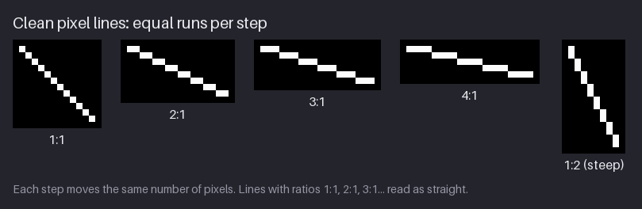
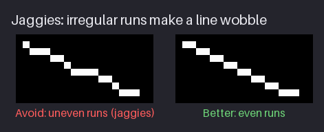
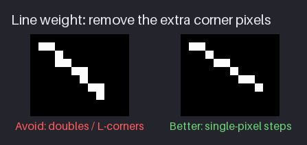
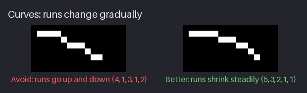
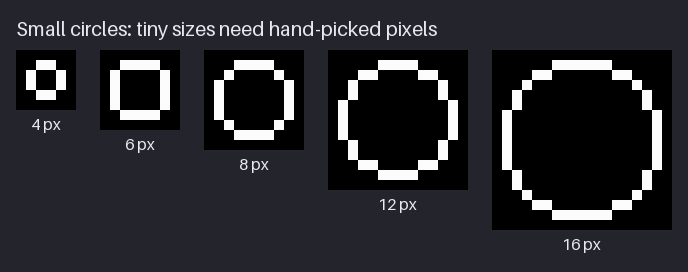
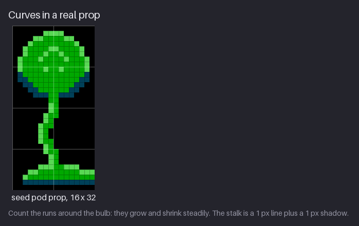
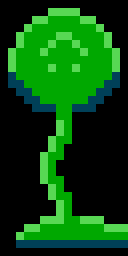

# Chapter 2 — Lines and Curves

Every outline, crack, vine, pipe and rim in pixel art is a line, and on a small grid a line is
not a smooth stroke. It is a staircase of short horizontal or vertical segments called *runs*.
Whether a line looks clean or broken depends almost entirely on how long those runs are and in
what order they come. At NES size this matters more than anywhere else: an 8×8 tile has only 64
pixels, so a single stray pixel is more than 1% of it, and a wobble that would vanish in a large
painting is the first thing the eye finds.

This chapter teaches the handful of slopes that always look clean, the two classic line faults
(jaggies and doubles) and how to remove them, and how to build curves and small circles whose
runs change smoothly. It ends with line weight, and with what the NES's four colours per tile
mean for line work. By the end you can ink clean lines and curves, and `hollow-vault` gets its
first prop: a seed pod, drawn with nothing but clean runs.

Previous: [Chapter 1](01-pixels-and-the-nes-screen.md). Next: [Chapter 3](03-shape-silhouette-and-readability.md).

## Lines are runs

Draw a diagonal line on a pixel grid and zoom in. It is made of runs: a few pixels in a row, a
step down, a few more pixels, another step. A run is a straight horizontal or vertical segment,
and its length is how many pixels it has. A whole line can be described by its list of run
lengths, and that list is how pixel artists talk about lines: "this edge is 2, 2, 2, 2" or "that
curve goes 5, 3, 2, 1".

The cleanest lines are the ones where **every run has the same length**. The eye reads a
repeating rhythm as a straight line at one angle. These are often called pixel-perfect slopes.

The figure shows the four shallow slopes and one steep one. Steep slopes are the shallow ones
turned on their side: 1:2 is vertical runs of 2 with a one-pixel step across. Here is the full
table, with the angle each slope makes with the horizontal:

| Slope | Runs | Angle | Typical use in `hollow-vault` |
|-------|------|-------|-------------------------------|
| 0 | one run, any length | 0° | floors, platform tops, pipe bodies |
| 4:1 | 4, 4, 4, … | about 14° | gentle ramps, distant ridges |
| 3:1 | 3, 3, 3, … | about 18° | sloped rubble, long roof lines |
| 2:1 | 2, 2, 2, … | about 27° | stairs, roof panes, the isometric line (Chapter 27) |
| 1:1 | 1, 1, 1, … | 45° | braces, glass cracks, diagonal struts |
| 1:2 | vertical runs of 2 | about 63° | leaning poles, steep cracks |
| 1:3 | vertical runs of 3 | about 72° | slightly tilted pipes and stalks |
| vertical | one run, any length | 90° | walls, pipes, ladders |

Read "2:1" as "2 across for every 1 down". The angles are not round numbers, and that is fine:
you will rarely measure an angle in pixel art. You pick the slope from the table that is closest
to what you want and use it consistently.

Two slopes matter more than the rest. The 1:1 diagonal is the only one where each pixel touches
the next by a corner only, so it is the thinnest and sharpest diagonal you can draw. The 2:1
line looks smooth at any size and its runs tile neatly, which is why isometric art is built on
it.

> **Try it (3 min).** On a 32×16 canvas, draw each slope from the table with the pencil by
> counting: click, move two pixels, step down, two more, step down. Say the runs out loud as you
> go. Then look at the sheet at 1×: every line should look perfectly straight.

### Slopes and the 8×8 grid

Background art on the NES is made of 8×8 tiles, and a slope that crosses tiles must continue its
pattern from one tile to the next. The simplest way to guarantee that is to pick slopes whose
runs divide 8.

- A 1:1 slope drops 8 pixels across one tile.
- A 2:1 slope drops 4.
- A 4:1 slope drops 2.
- A 3:1 slope drops 2⅔, so each tile needs a different piece of the pattern.

With 1:1, 2:1 and 4:1, every tile of a long slope is the same tile, so a ramp of any length
costs one or two unique tiles. A 3:1 ramp needs three different tiles before the pattern
repeats, and the NES can hold only 256 background tiles at once (Chapter 14). That is why NES
games almost always use 1:1 and 2:1 ground slopes, sometimes 4:1, and rarely anything else. The
same reasoning applies to roofs, stairs and the long diagonal edges of a room.

> **Try it (3 min).** On a 24×8 canvas with an 8 px grid, draw a 2:1 line that drops across all
> three tiles, then a 3:1 line. Copy the first 8×8 tile of each and paste it to the right of
> itself. The 2:1 copy continues the line seamlessly; the 3:1 copy breaks it.

### What the line tool does

The line tool draws from one end point to another. For each column it picks the row closest to
the ideal mathematical line. When the end points allow equal runs it gives you equal runs. When
they do not, it spreads the leftover pixels around, and the result often has short runs at the
ends. A line 12 pixels wide and 4 tall, for example, often comes out as 2, 4, 4, 2 instead of
3, 3, 3, 3.

Some editors snap the line tool to clean slopes while you hold a modifier key (often Shift).
Check what yours does, and check the result anyway. Treat every tool-made line as a draft that
you inspect run by run. Many artists draw short lines with the pencil even when a line tool is
available, because they are thinking in runs anyway.

## Jaggies

A *jaggy* is a run that breaks the rhythm of a line: a run that is suddenly much shorter or
longer than its neighbours. One irregular run makes the whole line look bent or broken at that
point, even though every pixel touches the next.

The left line has runs 1, 3, 2, 1, 4, 2, 1, 3. Every change of run length is a visible kink: the
eye sees a short steep piece at each 1 and a flat shelf at the 4. The right line covers almost
the same distance with runs of 2 and a final 3, and reads as straight.

Jaggies happen when you draw freehand, when a line tool works between awkward end points, and
when pixel art is scaled or rotated. There are two fixes:

1. **Regularise.** Change the line to the nearest clean slope from the table. If it is roughly
   25°, make it 2:1.
2. **Alternate in a pattern.** When the angle you need lies between two clean slopes, mix their
   runs in a strict repeating pattern. 2, 3, 2, 3 lies between 2:1 and 3:1 (about 22°). 1, 2,
   1, 2 lies between 1:1 and 2:1 (about 34°). The pattern must repeat exactly: the eye accepts a
   regular rhythm, but not a random one.

Short lines tolerate more. On an 8×8 tile, a line with three runs (2, 2, 3) is fine. On a long
line, such as the edge of a platform crossing six tiles, any break in the pattern shows. The
single extra 3 at the end of the "Better" line is acceptable for the same reason: it is at the
end, where the eye reads it as the line finishing, not bending.

Jaggies also appear where two slopes meet. A line that goes 2, 2, 2 and then 3, 3, 3 reads as
two straight lines with a bend, which is exactly what it is. That is only a fault when you meant
one straight line. When you mean a curve, a steady change of run length is what you want.

> **Try it (3 min).** Draw a line freehand, fast, at roughly 25° and about 20 pixels long. Write
> down its runs. Then fix it into either all 2s or a strict 2, 3, 2, 3 pattern, using the pencil
> and eraser only. Compare the two at 1×.

## Doubles and corners

A *double* is an extra pixel where two runs meet, so that the step between them is filled with
an L-shaped clump of three pixels instead of a clean diagonal step. It makes the line look
thicker at regular points, like a chain of little knots.

Doubles are the most common mark of a line drawn freehand. When you drag a pencil diagonally,
the cursor nearly always passes through a pixel to the side before it reaches the next diagonal
pixel, and the pencil fills both. The result touches its neighbours by edges instead of by
corners. Compare the two lines in the figure: the left one looks heavier and lumpier, though it
follows exactly the same path.

The fix is to delete the inner pixel of each L. In a clean line each pixel touches the next by
an edge along a run, and by a corner only at a step. You can check it by eye at 8×: along a
diagonal, any 2×2 block that contains three line pixels is a double.

Most editors can do this for you. Look for a **pixel-perfect** option on the pencil. With it on,
the editor removes the corner pixel as you draw. Turn it on for line work and off for filling,
where it gets in the way.

> **Aside: pixel-perfect mode.** Pixelorama, Aseprite and LibreSprite have a pixel-perfect
> toggle in the pencil's options. Krita and GIMP do not; there, draw lines with the line tool or
> click pixel by pixel. Appendix B lists where the option lives in each editor.

### When a double is right

A double is a tool, not only a fault. Use it on purpose when a line needs weight:

- **To thicken the shadow side** of a shape. This chapter's seed pod has a doubled dark edge
  along the bottom of its bulb for exactly this reason.
- **To keep a 2 px line the same width through a step.** Where a thick line steps sideways, an
  extra pixel stops it from pinching to a corner touch. The pod's stalk does this.
- **Where two lines meet at a corner.** A box corner is a "double" by definition, and is fine.

The rule is intent: a double you placed because the line needed weight is fine; a double the
pencil left behind is noise.

> **Try it (2 min).** With pixel-perfect off, drag the pencil fast in a diagonal zigzag across a
> 32×32 canvas. Zoom in and count the doubles. Undo, turn pixel-perfect on, and draw the same
> zigzag again.

## Curves

A curve is a line whose slope changes. In pixel terms that means its run lengths change, and the
rule for clean curves fits in one sentence: **run lengths change in one direction only**. They
get steadily shorter as the curve turns from flat to steep, or steadily longer as it turns from
steep to flat.

The left curve goes 4, 1, 3, 1, 2. The 1 then 3 goes steep, then flat, then steep again, and the
eye reads each reversal as a dent. The right curve goes 5, 3, 2, 1, 1. It turns at a steady rate
and reads as one smooth arc. Continue it past 45° and it carries on as vertical runs 1, 1, 2, 3,
5: the same list in reverse, turned on its side.

A few rules follow from the main one:

- **Never go back.** 3, 1, 2 is a dent: the 1 is steeper than its neighbours on both sides.
  Either 3, 2, 1 or 3, 1, 1 is smooth.
- **Repeating a length is fine.** 4, 2, 2, 1 changes in one direction; staying the same for a
  step or two only flattens the curve slightly at that spot.
- **The sharpest bend is where the runs are shortest.** Put the 1s where you want the curve to
  turn. Long stretches of 1s make a straight 45° section, so avoid them in a round shape.
- **Long runs at the ends flatten the curve.** The top of a dome is one long run; the longer it
  is, the flatter the top looks.

### Planning a curve

Runs have to fit the space the curve covers, so it helps to plan them. Horizontal runs each use
one row and as many columns as their length; vertical runs use one column and as many rows.

Take the upper-left edge of the seed pod's bulb later in this chapter. It must get from the
middle of the top row to the widest point of the left side: seven columns across and ten rows
down. The pod uses horizontal runs 2, 2, 1 (five columns, three rows), then vertical runs 2 and
5 (two more columns, seven rows). The horizontal runs shrink, then the vertical runs grow: one
direction throughout. If a planned curve does not add up, adjust the middle runs first; the long
runs at the ends carry the shape and are the last thing to change.

You do not need to do this arithmetic every time. It is a way to get unstuck when a curve will
not fit, and after a few curves you start to see run lists without writing them down.

> **Try it (3 min).** Draw a quarter curve with runs 5, 3, 2, 1, 1 and then vertical runs 1, 1,
> 2, 3, 5. Mirror it to make a half dome. Then change one run to break the rule (make it 5, 2, 3,
> 1, 1) and find the dent at 1×.

## Small circles

A circle is four mirrored quarter curves. Each quarter starts with a long flat run at the top,
its runs shrink toward the 45° point, and then grow again as vertical runs down the side. Small
circles have so few runs that each size has one typical shape, and it pays to know them by
heart: at NES scale you will draw lamps, eyes, bubbles, rivets, coins and pods at exactly these
sizes.

| Width | Runs of one quarter | What it looks like |
|---|---|---|
| 4 px | top 2, side 2 | a square with the corners removed |
| 6 px | top 4, side 4 | still a cut-corner square |
| 8 px | top 4, one corner pixel, side 4 | the first size with a diagonal |
| 12 px | top 4, then 2, then vertical 2, vertical 4 | clearly round |
| 16 px | top 6, then 2, 1, then vertical 2, vertical 6 | round, with a single 45° pixel |

Read the "runs" column from the middle of the top edge round to the middle of the side; for the
top run, the full length is listed (the quarter uses half of it).

Two things to notice:

- **Small circles are squares with the corners cut.** At 4 and 6 px there is no room for a
  diagonal at all. That is not a failure of drawing; it is all the grid can do, and at 1× it
  reads as round. Do not try to add a diagonal pixel to a 6 px circle; it turns into an octagon
  or a lump.
- **Every run list is a palindrome.** 4, 2, 2, 4 reads the same backwards because a circle is
  symmetric about its 45° diagonal. It is the quickest check for a round circle. If the top run
  and the side run differ, you have an ellipse, which is fine when you want one.

To draw a circle by hand, draw one quarter, check its runs, then copy, flip and paste it for the
other three. Your editor's symmetry option does the same as you draw.

### The ellipse tool

The ellipse tool is useful for sizes you do not want to construct, but its output needs the same
inspection as the line tool's. Typical problems at small sizes: a single-pixel bump in the middle
of a long side, runs that go 3, 1, 2 near the 45° point, doubles, and quadrants that are not
mirror images, so the circle looks lopsided at 1×. Clean it by fixing one quadrant until its
runs only shrink then grow, and mirror that quadrant over the other three. The circles in the
figure are what a careful hand produces; use them as the answer key for your ellipse tool.

Flat ellipses (the rim of a pot, the top of a pipe seen from slightly above) follow the same
rules with longer horizontal runs. Below about 3 pixels tall an ellipse turns into a pointed
lozenge; a straight line with its end pixels stepped in by one often reads better.

> **Try it (4 min).** Draw a 12 px circle by hand: one quadrant by counting runs (4, 2, 2, 4),
> then mirror it. Next to it, draw a 12 px circle with the ellipse tool. Compare the two
> quadrant by quadrant and fix the tool's version.

## Corners, joins and line ends

Most line art is many lines that meet. Three situations come up constantly.

**Corners.** Where two straight lines meet at a right angle, the corner pixel belongs to both.
On a small object you can leave it out: the missing pixel softens the corner into a tiny bevel,
which is how most 16×16 props get their rounded look. On a large building, keep it, or the
corner looks chipped.

**Joins.** Where one line meets another in a T (a vine leaving a pipe, a stalk meeting a bulb),
the joining line can touch the other or stop one pixel short. Touching makes a solid join and a
dark knot of pixels at the meeting point. Stopping short keeps the two areas apart and suggests
that one passes behind the other. On small sprites, stopping short is often cleaner.

**Line ends.** A line that ends with its full run length looks cut off. A line that ends with a
shorter run, or one step away from its direction, looks like it tapers. Vines, cracks, grass
blades, tails and hair all end better this way.

**Organic lines.** Cracks, roots and vines do not follow one slope, and a perfectly regular vine
looks drawn with a ruler. The rule is that **each segment** is clean, even when the line as a
whole is irregular: a crack might go 1:1 for three pixels, then 2:1 for four, then straight down
for two. Irregularity comes from the changes of direction, never from random runs inside one
segment.

> **Try it (3 min).** Draw a crack across an 8×8 tile in three segments, each a clean slope.
> Then draw a short branch leaving it: once touching, once stopping one pixel short. Look at
> both at 1× and decide which reads better.

## Line weight

Line weight is how thick a line is. At NES size one pixel is already heavy: a 1 px outline round
a 16×16 prop takes 2 of its 16 columns before any detail is drawn, and a 2 px outline takes 4.
So the default is a 1 px line, and anything else is a choice made for a reason:

- **Thicker on the shadow side.** Doubling the edge away from the light grounds a shape and
  suggests its form, before any shading.
- **Broken on the light side.** A gap in the outline where light hits reads as a highlight; the
  eye fills in the missing edge.
- **Interior lines lighter than the silhouette.** Lines inside a shape can be shorter, broken, or
  (from Chapter 6) drawn in a lighter colour than the outline, so they describe the shape without
  cutting it into pieces.

On the NES there is one more consideration: an outline is also a colour, and colours are scarce.
The last section of this chapter comes back to that.

## Construct, then ink

Inking is drawing the final clean line over a rough construction. It separates two jobs:
deciding where the shape goes, and deciding exactly which pixels form its edge. Doing both at
once is how jaggies and doubles creep in.

1. **Construct.** On a layer called `construction`, rough out the big shapes in any light colour
   with whatever is fastest: rectangles, ellipses, a quick freehand sketch. Do not care about
   clean pixels. Check size and placement against the grid: does the prop fill its 16×16 or
   16×32 slot? Does it stand on the bottom row?
2. **Lower the construction.** Set the layer's opacity to about 30% and lock it.
3. **Ink.** On a new layer, draw the clean edge with the pencil, using the construction as a
   guide only. Count runs. Use the slope table for straight edges and the one-direction rule for
   curves. Turn on pixel-perfect.
4. **Check.** Hide the construction. Look at the line at 1× and flipped, and fix anything that
   wobbles.

You are free to move off the sketch when a clean run lands a pixel away from it. The sketch is a
plan, not a template.

Before calling line art done, run through this check. It takes a minute and catches most
problems:

1. **Straight edges:** a clean slope or a strict alternating pattern? Check the first and last
   runs especially.
2. **Doubles:** any L-shaped clumps you did not mean?
3. **Curves:** do the runs change in one direction only on each side? Do mirrored parts really
   mirror?
4. **Joins:** where lines meet, did you decide to touch or stop short, or did it just happen?
5. **1× read:** does the object read as what it is, with line alone?
6. **Flip:** flip the canvas horizontally. Wobbles you had stopped seeing jump out.

## A prop from clean curves

Everything above comes together in this chapter's prop: the seed pod, a tall glowing seed head
growing out of the Greenhouse floor. It is 16×32, two metatiles stacked, and it uses the
Greenhouse's plant sub-palette: backdrop black `$0F`, dark teal `$0C`, green `$1A` and light
green `$2A`.

Count the runs around the bulb before reading on. Then compare with this list.

- **The bulb** (rows 1–13) is a round shape 14 px wide and 13 tall. Its top is a run of 4.
  Going down the left side, the outline runs 2, 2, 1, then vertical 2, then vertical 5: the runs
  shrink and then grow, one direction throughout. The bottom half comes back in with runs of 2,
  2, 2 and a final 3, and the right side mirrors the left exactly.
- **The rim changes colour at the middle.** The upper rim is light green, the lower
  rim dark teal, as if lit from above. Down the bottom curve the dark rim is two pixels thick:
  each run overlaps the one above by a column. That is a double placed on purpose, on the shadow
  side.
- **There is no black outline.** The pod is background art, and its empty pixels are the
  backdrop black. The black already separates the bulb from the room, so drawing an outline
  colour would waste a slot and thicken the shape.
- **Inside the bulb** a small light arch and two light dots mark the seams of the pod. They are
  interior lines: short, light and unconnected to the rim.
- **The stalk** (rows 14–26) is two 1 px lines side by side: light green on the left, mid green
  on the right. The light line bows to the left in vertical runs 2, 2, 4, 2, 2, a symmetric run
  list, so it reads as one smooth bow. At each step the two lines overlap by one row, so that
  row is three pixels wide. Without that deliberate double, the stalk would pinch to a corner
  touch at every step and look thinner there.
- **The base** (rows 27–30) is a low mound: light rim runs stepping outward, a mid-green body,
  and a dark teal bottom row. It is asymmetric on purpose, reaching further right than left, so
  it looks grown rather than stamped.

Every line in the pod is one of the patterns from this chapter. That is the point: a prop that
looks organic is made of clean, countable runs.

> **Try it (5 min).** Without looking at the figure, draw a 14 px wide round bulb on a 16×16
> canvas: top run 4, then 2, 2, 1, vertical 2, vertical 5, mirrored. Compare your runs with the
> pod's. A difference of one run is fine, as long as your runs still change in one direction.

## Lines at NES scale

The NES adds one more question to line work: what colour is the line? Every 8×8 tile can use at
most four colours, and for background tiles one of the four is always the shared backdrop. So a
background tile has exactly three colours of its own to spend.

If the outline used its own dark colour, that would leave only two for the object: a fill and a
highlight. That is why the course's background art leans on the backdrop:

- **The backdrop is the outline.** In `hollow-vault` the backdrop is black `$0F`, so any
  background object drawn without an outline is outlined anyway, by the black around it. The pod
  spends its three colours on form: a dark rim, a body and a light rim.
- **Lines inside a tile reuse the tile's colours.** A crack is drawn in the darkest of the three,
  a highlight in the lightest. There is no fourth "line colour".
- **A line that crosses tiles must stay in one sub-palette.** Colour is chosen per 16×16 area, so
  a vine that wanders from one metatile into another must use colours both areas share, or stop
  at the edge. Chapter 14 deals with this in detail.

Sprites work slightly differently. Their colour 0 is transparent, which leaves three real
colours. The course gives every sprite palette black `$0F` as one of the three, so Kit and the
creatures have a dark outline and two colours of their own. The outline costs a slot, but the
same slot is shared by every sprite in the scene, so it is decided once.

The resulting rule of thumb: **1 px lines are the default at NES scale**, and the colour of a
line is chosen from the tile's three colours, never added.

> **NES rule: four colours per tile.** Each 8×8 tile stores 2 bits per pixel, so it can show
> only 4 colours: one shared backdrop plus 3 for a background tile, or transparent plus 3 for a
> sprite. **Kept authentic:** every tile in `hollow-vault` uses at most 4 colours, and the course
> checker verifies it in every scene. Line art never gets a colour of its own; it uses one of the
> tile's three.

## Project: the seed pod

The milestone adds one prop to `hollow-vault`: `project/ch02/props/pod.png`, the 16×32 seed pod,
and its enlarged copy `preview/pod-8x.png`. Everything from Chapter 1 is unchanged.

Here is how it was built, step by step. Do the same on your own 16×32 canvas.

1. **Set up.** A 16×32 canvas filled with `$0F` black, the 8 px grid on, and only four colours in
   the palette: `$0F`, `$0C`, `$1A`, `$2A`. If your editor has indexed mode, use it, so that you
   cannot pick a fifth colour by accident.
2. **Construct.** On a construction layer, rough in a 14×13 ellipse at the top (columns 1–14,
   rows 1–13), a vertical line down the middle for the stalk, and a low wide oval at the bottom.
   Use any tool and do not worry about clean pixels. Lower the layer's opacity.
3. **Ink the bulb's left upper quarter.** On a new layer, in light green: half of the top run of
   4, then runs 2, 2, 1, then vertical runs 2 and 5. Count every run.
4. **Mirror it** to make the right upper quarter. Check that both sides read the same at 1×.
5. **Ink the lower half** in dark teal: the bottom of the vertical run, then runs 2, 2, 2, 3 back
   to the centre, each overlapping the run above by one column so the shadow side is two pixels
   thick. Mirror it.
6. **Fill the body** with mid green, then add the interior seams in light green: a 6 px arch near
   the top and two dots below. Keep them away from the rim.
7. **Ink the stalk.** A light green line from the bulb down to the base, bowing left in runs 2, 2,
   4, 2, 2. Then a mid green line one pixel to its right, following it. At each step let the two
   lines overlap by one row, so the stalk never pinches.
8. **Ink the base.** Light rim runs stepping outward from the stalk, a mid green body, a dark teal
   bottom row. Let the right side reach further than the left.
9. **Check.** Hide the construction layer. Look at the pod at 1× and flipped. Count the colours:
   four. Count the colours in each 8×8 tile: never more than four.

Two things to notice about the result. First, it is two metatiles tall, so in a room it occupies
a 16×32 slot of the grid and both halves use the same plant sub-palette. Second, its silhouette
already says "pod on a stalk": a round top, a thin bowed line, a heavy base. Its three colours
already do the work of shading (light rim on top, dark rim below), so this is the pod's final
form. You can find it on the middle platform of the finished Greenhouse in Chapter 1.

## Exercises

1. **Slope sheet.** On a 48×24 canvas, draw by hand (pencil only, no line tool) the slopes 1:1,
   2:1, 3:1 and 4:1, then the steep slopes 1:2 and 1:3, each about 16 pixels long.

   What to look for:
   - every run in a line has the same length, including the first and last;
   - no doubles at the steps;
   - at 1× every line looks straight;
   - the steep slopes are the shallow ones turned on their side.

   

Example solution

   

   Compare your lines run by run with these. The usual mistake is a short first or last run (a
   1 at the start of a 2:1 line); it makes the line look as if it bends at the end. A 1:3 line
   is the 1:2 line with vertical runs of 3.

   

2. **Fix a freehand line.** Draw a line freehand at about 25°, roughly 24 pixels long. Write
   down its runs. Then fix it with the pencil and eraser into a strict 2, 3, 2, 3 pattern.

   What to look for:
   - the fixed line repeats its pattern exactly, with no 1s and no 4s;
   - no doubles remain from the freehand stroke;
   - at 1× the fixed line is straight and the original visibly wobbles.

   

Example solution

   

   The "Avoid" line is a typical freehand result: every 1 is a kink and the 4 is a shelf. The fix
   shown uses even runs of 2; a strict 2, 3, 2, 3 is equally clean at a slightly shallower
   angle. What matters is that the rhythm never breaks.

   

3. **Small circles.** Draw circle outlines 6, 8, 12 and 16 pixels wide, each by drawing one
   quadrant and mirroring it.

   What to look for:
   - each quadrant's run list is a palindrome (for 12 px: 4, 2, 2, 4);
   - the 6 px circle has no diagonal pixel at all;
   - the 16 px circle has exactly one pixel at each 45° point;
   - all four quadrants are exact mirrors.

   

Example solution

   

   If your 8 px circle has two pixels at the corner instead of one, it reads as an octagon. If
   your 12 px circle has a 3 in its runs, it bulges. Compare quadrant by quadrant and fix one,
   then mirror it again.

   

4. **Ink two props.** Draw a 16×16 pipe valve (a round wheel on a short pipe) and a 16×16 lamp
   (a round glass globe on a short post). Use at most four colours each, one of them backdrop
   black `$0F`, and no separate outline colour.

   What to look for:
   - the round parts use the small-circle shapes from this chapter;
   - the straight parts use clean slopes or plain runs;
   - any double is on purpose (shadow side, or keeping a thick line even);
   - the backdrop black does the outlining;
   - each prop reads at 1×.

   

Example solution

   

   The pod shows the method: a round shape from palindromic runs, a stalk from two parallel
   1 px lines, and no outline colour. The project's own lamp is
   [`project/ch17/props/lamp.png`](project/ch17/props/lamp.png): a 10 px wide globe in four
   colours, whose outer ring is dark teal against the black and whose glowing centre is two
   warm colours, on a 2 px post with a stepped foot. Chapter 17 builds it.

   

## Recap

- A pixel line is a list of runs. Equal runs make straight lines: 1:1, 2:1, 3:1 and 4:1, and
  their steep versions.
- Slopes whose runs divide 8 (1:1, 2:1, 4:1) repeat every tile, so they are cheap on an 8×8
  grid.
- Jaggies are runs that break the rhythm; fix them by regularising or by a strict alternating
  pattern.
- Doubles are L-shaped extra pixels at the steps; remove them, or use them on purpose for
  weight. Pixel-perfect mode prevents them as you draw.
- Curves: run lengths change in one direction only. Plan runs to fit the space.
- Small circles have fixed shapes; their run lists are palindromes. Check the ellipse tool.
- 1 px lines are the default at NES scale. A line's colour is one of the tile's three; on the
  black backdrop, background art needs no outline at all.

Next, [Chapter 3](03-shape-silhouette-and-readability.md) moves from lines to whole shapes and
designs Kit's silhouette.

## Further study

- **Brandon James Greer, "Constructing Lines and Curves in Pixel Art (Tutorial)"**
  ([video](https://www.youtube.com/watch?v=ye21r27kN9I)). Builds lines and curves run by run;
  compare his run lists with the ones in this chapter.
- **MortMort, "3 PixelArt Techniques/Common Mistakes (Doubles, Jaggies & Outline)"**
  ([video](https://www.youtube.com/watch?v=gW1G_FLsuEs)). The two line faults of this chapter,
  shown being fixed in an editor.
- **Pedro Medeiros (Saint11), "Pixel Grimoire 7: Working with Lines"**
  ([article](https://medium.com/pixel-grimoire/how-to-start-making-pixel-art-7-e504bfa4ddf2)).
  A short illustrated guide to clean lines and curves.
- **Dual Core Studio, "Lines, Curves and Jaggies"**
  ([tutorial](https://lospec.com/pixel-art-tutorials/how-to-pixel-art-tutorials-16-lines-curves-jaggies-by-dual-core-studio)).
  A one-page visual summary; useful as a reference card.
- **Derek Yu, "Pixel Art Tutorial: Basics"**
  ([article](https://www.derekyu.com/makegames/pixelart.html)). A classic walk-through of a
  small sprite from lines to colour; read the sections on lines and jaggies now and the rest
  after Chapter 6.

Sources for this chapter: [REFERENCES.md](REFERENCES.md#chapter-2--lines-and-curves)
