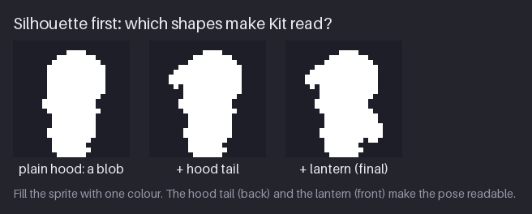
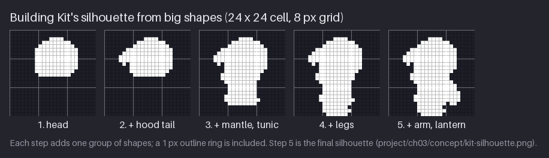
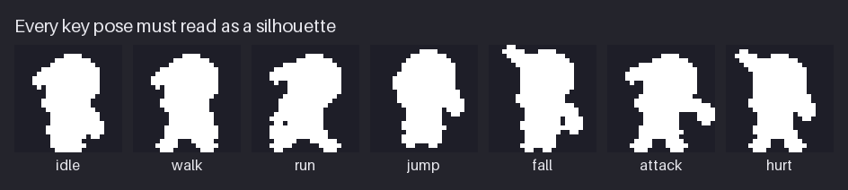
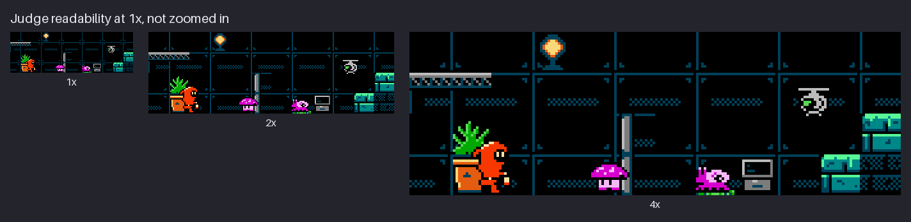
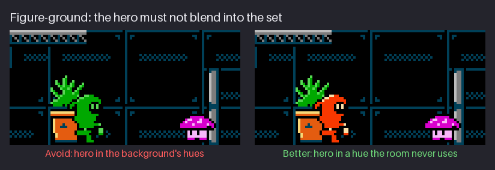
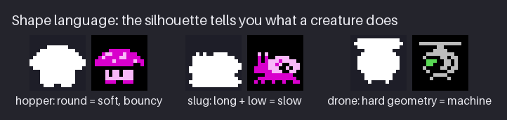
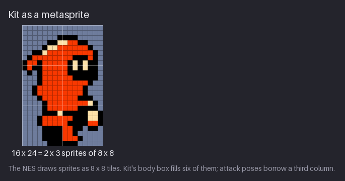
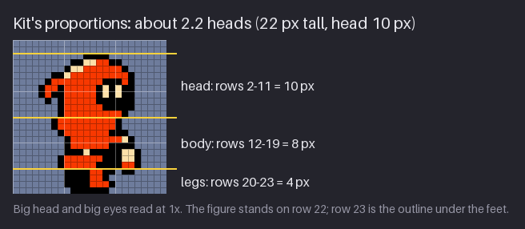

# Chapter 3 — Shape, Silhouette, and Readability

Before detail, colour or shading, a sprite has to read as a *shape*. In a game the player sees the
hero small, moving, for a fraction of a second at a time, over a busy background. What they
recognise in that moment is not the eyes or the belt buckle but the outline: a round hood, a
tail flicking out behind it, a light swinging in front. If the shape is right, every later
chapter makes the sprite better. If the shape is wrong, nothing later can fix it.

At NES size the stakes are higher still. Kit, the hero of `hollow-vault`, is 16×24 pixels: a hood
with a tail, a cream face in a dark opening, a red suit and a lantern. That is fewer pixels than
this paragraph has letters. Readability comes from three things working together: the
**silhouette**, the **value** contrast against the set, and a **hue** the set does not use. This
chapter is about the first, and introduces the other two.

You will learn to build a character from a few big shapes, test it as a solid silhouette in
every key pose, judge it at 1× against the real background, read the moods of round, long and
hard shapes, and fit it into the NES's 8×8 sprite grid. By the end, `hollow-vault` has Kit's
silhouette and its seven key poses as solid shapes.

Previous: [Chapter 2](02-lines-and-curves.md). Next: [Chapter 4](04-value-light-and-contrast.md).

## Silhouette first

A **silhouette** is a sprite filled with one colour: no outline colour, no interior detail, no
shading. It is the purest test of shape. If a silhouette reads, the sprite will read; if it does
not, more detail will not help.

Silhouettes are also fast. A solid 16×24 figure takes a minute to draw, so you can try many ideas
before choosing one. That is the exploration: draw variants that differ in one big or medium
shape, put them side by side, and judge.

The figure shows how Kit's silhouette was found. All three share the same head, body and legs.

- **Plain hood: a blob.** A round hood on a body on two legs. It is a figure, but an anonymous
  one: it could be any small character in any game, and nothing tells you which way it faces.
- **+ hood tail.** A pointed tip sticks out of the back of the hood. Now the figure has a
  direction (the tail trails behind, so Kit faces right) and one shape no other character in the
  pack has. The tail also hints at motion even when Kit stands still.
- **+ lantern (final).** A small block at hand height in front of the body. It balances the tail,
  so the shape has something at both ends, and it is the story in one shape: Kit is the keeper
  who carries the light. The lantern is also Kit's weapon, so it will lead every attack pose.

### What makes a silhouette work

- **One or two distinctive protrusions.** A tail, an ear, a tool. These make the character
  recognisable at a glance. Too many and the shape becomes noise; Kit has exactly two.
- **A clear direction.** The figure faces somewhere. Kit's tail points back, the lantern and the
  front foot point forward.
- **Negative space.** Gaps between legs, or between an arm and the body, make a pose readable.
  At 16 pixels wide there is room for only one or two such gaps, so place them where the
  animation needs them: between the legs.
- **Story.** A shape with a reason is easier to remember than one added for decoration. The hood
  says "protective suit", the tail says "small and quick", the lantern says "keeper".
- **Animation potential.** The tail can flick behind Kit in a run (follow-through, Chapter 13),
  and the lantern can swing. A plain blob gives animation nothing to work with.

> **Try it (4 min).** On a 24×24 canvas, draw a plain 16×24 figure as one solid colour: a round
> head on a body on two legs. Duplicate it three times. Give each copy one different protrusion:
> a hat brim, a tail, a backpack. Look at the four at 1× and decide which one you would remember.

### Big shapes first

Every character, prop and enemy can be reduced to a few simple shapes. Working from big to small
means you judge each step before it gets expensive.

Each step adds one group of shapes; each panel includes a 1 px ring around the shapes, because
the black outline is part of the silhouette.

1. **Head.** A round hood about 10 px tall and 12 wide with its outline: by far the biggest
   shape. It fills the top row of 8×8 boxes and reaches into the second.
2. **Hood tail.** Three short runs (2, 2, 1) stepping out and down from the back of the hood.
   This is the one shape that makes Kit recognisable, so it comes second, before the body.
3. **Mantle and tunic.** A short cape over the shoulders and a body that narrows toward the hips.
   The body is smaller than the head; that is what makes Kit read as small and young.
4. **Legs.** Two short legs in a slight stride, so the figure stands ready to move rather than
   at attention.
5. **Arm and lantern.** A hand and a small lantern in front, at hip height. The last shape is
   the smallest, and the cheapest to change.

Small shapes (the eyes, the belt, the buckle, the hood's highlight) come later, in colour. They
are the least important for reading the sprite, which is why they are the last thing you draw.

### Common silhouette problems

A few problems turn up again and again. Knowing their names makes them easier to spot.

- **Tangents.** Two edges that just touch: the tail tip touching the back, the lantern touching
  the hip. At 1× the eye cannot tell whether the parts overlap or are separate, and the shape
  flattens. Either overlap clearly or leave a full pixel of gap.
- **Twinning.** Both legs in the same pose, both arms at the same angle, a perfectly symmetric
  front view. It looks stiff. Even standing, change one side a little.
- **Lost limbs.** An arm in front of the body disappears in a silhouette, because it is inside
  the shape. That is fine for one arm; if a pose depends on an arm, move it outside the shape.
- **Single-pixel protrusions.** A one-pixel strand of hair, a thin tool tip. At 1× it reads as
  noise, and in animation it flickers, because it cannot move by less than a pixel. Make
  protrusions at least two pixels wide, or remove them.
- **Detail instead of shape.** Trying to tell two variants apart by a belt or a button. If a
  notch is the only difference, they are the same design.

## Every pose must read

A character is not one silhouette but many. Each key pose of the animation has to read on its
own, because in a fast game that single frame may be all the player sees.

Kit's seven key poses, as solid shapes:

- **Idle.** The standing silhouette: tail back, lantern front, a slight stride.
- **Walk.** The legs open into a clear stride, front foot forward, back foot behind. The gap
  between the legs is the most important piece of negative space in the whole design.
- **Run.** A wider stride, the body leaning a pixel forward, the lantern arm pumped back and the
  tail streaming flat behind. The lean is what separates it from the walk.
- **Jump.** The legs tuck up, the lantern rises and the tail hangs down: the body becomes
  compact, almost round. A compact shape reads as "in the air".
- **Fall.** The legs dangle straight and the tail flicks up. A shape that points up reads as
  falling down: the air is pushing it.
- **Attack.** The body leans forward and the lantern is thrown out in front at arm's length, the
  widest pose in the set. The silhouette's weight shifts forward.
- **Hurt.** The figure leans back on braced legs with the tail and lantern thrown up. It is the
  only pose that leans away from the facing direction, so it reads as "knocked back" instantly.

Each pose differs from the others in a *big* shape: the legs, the lean, or where the tail and
lantern go. None of them relies on the face or the colours. That is why they still read here as
plain white shapes, and why they will read in the game when Kit is small and moving.

> **Try it (3 min).** Take any sprite you have drawn (or any character art you like) and fill it
> with one colour on a copy layer. Does it still say what the character is doing? If not, which
> big shape would you move to make the pose clear?

### Stick figure to silhouette

A pose is easiest to judge before there are any shapes at all, as a stick figure: a circle for
the head, one line for the spine, lines for the limbs. It takes seconds and answers one question:
is the pose right? Then block big shapes over it, merge them into a silhouette, and refine the
edge pixel by pixel. If the pose is wrong at the stick stage, it costs ten seconds to fix; at the
coloured stage it costs an hour.

The most useful line in a stick figure is the *line of action*: one curve through the spine from
head to supporting foot. A straight vertical line looks stiff; a gentle lean or curve looks
alive. At 16×24, the line of action is often only a one-pixel offset between head, hips and feet.
That is enough.

> **Try it (4 min).** On a 24×24 canvas, draw a stick figure about to jump: knees bent, arms back.
> On a new layer, block big shapes over it; on a third, make the solid silhouette. Hide the first
> two layers and check the pose still reads.

## Judge at 1×

A silhouette that reads on an empty canvas at 8× can still fail in the game, where it is 1×,
moving and surrounded by tiles. So the real test always happens at 1×, in the scene.

The figure shows a crop of the finished Greenhouse at three sizes. At 4× you can read everything:
Kit's face, the hopper's spots, the slug's shell, the drone's eye. Now look at 1×, the true size.
Kit is still obvious: a red shape near the planter. The hopper and the slug read as two pink
creatures. The drone is a grey speck, which is fine for a hovering machine in the background but
is a warning for its design: at 1× it is held together by its shape alone, so that shape had
better be distinctive. The 2× panel is close to what a player sees on a laptop.

This is the check to run on every sprite, at the end of every stage:

1. **1×.** View it at 1×, not zoomed. Can you name what it is and which way it faces?
2. **In the scene.** Place it on the busiest background it will appear on, not on an empty
   canvas.
3. **Edges.** Is any part of the edge the same value as the background? That part will vanish.
4. **Protrusions.** Any single-pixel bits? They turn into noise at 1× and flicker in motion.
5. **Negative space.** Are the gaps between limbs at least one full pixel? A gap that is open
   only at a corner closes up at 1×.
6. **Squint.** Squint at the screen. What remains is the silhouette and the biggest value
   shapes, which is what the player sees in motion.

> **Try it (2 min).** Open `project/ch20/scene/greenhouse.png` at 1× and find Kit, the hopper,
> the slug and the drone. Time yourself. Then do the same at 4×. The difference tells you how much
> the shapes, not the details, are doing.

### The flip test

Kit faces right in every file of the pack. When Kit turns around, the game does not load new art:
it sets the horizontal-flip bit on each sprite and swaps the order of the two columns, and the
hardware draws the mirror image. So every silhouette you design is also a left-facing silhouette
you never drew, and it has to read too.

Flip the sprite horizontally in your editor and look at both versions side by side at 1×. A good
design reads equally well both ways. Watch for two problems:

- **Facing that depends on a detail.** If only the eyes tell you which way the character faces,
  the flipped version at 1× is a guess. Kit's facing is carried by big shapes: the tail behind,
  the lantern in front.
- **Handedness.** A sword always in the right hand moves to the left hand when flipped. Players
  accept this on the NES; design so that it does not matter. Kit's lantern is simply "in front",
  whichever way Kit faces.

## Figure and ground

Painters call it *figure and ground*: the subject (the figure) must separate from what is behind
it (the ground). In a game the stakes are practical: if the player loses the hero for half a
second, they miss a jump.

Both panels use the same silhouette in the same place. On the left Kit is drawn in the room's own
greens, and the shape merges with the plant behind it: the silhouette is still there, but the eye
no longer finds it first. On the right Kit is red `$16` with cream `$37` details, and the eye goes
straight to it.

The rule behind it is simple: **give the hero a hue the set never uses.** Every area of
`hollow-vault` keeps to one hue family for its tiles: greens and teal in the Greenhouse, blues
and teal in the Cistern, reds and oranges in the Furnace, purples and greys on Antenna Ridge. Kit
is warm red and cream, so they stand out in three areas out of four by hue alone. In the Furnace,
where the set is red too, the black outline and the cream face and lantern carry the read
instead; Chapter 5 shows Kit in all four areas.

This is the same trick *Environmental Station Alpha* uses: a small warm hero in cool,
colour-coded worlds. The hero can be tiny because nothing else on screen shares its colour.

Three things separate a figure from its ground, in this order of strength:

1. **Value**: light against dark, or dark against light. The strongest separation (Chapter 4).
2. **Hue**: a colour family the background does not use. Strong when values are close.
3. **Edge**: an outline or a rim that differs from the background. The weakest, but always
   available.

A hero that separates in all three is readable anywhere. Kit has value (cream face and lantern
against the dark rooms), hue (red against cool sets) and edge (a black outline, which on the
black backdrop merges with the void and leaves the red shape to do the work).

> **Try it (3 min).** Place a coloured sprite of your own on three backgrounds: one in the same
> hue family as the sprite, one in the complementary family, one black. Look at all three at 1×.
> On which one do you find the sprite slowest?

## Shape language

Simple shapes carry feelings. It is not a law of nature, but it is consistent enough across
cartoons, games and logos that designers use it on purpose and players read it without
noticing.

- **Round shapes** read as soft, friendly, harmless, bouncy.
- **Long, low shapes** read as slow, heavy, creeping.
- **Hard, geometric shapes** (straight edges, right angles, symmetry) read as built, mechanical,
  unnatural.
- **Pointed shapes** read as sharp, fast or dangerous.

The three creatures of `hollow-vault` are each built on one of these, and the shape tells the
player what the creature does before it moves:

- **The spore hopper** is a big round mushroom cap on short legs. Round says soft and bouncy, so
  the player expects it to hop, and it does. It is the first enemy, and it should look the least
  threatening.
- **The drip slug** is long and low, with a round shell on its back. Long and low says slow and
  creeping. The player expects it to crawl along a surface, which it does, on floors and
  ceilings.
- **The warden drone** is hard geometry: a straight rotor bar on top, a near-circular body, a
  flat underside, one eye. It reads as a machine, something built rather than grown, and the
  rotor says it hovers.

Most good designs mix shapes, with one in charge. Kit is mostly round (the big hood) and
therefore friendly, with one pointed shape (the tail) that suggests speed and direction.

### Shape as gameplay information

In a game, shape does a second job: it tells the player what they can do with a thing. Players
learn these signals in the first minute and rely on them for the rest of the game.

- **Flat tops** say "stand here". Platforms, planters and crates have level top edges.
- **Points** say "this hurts". Spikes and thorns use the same language, so decorative points
  near the hero's feet need care.
- **Round, compact shapes** say "this moves" or "this is alive".
- **Big, simple, solid shapes** say "solid ground or wall"; busy, broken outlines say
  "background".

You will meet these signals again when designing the enemies (Chapter 12) and the tiles
(Chapters 14 and 15).

### Shapes and animation

There is a practical side as well. Round, compact shapes are easy to animate at small sizes,
because squash and stretch on a ball reads instantly (Chapter 8). Long thin shapes, like a spear
or a long tail, move many pixels when they rotate, so they make animation harder and noisier.
Kit's tail is deliberately short for this reason: a few pixels of flick read as motion without
turning into noise. When two designs read equally well, prefer the one that is easier to
animate.

> **Try it (4 min).** On a 16×16 canvas, draw the same enemy three times as a solid silhouette:
> once from circles, once from a long low rectangle, once from straight-edged boxes. Without
> colour or eyes, say how each one would move.

## Kit as a metasprite

The NES does not draw a 16×24 character. It draws **sprites**, and every sprite is one 8×8 tile.
A larger character is a *metasprite*: several 8×8 sprites placed side by side and moved together
by the game, so that the player sees one figure.

Kit's body box is 16×24, exactly 2×3 sprites. The figure shows it on a blue-grey background so
you can see the black outline; on the game's black backdrop the outline merges with the void,
and the red shape is what reads. Look at how the design sits in the grid:

- The head fills the top row of sprites and the top of the middle row. The face, with its two
  cream eyes, sits in the right-hand column.
- The mantle fills the rest of the middle row.
- The belt, the lantern and the legs share the bottom row. The near leg is red and the far leg
  is black, so it reads as further away.
- The tail and the lantern touch the left and right edges of the box. The silhouette uses the
  full 16 px width at both ends.

Kit is drawn in a 24×24 cell, with 4 spare columns each side of the body box. In the standing
pose all of Kit fits in the 6 sprites of the box. In motion some frames reach out of it: a
stride, a jump or a hurt pose pokes a pixel or two past the edge, and the attack throws the
lantern well out in front. Each of those frames needs a third column of sprites on the rows it
reaches into. The worst frame, the attack wind-up, uses 9 sprites.

Why does this matter to an artist? Because of the scanline limit.

> **NES rule: sprites are 8×8 tiles.** The NES draws at most 64 sprites on screen, and at most 8
> on any one horizontal line of pixels (a scanline). A ninth sprite on the same line simply is
> not drawn; games made characters flicker to share the slots. Each sprite has 3 colours plus
> transparent. **Kept authentic:** Kit is 2×3 sprites of 8×8 in one sprite palette; enemies are
> 2×2; the course checker counts sprites on every scanline of every scene, and scenes stay at 8 or
> fewer. (The NES also had an 8×16 sprite mode; the course uses 8×8 throughout.)

Two sprites wide means Kit uses 2 of the 8 slots on every line they cover, and 3 during an
attack. Two enemies at the same height use 4 more. That leaves very little room, which is why NES
designers kept characters narrow and why `hollow-vault` places creatures at different heights in
a room (Chapter 16). A wider hero, say 24 px, would cost 3 slots on every line all the time.

A second reason to think in 8×8 boxes: **each sprite can be reused and flipped**. When Kit turns
around, the hardware mirrors the same tiles (the flip test above); no new art is needed. And when
two frames contain an identical 8×8 box, that tile is stored only once. Chapter 24 shows how real
NES games saved tiles this way.

> **Try it (3 min).** Open `project/ch01/templates/sprite-24x24.png`, the 24×24 cell with the
> 2×3 boxes marked. Draw a quick solid figure in it. Count the 8×8 boxes your figure touches,
> including the outline. If it touches more than 6 while standing, narrow it until it fits.

## Proportions at NES size

Proportion is the size of the parts relative to each other. For characters it is measured in
**heads**: how many head heights fit into the full height.

Kit stands 22 px tall including the outline, from row 2 to row 23 of the cell. The head, with its
outline, is 10 px. That is about **2.2 heads**: a big head on a small body. Realistic adult
figures are 7 or 8 heads tall; heroic ones even more. At NES size those proportions are
impossible: an 8-head figure 24 px tall would have a 3 px head with no room for a face.

So NES characters are almost always 2 to 2.5 heads tall, a "chibi" proportion. The classic
blue-armoured robot hero of the 8-bit era, for example, is about 2.5 heads: a large helmeted
head, a compact body and stubby legs, every part big enough to read and to animate. Kit uses the
same logic.

- **Big head, big eyes.** The head is where the character's expression lives, so it gets the
  most pixels. Kit's eyes are 1×2 cream pixels in a black face opening: the strongest contrast
  in the sprite, where the eye of the viewer lands first.
- **Short body.** 8 px for mantle, tunic and belt is enough to read "body" and to hold the
  lantern.
- **Short legs, but not too short.** The legs are 3 px plus the outline row under the feet. That
  is the minimum for a readable stride: Chapter 9's walk cycle needs every one of those rows.

### Exaggerate what matters

Small sprites exaggerate. Whatever must read (the head, the eyes, the one distinctive item, the
hands that hold a tool) is drawn bigger than in life, and everything else shrinks to make room.
Kit's lantern is huge for a hand lamp: 2 px wide and 3 tall plus a handle, nearly as big as a
leg. At real proportion it would be a single pixel and could not be seen, let alone swung.

### Proportion between assets

Characters also need to be in proportion with the world. In `hollow-vault`, a metatile is 16×16
and Kit is 1.5 metatiles tall, so a gap two metatiles high is a comfortable passage and a gap of
one is a crawlspace they cannot use.
Enemies are 16×16: smaller than Kit, so they read as critters, not rivals. Size relative to the
hero tells the player what is a threat, what is a step and what is decoration.

### The baseline

Every character in the pack stands on the bottom of its cell. Kit's feet are on row 22 and the
outline under them is row 23, so the anchor point the game uses, the bottom centre of the cell
at (12, 24), sits exactly on the floor. When every sprite shares this convention, placing them in
a room never needs adjustment by eye.

> **Try it (3 min).** Draw a 16×24 figure at three proportions on one canvas: 2 heads, 3 heads
> and 4 heads tall. Look at the three at 1×. On which one can you still see a face?

## Project: Kit's silhouette

This milestone adds two files to `hollow-vault`: `project/ch03/concept/kit-silhouette.png`, the
standing silhouette in its 24×24 cell, and `project/ch03/concept/kit-pose-silhouettes.png`, a
168×24 strip of the seven key poses, one 24×24 cell each. Both are pure white on transparent: one
colour, no detail. Their enlarged copies are
[`preview/kit-silhouette-8x.png`](project/ch03/preview/kit-silhouette-8x.png) and
[`preview/kit-pose-silhouettes-4x.png`](project/ch03/preview/kit-pose-silhouettes-4x.png); open
them on a dark background, because white on transparent is invisible on a white page. The
figures above show the same shapes on dark grey.

Here is how they were built. Do the same for your own hero.

1. **Start from the template.** Open `templates/sprite-24x24.png` (Chapter 1). The 2×3 boxes in
   the middle mark the 16×24 body; the 4 columns either side are spare room for poses.
2. **Fix the baseline and the head.** Decide the bottom row first (Kit's feet are on row 22, the
   outline row is 23) and the head height (10 px including outline). Every pose keeps them, so
   variants differ only in what you are testing.
3. **Block the big shapes** in one colour, as in the build figure: head, then the distinctive
   protrusion, then body, legs, arm and prop.
4. **Explore.** Duplicate the cell and try at least three variants of the medium shapes (Kit
   started as a plain hood; the tail came second and the lantern third). Look at them in one row
   at 1×. Keep the rejected ones in a `concept/` file; they help when you design the next
   character and want it to look different.
5. **Add the outline as part of the shape.** Kit will have a 1 px black outline, so the
   silhouette includes it: draw the shape, then grow it by one pixel all round. The silhouette
   is what the player sees against a lighter tile, so it must include the outline.
6. **Check the box.** In the standing pose, the silhouette must fit the 16×24 body box: columns
   4–19, rows 0–23. Kit's fills it from row 2 to row 23 and touches both side edges.
7. **Pose sheet.** In a strip of seven cells, draw idle (your standing silhouette), walk, run,
   jump, fall, attack and hurt as solid shapes. Change the big shapes for each (legs, lean, tail
   and lantern) and keep the head the same size.
   Let poses reach into the spare columns only where they must.
8. **Judge.** View the strip at 1×. Each pose should be nameable without colour.

Your silhouettes do not need to match Kit's. They need to pass the same tests: a clear direction,
one or two distinctive protrusions, a readable pose in every cell, and a fit in the sprite box.
Chapter 4 fills Kit's silhouette with values, and Chapter 5 gives them their colours.

## Exercises

1. **Three silhouettes.** On a 72×24 canvas (three 24×24 cells), draw three silhouettes for a
   16×24 hero. Keep the head, body and legs identical; give each one a different distinguishing
   feature (for example a backpack, a long ear, a staff).

   What to look for:
   - each variant is recognisable at 1× by its feature alone;
   - the feature is at least 2 px thick and does not just touch the body (no tangents);
   - each figure faces clearly one way;
   - all three fit the 16×24 box in the middle of the cell.

   

Example solution

   

   Kit's exploration added one feature at a time. The plain hood is the control: if your variants
   all look like it at 1×, the features are too small. The tail and the lantern work because
   they stick out at opposite ends and point the figure in one direction.

   

2. **Pose sheet.** Draw your hero's idle, run and jump poses as solid one-colour silhouettes, one
   per 24×24 cell.

   What to look for:
   - the three poses differ in big shapes (legs, lean), not in details;
   - the run has a visible gap between the legs;
   - the jump is more compact than the idle;
   - the head stays the same size in every pose;
   - each pose reads at 1× without colour.

   

Example solution

   

   Compare your three with Kit's idle, run and jump. Notice how the run leans forward and opens
   the legs, and the jump tucks them into a near-round shape. If your run and idle look alike at
   1×, open the stride and add a pixel or two of lean.

   

3. **A creature by shape.** Design a 16×16 enemy whose silhouette tells the player how it moves.
   Pick one behaviour (bounces, crawls, flies in straight lines, charges) and choose a shape
   family to match. Draw it as a silhouette first, then in at most 3 colours plus transparent.

   What to look for:
   - a friend shown only the silhouette can guess how it moves;
   - one shape family is in charge (round, long-and-low, geometric or pointed);
   - it fits 2×2 sprites of 8×8;
   - it reads at 1× next to your hero and is clearly smaller.

   

Example solution

   

   The three `hollow-vault` creatures each commit to one family: the hopper is round, the slug
   long and low, the drone hard-edged. Their silhouettes alone say "bounces", "creeps" and
   "machine". Chapter 12 builds and animates them.

   

4. **Figure and ground.** Open `project/ch20/scene/cistern.png`, the finished Cistern. List the
   hue families the room uses. Place your hero (or Kit) in it, then choose a main colour for the
   hero that the room never uses.

   What to look for:
   - your list covers the big areas: the walls, the water, the pipes;
   - the hero's main hue appears nowhere in the room's tiles;
   - at 1× you find the hero in under a second;
   - you also try one colour that the room does use, and see the hero sink into the set.

   

Example solution

   

   The Cistern is built from dark and mid blues, teal and greys on the black backdrop, so any
   warm hue separates; Kit's red `$16` is the strongest choice because it is also far from blue
   in value and temperature. The figure shows the same test in the Greenhouse: in the room's own
   greens, Kit sinks into the plant beside them.

   

## Recap

- Design the silhouette before anything else. If it reads as one solid colour, it will read
  finished.
- Build from big shapes to small: head, the distinctive protrusion, body, legs, prop. Detail
  comes last.
- One or two protrusions, a clear direction, negative space between the legs. Avoid tangents,
  twinning, lost limbs and single-pixel bits.
- Every key pose must read as a silhouette; poses differ in big shapes.
- Flip every sprite: the NES mirrors it for the other direction, so it must read both ways.
- Judge at 1×, in the real scene. Separate figure from ground by value, hue and edge; give the
  hero a hue the set never uses.
- Round reads soft, long and low reads slow, hard geometry reads machine, points read danger.
- Kit is a metasprite of 2×3 sprites of 8×8 in a 24×24 cell, anchored at (12, 24). The NES draws
  at most 8 sprites per scanline, so keep characters narrow.
- At NES size characters are about 2–2.5 heads tall. Kit is 22 px with a 10 px head: about 2.2.

Next, [Chapter 4](04-value-light-and-contrast.md) fills the silhouette with light and dark.

## Further study

- **AdamCYounis, "Pixel Art Class - Create More Engaging Character Sprites"**
  ([video](https://www.youtube.com/watch?v=mdoycEGHye0)). Character design for small sprites;
  watch for how he chooses which features to exaggerate.
- **Brandon James Greer, "Building a STICK FIGURE into a SPRITE"**
  ([video](https://www.youtube.com/watch?v=zhjGDjmKbIY)). The stick-figure-to-silhouette method
  of this chapter, step by step.
- **Pedro Medeiros (Saint11), Pixel Art Articles**
  ([index](https://saint11.art/pixel_articles/)). Short illustrated tutorials; the ones on
  character design and readability fit this chapter.
- **Slynyrd, "Pixelblog 38 - Metroid Study"**
  ([article](https://www.slynyrd.com/blog/2022/5/24/pixelblog-38-metroid-study)). An analysis of
  NES-era exploration-game sprites and tiles, in words and original studies; read it for how
  small heroes stay readable in dark, sprawling worlds.
- **Environmental Station Alpha release trailer**
  ([video](https://www.youtube.com/watch?v=6GnMvsTU--E)). Watch for the hero: a few pixels tall,
  warm against cool rooms, and never lost.
- **NESdev Wiki, "PPU OAM"** ([page](https://www.nesdev.org/wiki/PPU_OAM)) and **"PPU sprite
  evaluation"** ([page](https://www.nesdev.org/wiki/PPU_sprite_evaluation)). The hardware behind
  the NES rule box: how sprites are stored and why only 8 fit on a scanline. Optional reading.

Sources for this chapter: [REFERENCES.md](REFERENCES.md#chapter-3--shape-silhouette-and-readability)
