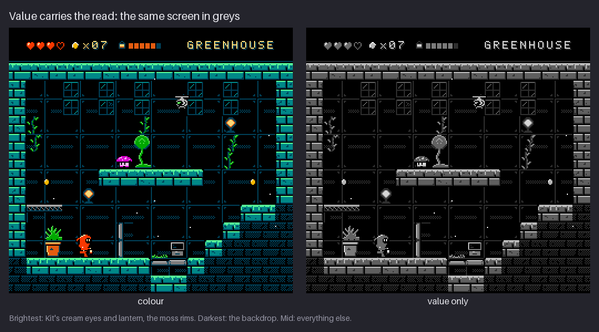
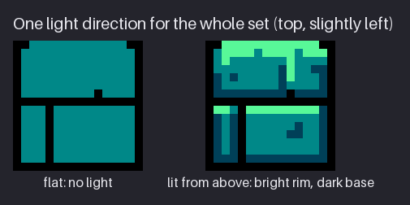
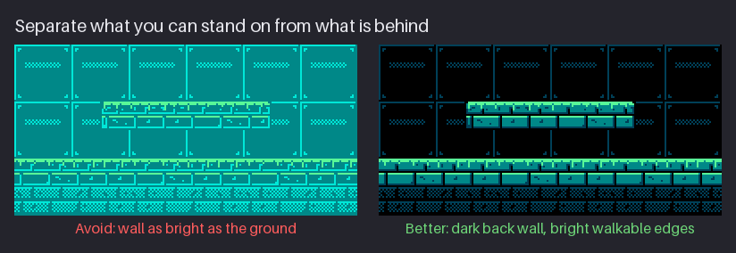
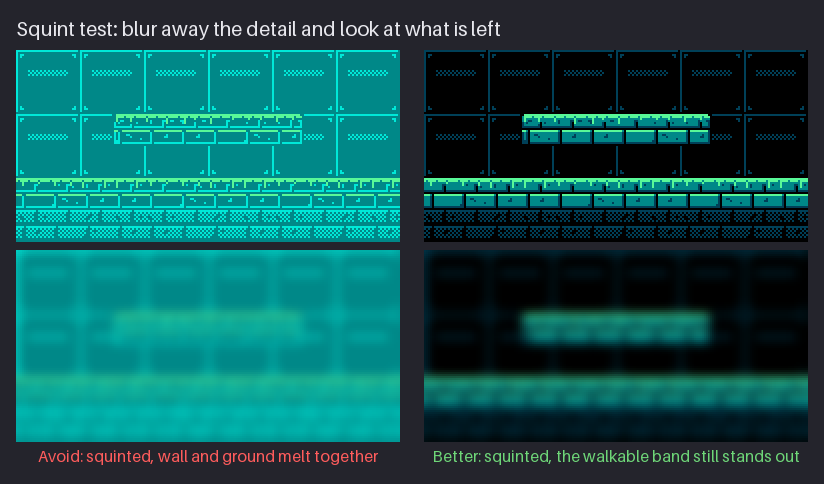
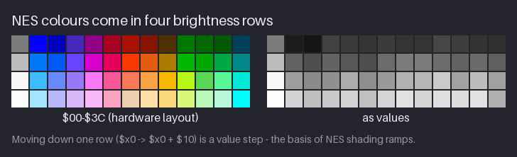

# Chapter 4 — Value, Light, and Contrast

Before a player notices that Kit is red, they notice that Kit is *there*: a shape with a light
spot in its face, standing on a bright edge in front of a dark wall. That first read comes from
**value**, how light or dark each pixel is, and it happens before hue plays any part. This
chapter teaches you to see colours as values, to plan a sprite in three values (the number an NES
sprite actually gets), to light every asset from one direction, and to separate what the player
can stand on from what is merely behind it. You will also learn to read the NES master palette
as four brightness rows, which is the key to every shading ramp in the rest of the course.

By the end of the chapter you can make a value study of any sprite or screen, spot merged values
with a squint, and explain why the `hollow-vault` walls are dark and its floors are bright. The
project gains one file: a greyscale value study of Kit, `concept/kit-values.png`.

Previous: [Chapter 3](03-shape-silhouette-and-readability.md). Next: [Chapter 5](05-the-nes-palette-and-sub-palettes.md).

## Value carries the read

**Value** is how light or dark a colour looks, ignoring its hue. A red and a blue can have the
same value; a pale yellow and a dark yellow have very different ones. Painters say "value does
the work, colour gets the credit". In pixel art, and in NES-style art most of all, that saying
is close to literal, for three reasons:

- **Your eye reads form from value.** The visual system finds edges, depth and roundness mostly
  from differences in brightness, and it resolves fine detail in brightness better than fine
  detail in colour. Two parts of a sprite that differ only in hue blur together at a distance;
  two parts that differ in value stay separate at any size.
- **Small sprites have no room for anything else.** Kit is 16×24 pixels and only 239 of them are
  visible. You cannot describe folds and stitching in that space. You can describe "the hood is
  lit on top, the face is in shadow" with two values. Value is the cheapest information per
  pixel.
- **The screen is busy and the hardware is strict.** An NES sprite gets three colours. If two of
  them land on the same value, you have effectively drawn the sprite in two. The hardware does
  not care about value; your player's eye does.

To compare values you need a number. The usual one is **luminance**: the weighted sum
`0.299 R + 0.587 G + 0.114 B`, on a 0–255 scale. Green counts most and blue least, because that
is how strongly the eye responds to each. The course uses this formula everywhere, and the
toolkit's greyscale figures are made with it.


This is the finished Greenhouse from Chapter 20, in colour and as values only. Read the grey
version from light to dark:

- **Brightest:** the 1 px moss rims along the top of every walkable surface, the two hanging
  lamps, and Kit's cream eyes and lantern. Everything the player needs (where to stand, where the
  hero is looking, where the light is) sits in the top band of values.
- **Darkest:** the backdrop. The back wall is black with thin dark-teal lines; in greys it is
  nearly empty.
- **Middle:** everything else. Stone, plants, metal props, the spore hopper and Kit's red suit
  all land in a narrow band of mid greys.

That last point contains a real finding. Kit's suit colour has a luminance of 107; the teal
stone of the floor is 95. In greys they are almost the same value. Kit still reads instantly,
for two reasons you will meet again in this chapter: a black outline and black face with two
cream eyes (the strongest contrast on the screen sits on the hero), and a dark back wall behind
the hero's whole body. Hue helps too, warm red against cool teal, but hue is the second line of
defence. If the game ever darkened the screen or turned it monochrome, the outline and the cream
would be what kept Kit visible.

**Try it.** Open any screenshot or sprite you like and desaturate it (a Desaturate or
Hue/Saturation adjustment with saturation at zero). Which part do you see first? It is almost
always the place with the strongest light-against-dark contrast, not the most colourful one.

## Three values for a sprite

An NES sprite has three colours plus transparent. In Chapter 5 you will see why; for now, take
it as the budget. Three colours give you at most three values, and the whole craft of NES sprite
shading starts with spending them well: **one dark, one mid, one light**, clearly apart.


Kit's sprite palette is called SP0 (sprite palette 0). Its slots, and their luminance:

| Slot | Colour | RGB in our rendering | Luminance | Job |
|---|---|---|---|---|
| 0 | transparent | — | — | the background shows through |
| 1 | `$0F` black | `#000000` | 0 | outline, face, far leg, belt |
| 2 | `$16` red | `#f83800` | 107 | the suit: the mass of the sprite |
| 3 | `$37` cream | `#fce0a8` | 226 | hood rim, eyes, hand, lantern |

The `$16` notation is the colour's index in the NES master palette, written in hexadecimal as NES
programmers do. Chapter 5 explains the palette; for now read `$0F` as "the NES black".

The three values are 0, 107 and 226: steps of 107 and 119. They are almost evenly spaced across
the whole range, so no two of them can merge, at any zoom, on any background. Compare that with a
palette where the suit was a dark red (`$06`, luminance 60): black and suit would be 60 apart and
the outline would melt into the body at 1×.

How the three values are distributed matters as much as which values they are. Count Kit's
pixels: 106 black, 118 red, 15 cream. Three rules follow from this sprite and apply to almost
every NES-style character:

- **The mid value carries the mass.** Most of the body is the mid colour. It gives the sprite its
  colour identity and its size.
- **The dark value draws.** Black is the outline, the inside of the hood where the face is, the
  belt line and the far leg. It is the line art and the deepest shadow at once.
- **The light value is an accent.** Only 15 pixels, about 6 % of the sprite, are cream. They sit
  exactly where the eye should go: the eyes, the lantern, and a short rim along the top-left of
  the hood where the light hits it. If the light colour covered half the sprite, it would stop
  being a highlight and become the body colour.

### Contrast hierarchy

The eye goes first to the place with the **strongest contrast**: the lightest light right next
to the darkest dark. On Kit that is the two cream eyes inside the black face, and the cream
lantern glass next to the black handle and outline. That is deliberate. The face is the focal
point of any character, and the lantern is Kit's story and weapon.

Use the same principle everywhere:

- On a character, put the strongest contrast at the face and at whatever matters for gameplay
  (the lantern, a weapon, a weak spot).
- On a prop, keep the contrast lower than on the characters. Props are scenery; they should not
  out-shout the hero.
- In a whole screen, keep the background low in contrast (values close together, mostly dark)
  and the gameplay layer high in contrast. The rest of this chapter builds on that rule.

**Try it.** Take your Chapter 3 silhouette and fill it with a mid grey. Add a black outline. Now
place exactly five light pixels where you want the player to look first. Where did you put them?
If the answer is "spread around evenly", try again with all five near the face.

## Light on a form, in three values

Put a ball under a lamp and the light does the same thing every time. Drawing books name the
zones, from the lamp outward:

- **Highlight:** the small spot where the light itself reflects toward you.
- **Light side:** every surface that faces the light. It is brightest where it faces the light
  most directly.
- **Terminator and core shadow:** the line where the surface stops facing the light, and the
  darkest band on the object just beyond it.
- **Reflected light:** a slightly lighter strip on the shadow side, from light bouncing off the
  ground. It is never as light as the light side.
- **Cast shadow and occlusion:** the shadow the object throws on the floor, and the darkest dark
  of all where the object touches it.

Group these into two **families**: the light family (highlight and light side) and the shadow
family (core shadow, reflected light, cast shadow). The rule that makes forms read is that no
shadow value is lighter than a light value.

A painter has dozens of values for these zones. You have three, and one of them is usually
black. So on NES-style art the zones collapse:

| Zone | Three-value version |
|---|---|
| highlight + light side | the light colour, as one cluster on the planes facing the light |
| the rest of the form, facing you | the mid colour |
| core shadow, planes facing away | the dark colour, or the mid colour if the dark is reserved for the outline |
| cast shadow, occlusion, cracks | black |
| reflected light | usually dropped: there is no value to spare |

That collapse is most of what "NES-style shading" means. The light/shadow split, the
**terminator**, is the big decision; with three values it is almost the only one. If the split is
in the right place, the form reads. If it is not, no amount of detail saves it. On Kit, the split
is simple: the cream rim on the top-left of the hood is the light family, the red suit is
everything facing you, and the black face and far leg are the shadow family.

**Try it.** Draw a 16 px circle with a black outline. Fill it with a mid colour. Add one cluster
of a light colour on the upper left (about a fifth of the area) and a crescent of black inside the
lower-right edge. Three values and an outline already make a ball. Chapter 6 refines this with
real shading craft.

## One light for the whole set

Every asset in `hollow-vault` is lit from the **top, slightly left**: tiles, props, Kit, the
creatures, even the background bands of Chapter 18. You make this decision once, write it down,
and never break it. Objects lit from different sides look as if they were cut out of different
pictures, even when each one is shaded well.


The figure shows a ground metatile (a 16×16 block of four 8×8 tiles; Chapter 14 covers metatiles
in depth) twice. The left version has the same shapes but no light: one teal for every brick.
It reads as a pattern, not as stone. The right version is lit from above:

- The **top** of the block, the surface you walk on, gets the lightest colour: a 1 px moss rim
  in bright green, with a few short drips hanging from it.
- The **faces** of the bricks get the mid teal.
- The **undersides and right sides** of the bricks get the dark teal: those planes face away from
  the light.
- The **gaps** between bricks are black: no light reaches into them.

That is the plane rule from drawing, compressed to NES size: **one plane, one value**. Planes
that face the light are lightest, planes that face you are mid, planes that face away are dark,
and cracks are black. With only three colours plus black per tile, you rarely get to do more than
that, and you rarely need to.

Why top, slightly left?

- **From the top** because light comes from the sky or the ceiling, and because in a side-view
  game a lit top edge means something: "you can stand here". If walkable surfaces were in
  shadow, the player would have to read the level by shape alone.
- **Slightly left** by convention. It has a long history in drawing and most pixel-art tutorials
  use it, which makes your work easy to compare with references. The right is equally valid; what
  matters is that the set agrees.
- **It survives mirroring.** When Kit turns around, the game flips the sprite horizontally (on
  the NES that is one bit per sprite, so it costs nothing). A left-facing Kit is lit from the top
  right. Nobody notices, because most of the light comes from *above*, and the above part survives
  the flip. Keep the light high and mirroring is free.

### Shadows in a side-view game

Side-view games show the ground as a thin edge seen from the side, so a cast shadow has almost
nowhere to fall. `hollow-vault` does what most NES platformers did:

- **Characters get no cast shadow.** Kit jumps, falls and stands on ledges of every height; a
  painted shadow would hang in the air. Instead the bottom of the sprite is dark (black feet
  outline, black far leg), so the figure looks heavy at the base.
- **Props get a contact edge.** A dark bottom row where the object meets the floor says "it
  rests here". You will see it on the crate in Chapter 6.
- **Shadows inside one object still follow the light.** The hood shades Kit's face, so the face
  is black. That is a cast shadow inside a single sprite, and it is consistent with light from
  above.

**Try it.** Draw a 16×16 block of two brick courses in three colours plus black. Give every brick
a lit top edge, a mid face and a dark bottom-and-right edge, with black gaps. Then flip it
horizontally. Does it still look lit from above? (It should: only the side shadows moved.)

## Walkable versus background

A platformer screen has two kinds of surfaces: the ones you can stand on, and the ones that are
only scenery behind you. The player has to tell them apart in a fraction of a second, every time
a new screen appears. Value is how you make that instant.


On the left ("Avoid"), the back wall is drawn in bright teal with light-teal panel lines. It is
just as bright as the platform and the floor, so the eye cannot tell which edges are solid. On
the right ("Better"), the same wall is black with thin dark-teal lines. The platform and the
floor are the only bright things in the strip, and their 1 px moss rims mark exactly where Kit's
feet will land.

This is the look of Environmental Station Alpha (ESA), the course's mood reference: a big quiet
space of dark voids, and a bright 1 px rim on every edge you can walk on. Describe it in words
and compare with the game itself (Chapter 1 links its trailer); the rule behind it is pure
value:

- **The background stays dark and low in contrast.** Its values sit close together near the
  bottom of the scale.
- **The walkable layer is mid-valued, with the lightest values on its top edges.**
- **Sprites carry the strongest contrast** (black outline against a light accent), so they pop
  off either layer.

> **NES rule:** every background sub-palette shares one colour, the backdrop (stored at
> palette address `$3F00`), and any pixel that uses slot 0 shows it. The course keeps this rule
> authentic and sets the backdrop to black `$0F` in every area, so the dark back wall costs
> nothing and can appear under any palette choice.

The hardware rule turns into a design rule. Because the backdrop is shared by every background
tile on the screen, making it black means every "empty" pixel in the background is black. Voids,
gaps, the inside of the back wall: all free, all the darkest value, all identical no matter which
colours the tile next to them uses. Chapter 5 extends this with one more shared colour, the
area's dark, which draws the thin wall lines.

### Value and depth

Air scatters light, so distant things are lower in contrast and closer to the colour of the sky
or the dark. Painters call this **atmospheric perspective**. It works at every scale of this
course:

- **Inside a sprite**, parts further from the viewer are darker: Kit's far leg is black, the near
  leg is red.
- **Inside a screen**, the back wall sits in the darkest band and the play layer in the middle and
  top bands. Two layers, two value ranges.
- **Across a whole background**, the Antenna Ridge parallax of Chapter 18 makes the far hills a
  nearly flat, dark mass with a thin lit rim, and gives only the near rocks the full range of
  values: far is dark and flat, near is bright and contrasted.

On the NES this is cheap: pushing something back is often one row darker (`-$10`), or one fewer
colour.

### The squint test

You cannot judge values reliably while you look at detail. **Squinting** (narrowing your eyes
until the image blurs) throws the detail away and leaves only the big value shapes. If two areas
merge when you squint, they will merge for a player glancing at the screen.


This figure blurs both strips to simulate a squint. On the left, the wall and the walkable bands
melt into one teal haze; you can find the platform only because you already know where it is. On
the right, two bright bands float in darkness: the platform and the floor. That is the read you
want at a glance.

**Try it.** Open `project/ch20/scene/greenhouse.png` (the finished screen) and look at it at 1×,
then squint at it. Count the bright horizontal bands you see. Each one should be a surface you
can stand on.

## The NES palette as values

The NES master palette is laid out in a grid of 16 columns and 4 rows. Chapter 5 covers it in
full; this chapter needs one fact about it: **the rows are brightness levels**.


Colour numbers are written `$RC`: the first hex digit is the row (0 to 3, darkest to lightest),
the second the column (the hue). Moving from one row to the next is adding or subtracting `$10`:

- **`$10` more = one value step lighter.** `$1C` teal becomes `$2C` light teal.
- **`$10` less = one value step darker.** `$1C` becomes `$0C` dark teal.

When later chapters say "step down a row" they mean "one row darker": subtract `$10`. In the
figure the darker row is drawn *above*, because that is how the hardware numbers them.

Here are the luminance values of the columns `hollow-vault` uses most:

| Column | Row 0 | Row 1 | Row 2 | Row 3 |
|---|---|---|---|---|
| grey (`$x0`) | `$00` 124 | `$10` 188 | `$20` 248 | `$30` 252 |
| blue (`$x2`) | `$02` 21 | `$12` 80 | `$22` 140 | `$32` 191 |
| red (`$x6`) | `$06` 60 | `$16` 107 | `$26` 155 | `$36` 214 |
| orange (`$x7`) | `$07` 52 | `$17` 124 | `$27` 177 | `$37` 226 |
| green (`$xA`) | `$0A` 61 | `$1A` 99 | `$2A` 163 | `$3A` 222 |
| teal (`$xC`) | `$0C` 48 | `$1C` 95 | `$2C` 161 | `$3C` 177 |

Read it across a row and down a column:

- **Every step down a column is a big value step**, usually 40 to 80 luminance. That is why
  NES-style shading looks bold: neighbouring steps of a ramp are never close enough to merge.
- **A column gives at most four values** (five with black). A background tile gets three colours
  plus the backdrop. So a material on the NES has two or three values, and you choose which.
- **Rows are bands, not exact values.** Blues are darker than oranges in the same row (`$12` is
  80, `$17` is 124). The grey column sits about half a row higher than the hues (`$00` is 124,
  brighter than every other colour in row 0). The pale cyan `$3C` (177) is darker than the
  light green `$2B` (189) from row 2. The row tells you roughly where a colour lands; the grey
  check tells you exactly.

The practical rule: use the rows to *plan* (dark, mid, light = rows 0, 1, 2 or 1, 2, 3 of one
column) and the greyscale view to *check*. When you mix hues within one sub-palette, as every
area in this course does, the check is not optional.

**Try it.** Desaturate the palette grid in your editor (or look at the right half of the figure)
and find, in each row, the colour that looks darkest and the one that looks lightest. You will
find blue and violet at the dark end of each row, yellow-green and the greys at the light end.

## Checking values

You get used to your own sprite after a few minutes, and saturated colours fool the eye. Check
values with tools that strip the colour and the detail away:

- **Desaturate.** A greyscale view of the canvas. Look for parts that should be separate but
  share a grey.
- **Squint.** Or step back from the screen. What remains are the big value shapes.
- **Look at 1×.** At 100 % zoom, value contrast is nearly all that survives. Keep a 1× preview
  window open while you work (Chapter 1).
- **Count your values.** For a sprite, there should be exactly three, clearly apart. For a tile,
  four including the backdrop.
- **Test on the real background.** A sprite that reads on a grey canvas can vanish on the area it
  will appear in. Test Kit on all four areas (Chapter 5 does this).

> **Tool note.** Most editors can show a greyscale version without damaging the art. Pixelorama
> has a Desaturation effect (as a layer effect you can toggle, or from the Effects menu and then
> undo); Krita has filter layers with Desaturate that stay on top as a toggle; GIMP has Colors →
> Desaturate; Aseprite and LibreSprite have Hue/Saturation adjustments with saturation at zero
> (undo afterwards). If your editor has none, export a 1× copy and desaturate it in any image
> viewer. Appendix B lists the menus per editor.

### Common value mistakes

Most value problems in beginner sprites and tiles fall into a few patterns. Name them and the
fix follows:

1. **Two colours on one value.** A sprite palette whose mid and light are 30 apart. At 1× the
   sprite has two values, not three. Fix: move one colour a row up or down.
2. **Too much light.** The lightest colour covers a third of the sprite. It stops being a
   highlight and the focal point disappears. Fix: keep the light colour to accents.
3. **A bright background.** Back walls as light as the floor (the "Avoid" panel above). Fix:
   keep the background in the bottom band of values.
4. **Shading from the outline.** Every edge darkened, the centre lightest, no light direction.
   Chapter 6 calls it pillow shading and fixes it.
5. **Inconsistent light.** Each prop lit from a different side, often because it was copied from
   a different reference. Fix: one light for the set, checked by placing assets side by side.
6. **Floating objects.** Nothing dark where an object meets the ground. Fix: a dark contact row.

**Try it.** Desaturate a sprite you have drawn before this course. Count its distinct greys. If
there are more than four, find the pairs that are too close to tell apart at 1×.

## Project: Kit's value study

At the end of Chapter 3 the pack had Kit as a solid silhouette (`concept/kit-silhouette.png`)
and a strip of key-pose silhouettes. This chapter turns the stand pose into a value study: Kit
in exactly three greys plus transparent, before any colour is chosen. The snapshot is
[`project/ch04/`](project/ch04/README.md); its README marks one new file:

- `concept/kit-values.png` — Kit's value study, 24×24 (the sprite cell from Chapter 3);
- `preview/kit-values-8x.png` — the same at 8×.


The three greys are not arbitrary: they are the luminance of the colours Kit will get in
Chapter 5 (black 0, mid grey 107, light grey 226). Planning in greys that match your real colours
means the colour step later is a direct swap, with no surprises.

Here is the value study as a pixel map of the 24×24 cell. `1` is black, `2` is the mid grey, `3`
the light grey, `.` is transparent. (These digits are the sprite palette slots; Chapter 5 maps
them to colours.)

```text
........................
........................
...........1111.........
.........11332211.......
........1332222221......
......1132222222221.....
.....12222222211121.....
....122122222131311.....
....121122222131311.....
.....1.122222111111.....
.......122222211111.....
.......12222222221......
......12222222221.......
......12222222221.......
.......12222222111......
........12222222231.....
........12222221111.....
........111311111331....
.......1222222111331....
.......1222221111221....
........11112211.11.....
........1111221.........
........11112221........
.........111111.........
```

To draw your own, start from your Chapter 3 silhouette and work from big value shapes to small
ones:

1. **Fill the whole silhouette with the mid grey.** This is the suit, the mass of the sprite.
   Everything else is carved out of it.
2. **Draw a 1 px black outline** around the outside, just inside the silhouette edge. Kit's
   outline is closed everywhere, so the sprite will separate from any background.
3. **Carve the face out in black.** The face is the 6×4 block on the right of the head
   (columns 13 to 18, rows 7 to 10). The hood shades it from the light above, so it is the
   darkest area of the head: a cast shadow inside the sprite. It is also the frame for the
   strongest contrast you are about to add.
4. **Push the far leg to black.** Kit stands with one leg in front of the other. The far leg
   (rows 20 to 22, the left part of the legs) is filled black, the near leg (the `22` columns)
   stays mid grey. Parts further from the viewer and partly hidden by the body are darker: this
   one change gives the sprite depth for free.
5. **Add the belt.** One black row (row 17) separates the mantle from the legs, with a single
   light pixel as the buckle.
6. **Place the light accents, and only these:** a 5 px diagonal rim along the top-left of the
   hood (rows 3 to 5, where the light from the top left hits first), the two eyes (1×2 each, in
   the black face), one pixel for the hand, and the lantern (2×2 of light with a mid-grey base
   and a black handle above it).

Then check it the way this chapter taught:

- **Squint.** The eyes and the lantern appear first, then the hood rim, then the mid-grey mass,
  then the dark base. Face first is the order you want.
- **Look at 1×.** The light still clearly comes from the top left (the hood rim), and the pose
  from Chapter 3 is still readable.
- **Count.** Three values, 106 / 118 / 15 pixels. The light grey is an accent; the mid grey is
  the mass; black draws.

The value study is the blueprint for the next two chapters. In Chapter 5 every grey becomes a
palette slot and a colour of matching value; in Chapter 6 the light colour goes back in, pixel by
pixel, as the finishing step. If the values are right now, those steps are mostly mechanical.

## Exercises

1. **A screen in four greys.** Take a screenshot of an NES-era or NES-style game you like (one
   screen, at its native resolution). Make a value study of it by hand: on a new layer, block in
   every area with one of four greys (black, dark, mid, light). Do not trace pixels; block in
   areas.

   *What to look for:*
   - you can name where the brightest values sit, and whether they mark walkable surfaces, the
     hero, or something else;
   - the background occupies a narrower, darker band of values than the play layer;
   - the hero carries the strongest local contrast on the screen.

   <details><summary>Example solution</summary>

   

   Done on the course's own Greenhouse: the lightest band is the moss rims, the lamps and Kit's
   eyes and lantern; the background is almost all black; stone, plants and Kit's suit share the
   mid band. Many NES games follow the same pattern; some invert it (a light sky behind dark
   platforms), which still works as long as the two layers are far apart in value.
   </details>

2. **A lit rock.** Draw a 16×16 rock or stone block lit from the top, slightly left, using three
   colours plus black. Draw the same shapes once flat (one colour plus black) for comparison.

   *What to look for:*
   - the lightest colour sits on the top planes and the top-left edges only;
   - planes facing away (bottom, right) use the dark colour;
   - cracks and gaps are black;
   - the flat version reads as a pattern, the lit version as a solid object.

   <details><summary>Example solution</summary>

   

   The course's ground metatile: a bright moss rim on top, mid-teal brick faces, dark-teal
   bottom and right edges, black gaps. Your rock may be rounder; check that its lightest pixels
   form one cluster on the upper-left planes.
   </details>

3. **Fix a competing wall.** Draw a 64×32 strip of room: a back wall with panel lines, a floor
   along the bottom and one platform. First draw the wall as bright as the floor; then fix it.

   *What to look for:*
   - in the fixed version the wall is mostly the backdrop colour, with low-contrast lines;
   - the floor and platform have the brightest values, on their top edges;
   - when you squint (or blur a copy), the walkable surfaces remain as separate light bands.

   <details><summary>Example solution</summary>

   

   

   Only the wall changed between the two versions: its fill went from teal to the black
   backdrop and its lines from light teal to dark teal. The floor and platform are identical.
   The squinted pair shows why the fix works.
   </details>

4. **Sort twelve colours by value.** Without a greyscale view, sort these NES colours from darkest
   to lightest: `$02`, `$0C`, `$16`, `$12`, `$1A`, `$00`, `$21`, `$2B`, `$3C`, `$28`, `$37`, `$30`.
   Then check yourself with a greyscale view.

   *What to look for:*
   - you used the row digit as a first guess and then corrected for hue;
   - you can say which colours surprised you, and why.

   <details><summary>Example solution</summary>

   

   By luminance: `$02` 21, `$0C` 48, `$12` 80, `$1A` 99, `$16` 107, `$00` 124, `$21` 157,
   `$3C` 177, `$28` 182, `$2B` 189, `$37` 226, `$30` 252. The usual surprises: `$00`, from row 0,
   is lighter than every row-1 colour in the list (the grey column sits high); and `$3C`, from
   row 3, is darker than two row-2 colours (`$28` and `$2B`).
   </details>

## Recap

- Value (light versus dark) carries the read before hue does. Measure it as luminance:
  `0.299 R + 0.587 G + 0.114 B`.
- An NES sprite has three colours, so plan it in three values: a dark that draws, a mid that
  carries the mass, a light that marks the focal points. Kit's are 0, 107 and 226.
- Keep the lightest value small. Put the strongest contrast where the eye should go: Kit's eyes
  and lantern.
- One light for the whole set: top, slightly left. One plane, one value. Light from above
  survives horizontal flipping.
- Dark background, bright walkable edges, highest contrast on sprites. The shared backdrop
  (`$0F` black) makes the dark background free.
- The NES palette's rows are brightness bands: `+$10` is one step lighter, `-$10` one step
  darker. Rows are approximate; check in grey.
- Check values by desaturating, squinting, looking at 1× and counting.
- The pack now has Kit's value study, `concept/kit-values.png`.

## Further study

- **"Pixel Art Class - Lighting & Shading Basics"** — AdamCYounis —
  https://www.youtube.com/watch?v=u7v4uEDwW9o. Watch for how the light/shadow split is decided
  before any detail goes in, and how few values each form needs.
- **"The Shading Lesson That Made My Art Career Possible"** — Marco Bucci —
  https://www.youtube.com/watch?v=DQ5QF0q4QqQ. Painting, not pixels, but the clearest explanation
  of keeping light and shadow as two separate families; with three NES colours that split is most
  of your shading.
- **"Pixelblog 6 - Light and Shadow"** — Raymond Schlitter (Slynyrd) —
  https://www.slynyrd.com/blog/2018/6/15/pixelblog-6-light-and-shadow. Pixel-level forms under
  one light; notice how few values each form uses.
- **"Introducing Color and Light"** — James Gurney —
  https://gurneyjourney.blogspot.com/2010/05/introducing-color-and-light.html. How light behaves
  in the real world; background for the one-light rule and for Chapter 5's ramps.
- **PPU palettes** — NESdev wiki — https://www.nesdev.org/wiki/PPU_palettes. The hardware
  reference for the master palette and the shared backdrop at `$3F00`; skim the layout section
  now and read the rest with Chapter 5.

Sources for this chapter: [REFERENCES.md](REFERENCES.md#chapter-4--value-light-and-contrast)
