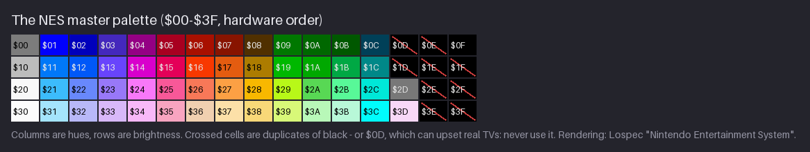
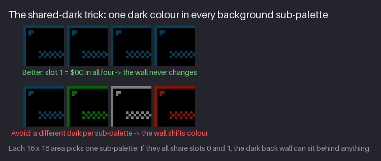
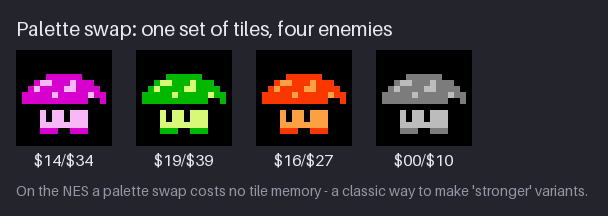
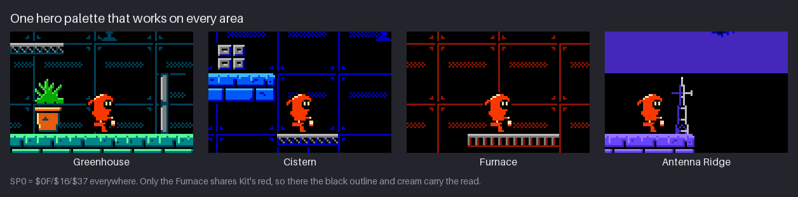

# Chapter 5 — Colour: the NES Palette and Sub-palettes

Most pixel art palettes are lists you choose freely: 16 colours, 32 colours, whatever the piece
needs. The NES works differently, and that difference shapes every asset in this course. There is
one fixed **master palette** of 64 entries. From it you pick small groups of colours, the
**sub-palettes**: four for the background, each made of a shared backdrop plus three colours, and
four for sprites, each made of "transparent" plus three colours. Every 8×8 tile is drawn with four
indices, not four colours, so the same tile can appear in any sub-palette. Choose those groups
well and a screen looks rich with 25 colours; choose them badly and nothing fits.

This chapter covers colour in that system. You will read the master palette as a grid of hues
and brightness rows, build sub-palettes that share a dark, make shading ramps out of rows and
columns, keep one hero palette for Kit in every area, and get variety for free with palette
swaps. The worked example is the Greenhouse, the first area of `hollow-vault`. The project gains
the Greenhouse sub-palettes as a palette file and a swatch image, and Kit's stand pose gets its
first colours.

Previous: [Chapter 4](04-value-light-and-contrast.md). Next: [Chapter 6](06-shading-clusters-and-black.md).

## The master palette


The figure shows all 64 entries in **hardware order**: the entry number is a two-digit hex value,
`$00` to `$3F`. The first digit picks the **row**, the second picks the **column**:

- **Columns are hues.** Column `$x0` is grey. Columns `$x1` to `$xC` walk around the colour wheel:
  blue (`1`), blue-violet (`2`), violet (`3`), magenta (`4`), rose (`5`), red (`6`), orange (`7`),
  olive and gold (`8`), yellow-green (`9`), green (`A`), sea green (`B`) and teal (`C`). The ring
  closes: teal `$xC` sits next to blue `$x1` on the wheel. Columns `$xD` to `$xF` are black.
- **Rows are brightness.** Row `$0x` is the darkest, then `$1x`, `$2x`, and `$3x` is the
  lightest and palest. Chapter 4 measured them: the rows are value bands, roughly, with some
  overlap between hues.

So `$16` is "row 1, column 6": a mid red. `$26` is the same hue one row lighter, `$06` one row
darker. `$1A` is a mid green, `$2A` a light green. Once you see the grid this way you can
name colours by their number, and you can move through it on purpose: `+$10` is one step lighter,
`-$10` one step darker, `+1` or `-1` one step around the hue wheel.

**Why this grid?** The NES did not store RGB colours at all. Its picture chip, the PPU, built a
TV signal directly: a brightness level (four of them) and a colour phase (twelve of them, one per
hue column), plus greys. A TV turned that signal into the colours you saw, and different TVs
showed it differently. Every "NES palette" in RGB is somebody's measurement or interpretation of
that signal; the NESdev wiki lists several. None is the one true palette.

So pick one rendering and stick to it. This course uses the Lospec palette "Nintendo
Entertainment System", re-ordered into hardware positions; you set it up in Chapter 1 as
`palette/nes.gpl` and `palette/nes-grid.png`. Mixing renderings between files is a classic way
to get colours that almost, but not quite, match.

Three rules about specific entries:

- **Black is `$0F`.** In this rendering `$0E`, `$1D`, `$1E`, `$1F`, `$2E`, `$2F`, `$3E` and
  `$3F` are black too, but always write `$0F`. One name for one colour keeps your files and
  notes unambiguous.
- **Never use `$0D`.** It is "blacker than black": a signal below the black level, which can
  upset the picture on some real TVs. NES developers learned to avoid it, and so do we.
- **`$20` and `$30` are both white**, `#f8f8f8` and `#fcfcfc` in this rendering. The project uses
  `$30`.

Take those nine away and 55 usable entries remain (the crossed cells in the figure are the nine).
Two more are worth knowing: `$2D` is a dark grey and `$3D` a very pale pink.

### Hue, saturation and value on a fixed grid

Colour has three properties. **Hue** is which colour it is (red, green, teal). **Saturation**
is how intense it is, from grey to vivid. **Value**, Chapter 4's subject, is how light or dark
it is. With a free palette you set all three. On the NES grid you mostly choose two:

- hue is the column;
- value is the row;
- saturation comes with the row. Rows `$1x` and `$2x` hold the most vivid colours, row `$3x`
  holds pastels (light and soft), row `$0x` holds dark, deep colours. For a truly muted colour,
  use the grey column or a pastel.

That makes the NES palette loud by default. Most NES-style screens look good because the vivid
colours are kept small (an accent, a hero, a light rim) on large areas of black and dark colour,
not because the colours themselves are subtle.

**Try it.** Open the course palette in your editor next to the grid figure. Pick five colours
from the grid by number only (for example `$0C`, `$16`, `$2A`, `$31`, `$07`), predict what each
looks like from its row and column, then check. Do it until you can predict hue and rough value
without looking.

## Sub-palettes


The NES never puts all 64 colours on screen. It holds a small **palette memory** of 32 entries
and every pixel picks its colour from there. Those 32 entries are organised as eight
sub-palettes of four:

- **Four background sub-palettes, BG0 to BG3.** Slot 0 of every one of them is the same entry:
  the **backdrop**, shared by the whole background. Slots 1 to 3 are free. So the background
  gets one shared colour plus four groups of three.
- **Four sprite sub-palettes, SP0 to SP3.** Slot 0 means **transparent**: those pixels show
  whatever is behind the sprite. Slots 1 to 3 are free.

Count them: 1 backdrop + 4 × 3 background colours + 4 × 3 sprite colours = **at most 25
colours** on screen at once. Fewer, in practice: this course repeats black and greys across
sub-palettes, so the whole Greenhouse set holds 16 different colours.

The figure shows the whole colour plan of `hollow-vault`: one set of eight sub-palettes per
area. Read the Greenhouse row from the left. The four background sub-palettes all begin with
black (`$0F`), the backdrop. The four sprite sub-palettes begin with a checker, which stands for
transparent.

### How a tile gets its colours

An 8×8 tile is stored as a pattern of **indices**, 0 to 3, two bits per pixel. It does not store
colours. The colours come from whichever sub-palette the tile is drawn with:

- **Background tiles** get their sub-palette from the **attribute** of the screen area they sit
  in. One attribute covers a 16×16 block of four tiles, so all four tiles of a 16×16 block
  share one sub-palette. This is why the course builds the background from 16×16 **metatiles**
  (Chapter 14 builds the full set).
- **Sprites** carry their own sub-palette number. Each 8×8 hardware sprite chooses one of SP0 to
  SP3, so a character made of several sprites normally uses one sub-palette for all of them.

> **NES rule:** the NES has 4 background and 4 sprite sub-palettes. Every background
> sub-palette is the shared backdrop plus 3 colours; every sprite sub-palette is transparent plus
> 3 colours. A background sub-palette applies to a whole 16×16 area, a sprite sub-palette to a
> whole 8×8 sprite. (Authentic: this course follows the hardware rule exactly.)

Three consequences shape everything you draw from here on:

1. **Draw in indices, not colours.** When you draw a tile you decide "this pixel is slot 2". The
   same pixels can be teal stone in the Greenhouse and blue stone in the Cistern without
   redrawing anything. Your editor will show colours, but think in slots.
2. **Every 16×16 background block is limited to four colours, and one of them is black.** A
   plant in front of a teal wall cannot use the wall's teal unless both come from the same
   sub-palette. Planning which object uses which sub-palette is part of the art, and the next
   section shows the trick that makes it manageable.
3. **A character has three colours.** Kit gets black, red and cream, and nothing else. Some
   games layer an extra sprite over a character for one more colour, paying for it with the
   sprites-per-line limit. This course keeps Kit to one sub-palette.

**Try it.** In the Greenhouse row of the figure, find the sub-palette for each of these, by
looking at the swatches only: the moss on top of the floor, the leaves of a fern, a metal door,
the warm light of a lamp, Kit's suit, an enemy's body. You should get BG0, BG1, BG2, BG3, SP0 and
SP1.

## The shared dark


Slot 0, the backdrop, is shared by hardware. This course shares one more slot by choice: inside
an area, **every background sub-palette has the same slot 1**, the area's **dark**. In the
Greenhouse that is `$0C`, a dark teal, in all four.

Why give up three of your twelve background colours? Look at the figure. The back wall of a room
is drawn in black and the dark colour: thin panel lines, a checker of rivets, a frame. A wall
covers most of the screen, and every 16×16 block of it sits in some sub-palette, whichever the
objects in front of it need. If each sub-palette has its own dark (bottom row), the same wall
tiles turn green, grey or red depending on what stands in front of them, and the room looks
patched. With a shared dark (top row) the wall looks identical in every block, so:

- the back wall can sit behind anything: a plant in BG1, a door in BG2, a lamp in BG3;
- any detail drawn in black and slot 1 works in any sub-palette, which saves tile memory
  (Chapter 15 uses this for wall details);
- the dark gives the whole area a single colour mood, which is most of what makes the
  Greenhouse feel green-blue and the Furnace feel red-brown.

The cost is real: each background sub-palette has only two free colours, slots 2 and 3. That
turns out to be enough, because those two are a mid and a light: exactly the two values that
carry form on the play layer.

Many NES games use some version of this. Look for it: when a room's dark tone stays the same
behind every object, its sub-palettes share it.

**Try it.** Take the Greenhouse set (it is in the table in "Building an area palette" below) and
change BG2's slot 1 from `$0C` to `$00`, grey. Draw a 32×16 strip of wall in black and slot 1 and
give the right half BG2. Notice how loudly the seam shows. Change it back.

## Ramps on the NES


A **ramp** is an ordered set of colours from dark to light that you shade one material with. Each
background sub-palette in this course is a ramp of four: black, the area dark, a mid and a
light. Chapter 4 explained why the steps must be clear value steps; this section is about their
hue.

The simplest NES ramp is one column: pick a hue and take it from several rows. Teal in column C
gives `$0F $0C $1C $2C`. Each step is "one row lighter", so the values step up cleanly: 0, 48,
95, 161. That is the left tile in the figure, and it works.

The right tile changes only the top step, to `$2B`. That colour is in the next column over
(sea green instead of teal) and the light reads warmer and more natural, like sunlight on moss
rather than a glowing cyan. This is **hue shifting**: moving the hue a little as the value
changes, instead of keeping one hue for the whole ramp. On the NES grid it means: **step a row
for value, step a column for hue.**

Painters and pixel artists shift hue in a consistent direction:

- **Lights lean warm**, toward yellow. Light sources (sun, lamps, fire) are usually warm, so lit
  surfaces pick up their colour.
- **Shadows lean cool**, toward blue or violet, the colour of sky light and of shade.
- **Saturation peaks in the middle** of a ramp. The darkest and lightest steps are less vivid.

The NES grid handles the last point by itself: row 0 is deep, row 3 is pastel. For the first two,
you step one column toward yellow for lights (column 8, from either side) and one toward blue or
violet for shadows (columns 1 to 3). Some ramps from this course:

| Ramp | Shift |
|---|---|
| Greenhouse stone `$0F $0C $1C $2B` | light steps from teal toward green (warmer) |
| Kit `$0F $16 $37` | the light steps from red to cream in the orange column (warmer, much paler) |
| Cistern stone `$0F $02 $12 $21` | dark is deep blue, light steps toward cyan |
| Furnace brick `$0F $07 $16 $27` | dark brown-red, red, light steps to orange (warmer) |
| Antenna Ridge rock `$0F $03 $13 $23` | straight violet column: cold, night-time |

The Ridge ramp is straight on purpose: the area is lit by night light, and a straight cold ramp
says "no warm light here". Hue shifting is a tool, not a law. Use it when the light is warm, or
when a straight ramp looks plastic.

Two cautions:

- **Shift, do not jump.** One column per step is plenty. Teal to green is a hue shift; teal to
  orange is a different material.
- **Check value after shifting.** Moving sideways changes value too. `$2B` (189) is lighter than
  `$2C` (161), which helps the moss rim here; but some neighbours are darker than you expect.
  Check every ramp in grey.

**Try it.** Build two ramps of four for a brick wall: one straight (`$0F $06 $16 $26`) and one
hue-shifted (try `$0F $06 $16 $27`, or `$0F $05 $16 $27` with a cooler dark). Paint the same
16×16 brick tile in both and compare at 1× and 4×.

## One hero palette everywhere


Kit's sprite palette, SP0, is `$0F $16 $37` in every area. It never changes. Three reasons:

- **The player learns one shape and one colour.** Wherever they are, the red figure with the
  cream face is them. Many NES games keep the hero's palette constant for the same reason.
- **Warm hero, cool worlds.** Three of the four areas are cool: teal, blue, violet. A warm red
  hero stands out against all of them without any extra effort. The idea is borrowed from games
  like *Environmental Station Alpha* (Chapter 1), whose areas each have their own colour family
  while the hero keeps one warm colour.
- **It is cheap.** One sub-palette for the hero, fixed, leaves the other three free to change
  per area.

The figure also shows the hard case. The Furnace is red-brown, and its brick uses `$16`, Kit's
suit colour. Kit does not vanish there, because their read does not rest on hue alone:

- the **black outline** separates the red suit from red brick (Chapter 6 explains why every
  sprite in this course gets one);
- the **cream** face and lantern are the lightest values on the screen;
- the **background is dark**: most of the Furnace wall is black and `$07`, so the red of the
  brick is limited to edges and accents.

That is the general method for testing a hero palette: put the hero on every backdrop you plan
to use, at 1×, and look for the screen where it is weakest. If the hero only reads because of
hue, the palette is fragile. If value and the outline do the work, hue is a bonus.

Keep the hero's colour rare in the backgrounds, too. If half the Greenhouse were red, Kit would
not be the red thing on screen. In this course `$16` appears in backgrounds only in the Furnace,
and there as brick edges.

**Try it.** Put your own hero sprite (or Kit) on four flat backdrops: black, a dark blue `$02`, a
dark red `$07` and a light grey `$10`. Look at 1×. On which one does the hero almost disappear,
and what carries the read there?

## Palette swaps


Because a sprite stores indices, changing its sub-palette changes its colours and nothing else.
The figure is one set of tiles, the spore hopper from Chapter 12, shown in four sprite palettes.
That is a **palette swap**, and on the NES it costs no tile memory at all: the four enemies take
exactly the tile space of one.

Games used palette swaps constantly:

- **Area variants.** In `hollow-vault` the creature sub-palette SP1 changes per area: the hopper
  is magenta in the Greenhouse (`$14 $34`), green in the Cistern (`$19 $39`), grey in the
  Furnace (`$00 $10`) and violet on the Ridge (`$13 $33`). Same creature, local colours.
- **Stronger versions.** A tougher enemy in a different colour is a classic way to signal "this
  one hits harder" without drawing anything new.
- **States.** A flash to white, a hurt tint, or a frozen blue can all be palette changes on a
  single frame.
- **Fades.** A fade to black subtracts `$10` from every colour each step; anything that would go
  below row 0 becomes `$0F`. Four steps take any palette to black. It is the NES grid used as a
  value dial.

Palette swaps only work if the sprite was drawn with good values. Each of the four hoppers
reads, because slot 2 is always the mid and slot 3 always the light, and the black outline stays
black. If you swapped in a palette where slot 3 was darker than slot 2, the light would land on
the shadow side and the form would turn inside out. **Keep the order of value in every swap:
slot 1 darkest, slot 3 lightest.**

**Try it.** Recolour any 16×16 sprite you drew earlier with three different sprite palettes,
changing only slots 2 and 3. Then try one bad swap where slots 2 and 3 are reversed in value, and
look at what happens to the light.

## Building an area palette

The eight sub-palettes of an area are designed together. Here is the order this course uses,
and the Greenhouse as the worked example.

1. **Choose the area's colour family and its dark.** The Greenhouse is an overgrown glasshouse
   lab: teal and green, a cool and damp place. Its dark is `$0C`, a deep teal. The dark sets the
   mood of the whole area, because it is most of the wall.
2. **Make BG0 the walkable surface.** Every floor and platform uses it, so it needs the brightest
   light on the screen (Chapter 4): `$1C` teal stone, with the hue-shifted `$2B` as the moss rim.
3. **Give the other materials one sub-palette each.** Plants are the area's identity: BG1 is
   green `$1A $2A`. Doors, pipes and terminals are metal: BG2 is grey `$00 $10`, a neutral that
   works in every area. One warm group for lamps, pots and crates: BG3 is rust `$17` and lamp
   cream `$38`.
4. **Keep the hero palette.** SP0 is `$0F $16 $37` as everywhere. Check it against BG0 to BG3.
5. **Choose creature colours that contrast with the area.** SP1 is magenta and pink (`$14 $34`):
   the complement of green, so spore hoppers pop against the plants.
6. **Effects and the drone.** SP2 is yellow and white (`$28 $30`) for sparks, pickups and
   flashes: the lightest colours, for the shortest-lived things. SP3, the warden drone, is grey
   metal with a green lens (`$10 $2A`).
7. **Check everything in grey,** then on a mock-up screen at 1×.

The result:

| Sub-palette | Slot 0 | Slot 1 | Slot 2 | Slot 3 | Used for |
|---|---|---|---|---|---|
| BG0 stone | `$0F` | `$0C` | `$1C` | `$2B` | ground, platforms, walls |
| BG1 plants | `$0F` | `$0C` | `$1A` | `$2A` | ferns, vines, pods |
| BG2 metal | `$0F` | `$0C` | `$00` | `$10` | doors, pipes, terminals |
| BG3 warm | `$0F` | `$0C` | `$17` | `$38` | lamps, planters, crates |
| SP0 Kit | – | `$0F` | `$16` | `$37` | the hero |
| SP1 creatures | – | `$0F` | `$14` | `$34` | spore hopper, drip slug |
| SP2 effects | – | `$0F` | `$28` | `$30` | sparks, pickups, flashes |
| SP3 drone | – | `$0F` | `$10` | `$2A` | the warden drone |

Notes on the table:

- **Sprite slot 1 is always black.** Every sprite in the course has a black outline, so black is
  in all four sprite sub-palettes. That leaves two colours per sprite palette for form: a mid and
  a light. Chapter 6 shows why that is enough.
- **Values step clearly in every row.** BG0 goes 0, 48, 95, 189; BG3 goes 0, 48, 124, 215; SP0
  goes 0, 107, 226. No slot 2 is near its slot 3.
- **The palette has an order of importance.** BG0 and SP0 must be right; the rest can be tuned
  later. That is also the order to design in.

The other three areas follow the same recipe with a different dark: the Cistern's is `$02` deep
blue, the Furnace's `$07` brown-red and the Ridge's `$03` violet. Read them in the area-palettes
figure at the top of "Sub-palettes".

**Try it.** Build the Cistern set yourself before you look: a flooded, cold underground area with
water channels, metal, and algae. Choose a dark, then BG0 to BG3 and SP1 to SP3 (SP0 stays Kit's).
Then compare with the Cistern row of the area-palettes figure. A different answer is fine if your
values step clearly and your dark is shared.

### Common colour mistakes

- **Two slots of nearly the same value.** `$1A` (99) and `$1C` (95) are different hues but almost
  the same grey. In one sub-palette they waste a slot: the eye cannot use the difference for
  form. Each slot should be a clear value step.
- **A bright background.** A light wall colour in slot 2 or 3 of a wall sub-palette competes with
  the floor (Chapter 4). Keep walls to black and the dark; save the lights for walkable edges.
- **Too many hues.** Twelve free background colours tempt you to use twelve hues. An area reads
  as a place when most of its colours come from one family (the dark, the stone) with one or two
  accents.
- **The hero's colour everywhere.** If the background uses the hero's main hue widely, the hero
  stops being the thing that pops. Keep it rare, as `$16` is outside the Furnace.
- **Colours from a different rendering.** A colour picked from a screenshot or another NES
  palette file is close but not equal. Always take colours from your own palette file.

## Project: the Greenhouse palette and a flat Kit

At the end of Chapter 4 the pack had Kit's value study in three greys. This chapter adds the
Greenhouse colour plan and puts colour on Kit. The snapshot is
[`project/ch05/`](project/ch05/README.md); its README marks the new files:

- `palette/greenhouse.gpl` — the Greenhouse sub-palettes as a palette file of 32 entries;
- `palette/greenhouse-subpalettes.png` — the same as a 4×8 swatch image, one row per
  sub-palette;
- `sprites/kit-stand.png` — Kit's stand pose in SP0, flat for now;
- `preview/greenhouse-subpalettes-16x.png` and `preview/kit-stand-8x.png` — enlarged copies.


### The palette file

`greenhouse.gpl` is a GIMP palette file, a plain text format that most pixel art editors can
import. It lists the 32 entries in palette-memory order, four per sub-palette, and names each
one with its sub-palette, slot and NES number:

```text
GIMP Palette
Name: Greenhouse
Columns: 4
#
  0   0   0	BG0.0 $0F
  0  64  88	BG0.1 $0C
  0 136 136	BG0.2 $1C
 88 248 152	BG0.3 $2B
  0   0   0	BG1.0 $0F
...
```

Two details:

- **`Columns: 4`** makes the editor show one sub-palette per row, which matches how you think.
- **Sprite slot 0 is written as `$0F`.** It is transparent in the game, but a palette file needs
  some colour there. Never paint with it in a sprite; use your editor's transparency instead.

Build it by hand from the table above: it is 32 lines, and typing them once fixes the numbers in
your memory. The RGB values come from your Chapter 1 `nes.gpl`, so the colours match the master
palette exactly. The swatch image `greenhouse-subpalettes.png` is the same data drawn as pixels,
4 wide and 8 tall; it is handy as a reference layer, and some editors can load a palette from
an image.

### Colouring Kit, flat

Kit's value study used three greys that matched slot values. Colouring it is now a direct swap:

| Value study | Slot | Colour |
|---|---|---|
| transparent | 0 | transparent |
| black | 1 | `$0F` black |
| mid grey (107) | 2 | `$16` red |
| light grey (226) | 3 | `$37` cream |

For this chapter, swap slot 1 and slot 2 only, and paint the light accents red as well: the
hood rim, eyes, hand, buckle and lantern. The result is a **flat** Kit: red suit, black outline,
black face, black far leg. 133 red pixels, 106 black, nothing else.


Why hold the cream back? Because Chapter 6 adds it as a shading decision, pixel by pixel, and it
is easier to judge each light pixel when you add it to a finished flat sprite. The flat version
is also a test: look at it at 1× on the Greenhouse backdrop. The pose from Chapter 3 and the
hood still read with just a mid and a black. If they do, the cream will only make it better.

Then check the work:

- **Load the palette file** in your editor and confirm that every swatch matches the table.
- **Check the values in grey** (Chapter 4's desaturate test): slot 1 is darker than slot 2, which
  is darker than slot 3, in every row.
- **Count Kit's colours:** two used plus transparent, all from SP0.

## Exercises

1. **Rows and a grey ramp.** On the master palette, find the four brightness rows and say, for
   each, what kind of colours it holds (deep, vivid, vivid-light, pastel). Then pick a four-step
   grey ramp from the palette, darkest to lightest, using only usable entries.

   *What to look for:*
   - you used black `$0F` for the darkest step, not `$0D` or a duplicate black;
   - the steps come from the grey column and rise one row at a time;
   - you can explain why `$20` and `$30` should not both be in one ramp.

   <details><summary>Example solution</summary>

   

   Rows: `$0x` deep and dark, `$1x` vivid mid tones, `$2x` vivid light tones, `$3x` pastels. A
   grey ramp: `$0F`, `$00`, `$10`, `$30` (luminance 0, 124, 188, 252). `$2D` is also a grey
   (120), but it is almost the same value as `$00`, and `$20` is almost the same white as `$30`;
   two near-equal steps waste a slot.
   </details>

2. **A desert ruin.** Design four background sub-palettes for a desert ruin: sand floors, stone
   walls, dry plants, and one accent of your choice. Use a shared dark.

   *What to look for:*
   - slot 0 is `$0F` and slot 1 is the same in all four;
   - each sub-palette steps clearly in value: slot 1 < slot 2 < slot 3;
   - the walkable material (sand) has the brightest light;
   - the accent contrasts with the rest in hue, and does not use the hero's colours.

   <details><summary>Example solution</summary>

   

   One answer: shared `$0F` and `$07` (a warm brown dark); sand `$27 $37`, stone `$00 $10`,
   plants `$1A $2A`, accent `$11 $21` (a blue for water or tiles). In grey: `$07` 52, sand 177
   and 226, stone 124 and 188, plants 99 and 163, accent 99 and 157, so sand has the brightest
   light. A blue accent is the complement of the sand and makes a small pool or mosaic stand out.
   </details>

3. **Three hoppers.** Draw a 16×16 enemy (or use any you have) in one sprite sub-palette. Then
   make three palette-swapped versions by changing slots 2 and 3 only.

   *What to look for:*
   - no pixel changed between versions, only the palette;
   - slot 3 is lighter than slot 2 in every version, so the light stays on the light side;
   - at least one version could pass as "the stronger one", and you can say why.

   <details><summary>Example solution</summary>

   

   The course's hopper in magenta, green, red-orange and grey. Each keeps black in slot 1 and
   a mid and light in slots 2 and 3. The red version, `$16 $27`, reads as the most aggressive:
   warm, saturated, and close to "danger" colours. It also shares Kit's red, so in a real game it
   would want a different light to keep it apart from the hero.
   </details>

4. **Hero on every backdrop.** Make four crops, 64×48 each, of different backgrounds: your own
   or the four `hollow-vault` areas. Place your hero in each, using one fixed sprite
   sub-palette.

   *What to look for:*
   - the hero reads at 1× in all four;
   - in the hardest crop you can name what carries the read (outline, light value, shape);
   - the hero's main colour is rare or absent in the backgrounds.

   <details><summary>Example solution</summary>

   

   Kit's palette never changes. The Furnace crop is the hardest, because its brick shares
   Kit's red `$16`; the black outline and the cream face and lantern carry the read there, and
   the mostly black wall keeps the red to a few edges.
   </details>

## Recap

- The NES master palette is a 16×4 grid: columns are hues, rows are brightness. `+$10` is one
  step lighter, `-$10` one step darker, `±1` one step round the hue wheel.
- Every RGB NES palette is an interpretation of a TV signal; pick one rendering and keep it.
  This course uses Lospec's "Nintendo Entertainment System": 55 usable entries.
- Black is `$0F`. Never use `$0D`. The project's white is `$30`.
- Four background sub-palettes (shared backdrop + 3) and four sprite sub-palettes
  (transparent + 3): at most 25 colours on screen. A background sub-palette covers a 16×16
  block; a sprite sub-palette covers an 8×8 sprite. Draw in indices.
- The shared dark: the same slot 1 in every background sub-palette of an area, so walls look the
  same behind everything.
- Ramps: a row for value, a column for hue. Lights lean warm, shadows cool. Check in grey.
- Kit's SP0, `$0F $16 $37`, never changes. Test a hero on every backdrop; outline and value
  should carry the read.
- Palette swaps make new variants for no tile memory. Keep slot 3 lighter than slot 2.
- The pack now has `palette/greenhouse.gpl`, `palette/greenhouse-subpalettes.png` and a flat
  `sprites/kit-stand.png`.

## Further study

- **PPU palettes** — NESdev wiki — https://www.nesdev.org/wiki/PPU_palettes. The hardware
  reference: palette memory at `$3F00`, the shared backdrop, the meaning of each row and column,
  and why `$0D` is unsafe. Read the sections on palette RAM and on the colour signal.
- **Nintendo Entertainment System palette** — Lospec —
  https://lospec.com/palette-list/nintendo-entertainment-system. The rendering this course uses,
  with its hex values and downloads in common palette formats.
- **"Creating NES Graphics"** — Mega Cat Studios —
  https://megacatstudios.com/blogs/retro-development/creating-nes-graphics. A studio that ships
  new NES games explains sub-palettes and attribute areas from the artist's side. Notice how
  they plan which objects share a sub-palette.
- **"Hue Shifting in Pixel Art (Color Tutorial)"** — Brandon James Greer —
  https://www.youtube.com/watch?v=PNtMAxYaGyg. A clear demonstration of hue-shifted ramps; on
  the NES each of his small hue moves becomes a step to the next column.
- **"Pixel Art Class - Palettes & Colour"** — AdamCYounis —
  https://www.youtube.com/watch?v=hkrK65FPmDI. How to build a palette around value and
  purpose, not just favourite colours.
- **"Pixelblog 1 - Color Palettes"** — Raymond Schlitter (Slynyrd) —
  https://www.slynyrd.com/blog/2018/1/10/pixelblog-1-color-palettes. Ramps, hue shifting and
  saturation, with many worked examples; compare his free ramps with what the NES grid allows.
- **"NES Graphics Explained"** — NesHacker —
  https://www.youtube.com/watch?v=7Co_8dC2zb8. An animated walk through tiles, attributes and
  palettes on the real hardware; good for seeing why a tile stores indices.

Sources for this chapter: [REFERENCES.md](REFERENCES.md#chapter-5--colour-the-nes-palette-and-sub-palettes)
