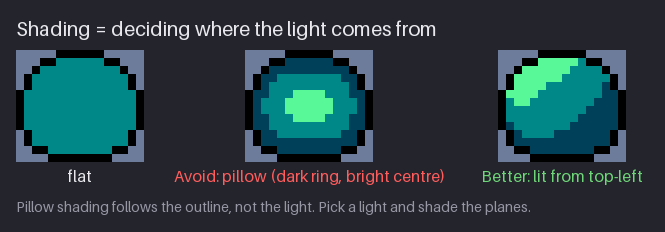
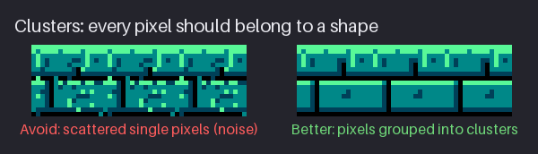
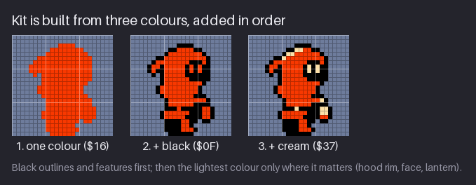
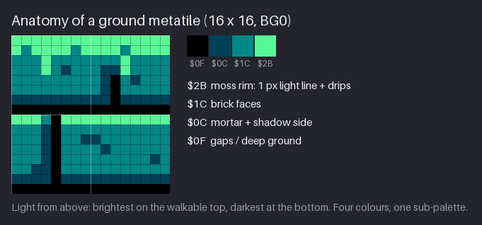

# Chapter 6 — Shading Craft: Clusters, Outlines, and Black

An NES sprite has three colours and an NES background tile has four, and one of those is usually
black. At that budget there is no blending and no soft gradient that hides a weak decision. Every
pixel is visible and every pixel is a choice. That is good news: a small number of clear rules,
applied every time, separates professional NES-era art from beginner work. This chapter teaches
those rules.

You will shade by light direction instead of following the outline, keep pixels in clean
**clusters** with no stray singles, and use black as a deliberate colour: an outline on sprites,
gaps and depth on tiles. Then you will finish Kit in their three colours, draw the first ground
metatile, and fit props into one sub-palette per 16×16 block. The chapter ends with **the
professional checklist**, the list you will run on every asset for the rest of the course.

Previous: [Chapter 5](05-the-nes-palette-and-sub-palettes.md). Next: [Chapter 7](07-texture-and-dithering.md).

## Light, not outline


The most common shading mistake in pixel art has a name: **pillow shading**. The artist takes a
shape, puts the darkest colour just inside the outline, the next colour inside that, and the
lightest in the middle. The result looks like a cushion pressed from the inside: every edge is
dark, the centre bulges, and nothing tells you where the light is. The middle boulder in the
figure is pillow shaded.

It is tempting because it is easy. It needs no decision: you just follow the outline inward. But
shading exists to show the **form** of an object under **light** (Chapter 4), and pillow shading
shows neither. Real light falls on one side of an object. The side facing the light is bright,
the side facing away is dark, and the edge between them follows the form, not the outline.

The fix is to decide first, then shade:

1. **Pick the light.** In this course it is always top, slightly left.
2. **Find the planes.** Think of the object as a few flat faces: a boulder has a top, a front
   and a side. Which face points at the light?
3. **Give each plane one value.** The planes facing the light get the light colour, as one
   cluster. The planes facing you get the mid. The planes facing away, and the bottom, get the
   dark.
4. **Let the outline be the outline.** The black edge stays black all round; it is not part of
   the shading.

That is the right boulder. Same four colours, same outline; only the placement changed. The
light band sits across the upper-left planes, the dark wraps the lower right, and the boulder
now has a top and a side.

With three or four colours there is little room for a smooth turn from light to dark, and that
is fine. The light/shadow split, the terminator from Chapter 4, is the one big decision. Make it
in a clear place and the form reads.

**Try it.** Draw a 16×16 circle with a black outline and pillow shade it on purpose: dark ring,
mid ring, light centre. Then copy it and re-shade the copy for a top-left light, with the same
four colours. Look at both at 1×. The lit one should look like a ball; the pillow like a button.

## Clusters


A **cluster** is a group of touching pixels of the same colour. Good pixel art is built from
clusters that each mean something: this cluster is the lit top of a brick, this one its shadow
side, this one a crack. The eye reads clusters as shapes. It reads single scattered pixels as
noise.

A pixel of one colour with no neighbour of the same colour is an **orphan pixel**. The left
strip in the figure has forty of them, placed at random. At 1× they turn the bricks into static;
the shapes underneath are still there, but the eye cannot find them. The right strip is the same
tiles without the orphans.

Orphans usually creep in from two habits:

- **"Adding texture"** by sprinkling single pixels of a lighter or darker colour over a surface.
  Chapter 7 shows how texture is done properly: with small, deliberate clusters and patterns.
- **Shading pixel by pixel** without stepping back. Each pixel looked right at 800% zoom; at 1×
  they do not form a shape.

Not every single pixel is a mistake. A single pixel is fine when it is a **deliberate mark** with
a job: an eye, a rivet, a highlight glint, a star, a 1 px pit in a brick face. The test is not
"is it alone?" but "does it mean something?". If you can name what a single pixel is, it can
stay. If you cannot, merge it into a neighbouring cluster or remove it.

Two more cluster rules:

- **Clusters follow the form.** The light cluster on a round boulder is curved; on a brick it is a
  straight edge. A cluster shaped against the form (a round highlight on a flat brick) looks like
  a stain.
- **Clusters have clean edges.** The edge of a cluster is a line, so Chapter 2's rules apply: no
  **jaggies** (irregular steps in what should be a smooth line) and no **doubles** (lumps where a
  1 px line is 2 px thick for no reason).

### Banding

**Banding** is when clusters of different colours run side by side in parallel strips of the same
width, so they read as stripes instead of form. It often appears as two or three 1 px rings of
colour that hug each other along an edge, every step lining up with the step next to it. The
pillow boulder above has banding, too: its dark ring and mid ring are parallel copies of the
outline.

Banding makes pixels visible as pixels, which is exactly what you do not want. The fixes:

- **Vary the widths.** A light band that is 2 px wide in one place and 1 px in another follows the
  form better than a band that is 1 px everywhere.
- **Offset the steps.** If the step in one band lines up with the step in its neighbour, move
  one of them by a pixel.
- **Use fewer bands.** With NES colour counts the best fix is often to drop a band: one light
  cluster on a mid fill, with no dark ring at all.

**Try it.** Copy one of your earlier tiles and sprinkle twenty orphan pixels over it. Then clean it
up without looking at the original: for each orphan, either delete it or grow it into a cluster
that means something (a crack, a pit, a bit of moss). Compare the result with the original.

## Building Kit in three colours


Kit is the clearest example of NES shading in this course, because their palette is as small as it
gets: black, a mid (red `$16`) and a light (cream `$37`). The figure shows Kit built in the order
that works for any NES sprite: from the big shape to the small accents.

1. **One colour: the mass.** Fill the silhouette from Chapter 3 with the mid. This is the suit, and
   it is most of the sprite. Check that the shape still reads as a solid shape.
2. **Add black: outline, features, depth.** Black does four jobs at once:
   - the **outline**, 1 px and closed all round;
   - the **face**, a dark opening under the hood, where the hood blocks the light;
   - **depth**: the far leg is black, so it sits behind the near leg;
   - **separation**: the belt is a black row that splits the mantle from the legs.

   After this step Kit is a finished flat sprite, the one the project got in Chapter 5.
3. **Add the light: only where it matters.** The cream goes in last and stays small. Fifteen
   pixels in total:
   - a **hood rim** of 5 px on the top left, where the light hits first;
   - two **eyes**, 1×2 each, in the black face: the strongest contrast on the sprite, at the spot
     players look at;
   - the **hand** and the **buckle**, 1 px each: deliberate single pixels, each with a name;
   - the **lantern**, 2×2 cream with a red base and a black handle: the second focal point.

Notice what is *not* there. The red suit has no dark shading band and no light band. With three
colours, one of them black, there is no colour for a "red in shadow". The form comes from black
shapes cut into the red (face, belt, far leg) and from small cream accents on the side facing
the light. This is how most NES heroes are shaded: one mid, black shapes, a few light accents.

The counts confirm the hierarchy from Chapter 4: 118 red (the mass), 106 black (the drawing), 15
cream (the accents). If the cream count crept above about a fifth of the mid, the light would
stop being an accent.

**Try it.** Take a sprite you drew earlier and rebuild it in the same three passes on separate
copies: one colour; plus black; plus the light. After the last pass, count the light pixels and
name each cluster. Remove any light pixel you cannot name.

## Black as a colour


On the NES, black is not "no colour". It is a palette slot like any other, and you choose where it
goes. This course uses it by a simple rule: **sprites are outlined, background tiles mostly are
not.**

### Sprites: a black outline

Every sprite in `hollow-vault` has a closed 1 px black outline, for three reasons:

- **It is free.** Slot 1 of every sprite sub-palette is black (Chapter 5). The outline costs no
  extra colour, and the other two slots stay free for the mid and the light.
- **It separates the sprite from any background.** A sprite moves across every tile in the area.
  Without an outline its edge is wherever its colour happens to meet the tile behind it: on
  dark lines the edge smears, on a similar colour it vanishes. The left half of the figure shows
  it. With an outline the edge is the same on every tile.
- **It marks what is interactive.** Outlined things move, hurt or can be picked up. Unoutlined
  things are scenery. Players learn this without being told.

On the black backdrop the outline merges with the background, and the sprite reads by its
coloured silhouette instead. That is fine: the outline only has to work where the background is
not black.

> **NES rule:** a sprite sub-palette has 3 colours plus transparent, so an NES sprite has at most
> 3 visible colours. Slot 0 is always transparent and cannot be used as a colour. (Authentic: this
> course follows the hardware rule exactly. Using black as one of the three is a convention, not a
> rule, but nearly every NES game does it.)

### Background tiles: black as gaps, voids and depth

Background tiles in this course are mostly **not** outlined. Black there is the backdrop, slot 0,
and it is used for what is deepest or missing:

- **gaps** between bricks and under platforms;
- **voids**: openings, the space behind a window, the dark of the back wall;
- **the far side** of a prop or the darkest crack in a rock.

Outlining every tile would make the background look like a field of sprites, and the player
could no longer tell scenery from things that matter. It would also spend the darkest value on
lines instead of depth.

Props get a black edge anyway, for free. A prop drawn inside a 16×16 block is surrounded by
slot 0, the backdrop, so wherever it meets the back wall there is black around it. The crate,
the lamp and the terminal in the next figures all show it.

### No anti-aliasing here

Pixel art with bigger palettes often softens edges with **anti-aliasing** (intermediate colours
on the steps of a line) or **selective outlining** (an outline lightened where the light hits).
Both need spare colours between the line colour and the fill. An NES sprite has none: its three
colours are black, a mid and a light, and each is already doing a job. So `hollow-vault` uses
neither. Chapter 26, the hi-bit style, teaches both, where the palette has room.

**Try it.** Draw a 16×16 sprite once without an outline and once with a closed black one. Place
both over three backgrounds: black, the Greenhouse wall (black with dark-teal lines) and the light
moss floor. Note where the unoutlined one loses its edge.

## A ground metatile


The ground is the most repeated asset in a platformer, and the one that matters most for play: it
tells the player where they can stand. Here is the first one in `hollow-vault`, a 16×16 metatile
in BG0 (`$0F $0C $1C $2B`). It is two courses of brick with a mossy top.

It uses the four colours as four jobs, from the top down:

- **`$2B` moss rim.** The top row is one unbroken line of the lightest colour: the walkable edge,
  brighter than anything in the background (Chapter 4). A few short drips hang from it into the
  bricks below, so the edge reads as moss and not as a ruler line. The top row of the lower course
  is lit too, because it faces the light.
- **`$1C` brick faces.** The mid fills the faces of the bricks: the mass of the tile.
- **`$0C` mortar and shadow side.** The dark marks the bottom row of each course and the right side
  of each brick, the planes facing away from a top-left light. It also makes a few small pits in
  the brick faces.
- **`$0F` gaps and deep ground.** Black fills the horizontal gap under each course and one
  vertical gap per course. The bottom row of the tile is black: the darkest value at the bottom.

So the tile runs from brightest at the top to darkest at the bottom, the same direction as the
light. There is no outline: the black is in the gaps.

A few details that make it work in a level:

- **The vertical gaps are staggered:** at column 10 in the top course and column 4 in the bottom
  one, like real brickwork. Stacked gaps would read as a grid.
- **It tiles sideways.** The courses run out of the left edge and back in on the right, so a row
  of these tiles reads as one long floor. Chapters 14 and 15 add ends, corners and fill tiles.
- **Each 8×8 quarter uses only the four BG0 colours,** and the whole 16×16 block is one
  sub-palette, so it is a legal NES metatile as drawn.

Here is the tile as slot digits, `0` = `$0F`, `1` = `$0C`, `2` = `$1C`, `3` = `$2B`:

```text
3333333333333333
3233332333323333
2223222222232222
2223212221132222
2222222221021222
2222222221022222
1111111111011111
0000000000000000
3332033333333333
2221022222222222
2221022112222222
2221022221222222
2221022222222212
2211022222222222
1111011111111111
0000000000000000
```

The pixel counts are 121 `$1C`, 47 `$2B`, 46 `$0C` and 42 `$0F`. The mid is the mass, as on Kit;
the light is a top edge and accents.

**Try it.** Draw a 16×16 ground metatile in four colours of your own: a lit top row, a mid face,
a dark shadow side, black gaps. Paste it four times in a row and check that it tiles without a
visible seam.

## Props, one sub-palette per 16×16


A **prop** is a background object: a lamp, a crate, a fern, a door. On the NES a prop is made of
background tiles, so it obeys the attribute rule: **every 16×16 block uses one sub-palette.**
That means each 16×16 prop is drawn in four colours, black, the area dark and one material ramp
of two colours, and you choose the ramp by material:

- **BG3 warm** (`$17 $38`): the lamp, the planter, the crate. Rust and cream.
- **BG1 plants** (`$1A $2A`): the fern, the seed pod.
- **BG2 metal** (`$00 $10`): the terminal, the drawers, the door.
- **BG0 stone** (`$1C $2B`): rubble, which must match the ground it fell from.

Taller props, the door and the pod, are two 16×16 blocks stacked. Both halves use the same
sub-palette, so the prop looks like one object.

What if a prop needs two materials, like a fern in a pot? Then it becomes two props: the planter
in BG3 and the fern in BG1, each in its own 16×16 block, one on top of the other. The Greenhouse
room in "Black as a colour" does exactly that. When two materials must share one block, draw one
of them in black and the dark only, which every sub-palette shares.

### The crate


The crate shows the whole chapter in one 16×16 block, BG3:

- a **black border** all round: slot 0, which is also the backdrop, so on the back wall the crate
  has a free black edge;
- the **light bevel**, `$38` cream, along the top and left edges, the sides facing the light;
- the **frame** in rust `$17`, the mid;
- the **shadow side**, `$0C`, along the bottom and right edges. This is the area's shared dark,
  doing a second job: in every Greenhouse sub-palette, slot 1 is the shadow colour of the material;
- a **black inner panel**: the deep space between the boards;
- an **X brace** of 2 px diagonal steps, mostly a cream pixel beside a rust one, so the boards
  catch the light on their upper-left side.

Count the colours: `$0F` 134 px, `$17` 61, `$38` 36, `$0C` 25. Black covers half the block, as it
should for a crate that is mostly border and dark gaps. The light and the dark are both small,
and every cream pixel is on a surface facing the light.

**Try it.** Draw a 16×16 barrel or chest in one sub-palette: black, the shared dark, a mid and a
light. Put the light only on the top and left edges, the dark only on the bottom and right.

## The professional checklist

These checks sum up Chapters 2 to 6. Run them on every asset before you call it done: sprite,
tile or prop. They are also collected in Appendix A, and later chapters add to them.

1. **The silhouette reads.** Fill the asset with one colour: it is still recognisable (Chapter 3).
2. **It reads at 1× on its real background,** not only zoomed in, and not only on a neutral
   grey.
3. **Values are distinct.** Three clear value steps; the light is small; the strongest contrast
   sits at the focal point (Chapter 4).
4. **One light, top-left, and no pillow shading.** Planes facing the light are light, planes
   facing away are dark; the shading does not just follow the outline.
5. **Clean lines.** No jaggies, no doubles (Chapter 2).
6. **Clean clusters.** No unintended orphan pixels; every single pixel has a name; clusters
   follow the form.
7. **No banding.** No parallel rings of colour hugging an edge.
8. **Black is deliberate.** Sprites have a closed black outline; tiles use black for gaps, voids
   and depth; there is no stray black.
9. **The palette rules hold.** At most 3 colours plus transparent per sprite, from one sprite
   sub-palette; at most 4 colours per 8×8 tile and one sub-palette per 16×16 block; only the
   area's colours; never `$0D`.
10. **It is consistent with the set.** Same pixel size (no scaled or rotated pixels), same palette,
    same light direction as every other asset.
11. **Walkable surfaces are brighter than the background,** and the background is quieter than
    the sprites.

A professional asset passes all eleven. When an asset looks wrong and you cannot say why, go down
the list in order: most problems are caught by one of the first four.

### A checklist pass, worked

Here is the checklist run on the ground metatile from earlier in this chapter, the way you would
run it on your own work:

- *Silhouette:* a tile has no silhouette of its own, but its top edge does: one straight, unbroken
  line. Pass.
- *1× on its background:* on the black backdrop and next to the Greenhouse wall the moss rim is
  among the brightest values in the room, with the lamps and Kit's accents. Pass.
- *Values:* four colours at 0, 48, 95 and 189; the light is 47 of 256 pixels, all at the top.
  Pass.
- *Light and pillow:* light on the top of each course, dark on the bottom and right sides, no
  ring around the bricks. Pass.
- *Lines, clusters, banding:* the single `$0C` pixels in the faces are named pits; the drips hang
  from the rim, so they are part of its cluster; the dark rows and the black rows are parallel,
  but they are mortar and gap, two different things with a real reason to be parallel. Pass.
- *Black, palette, set, walkable:* black only in gaps and the bottom row; four colours from BG0;
  same light as Kit; the walkable rim is the lightest value in the background. Pass.

Notice the banding note: parallel lines are not banding when the object really has parallel
edges, like mortar. Banding is parallel bands that *pretend* to be shading.

**Try it.** Run the checklist on the best sprite you have drawn so far. Write down every check it
fails, then fix them in order.

## Project: Kit finished, the first ground tile and a crate

At the end of Chapter 5 the pack had the Greenhouse palette and a flat Kit. This chapter
finishes Kit's stand pose and adds the first background art. The snapshot is
[`project/ch06/`](project/ch06/README.md); its README marks the new and changed files:

- `sprites/kit-stand.png` — Kit's stand pose, now with cream (changed);
- `tiles/ground-top.png` — the 16×16 ground metatile in BG0;
- `props/crate.png` — the 16×16 crate in BG3;
- `preview/kit-stand-8x.png`, `preview/ground-top-8x.png` and `preview/crate-8x.png`.


### Step 1: finish Kit

Open the flat Kit from Chapter 5 and add the cream, slot 3, in this order, checking at 1× after
each: the hood rim (5 px on the top left), the eyes (1×2 each), the lantern (2×2), the hand and
the buckle (1 px each). That is the whole change: 15 pixels move from red to cream. Kit's final
counts are 106 black, 118 red and 15 cream, the same pixel map as Chapter 4's value study with
each grey swapped for its colour.

### Step 2: draw the ground metatile

Draw `tiles/ground-top.png` in BG0 from the slot map in "A ground metatile". Work in the same
order as Kit: fill with `$1C`, cut the black gaps, add the `$0C` shadow sides and pits, then the
`$2B` rim and drips last. Check that it tiles: paste it three times side by side.

### Step 3: draw the crate

Draw `props/crate.png` in BG3. Here is its slot map, `0` = `$0F`, `1` = `$0C`, `2` = `$17`,
`3` = `$38`:

```text
0000000000000000
0333333333333320
0322222222222210
0320000000000210
0320320000032210
0320032000322010
0320003203220010
0320000322200010
0320000232000010
0320002203200010
0320022000320010
0320220000032010
0320000000000210
0322222222222210
0211111111111110
0000000000000000
```

Read it from the outside in: black border; cream bevel on the top row and left column; rust
frame; dark-teal shadow on the bottom row and right column; black panel; and the X brace. The
board from the top left to the bottom right is a 2 px stair of a cream pixel and a rust pixel
all the way; the other board is lit only on its upper half, and its lower-left arm is rust.
Draw the stairs as clean 1:1 steps, as in Chapter 2.

### Check

Run the professional checklist on all three. Then look at them together at 1× on the black
backdrop: Kit should be the first thing you see, the ground rim second, the crate third.

## Exercises

1. **Re-shade a pillow boulder.** Draw a 16×16 boulder pillow shaded (dark ring, light centre)
   in four colours. Then re-shade it for a light from the top left, without changing the outline
   or the palette.

   *What to look for:*
   - the light colour forms one cluster on the upper-left planes;
   - the dark colour sits along the lower right and the bottom, not all round;
   - no parallel rings of colour remain.

   <details><summary>Example solution</summary>

   

   The right boulder is the fix: a light band across the upper-left planes, the mid on the front,
   the dark wrapping the lower right. The outline and the four colours are the same as the
   pillow version; only the placement of the values changed.
   </details>

2. **Remove the noise.** Take one of your tiles, or the course's ground tile, and add thirty
   orphan pixels of random colours from its palette. Swap with a friend, or wait a day, then clean
   it up.

   *What to look for:*
   - every remaining single pixel has a name (pit, rivet, drip);
   - the clusters follow the brick shapes;
   - at 1× the tile reads as calmly as the clean version.

   <details><summary>Example solution</summary>

   

   In the clean strip every pixel belongs to the rim, a brick face, a shadow edge, a gap or a
   named pit. Most of the noise pixels can simply be deleted; a few can be grown into a small
   crack or a moss drip if the tile needs it.
   </details>

3. **Shade your hero.** Take the hero you designed in Chapter 3 and shade it in three colours
   plus transparent: one colour, then black, then the light.

   *What to look for:*
   - a closed black outline;
   - black also used inside for features, depth and separation;
   - the light is under a fifth of the mid, and every light cluster has a name;
   - the strongest contrast is at the face.

   <details><summary>Example solution</summary>

   

   Kit's three passes: red mass; black outline, face, belt and far leg; then 15 cream pixels
   on the hood rim, eyes, hand, buckle and lantern. Your hero may need the light in different
   places, but it should be about as small.
   </details>

4. **A ground metatile.** Draw a 16×16 ground metatile for an area of your own, in one
   four-colour sub-palette with black as slot 0.

   *What to look for:*
   - the top row is the lightest colour and unbroken;
   - the bottom is the darkest;
   - shadow sides are on the right and bottom of each shape;
   - it tiles sideways without a seam.

   <details><summary>Example solution</summary>

   

   The Greenhouse tile: `$2B` rim and drips, `$1C` faces, `$0C` mortar and shadow sides, `$0F`
   gaps and bottom row. Yours may be grass on dirt or snow on rock; the order of values from top
   to bottom should be the same.
   </details>

## Recap

- Shade by light, not by outline. Pick the light, find the planes, give each plane one value.
  Pillow shading (dark ring, light centre) shows neither form nor light.
- Build in clusters. Every single pixel must have a name; otherwise merge it or delete it.
  Clusters follow the form and have clean edges.
- Avoid banding: vary widths, offset steps, or drop a band.
- Build sprites in three passes: mid mass, then black, then the light. Kit: 118 red, 106 black,
  15 cream.
- Black is a colour. Sprites get a closed black outline (free in every sprite sub-palette);
  background tiles use black for gaps, voids and depth. No anti-aliasing or selective outlining
  at NES colour counts.
- A ground metatile runs from its brightest row at the top to black at the bottom.
- Props use one sub-palette per 16×16 block; split a prop of two materials into two blocks.
- Run the professional checklist on every asset.
- The pack now has the finished `sprites/kit-stand.png`, `tiles/ground-top.png` and
  `props/crate.png`.

## Further study

- **"The Pixel Art Tutorial"** — cure (Pixel Joint) —
  https://pixeljoint.com/forum/forum_posts.asp?TID=11299. A classic forum tutorial covering
  pillow shading, banding, jaggies and noise, with clear before-and-after examples. Read the
  sections on shading and banding; skip anti-aliasing until Chapter 26.
- **"4 - Basic Shading"** (Pixel Art Articles) — Pedro Medeiros (Saint11) —
  <https://saint11.art/pixel_art_articles/article4/>. Short, visual notes on light direction and
  form; good for the order of decisions.
- **"Pixel Art Tutorial: Basics"** — Derek Yu — https://www.derekyu.com/makegames/pixelart.html.
  From the maker of *Spelunky*: outline first, then shading by light, with a sprite built step
  by step much like Kit.
- **"3 PixelArt Techniques/Common Mistakes (Doubles, Jaggies & Outline)"** — MortMort —
  https://www.youtube.com/watch?v=gW1G_FLsuEs. The line and outline mistakes from the checklist,
  shown being fixed live.
- **"Breaking the NES"** — David D'Angelo (Yacht Club Games) —
  https://old.yachtclubgames.com/2014/07/breaking-the-nes/. How *Shovel Knight* uses NES-style
  palettes and where it breaks the rules on purpose. Useful for seeing which NES limits matter to
  the look and which can be relaxed.

Sources for this chapter: [REFERENCES.md](REFERENCES.md#chapter-6--shading-craft-clusters-outlines-and-black)
