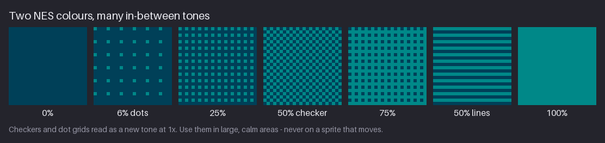
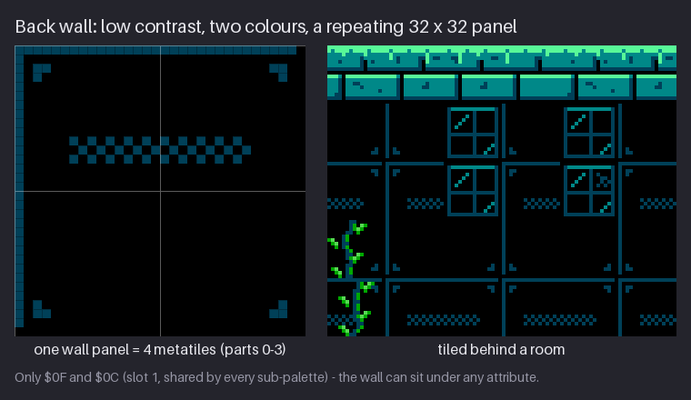
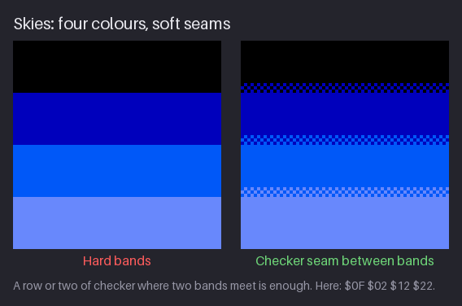
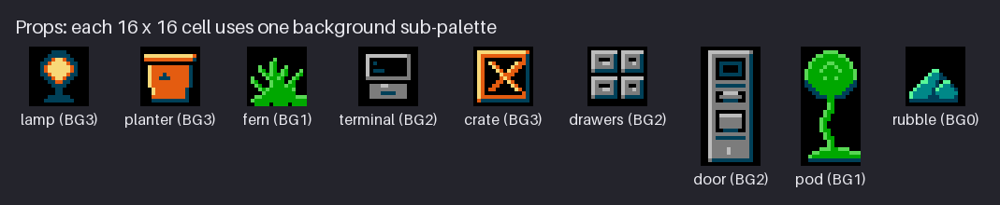
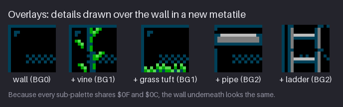

# Chapter 7 — Texture, Materials, and Dithering on Tiles

Chapter 6 gave Kit, a ground metatile and a crate clean light and clean clusters. This chapter is
about what fills the space *between* those shapes: the surface of a wall, the inside of a block of
ground, a sky, a sheet of water. On the NES every background tile has only four colours, one of
them the shared black, so you cannot add a new colour every time a surface needs a new tone.
Instead you mix two colours with a pattern of pixels (dithering), and you make materials from
pattern and value rather than from extra colours. The other half of the lesson is restraint: the
background is where the player looks *through*, not *at*, so most of it should be quiet.

By the end of the chapter you will be able to build a ladder of tones from two colours, darken the
inside of a solid mass so it recedes, draw a quiet back-wall panel that works under any
sub-palette, soften the seams of a four-colour sky, and animate water by moving only its crest. In
the project, `hollow-vault` gains its back-wall panel (four metatiles) and four variants of the
ground-top metatile.

Previous: [Chapter 6](06-shading-clusters-and-black.md). Next: [Chapter 8](08-animation-basics-and-idle.md).

## Texture is shading at a small scale

A rough surface is a field of tiny forms. Each chip in a brick, each crack in a slab, each knot of
moss is a small bump or dent, and each one is lit by the same light as the big form it sits on. So
the first rule of texture is the same as the first rule of shading: **a texture mark is a tiny
light/shadow pair, oriented to the light.** In `hollow-vault` the light comes from the upper left,
so a bump gets its light pixel on its upper-left side and a dent (a crack, a joint) gets its dark
pixel there instead.

Three more rules from general pixel art carry over directly, and the four-colour limit makes them
stricter:

- **Stay inside the surface's value range.** A mark that is lighter than the lit plane, or darker
  than the deepest crevice could be, pops out of the surface. In a 4-colour tile you only have one
  colour above and one below the face colour, so a mark is almost always "one slot away" from the
  pixel it sits on.
- **Texture shows in the half-tones.** In full light, bumps are flooded; in deep shadow, there is
  no light to model them. Marks belong where light rakes across the surface.
- **Texture must not break the silhouette by accident.** On tiles, the silhouette is the walkable
  edge. Keep texture marks off the bright rim unless the mark *is* part of the edge (a moss drip, a
  chip).

The rest of this chapter is about the tool that lets two colours do the work of three or four.

## Patterns as tones

Dithering mixes two colours with a fine, regular pattern so that, at normal viewing size, the eye
blends them into a tone that is not in the palette. It works because your visual system averages
detail that is finer than it can resolve. At 1× a game pixel is tiny, and a checkerboard of two
colours is too fine to be seen as separate pixels.

The figure uses two colours of the Greenhouse stone sub-palette BG0: the shared dark `$0C` and the
teal `$1C`. Read it as a ladder of tones:

| Pattern | Share of the lighter colour | How it reads | Typical use |
|---|---|---|---|
| 0% | none | flat dark | voids, the back of the mass |
| 6% dots | 1 pixel in 16 | a dark surface with a faint grain | vents, distant panels |
| 25% | 1 pixel in 4 | a step lighter, visibly textured | the first step out of a flat area |
| 50% checker | 1 in 2, alternating | a true in-between tone | the "third colour" between two slots |
| 75% | 3 in 4 (25% inverted) | a step darker than the light colour | the last step into a flat area |
| 50% lines | 1 in 2, as rows | the same tone with a horizontal grain | water, metal, scanline-like surfaces |
| 100% | all | flat light | lit faces |

The checker and the 25% / 75% patterns are the ones you will place by hand. Notice that the two
50% patterns contain exactly the same number of teal pixels but look different: the checker reads
as a *tone*, the lines read as a *texture* with direction. That is the general rule: the more
regular and the finer a pattern, the more it disappears into a tone; the more it lines up into
shapes, the more it reads as a surface.

**Only dither between neighbours.** `$0C` and `$1C` are one row apart on the NES palette grid
(Chapter 5), so their checker blends. A checker of `$0F` black and `$30` white does not blend into
grey at any normal size; it flickers. The bigger the value jump, the further away the viewer has
to stand before the pattern blends, and game screens are not viewed from across the room.

**Why it was natural on the NES.** The console sent a composite video signal to a CRT television,
and neighbouring pixels bled into each other on the way. A checker on a 1980s TV looked softer and
more like a flat tone than it does on a sharp modern LCD. Today a 50% checker at ×4 is a crisp
pattern, so dithering is a decision with a visible cost, not a default.

**Why patterns fit tiles.** Every pattern above repeats every 2 or 4 pixels, and 2 and 4 both
divide 8. A checker drawn on an 8×8 tile is seamless against copies of itself, so a whole wall of
checker costs one tile in the pattern table. A pattern with a period of 3 or 5 would not line up at
the tile edges and would need several different tiles to cover the same area.

> **NES rule:** Background tiles are 2 bits per pixel, so each 8×8 tile can show at most 4
> colours: the 3 colours of its sub-palette plus the shared backdrop. Dithering is how NES artists
> got more apparent tones out of those 4. The course keeps this rule authentic, and the toolkit
> checks every tile.

> **Try it (3 minutes).** Make a 64×8 canvas and pick two neighbouring colours, for example `$0C`
> and `$1C`. Fill the left 8 columns with the dark colour and the right 8 with the light one. In
> between draw 25%, 50% and 75% by hand, 16 columns each. Look at it at 1× and at 8×. At 1× the
> strip should read as a smooth five-step ramp; at 8× you see only two colours.

> **Tool aside.** Most editors can paint a pattern for you. Pixelorama's fill tool can fill with a
> pattern, GrafX2 has pattern fills built in, and in Aseprite, LibreSprite or Krita you can draw
> one 2×2 or 4×4 cell of the pattern, select it and use it as a brush. On small tiles the pencil is
> usually faster and gives you control over where the pattern starts and stops.

## Depth inside solids

A block of ground three metatiles thick has a problem: if every metatile is drawn like the top one,
with bright bricks all the way down, the block reads as a wall of equal-weight shapes. The eye
cannot tell where the walkable surface is, and the mass looks flat. Real masses are lit from
outside; light does not reach their middles. `hollow-vault` shows that with a simple rule.

The block has three kinds of metatile:

1. **The rim** (open sky above): a bright 1 px moss line in `$2B`, teal brick faces in `$1C`, dark
   `$0C` shadow rows and black mortar.
2. **Edge bricks** (open on the left or right): still fully lit, because light reaches the sides.
3. **Interior** (ground on all four sides, mask 15 in the autotile set of Chapter 15): every colour
   drops one step. The lit top row of each brick goes from `$2B` to `$0C`, the face from flat `$1C`
   to a **50% checker of `$0C` over black**, and the dark shadow row and cracks go to black.

The brick *layout* is unchanged: same joints, same running bond. Only the values change. That is
why the interior still reads as "more of the same ground", just further from the light. The
checker is doing the job a fifth colour would do: it makes a tone between `$0C` and black that the
sub-palette does not have.

This is also why the checker is acceptable here and not on Kit: the interior never moves, it is
large, and it sits at the back of the value range where a little visual noise reads as darkness
rather than detail.

> **Try it (4 minutes).** Draw a 16×16 brick metatile with a lit top row, a face colour, a dark
> bottom row and black mortar. Copy it. In the copy, recolour: light → dark, dark → black, and
> turn the face into a checker of dark over black. Place 3×2 copies with the bright version only
> on the top row and the outer columns. At 1× the block should look solid and deep, with the
> walkable top clearly brightest.

## Texture density

The background in a platformer has one job: to tell the player where they are without competing
with the things they must react to. Kit, enemies, pickups and walkable edges are the play layer.
The back wall is behind all of them.

On the left, 260 random pixels of `$0C` and `$1C` were scattered over the wall. Each one is only a
pixel, but together they make the wall as busy as the ground, and the bright moss rim no longer
stands out as "the place to stand". On the right the wall keeps only its structure: frame lines,
bolts, a vent. All the high contrast and detail sits on the walkable edge.

Rules of thumb for density:

- **Detail goes where the player's eye should go**: walkable edges, interactive props, exits.
- **Large areas stay flat or use a regular pattern.** A regular pattern (the vent's checker)
  reads as one shape. Random specks read as noise, and noise attracts the eye.
- **Group marks.** Two or three marks close together, then a calm stretch, reads as a surface
  with a history. Marks spread evenly read as a pattern or a grid.
- **Far is quieter than near.** Texture is detail, and detail is a depth cue. A back wall with as
  much texture as the ground pulls forward and flattens the room.

This is also the ESA lesson the course builds on: its rooms are mostly black voids with a few
bright, deliberate lines, and that is exactly why its tiny hero stays readable.

> **Try it (3 minutes).** Take any 32×16 wall you have drawn. Make a copy and add 40 random
> single pixels in its two darkest colours. Put both copies under a bright ground strip and look at
> 1×. Count how long it takes your eye to find the ground edge in each.

## The back wall

The Greenhouse back wall is the quietest asset in the pack, and the most used: it fills almost
every empty cell of every room.

It is built from only **two colours**: the backdrop `$0F` and the area's shared dark `$0C`. That
choice does two things.

1. **Low contrast keeps it behind.** `$0C` on black is the smallest value step in the sub-palette.
   Nothing on the wall can compete with the `$2B` moss rim or with Kit's `$16` red.
2. **Slots 0 and 1 are the same in every sub-palette.** Chapter 5 set up the "shared-dark trick":
   in the Greenhouse, BG0 to BG3 all have `$0F` in slot 0 and `$0C` in slot 1. A tile that uses
   only those two slots looks identical under any attribute. So a 16×16 cell can hold the wall plus
   a vine (BG1), a pipe (BG2) or a lamp (BG3), and the wall underneath does not change colour.
   Chapter 15 relies on this for its overlays.

The panel is 32×32, four metatiles (parts 0 to 3: top-left, top-right, bottom-left, bottom-right):

- a 1 px frame line in `$0C` along the **top and left** edges only. The right column and bottom row
  are black, so when panels tile, each seam shows exactly one line, not two;
- an L-shaped bolt of 3 pixels in each corner, mirrored so the four bolts face inwards;
- one vent: a 20-pixel-wide, 3-row checker across the top half, the only "texture" on the panel;
- everything else black.

A 32×32 panel instead of a 16×16 one makes the repeat longer, so the eye sees panels, not a grid of
small squares. It costs little: the 16 tile positions of the panel use 10 different tiles,
because the empty interior tiles are all the same.

> **Try it (5 minutes).** On a 32×32 canvas with an 8 px and a 16 px grid, draw a wall panel with
> two colours: black and your darkest non-black colour. Frame line on two sides, one small detail
> per corner, one larger detail somewhere off-centre. Turn on tile mode (or paste it 3×3) and check
> that the seams show single lines and that no detail lines up into an obvious stripe.

## Skies

Skies are the classic home of dithering, because they are large, still and smooth. With an NES
sub-palette a sky has at most four colours, and if one of them is the black backdrop, that is a
four-step gradient.

On the left, four flat bands. Each boundary is a perfectly straight, high-contrast horizontal line,
and the eye reads a straight line in a sky as an object: a horizon, a cloud bank, a ledge. On the
right, the bottom 3 rows of each band are a checker of that band's colour and the next one. The
boundary softens into a seam, and at 1× the sky reads as one smooth gradient.

Details that matter:

- **Short seams.** Three rows in a 16-row band is enough. A seam that fills half the band turns the
  whole sky into texture.
- **One pattern for all seams.** Mixing a checker seam with a 25% seam elsewhere makes one seam
  look heavier than the others.
- **Cheap in tiles.** The hard-band sky uses 4 different tiles for any width; the seamed sky uses
  7, because each seam is one tile repeated across the screen.
- **Hue order.** The gradient goes `$0F` → `$02` → `$12` → `$22`: one hue column of the NES grid,
  stepping one row lighter each time (Chapter 5). Neighbours in value, so the checkers blend.

The Antenna Ridge sky in Chapter 18 is built the same way with `$0F $03 $02 $12`. A banded sky with
short seams is one of the most recognisable NES-era looks; a smooth sky without any banding is not
possible with four colours, and that is fine.

> **Try it (3 minutes).** Make a 32×64 canvas. Fill four 16-row bands with black and three
> colours from one column of the NES grid. Add a 3-row checker at the bottom of each upper band.
> Then try a 6-row seam and a 1-row seam, and pick the one that reads smooth at 1× without looking
> textured at ×4.

## Water

Water is a surface you read from its *top line* and its horizontal marks, not from texture all
over. The Cistern water uses the BG1 sub-palette `$0F $02 $1C $2C`: black, dark blue, teal and a
bright aqua.

How it is built:

- **The surface metatile** has a black row on top (the air gap that separates water from the room),
  then three rows of crest: two clusters of `$2C`, 3 and 4 pixels wide, on a 16 px repeat, rising
  out of the black gap into the teal. Below that, a teal body with two lone `$2C` flecks, then a darker band where the
  body turns into a checker of `$02` and `$1C`, ending in solid `$02`.
- **The body metatile** below it is a checker at the top, then mostly `$02` with a sparse diagonal
  pattern of `$1C`. Water gets darker with depth, and the patterns do that with two colours.
- **The animation** moves only the crest: each frame shifts it 4 px, and after four frames
  (4 × 4 = 16 px, one full repeat) the loop closes. Each frame is held 200 ms, so a loop is 800 ms.
  The body never moves.

Why animate only the top? A moving surface line is enough to say "this is liquid", and it is the
only part the eye watches. A moving dithered body would shimmer: every checker pixel would flip
colour on every frame, which reads as noise, not as water. Keeping the body still also keeps the
cost low. On the NES, background animation means swapping tiles (Chapter 13), and because the crest
repeats every 16 px, all four frames together need only 5 different surface tiles.

> **Try it (5 minutes).** Draw a 16×16 water surface tile in four colours with a black gap row, a
> crest of two clusters and a calm body. Duplicate it three times and in each copy shift only the
> crest rows 4 px to the right, wrapping around. Play at 200 ms per frame and place four copies side
> by side. The crest should flow without a jump at the tile edges or at the loop point.

## Materials in one sub-palette

With three colours plus black, a material is defined mostly by three properties, in this order:

1. **Contrast**: how far apart the darkest and lightest values are.
2. **Edge hardness**: whether light changes in hard steps or across wide areas.
3. **Mark shape**: the size, direction and spacing of the marks.

Hue helps, but in `hollow-vault` each area's sub-palettes are already chosen per material
(Chapter 5): BG0 is stone, BG1 plants, BG2 metal, BG3 warm rust and lamp light. So the drawing
decides the material within one sub-palette.

Look at the props from Chapter 6 as material samples:

- **Metal** (the terminal, drawers and door in BG2: `$0C $00 $10`). Hard edges, the full value range
  of the sub-palette, 1 px bevels: light `$10` on top and left, dark on the bottom and right. Large
  flat faces with no texture at all. Metal reads as metal *because* it is clean.
- **Stone** (the bricks and the rubble in BG0: `$0C $1C $2B`). Chunky facets, each one value, with
  sharp boundaries. Cracks are short dark lines in the half-tones. The face stays calm; joints and
  edges carry the material.
- **Plants** (the fern and the pod in BG1: `$0C $1A $2A`). Clumps rather than single leaves, each
  with a lighter top. Edges are irregular and break the cell outline. Plants are the only material
  allowed to look "noisy", and only at their edges.
- **Water** (Cistern BG1, above). Horizontal marks only, darker with depth, motion only on top.
- **Glass** (the Greenhouse windows in the wall figure above; Chapter 16 places them). A thin frame
  and one or two diagonal glints; mostly the black behind shows through.

The greyscale test from Chapter 4 still applies: if two of your materials look the same in grey,
change their contrast or their marks, not only their hue.

## When not to dither

Dithering is a background tool. The list of places it does *not* belong is longer than the list of
places it does.

The left Kit uses a checker of the suit red `$16` and black to "shade" the back of the hood and
body. At 6× it looks like an interesting texture. At 1× and 2× it turns the suit muddy, the hood's
edge blurs into its black outline, and the light/shadow split of Chapter 6 disappears
because both halves are now "partly dark".

It gets worse in motion. When a sprite moves 1 px, every pixel of a checker on it changes colour on
screen: the pattern's phase flips against the fixed pixel grid. A dithered sprite in a walk cycle or
an idle bob shimmers on every frame. Clean clusters move as solid shapes.

Do not dither:

- **Sprites that move**, which on the NES means nearly all sprites. Kit and every enemy in the pack
  use flat clusters only.
- **Small areas.** A checker needs room to be read as a tone. Under about 4×4 pixels it reads as a
  few random pixels.
- **Between distant values.** Only neighbours blend.
- **Scrolling areas with fine detail you want calm.** A scrolling checker is fine (it moves as a
  whole), but busy dithered texture behind a moving camera draws the eye.
- **Instead of choosing.** If a surface needs a tone between two slots everywhere, the answer may be
  a different sub-palette, not a checker over the whole tile.

Do dither:

- **Large, still, smooth areas**: skies, fog, the dark interior of a mass, a light falloff on a wall.
- **Short seams** between two flat areas.
- **Regular, designed details**: a vent, a grille, a mesh, a screen.

> **Try it (3 minutes).** Take your shaded hero from Chapter 6. Copy it and replace the shadow
> side with a checker of the shadow colour and the mid colour. Move both copies 1 px at a time
> across a black background, a few frames each, and play it. Watch which one flickers.

## Project: the back wall and ground variants

The snapshot for this chapter is [`project/ch07/`](project/ch07/README.md). Its README marks the
new files with `*`:

| File | Size | What it is |
|---|---|---|
| `tiles/wall-panel.png` | 32×32 | the back-wall panel: 4 metatiles, slots 0 and 1 only |
| `tiles/ground-variants.png` | 64×16 | four ground-top metatiles side by side, all BG0 |
| `preview/wall-panel-6x.png` | 192×192 | 6× preview |
| `preview/ground-variants-6x.png` | 384×96 | 6× preview |

Everything else is unchanged from Chapter 6. Both new tiles are drawn with the Greenhouse BG0
sub-palette (`$0F $0C $1C $2B`). The wall panel uses only its first two slots, so it is legal under
any of the four Greenhouse background sub-palettes.

### The wall panel, step by step

Coordinates are `(x, y)` in the 32×32 panel, `(0, 0)` at the top left.

1. **Canvas and grids.** 32×32, an 8 px grid for tiles and a 16 px grid for metatiles. Fill with
   `$0F`. Load the Greenhouse palette file (`palette/greenhouse.gpl`) and work in indexed mode, so
   you cannot pick a colour outside it by accident.
2. **The frame.** Draw a 1 px line of `$0C` along row 0 from `x = 0` to `x = 30`, and along column 0
   from `y = 0` to `y = 30`. Leave column 31 and row 31 black. When the panel tiles, the next
   panel's top and left lines become this panel's bottom and right edges.
3. **The bolts.** In each corner, an L of 3 pixels, 2 px in from the frame. Top-left:
   `(2, 2)`, `(3, 2)`, `(2, 3)`. Top-right: `(28, 2)`, `(29, 2)`, `(29, 3)`. Bottom-left and
   bottom-right are the same shapes flipped vertically, at rows 28 and 29. They mark the corners
   without adding a line.
4. **The vent.** Rows 10 to 12, from `x = 6` to `x = 25`: a checker of `$0C` and black. It is the
   one detail that says "machine", and because it is a regular pattern it reads as a single grey
   shape, not as noise.
5. **Check.** Turn on tile mode (or paste the panel 3×3). Look at 1×: you should see a dim grid of
   panels with small vents, and nothing that pulls the eye. Then split the panel into its four
   16×16 quarters; each quarter is one metatile of the pack (parts 0 to 3).

### Ground variants, step by step

A floor made of one metatile repeated shows a 16 px rhythm: the same drip, the same crack, every
16 pixels. Over a 256-pixel screen that is 16 identical repeats, and the eye spots it at once.
Four variants that share every edge but differ inside break the rhythm.

The second variant is Chapter 6's `tiles/ground-top.png`. The other three are copies of it with
small changes:

1. **Keep every edge identical.** Row 0 is solid `$2B` in all four. Row 1 is `$2B` with a `$1C`
   notch every 5 px. The brick joints sit at the same columns (`x = 10` in the upper course,
   `x = 4` in the lower), and the shadow and mortar rows are the same. This is what makes the
   variants interchangeable: any one can sit next to any other without a seam.
2. **Move the drips.** Each variant has two moss drips, one in the left part of the tile and one in
   the right, at different columns in each variant. A drip is a column of `$2B`, 2 or 3 px long,
   hanging from the rim into the brick face. Light things hang from the lit edge, so the drips
   also say "wet moss" without a new colour.
3. **Move the cracks.** The cracks are 1 to 3 pixels of `$0C` on the `$1C` brick faces. Variants 1
   and 4 share one crack layout (with different drips), variant 2 has another, and variant 3 has
   none. A plain variant is important: it gives the eye a rest between the marked ones.
4. **Check the count.** Place them in a row of 16 in a non-repeating order (for example
   1 2 4 3 2 1 3 4 …). At 1× the floor should read as one continuous ledge, with no spot that
   jumps out.

The four variants use 12 different 8×8 tiles, because their bottom halves (the second brick
course) partly repeat. Chapter 15 turns this ground into a full autotile set, and the interior
metatiles from the "Depth inside solids" section come from the same code.

## Exercises

### 1. Pattern ladder

With two neighbouring colours of one NES column, make a 112×16 strip of seven 16×16 cells: 0%, 6%
dots, 25%, 50% checker, 75%, 50% lines, 100%.

**What to look for:**

- Each pattern is perfectly regular: no stray pixels, no accidental diagonals.
- 25% and 75% are exact inverses of each other.
- Every pattern repeats every 2 or 4 px, so each 8×8 cell is seamless with its neighbours.
- At 1× the strip reads as a ramp, except the lines cell, which reads as a texture.

Example solution

The figure uses `$0C` and `$1C` from the Greenhouse BG0 sub-palette, at 6×. Compare your 50% checker
and 50% lines: same pixel count, different read.

### 2. A quiet wall panel

Draw a 32×32 back-wall panel with only `$0F` and one dark colour.

**What to look for:**

- Two colours only, and the dark is the smallest value step above black in your sub-palette.
- Seams show single lines when the panel is tiled 3×3.
- One regular detail at most (a vent, a grille); no scattered specks.
- Under a bright ground strip at 1×, the ground is clearly the first thing you see.

Example solution

The Greenhouse panel uses `$0F` and `$0C`. Because `$0C` is slot 1 in every Greenhouse
sub-palette, the panel stays the same colour under any attribute, so props and vines can share its
16×16 cells.

### 3. A four-colour sky

Make a 32×64 sky in one sub-palette: the black backdrop plus three colours from one column of the
NES grid, in 16-row bands, with a checker seam between bands.

**What to look for:**

- The colours step one row of the NES grid at a time.
- Seams are short (2 to 4 rows) and all use the same pattern.
- At 1× there is no hard horizontal line; at ×4 the bands are still clearly visible.
- Count the tiles: the whole sky should need well under 10 different 8×8 tiles.

Example solution

The right-hand sky uses 3-row checker seams and needs 7 tiles for any width. If your seams look
heavier than the bands, make them shorter.

### 4. Three materials, three sub-palettes

Draw three 16×16 background metatiles: a metal panel, a stone block and a patch of moss, each in
one Greenhouse sub-palette (BG2, BG0, BG1), all lit from the upper left.

**What to look for:**

- Each tile uses only its sub-palette's 4 colours, and the light comes from the upper left in all
  three.
- Metal has hard 1 px bevels and flat faces; stone has chunky facets and short cracks; moss has
  irregular clumps with lighter tops.
- In greyscale the three still read as different materials.
- None of them uses dithering on a small area.

Example solution

The terminal, drawers and door show metal in BG2, the rubble shows stone in BG0, and the fern and
the vine show plants in BG1. The overlay figure (from Chapter 15) shows each material sitting on the
shared-dark wall from this chapter without changing its colour.

## Recap

- Texture is shading at a small scale: tiny light/shadow pairs, lit like the big form, kept inside
  the surface's value range and out of the walkable rim.
- Two colours make a ladder of tones with patterns: 6%, 25%, 50% checker, 75%. Fine regular
  patterns read as tones; patterns with direction read as textures.
- Dither only between neighbours in value. NES dithers looked softer on a CRT than they do on a
  modern screen; today dithering is a deliberate style choice.
- Patterns with a period of 2 or 4 px tile seamlessly in 8×8 tiles and cost almost nothing in the
  pattern table.
- Interior metatiles drop every colour one step and turn faces into a dark checker, so the mass
  recedes and the lit rim stays the brightest edge.
- Keep backgrounds quiet: detail on walkable edges and interactive things, regular shapes on large
  areas, no random specks.
- The back wall uses only `$0F` and the shared dark `$0C`, so it looks the same under any
  sub-palette.
- Skies: four colours in bands, with short checker seams. Water: animate the crest only (4 px per
  frame, 4 × 200 ms), keep the dithered body still.
- Never dither moving sprites: the pattern flips on every 1 px move.
- NES rule: background tiles are 2 bits per pixel, 4 colours per tile.

## Further study

- Raymond Schlitter (Slynyrd), **"Pixelblog 2 – Texture"** —
  <https://www.slynyrd.com/blog/2018/2/15/pixelblog-2-texture>. Watch how each texture is built
  from clusters that follow the light, and how density changes across a form.
- AdamCYounis, **"Pixel Art Class - Environment Texture Basics"** (YouTube) —
  <https://www.youtube.com/watch?v=yBmaz45eHFA>. Watch how texture stays inside a value range and
  how he decides where marks go on a tile.
- Christopher Yabsley, **"How To Pixel Art Tutorial Part 3: Dithering"** (YouTube) —
  <https://www.youtube.com/watch?v=ATetLq-JR7s>. A short tour of dither patterns; note which
  examples are large calm areas and which are small, and where it helps.
- Pix3M, **"Seven solutions to color banding"** (Lospec) —
  <https://lospec.com/pixel-art-tutorials/pixel-tutorial-seven-solutions-to-color-banding-by-pix3m>.
  Banding fixes, including dithered seams; compare with the sky seams in this chapter.
- Raymond Schlitter (Slynyrd), **"Pixelblog 38 – Metroid Study"** —
  <https://www.slynyrd.com/blog/2022/5/24/pixelblog-38-metroid-study>. An NES-era exploration
  game's tiles analysed: notice how much of each screen is black, and where the texture is.
- Mega Cat Studios, **"Creating NES Graphics"** —
  <https://megacatstudios.com/blogs/retro-development/creating-nes-graphics>. An artist's guide to
  NES palette and tile limits; read the parts on background tiles and tile reuse.

Sources for this chapter: [REFERENCES.md](REFERENCES.md#chapter-7--texture-materials-and-dithering-on-tiles)
