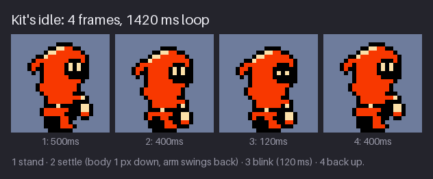
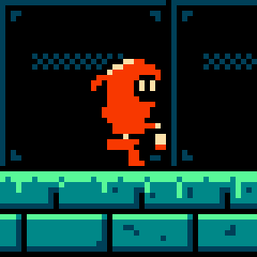
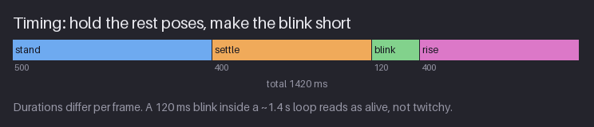
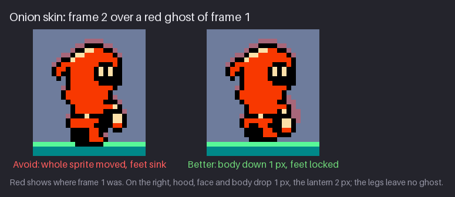
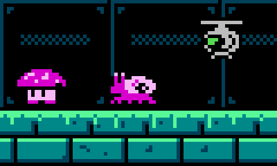
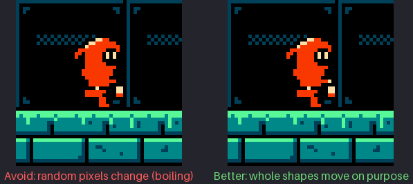
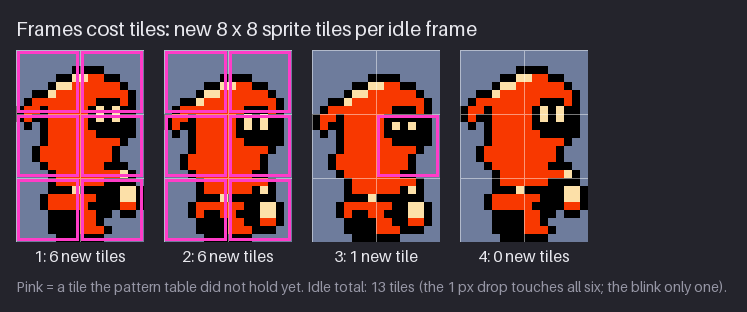
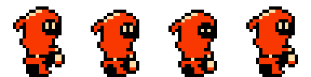

# Chapter 8 — Animation Basics and the Idle

Up to now every sprite in `hollow-vault` has been a single still image. This chapter makes them
move. Animation in pixel art is a short list of drawings (frames), each shown for a set time, and
almost all of the craft is in two choices: what changes between one frame and the next, and how
long each frame stays on screen. NES games made those choices under hard limits. Every new pose
costs 8×8 tiles in a small pattern table, so their animations use few frames, hold poses for a
long time and move parts by single pixels. Those limits are also good teachers: with four frames
there is no room to hide a bad pose.

By the end of the chapter you will be able to read and plan an animation as frames plus
durations, tell timing from spacing, check your frames with onion skin, give a character and a
few creatures an idle that feels alive without twitching, avoid "boiling", and count what each
frame costs in tiles. In the project, Kit gets a 4-frame idle and the spore hopper gets a 2-frame
idle, each with a small JSON file that tells a game engine how to play it.

Previous: [Chapter 7](07-texture-and-dithering.md). Next: [Chapter 9](09-walk-and-run.md).

## Frames, timing, spacing

An animation is a list of frames and a duration for each one. That is all a game engine needs:
"show frame 1 for 500 ms, then frame 2 for 400 ms, …, then go back to frame 1". It helps to keep
the two halves separate in your head, because they fix different problems.

- **Frames** are the drawings. They decide *what* the movement is: a nod, a breath, a step.
- **Durations** decide *how it feels*: lazy, nervous, heavy, snappy. The same four drawings can
  look like a sleepy breath or a panicked pant depending only on the numbers.

Most tools and tutorials talk in frames per second (fps). Games and the JSON in this course store
milliseconds per frame, because real animations rarely run at one even speed. This table converts
between the two, and adds the NES column: how many 60 Hz screen refreshes ("ticks") a frame lasts.

| Frames per second | ms per frame | NES ticks (60 Hz) | Feels like |
|---|---|---|---|
| 30 | 33 | 2 | very smooth; rare in pixel art |
| 15 | 67 | 4 | fast action, effects |
| 12 | 83 | 5 | a common "full" animation rate |
| 10 | 100 | 6 | quick cycles (the drone's rotor) |
| 8 | 125 | 7 or 8 | a relaxed walk |
| 6 | 167 | 10 | slow, deliberate motion |
| 2 to 2.5 | 400 to 500 | 24 to 30 | held poses in an idle |

To convert milliseconds to ticks, divide by 16.7 and round. A 120 ms frame is 7.2 ticks, so a NES
game would show it for 7 ticks (117 ms). Nobody can see that 3 ms difference; what matters is that
on the NES every duration is a whole number of ticks.

### Keys, breakdowns and in-betweens

Animators plan a movement in three layers.

- **Keys** are the poses that tell the story: for an idle, "standing" and "settled". If you show
  someone only the keys, they should understand the action.
- **Breakdowns** are the frames that decide *how* you get from one key to the next: does the head
  arrive before the body, does the arm swing out on the way?
- **In-betweens** fill the remaining gaps so the motion is smooth.

In large-sprite animation you draw keys first and add breakdowns and in-betweens until it is
smooth enough. At NES sizes you often stop after the keys. Kit is 24 px tall; the whole idle
movement is 1 px. There is nothing to put between "here" and "1 px lower", so an in-between would
just be a copy of one of the keys. Small sprites animate in *jumps* of 1 px, and the durations do
the work that in-betweens do in bigger art.

### Timing versus spacing

These two words come from traditional animation and are worth keeping apart:

- **Timing** is how long the movement takes in total, and how long each frame is held.
- **Spacing** is how far things move between frames. Big gaps read as fast; small gaps as slow.
  Gaps that grow from frame to frame read as speeding up (ease-in); gaps that shrink read as
  slowing down (ease-out).

With a 1 px move you cannot vary spacing much: the gap is either 0 or 1 px. So at NES sizes you
get "ease" from timing instead. Hold the frame before a move a little longer and the move feels
like it was prepared; hold the frame after a move a little longer and it feels like it settled.
Kit's idle does exactly that: the up pose is held for 500 ms, and the down pose for 400 ms.

### The principles, in one paragraph

Disney animators Frank Thomas and Ollie Johnston wrote down twelve principles of animation in
1981, and they still name most of what makes motion believable. The ones you will use in every
chapter of this part are **squash and stretch** (soft things change shape when they move or land,
but keep their volume), **anticipation** (a small move the other way before a big move),
**follow-through and overlapping action** (loose parts such as a hood tip or a lantern keep going
after the body stops, and different parts arrive at different times), **slow in and slow out**
(ease, which at this size means timing), **arcs** (natural motion curves), **timing** itself, and
**exaggeration** (push poses further than real life so they read at a small size). The others
(staging, straight-ahead versus pose-to-pose, secondary action, solid drawing and appeal) matter
too, but are mostly about the drawing and the scene. Alan Becker's video series in Further study
shows each one in a few minutes. This chapter uses three of them lightly: a little squash, a
little follow-through, and a lot of timing.

### Loops and one-shots

An animation either **loops** (idle, walk, run, a hovering drone: the last frame flows back into
the first) or plays **once** (a jump, an attack, a hit: it ends on a pose and something else takes
over). For a loop, always check the seam: the change from the last frame back to the first should
look like any other change in the cycle. A one-shot needs an ending pose that the next animation
can start from. Both kinds are stored the same way; the JSON in this course has a `"loop"` flag.

> **Try it (2 minutes).** Take any sprite you have drawn and copy it to a second frame. In the
> copy, move the top half of the sprite 1 px down. Play the two frames at 500 ms each, then at
> 100 ms each. Same drawings: one should look like a calm breath, the other like shivering.

## The idle

The idle is what a character does when the player does nothing. It is on screen more than any
other animation, so it sets the character's personality: calm, nervous, tired, heroic. It also
has a job: it tells the player "the game is running and this character is ready". A frozen sprite
can look like a crashed game.





Kit's idle has four frames:

1. **Stand** (500 ms). The pose from Chapter 6, unchanged.
2. **Settle** (400 ms). Everything above the legs moves 1 px down: hood, face, mantle, tunic,
   sleeve and lantern. The lantern arm also swings: the hand and lantern drop a further 1 px and
   move 1 px back, so the lantern drops 2 px in total. The feet stay exactly where they were.
3. **Blink** (120 ms). The settle pose with the eyes shortened from 2 px to 1 px. Only 2 pixels
   change.
4. **Rise** (400 ms). Back to the stand pose. In the current files this frame is pixel-identical
   to frame 1.

That last point is worth being honest about. Because frame 4 equals frame 1, the loop really
shows the up pose for 900 ms in a row (400 ms + 500 ms) and the down pose for 520 ms. Why keep a
fourth frame at all? Two reasons. It costs nothing in tiles (more on that below), and it gives a
slot where you can later add variation: a head that rises a moment after the body, a lantern that
swings a little further. Exercise 2 uses that slot. If you are building your own idle and have
no plans for the slot, 3 frames with durations 900, 400, 120 play the same.

The rules this idle follows are the rules of almost every good pixel idle:

- **Feet stay planted.** The ground does not move, so the feet must not move either. If the feet
  slide or sink, the character looks like it is floating or melting.
- **The mass goes down, not the whole sprite.** Breathing out, a body sags; breathing in, it
  rises. Move the heavy part (head and torso) and leave the base.
- **Loose parts lag or overshoot.** The lantern hangs from a hand, so it swings a little more than
  the body. That one extra pixel is follow-through, and it makes the lantern feel like an object
  with weight rather than part of the body.
- **1 px is enough.** On a 24 px character, 1 px is about 4% of the height, already far more
  than a real breath moves a body. That exaggeration is what makes it visible at this size; a
  2 px bob reads as bouncing, not breathing.
- **The face does something occasionally.** A blink is the cheapest sign of life there is.

> **Try it (5 minutes).** Draw a 2-frame breathe for any character of yours. Frame 2: move
> everything above the hips 1 px down, keep the feet exactly in place, and fix the place where the
> body meets the legs (the waist will now overlap the top row of the legs). Play it at 500 ms /
> 400 ms. If it looks like bouncing, check that the head and the body moved together and the feet
> did not move at all.

> **Tool aside.** Every animation editor has a timeline with one cell per frame. In Aseprite and
> LibreSprite you add a frame with Alt+N (it copies the current one) and play with Enter.
> Pixelorama has the same idea, with a "+" button and a play button on its timeline. In Krita you
> enable the Animation workspace and draw on keyframes in the timeline; GraphicsGale, Pyxel Edit
> and Piskel all have a frame list beside the canvas. Whatever you use, set it to show the canvas
> at a fixed integer zoom while it plays, and keep a 1× preview open too.

## Timing



The bar chart shows Kit's idle the way a game sees it: a 1420 ms loop split into four uneven
pieces. Three ideas are behind those numbers.

**Rest poses get the long holds.** The stand and the settle are the two keys, so they get most of
the time. If every frame were 355 ms (the same 1420 ms split evenly), the blink would last a third
of a second, which looks like a sleepy droop, and the settle would end too soon.

**The blink is short.** A quick real blink lasts roughly 100 to 150 ms. At 120 ms (7 ticks) the eyes
shut for long enough to be seen and no longer. Longer than about 200 ms and it stops being a blink
and starts being a sleepy or suspicious look. That can be a nice idea for a different character, but
it should be a choice.

**The loop length decides the mood.** Around 1.5 s is roughly a calm breath. At 700 ms the same
frames look out of breath; at 3 s they look half asleep. Nervous characters get short loops,
heavy ones get long holds.

A useful habit is to say each duration aloud while the animation plays: "staaand, settle, blink,
rise". If one beat feels rushed or stuck, change only that frame's duration, never the drawings
first. Change one duration at a time, by about 20% (for example 400 → 480 ms), and watch at least
three loops before you decide.

The blink is also a timing trick in a second way. The player sees it every 1.4 s, which is quite
often. A real game would usually play a plain breathing loop several times and only then a loop
with a blink, or pick blinks at random. That is a programming choice, not an art one: you draw one
blink frame and the code decides when to use it. Chapter 13 comes back to these "living" details.

> **NES rule:** The NES draws a new screen about 60 times per second (NTSC; PAL machines run at 50).
> Games updated their animations once per screen, so every duration was a whole number of these
> ticks: 500 ms is 30 ticks, 400 ms is 24, and 120 ms is about 7. This course stores milliseconds
> because modern engines use them; to plan for real hardware, divide by 16.7 and round.

> **Try it (3 minutes).** Play Kit's idle (`project/ch08/preview/kit-idle.gif`) next to your
> breathing loop from the last section. Then change your loop to 200 ms / 200 ms and to
> 900 ms / 900 ms. Write one word for the mood of each version.

> **Tool aside.** In Aseprite, LibreSprite and Pixelorama you set the duration of each frame
> separately (Frame Properties, or right-click the frame in the timeline), and they export those
> durations into GIFs and JSON. Krita works in a fixed frame rate instead: you hold a drawing for
> several timeline frames, so at 24 fps a 120 ms blink is 3 frames and a 500 ms hold is 12.
> Piskel and some web tools play every frame at one fps; for those, duplicate frames to make a
> long hold, and remember to remove the duplicates (or merge their durations) when you export.

## Onion skin

When frames differ by one pixel, you cannot judge them by flipping back and forth: your eye sees
"something moved" but not what. **Onion skin** fixes that. The editor draws the previous frame
(and often the next) faintly under the current one, usually tinted red for "before" and
blue or green for "after", so you can see every pixel that changed.



The figure shows the settle frame over a red ghost of the stand frame, standing on a strip of
Greenhouse floor. On the left (Avoid), the whole sprite was simply moved 1 px down: the red ghost
shows along every top edge, but it also shows that the feet have sunk 1 px into the floor. In a
game that reads as Kit bobbing like a buoy. On the right (Better), only the hood, face and body
moved 1 px, and the lantern 2 px (it swings a little further); the legs leave no ghost at all, and the feet still stand on the top row of the
floor. That is what "feet locked" looks like under an onion skin.

Habits that make onion skin useful:

- **One frame back, low opacity.** Showing more frames turns the canvas into soup. Turn the next
  frame on only when you are checking a loop seam or an in-between.
- **Look for ghosts where none should be.** The most useful question is "what should *not* have
  moved?". For an idle that is the feet; for a walk (Chapter 9) it is the planted foot.
- **Check the silhouette, then the inside.** First check that the outline moved as intended, then
  look for single pixels that changed by accident inside the shape (a shading pixel nudged, an
  outline corner missing). Those are the seeds of boiling (below).
- **Turn it off and watch like a player.** Onion skin is for editing. To judge the result, hide
  it, set the zoom to 1× or 2×, put the sprite on its real background and watch at full speed for
  ten loops. Players see sprites at that size, against that background, while they are busy doing
  something else. Anything that draws your eye in that view will draw theirs.

> **Try it (3 minutes).** Open your 2-frame breathe and turn on onion skin. Count the pixels that
> show a red ghost below the hips. The answer should be zero. If it is not, fix them and watch the
> loop again.

> **Tool aside.** Aseprite and LibreSprite: View → Show Onion Skin (F3), with settings for how
> many frames and their tint. Pixelorama: the onion skin button in the timeline, with past and
> future colours. Krita: the Onion Skins docker. Piskel and GraphicsGale have an onion skin toggle
> beside the frame list. If your tool has no onion skin, copy the previous frame to a layer
> beneath, set it to 30% opacity, and delete it when you are done.

## Creature idles

Enemies need an idle too, and on the NES it usually tells the player as much about *behaviour* as
about personality. A slow, heavy idle says "this one is not in a hurry"; a fast one says "watch
out".



The figure plays the three Greenhouse creatures on one 100 ms clock, so their rhythms are easy to
compare.

- **The spore hopper** (16×16, sprite sub-palette SP1: `$0F $14 $34`) has 2 frames of 400 ms. In
  frame 2 its cap drops 1 px and widens by 1 px on each side, and its body gets one row shorter.
  The feet stay on the same row. That is squash: the cap gets wider as it gets lower, so it looks
  soft and keeps its volume. The rhythm is slow and even: this is a creature that waits.
- **The slug** (SP1 too) has 2 frames of 260 ms. Its body stretches 1 px at the front and its eye
  stalks rise 1 px. Slightly faster than the hopper, so it looks restless, as if it is about to
  crawl off, which is what it will do in Chapter 12.
- **The drone** (SP3: `$0F $10 $2A`, light grey with a green lens) has 4 frames of 100 ms. Its
  rotor alternates between wide and narrow every 100 ms, while its body bobs 1 px every 200 ms.
  Two rhythms on one sprite: the fast rotor says "machine", the slower bob says "hovering in air".
  A flying thing that did not bob would look stuck to the background.

Notice what the three do *not* do. None of them moves its base: the hopper's feet never change,
the slug stays on the same row and only reaches its front 1 px forward, and the drone's bob is a
whole-body move that reads as flight, not as sinking. None
of them changes more than a few rows of pixels. And none of them uses more than 4 frames.

A note about the hopper: in the squashed frame its cap reaches the left and right edges of the
16×16 cell, and there is no room for the black outline on those two rows. On the dark Greenhouse
wall it still reads, because the outline would be black against black anyway. On a bright
background you would want the cap 1 px narrower, or the outline drawn inside the cell. Keep 1 px
of margin in a sprite cell when you plan a squash.

Different creatures of the same kind should not all breathe in step. A row of hoppers that squash
together looks mechanical (sometimes that is the point: guards, machines, a dance). The fix is in
code, not art: start each copy at a different frame or delay. Remember this when Chapter 16 puts
several creatures in one room.

> **Try it (4 minutes).** Draw a 16×16 blob creature standing on a flat base. Frame 2: lower its top
> 1 px and make it 1 px wider on each side; keep its base row the same. Play it at 400 / 400 ms,
> then at 150 / 150 ms. Which version is the guard and which is the hunter?

## Boiling

**Boiling** is the shimmer you get when pixels change from frame to frame for no reason. It
happens when each frame is redrawn instead of copied and edited: the outline wobbles by a pixel
here and there, a shading pixel appears and disappears, and the sprite seems to fizz. In
hand-drawn animation a little boil is sometimes used on purpose, for a lively, sketchy feel. At
NES size it almost never helps: there are so few pixels that every accidental change is visible,
and the player reads it as noise.



On the left of the figure, Kit's stand pose is copied four times and in each copy up to ten random
pixels take a neighbour's colour; the four copies cycle at 120 ms. Nothing in the pose moves, yet
the eye cannot rest on it, and the outline and the face are the worst. On the right is the real
idle: long stretches where nothing changes at all, then a whole part of the body moves by 1 px. The
right side looks calmer *and* more alive.

How to avoid boiling:

- **Copy, then edit.** Start every new frame as a copy of the one before it. Change only the parts
  that move.
- **Move parts as blocks.** Select the part (head, arm, lantern), move it by whole pixels, then
  repair the joins. Do not redraw a part that only moved.
- **Repair the join, not the part.** After a move, the only pixels that need hand work are where
  the moved part meets the still part: Kit's waist in the settle frame, for example.
- **Check with onion skin and a diff.** Every ghost pixel should belong to a part you meant to
  move. Some editors can show the difference between two frames; if yours cannot, count by eye.

Boiling is fine in one place: things that really are random. Fire, sparks, water froth and static
on a screen *should* change in irregular ways. Even then, NES effects usually cycle 2 to 4 fixed
frames rather than truly random ones, both to save tiles and so the eye can learn the pattern.
Chapter 11 draws those effects.

> **Try it (2 minutes).** Duplicate any sprite of yours three times. In each copy, change three
> pixels on the outline at random. Play the four frames at 120 ms. Then play the original alone.
> That fizz is what a hand-redrawn idle looks like to a player.

## Frames cost tiles

On the NES a sprite is not stored as one picture. It is built from 8×8 hardware sprites, and each
one shows an 8×8 tile from the sprite pattern table. Kit's body fills a 16 px wide part of the
24×24 cell (columns 4 to 19), so each frame is 2 × 3 = 6 hardware sprites. A new frame of
animation is only free if all its 8×8 tiles are already in the pattern table. Every tile that
differs from all the tiles already there must be added.



The figure marks in pink the tiles each frame adds:

- **Frame 1: 6 new tiles.** Nothing is in the table yet.
- **Frame 2: 6 new tiles.** The 1 px drop touches all six. That may be a surprise: surely the legs
  did not change? They did not move, but the bottom row of tiles holds more than legs. The tunic's
  hem drops into it and covers the top row of the legs, and the lantern hangs in it too. Any
  change to any pixel makes a new tile.
- **Frame 3: 1 new tile.** The blink changes 2 pixels, and both are in the same tile.
- **Frame 4: 0 new tiles.** It is a copy of frame 1, so it reuses all six of frame 1's tiles.

So the whole idle costs 13 tiles. For comparison, four completely different frames would cost 24.
The blink is the best deal in the chapter: a full sign of life for one tile.

There are two ways NES artists made such moves cheaper, and they are worth knowing even if you
never write a byte of NES code.

- **Keep the change out of tiles that need not change.** A character whose moving parts all sit
  in the top two rows of tiles could reuse its bottom tiles (the legs) in every idle frame. Kit's
  settle cannot, because both the hem and the lantern reach into the bottom row. When you design a
  character for a tile budget, look at where its tile rows fall and keep the moving parts away
  from the rows you want to reuse.
- **Move the hardware sprite instead of the pixels.** Each hardware sprite has its own position on
  screen. A game can move the top four sprites 1 px down without any new tiles at all, which is a
  common way to bob a head or a body. The catch is that a whole 8×8 tile moves, so the join
  between moved and unmoved tiles must still look right. Kit's tunic continues past the tile line
  into the bottom row, so for Kit that trick would leave a step in the tunic at the join.

This course draws each frame as a full picture, because that is how you work in an editor and
how modern engines play animations. Counting tiles is how you keep the art honest to the NES.

> **NES rule:** A sprite pattern table holds 256 tiles of 8×8. Everything that moves on screen at
> one time (Kit, the enemies, effects, sometimes the HUD) has to share those 256 tiles. Kit's idle
> uses 13, about 5%. Walking, running, jumping, attacks and hits in the next chapters will cost far
> more, so the budget matters from now on. Games swapped parts of the pattern table (CHR banks)
> to fit more; Chapter 24 explains how.

> **Try it (3 minutes).** Put an 8×8 grid over the two frames of your breathing loop (most editors
> have a grid setting; set it to 8×8). Count how many tiles in frame 2 are different from every
> tile in frame 1. Then see if you can move the waist so that one row of tiles does not change at
> all.

## Project: Kit's idle and the hopper idle

The `hollow-vault` pack gains four files and four previews this chapter:

| File | Size | What it is |
|---|---|---|
| `sprites/kit-idle.png` | 96×24 | Kit's 4 idle frames in a row, 24×24 each |
| `sprites/kit-idle.json` | | frame size, palette, durations |
| `enemies/hopper-idle.png` | 32×16 | the hopper's 2 idle frames, 16×16 each |
| `enemies/hopper-idle.json` | | the same, for the hopper |
| `preview/kit-idle-4x.png`, `preview/kit-idle.gif` | | previews |
| `preview/hopper-idle-4x.png`, `preview/hopper-idle.gif` | | previews |




The hopper's two frames live in `enemies/` for now; Chapter 12 replaces `hopper-idle.*` with the
hopper's full sheet, `enemies/hopper.{png,json}`, where this idle becomes one animation of several.

### The sheet format

A **sprite sheet** is one image with all the frames of one or more animations laid out on a grid.
The course uses the simplest layout: each animation is one row, frames go left to right, every
cell is the same size. Kit's idle sheet is 4 cells of 24×24, so 96×24. The sheet uses only the
four colours of its sprite sub-palette, with slot 0 as transparency, so it stays a valid NES-style
sprite.

The JSON file beside it tells an engine how to cut and play the sheet. This is
`sprites/kit-idle.json`, shown compactly:

```json
{
  "image": "kit-idle.png",
  "frameWidth": 24, "frameHeight": 24,
  "palette": ["$0F", "$0F", "$16", "$37"],
  "paletteRGB": ["#000000", "#000000", "#f83800", "#fce0a8"],
  "animations": {
    "kit-idle": { "row": 0, "frames": 4, "durations": [500, 400, 120, 400], "loop": true }
  }
}
```

- `frameWidth` and `frameHeight` say how to cut the sheet.
- `palette` lists the sprite sub-palette SP0 in NES colour numbers. Slot 0 is transparent, so its
  value does not matter; the file writes `$0F` there. `paletteRGB` gives the same colours as RGB,
  for engines that do not know the NES palette.
- Each animation names its row, its frame count, one duration per frame in milliseconds, and
  whether it loops.

`enemies/hopper-idle.json` has the same shape: 16×16 frames, palette `$0F $0F $14 $34`
(`#d800cc`, `#f8b8f8`), one animation with 2 frames of 400 ms, looping. Later chapters add more
rows (walk, run, jump) and more animations to the same structure; nothing about the format will
change.

> **Tool aside.** Aseprite and LibreSprite export a sheet and a JSON with File → Export Sprite
> Sheet. Their JSON layout is different from this course's (it lists every frame with its position),
> but holds the same information. Pixelorama exports sheets from its export dialog, and Krita can
> render a sequence of PNGs that a sheet-packing tool or a short script combines. Any of them is
> fine; what matters is a fixed cell size, one animation per row, and durations recorded somewhere.

### Kit's idle, step by step

1. **Set up.** Make a 96×24 canvas, or a 24×24 canvas with 4 frames. Paste `sprites/kit-stand.png`
   from Chapter 6 into frame 1. Turn on a 24×24 grid (or a 8×8 grid, to see tiles).
2. **Copy frame 1 into frames 2, 3 and 4.** From now on you only edit copies.
3. **Settle (frame 2).** Select everything above the legs: hood, face, mantle, tunic and the arm
   with its lantern. Move the selection 1 px down. Now repair the waist: the bottom row of the
   tunic covers the top row of the legs; make sure the leg outline still meets the tunic cleanly.
4. **Swing the lantern (frame 2).** Select the hand and lantern only. Move them 1 px down and 1 px
   back (to the left, away from the direction Kit faces). Repair the sleeve so the arm still joins
   the hand. The lantern now hangs 2 px lower than in frame 1.
5. **Blink (frame 3).** Copy frame 2 over frame 3. Shorten each eye from 2 px to 1 px by turning
   its top pixel into the face colour. Only 2 pixels change.
6. **Rise (frame 4).** Leave it as the copy of frame 1.
7. **Set the durations** to 500, 400, 120, 400 ms.
8. **Check.** Onion skin on frame 2: no ghost below the waist. Then onion skin off, 1× zoom, on
   the Greenhouse wall from Chapter 7, ten loops. It should look calm, and the lantern should feel
   a little heavier than the body.
9. **Export** the 96×24 sheet, a 4× preview strip and a GIF, and write the JSON.

### The hopper idle, step by step

1. Make a 32×16 canvas (or 16×16 with 2 frames) in SP1: `$0F` outline, `$14` magenta, `$34` light
   pink, transparent background. Draw the hopper standing: a wide spotted cap on a short pale body
   with two feet, leaving the bottom row of the cell empty.
2. Copy it to frame 2. Move the cap 1 px down, then widen it by 1 px on each side. The body loses
   one row, because the cap now covers it. The feet do not move.
3. Re-place the spots so that they sit on the cap's new, flatter shape. Keep them about the same
   size and number, or the cap will seem to change material.
4. Set both durations to 400 ms. Check with onion skin that the bottom rows match exactly.
5. Export the 32×16 sheet, a 4× preview, a GIF and the JSON.

## Exercises

### 1. A 2-frame breathing idle

Give your own hero (or Kit from `sprites/kit-stand.png`) a 2-frame breathing idle.

**What to look for:**

- Frame 2 moves only the upper body, by exactly 1 px.
- The feet are identical in both frames: zero ghost pixels below the hips under onion skin.
- The waist join is repaired: no gap and no doubled outline where the body overlaps the legs.
- At 1× and at 400 to 500 ms per frame it reads as breathing, not bouncing.

<details><summary>Example solution</summary>


Frames 1 and 2 of the strip are the 2-frame breathe. The lantern dropping one extra pixel is
optional, but it is what makes the breath feel weighted.

</details>

### 2. Add a blink and tune the timing

Add a blink frame to your breathing idle and set a duration for every frame. Then use the fourth
slot: make frame 4 differ from frame 1 in one small, deliberate way.

**What to look for:**

- The blink is shorter than 200 ms and changes only the eyes.
- The rest poses each last 400 to 600 ms; the total loop is about 1.2 to 2 s.
- Frame 4 changes something that helps the motion: for example the hood or head still 1 px low
  while the body has risen (overlap), or the lantern still swinging.
- The loop seam (last frame back to first) looks like any other change in the loop.

<details><summary>Example solution</summary>


The course's version keeps frame 4 equal to frame 1, so the up pose is held for 900 ms in a row.
If your frame 4 lags the head by a pixel, keep its duration short (150 to 250 ms) so that the
head catches up before the hold.

</details>

### 3. Onion-skin check: what moved?

Turn on onion skin for frame 2 of Kit's idle (`sprites/kit-idle.png`) with frame 1 as the ghost.
Without looking at the step-by-step list, write down every part that moved and by how much. Then
do the same for your own idle.

**What to look for:**

- You find all of: hood, face, mantle, tunic, sleeve and lantern 1 px down; hand and lantern a
  further 1 px down and 1 px back.
- You notice that the legs did not move, and that the tunic now covers the top leg row.
- In your own idle, every ghost pixel belongs to a part you meant to move.
- Nothing changed by accident inside a shape (no stray shading pixels).

<details><summary>Example solution</summary>


The right-hand panel is Kit's real settle frame. If your own idle looks like the left-hand
panel, select only the upper body and move that instead.

</details>

### 4. A 2-frame creature idle

Draw a 16×16 creature and give it a 2-frame idle that says something about how it behaves: slow
and waiting, restless, or mechanical.

**What to look for:**

- The base (feet, belly, bottom row) does not move, unless the creature flies.
- One shape changes by squash or stretch, and keeps its volume (wider as it gets lower).
- The sprite keeps 1 px of margin inside its cell, so the outline survives the squash.
- The timing matches the behaviour: long holds for waiting, short for restless.
- Uses one sprite sub-palette: transparent, black and two colours.

<details><summary>Example solution</summary>


The hopper squashes its cap at 400 ms per frame; the slug stretches at 260 ms; the drone uses two
rhythms (rotor every 100 ms, bob every 200 ms). The hopper's squashed cap touches the edges of its
cell: a case where 1 px of margin would have been better.

</details>

## Recap

- An animation is frames plus a duration for each. Frames decide what moves; durations decide how
  it feels.
- Keys tell the story; breakdowns and in-betweens smooth it. At NES size you often stop at the
  keys and move in 1 px jumps.
- Timing is how long; spacing is how far. With 1 px moves, ease comes from timing: hold before and
  after a move.
- Loops need a clean seam; one-shots need an ending pose the next animation can start from.
- A good idle: feet locked, the upper body drops 1 px, loose parts lag or overshoot, the face does
  something occasionally.
- Kit's idle: stand 500, settle 400, blink 120, rise 400 ms (1420 ms). Frame 4 equals frame 1.
- A blink of about 120 ms reads as a blink; above about 200 ms it reads as a look.
- Onion skin: one frame back, low opacity; ask "what should not have moved?". Then turn it off and
  watch at 1× on the real background.
- Creatures: the idle hints at behaviour. Squash keeps volume; keep 1 px of margin in the cell.
- Boiling is accidental change between frames. Copy, then edit; move parts as blocks.
- Every changed pixel makes a new 8×8 tile. Kit's idle costs 13 tiles: 6 + 6 + 1 + 0.
- NES rule: 256 sprite tiles per pattern table, shared by everything that moves on screen; NES
  animations step in whole 60 Hz ticks.

## Further study

- Alan Becker, **"12 Principles of Animation (Official Full Series)"** (YouTube) —
  <https://www.youtube.com/watch?v=uDqjIdI4bF4>. Each principle with a short, clear example; watch
  timing, squash and stretch, and follow-through closely, as those carry most of the weight at
  small sizes.
- AdamCYounis, **"Pixel Art Class - Simple Character Idle Animation"** (YouTube) —
  <https://www.youtube.com/watch?v=vs-ierVdE7I>. A pixel idle built step by step; notice which
  parts stay still and how few pixels move.
- Raymond Schlitter (Slynyrd), **"Pixelblog 8 – Intro to Animation"** —
  <https://www.slynyrd.com/blog/2018/8/19/pixelblog-8-intro-to-animation>. Frames, timing and
  simple loops for pixel sprites, with clear frame-by-frame breakdowns.
- Pedro Medeiros (Saint11), **"3 - A Basic Aseprite Animation"** (Pixel Art Articles) —
  <https://saint11.art/pixel_art_articles/article3/>. A short, illustrated guide to a first
  animation; compare its frame counts with the ones in this chapter.
- Pixel Overload, **"The secrets to good Pixel Art animation! (Animation tutorial)"** (YouTube) —
  <https://www.youtube.com/watch?v=J1sFBDQt8J0>. Common animation mistakes and how to fix them;
  watch for the parts on stiffness and on too much movement.

Sources for this chapter: [REFERENCES.md](REFERENCES.md#chapter-8--animation-basics-and-the-idle)
