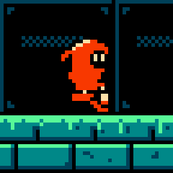
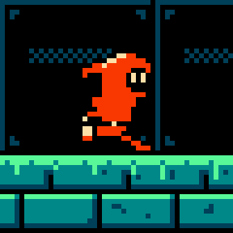
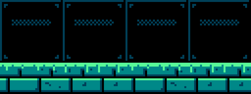

# Chapter 9 — Walk and Run Cycles

Kit can stand and breathe. Now Kit has to move. A walk is the animation the player sees more than
any other: it plays every time they press left or right. That makes it worth doing well, and it
also means every frame of it lives in the sprite pattern table for the whole game. Many NES heroes
walk in three or four frames, and at 16×24 that is plenty. This chapter builds Kit's walk from
four drawings: two *contacts* (legs apart) and two *passing* poses (legs together, body 1 px up).
Then it changes the timing, the lean and the stride to turn the same four-frame plan into a run.

The drawing is only half of a walk. The other half is the speed: the game slides the sprite across
the screen while the frames play in place, and if those two do not agree, Kit's feet skate on the
floor. You will learn to measure a stride, turn it into a speed, and check the result on the
Greenhouse floor. The chapter ends with mirroring: on the NES every sprite can be flipped for free,
so Kit can face left without a single new tile.

By the end of the chapter, `hollow-vault` has two new animations: `kit-walk` (4 × 140 ms) and
`kit-run` (4 × 90 ms).

Previous: [Chapter 8](08-animation-basics-and-idle.md). Next: [Chapter 10](10-jump-and-fall.md).

## The 4-frame walk

A walk is a controlled fall. The body tips forward, a leg swings out to catch it, the weight
rolls over that leg, and the body tips forward again. Each catch is a **contact**: the moment the
front heel meets the ground with both legs spread. Between two contacts the free leg swings past
the standing one; the moment the two legs are side by side is the **passing** pose.

A full cycle has two steps (left foot, right foot), so it has two contacts and two passes. Large
sprites add more in-betweens (a *down* pose after each contact, an *up* pose after each pass),
which gives the 8-frame walks of animation textbooks. At 24 px the in-betweens would differ from
their neighbours by one or two pixels, so you can leave them out and let the eye fill the gaps.
Four frames is the usual NES answer:

![Kit's walk as four frames on a slate-blue background, each labelled 140ms. Frame 1: legs apart,
the red front leg forward, the black back leg behind, lantern hanging slightly back. Frame 2: legs
together under the body, the body 1 px higher. Frame 3: legs apart again, but now the black leg is
in front and the red leg behind, lantern swung forward. Frame 4: legs together, body up 1 px.
Caption: contact (legs apart) and passing (legs together, body 1 px up), then mirrored; the arm
swings opposite to the front leg.](images/ch09-walk-strip.png)

| Frame | Pose | Legs | Body | Lantern | Duration |
|---:|---|---|---|---|---:|
| 1 | contact | red (near) leg in front, black (far) leg behind | rest height | swung back 1 px | 140 ms |
| 2 | passing | legs together, near leg forward of the far one | up 1 px | hanging | 140 ms |
| 3 | contact | black leg in front, red leg behind | rest height | swung forward 1 px | 140 ms |
| 4 | passing | legs together, far leg forward of the near one | up 1 px | hanging | 140 ms |

Things to notice:

- **The near leg is red, the far leg is black.** Kit has only three colours, so there is no
  "slightly darker red" for the far leg. Black does the job: it reads as the leg in shadow, behind
  the body. It also makes the two contacts easy to tell apart at 1×. In frame 1 the red leg leads;
  in frame 3 the black leg leads. Without that difference the walk would look like a hop.
- **The body is highest on the passing frames.** On a contact the legs are spread like an
  upside-down V, so the hips are low. On a pass the standing leg is straight under the body, so
  the hips are at their highest. One pixel of bob is enough at this size; two would make Kit
  bounce like a ball.
- **The arm opposes the legs.** When the red (near) leg is in front, the lantern arm swings back;
  when the near leg is behind, the lantern swings forward. People walk this way to balance the
  twist of the hips, and a walk without it looks stiff. Kit's swing is tiny (the lantern moves 1 px
  each way), but you can see it in the GIF.
- **The feet stay on one row.** Every planted foot sits on row 22 of the 24×24 cell, with its
  outline on row 23. The body moves; the ground does not. A foot that sinks 1 px into the floor on
  one frame shows up at once as a limp.
- **The timing is even.** A cycle should feel like a steady rhythm, so every frame gets the same
  140 ms. A walk with uneven timing reads as a limp, a sneak or a heavy creature, which is useful
  when you want it and a bug when you do not.

The two contacts are the key poses: they fix the stride, the height of the hips and which leg is
in front. Draw them first, check them against each other, and only then draw the passes between
them. If the contacts are wrong, no amount of work on the passes will save the walk.

**Try it (5 minutes).** On a 24×24 canvas, draw a stick figure 20 px tall in a contact pose: legs
in a V, the front foot 4 px ahead of the hips, the back foot 4 px behind. Copy it and draw a pass:
legs together, body 1 px up. Duplicate both, swap which leg is dark, and play the four frames at
140 ms. Then set the bob to 0 and play again: the walk loses its weight.

> **Tool aside.** Onion skin shows the previous and next frame as faint ghosts, which is the
> easiest way to check that the feet sit on the same row and that the pass lies halfway between
> the contacts. Aseprite, LibreSprite, Pixelorama and Krita all have it, usually as a toggle in
> the timeline. Piskel shows the previous frame faintly when "onion skin" is enabled in the layers
> panel. Set the ghosts to one frame on each side; more just adds noise at this size.

## What changes

The changes between frames are small, but they are not where you might expect. The next figure
marks in pink every pixel that differs between two frames:

From one contact to the other only 39 pixels change: the legs swap colour and the lantern moves.
From a contact to a pass, 143 pixels change, because the 1 px bob moves every edge of the hood,
face and body, and each edge pixel becomes either sprite or background. That is the point of the
bob: a one-pixel move of a whole shape is the largest change you can make for the least drawing,
and the eye reads it as weight going up and down.

Two lessons follow from these numbers.

- **Small moves of big shapes read more strongly than big moves of small shapes.** If a walk
  looks flat, raise the whole body by 1 px before you start redrawing limbs.
- **Every changed pixel can cost a tile.** On the NES each frame is built from 8×8 sprite tiles
  stored in the pattern table (Chapter 8). Cut on a fixed 2×3 grid, the four walk frames use 17
  different tiles, plus one more for frame 3, where the outline of the forward-swung lantern
  sticks 1 px out of the 16 px box. Without the bob, the walk would need three tiles fewer.
  Three tiles for a walk that feels alive is a good trade; a bob of the legs as well would not
  be.

The far leg is drawn in black. Black is also Kit's outline colour, so in the contacts the far leg
merges with the outline of the near leg where they cross. That is fine: the eye completes the
shape. What matters is that the *silhouette* of the two contacts differs only in the legs, so
nothing else flickers when the cycle loops.

**Try it (3 minutes).** Take any two frames of your own walk and put one on a layer above the
other with the "difference" blend mode, or toggle between them quickly. Count, or estimate, the
pixels that change. If the contacts differ anywhere above the hips, find out why: the hood, the
face and the mantle should be identical in both.

## The run

A run is not a fast walk. The body leans into the direction of travel, the stride gets longer, the
arms pump instead of swinging, and loose parts stream behind. Large sprites also show *flight*
frames, where both feet are off the ground. Kit's run uses the same four-frame plan as the walk
(contact, pass, contact, pass) and gets its speed from timing, not from extra drawings:

![Kit's run as four frames, each labelled 90ms. The head is 1 px further forward than in the walk
and the hood tail sticks straight back. Frame 1: long stride, red leg far forward, lantern pumped
back behind the body. Frame 2: the red leg is lifted off the ground and tucked, the body up 1 px.
Frame 3: long stride with the black leg in front and the lantern pumped forward. Frame 4: the
black leg lifted, the body up 1 px. Caption: lean forward, longer stride, flat hood tail, pumping
arm; faster frames, not more frames.](images/ch09-run-strip.png)

What changed from the walk:

- **Lean.** The head is drawn 1 px further forward on every frame. The torso and legs stay where
  they are, so the whole figure tilts. One pixel is all the lean a 16 px wide sprite can take
  before it looks like it is falling over.
- **Hood tail.** In the walk the hood's tail droops behind the head. In the run it sticks out flat
  behind: the air is pushing it back. Loose parts are the cheapest way to show speed, because they
  react to motion without changing the body.
- **Stride.** The run's contacts reach 1 px further forward and 1 px further back than the walk's.
  A planted foot moves 11 px from one contact to the next, against 9 px in the walk.
- **Arms.** The lantern arm pumps: it swings all the way behind the body on frame 1 and forward on
  frame 3, instead of moving 1 px.
- **Passing frames lift a foot.** On frames 2 and 4 one leg is tucked up under the body, its foot
  off the ground row, while the other foot is planted behind; the body is 1 px up, as in the
  walk. Kit never has both feet off the ground. At 90 ms a frame, the lifted foot and the bob are
  enough to read as a run. A bigger hero would add a true flight frame here.
- **Timing.** 90 ms per frame instead of 140 ms. The cycle is 360 ms against the walk's 560 ms.

The rule "faster frames, not more frames" holds for small sprites in general. More frames would
cost more tiles and would make each change smaller, which reads as *smoother*, not *faster*. Speed
comes from the time each pose stays on screen and from how far the feet travel.

**Try it (5 minutes).** Copy your four walk frames. Move the head 1 px forward on all four,
lengthen both contacts by 1 px at each foot, and lift one foot 1 px on each of the two passes.
Play it at 90 ms. Then play it at 140 ms: it should look like a stiff, leaning walk. The timing is
half of the run.

## Walk vs run

Put a walk contact next to a run contact and the difference is clear even without motion:

| | Walk | Run |
|---|---|---|
| Frames | 4 | 4 |
| Frame time | 140 ms | 90 ms |
| Cycle | 560 ms | 360 ms |
| Stride (planted foot, contact to contact) | 9 px | 11 px |
| Lean | none | head 1 px forward |
| Hood tail | droops behind | flat behind |
| Lantern | swings 1 px | pumps behind and in front |
| Passing frames | body up 1 px | body up 1 px, one foot lifted |
| Speed on screen (next section) | about 32 px/s | about 61 px/s |

Two drawings that share the same frame plan are cheap to make and easy to switch between: a game
can blend from walk frame 2 into run frame 3 when the player holds the run button, because the
leg positions line up. If your run has a different number of frames from your walk, plan which
frames match before you switch.

## In the world

The frames play in place: Kit's feet go back and forth inside the 24×24 cell, but the cell itself
never moves. The game moves the cell. If the game moves Kit at the wrong speed, the planted foot
slides along the floor, and the player sees it immediately, because the floor has tiles with edges
and highlights that make the slide obvious.

The rule is simple. While a foot is planted, it must stay on the same floor pixels, so the sprite
must move forward exactly as far as the foot moves backward inside the cell:

> **Speed = stride ÷ step time.** Kit's walk: the planted foot moves 9 px back between frame 1 and
> frame 3, which takes two frames of 140 ms. That is 9 px per 280 ms, or 18 px per 560 ms cycle,
> about 32 px per second, or 4.5 px per 140 ms frame.

![Three panels, each showing two copies of Kit's walk on the Greenhouse floor, the first contact
tinted red and the next contact tinted blue, with a white box where the near foot touched down.
Left, labelled "Avoid: 2 px per frame - foot slides back": the blue copy is only a little ahead
and its planted foot lands well behind the white box. Middle, labelled "Better: 4.5 px per frame -
foot stays put": the blue foot lands inside the white box. Right, labelled "Avoid: 8 px per
frame - Kit skates": the blue copy is far ahead and the foot lands well in front of the
box.](images/ch09-foot-slide.png)

Too slow and the foot slides backward, as if Kit were walking on ice or on a treadmill. Too fast
and Kit glides forward, which looks like skating. The run follows the same rule: the planted foot
moves 11 px per step of two 90 ms frames, so the run should cover 22 px per 360 ms cycle, about
61 px per second, almost twice the walk.

Here are both cycles on the Greenhouse floor, moving at the matched speeds:

| Walk, 18 px per cycle | Run, 22 px per cycle |
|---|---|
|  |  |

Watch the feet, not the body. With the speed matched, each planted foot stays on its brick while
the body passes over it.

Three practical notes:

- **The match is never perfect.** The game moves Kit at a steady speed, but inside the cycle the
  planted foot moves unevenly (by 3, 6, 2 and 7 px from frame to frame in the walk). A slip of a
  pixel or two inside a step is normal and invisible at 1×. A slip that keeps growing over the
  whole step means the speed is wrong.
- **Speeds are often below one pixel per frame.** An NES runs at about 60 frames per second. At
  32 px/s, Kit moves about half a pixel per video frame. Games of that era kept positions with a
  fractional part (sub-pixels) and drew the sprite at the whole-pixel part, so the sprite moves
  one pixel every second frame or so. Your art does not change; it is useful to know when a
  programmer asks for "the walk speed in pixels per frame": 0.54 for the walk, about 1 for the run.
- **Durations become whole video frames.** On hardware an animation timer counts video frames of
  about 16.7 ms, so 140 ms becomes 8 or 9 frames and 90 ms becomes 5. The course keeps durations
  in milliseconds because editors and engines use them; round to frames only when you need to.

If the designer wants a different speed, change the stride (redraw the contacts) or the frame time,
not just the speed. A walk that is too slow for the game is better fixed with a shorter frame time
than with a sliding foot.

**Try it (5 minutes).** Make a 64×32 canvas with a strip of floor tiles along the bottom. Paste
your walk contact at x = 0, then paste the next contact at x = 0 plus your stride. The planted
foot must land on the same floor pixels in both. If it does not, measure how far it is off: that
is how much your speed is wrong per step.

## Mirroring

Kit faces right in every drawing. To face left, the game flips the sprite horizontally. On the NES
this costs nothing: each of the 64 entries in the sprite list (OAM) has a horizontal-flip bit and
a vertical-flip bit, and the hardware reads the tile backwards when the bit is set.

> **NES rule:** Every hardware sprite can be flipped horizontally or vertically by a bit in its
> attributes, so a mirrored frame uses no new tiles. Kept authentic: Kit's left-facing frames are
> exactly the right-facing tiles with the flip bit set.

Flipping each 8×8 tile is only half the job. Kit is a *metasprite*: six hardware sprites placed
in a 2×3 block. If you flip each tile but leave them in place, the two halves of the body swap
inside their own tiles and the figure falls apart. The game must also mirror the positions, so the
left column becomes the right column:

| Tile | Facing right: x offset | Facing left: x offset | Flip bit |
|---|---:|---:|---|
| top-left, middle-left, bottom-left | 4 | 12 | set when facing left |
| top-right, middle-right, bottom-right | 12 | 4 | set when facing left |

(The offsets are measured from the left edge of the 24×24 cell. Kit's body sits from x = 4 to
x = 19, the same distance from both edges, so the mirrored body lands in exactly the same place.
That is one reason the cell is 24 wide: the anchor point at the feet does not jump when Kit
turns.)

What mirroring changes, and why it is usually fine:

- **Handedness.** Facing right, Kit carries the lantern in the near hand, in front of the body.
  Mirrored, the same drawing still shows the lantern in front, so in "real" terms Kit has switched
  hands. Many NES-era heroes switch hands, shields or weapons when they turn, and players accept
  it, because the drawing reads the same in both directions.
- **Light.** Kit's highlights are on the upper back of the hood. Mirrored, they are still on the
  back of the hood, so the light seems to come from the other side. On a single-colour highlight
  of five pixels nobody notices.
- **Asymmetric details.** A badge on one shoulder, a scar on one cheek, text on a shirt: these jump
  sides when flipped. Keep them off the hero, or accept the jump.

**Do not use a flip to make the second half of the cycle.** Frame 3 of the walk is not frame 1
mirrored: the near leg is still red and the far leg still black, and Kit still faces right. A
mirrored frame 1 would face left. The second half of a cycle swaps *which leg is in front*, which
is a redraw (on Kit, a recolour of the two legs), not a flip.

**Try it (3 minutes).** Mirror one of your walk frames horizontally in your editor and set it
next to the original. Check the anchor: do the feet land on the same pixels? If your character is
not centred in its cell, find the offset you would have to add when it turns, then centre it.

> **Tool aside.** Every editor has "flip horizontal" for the canvas or a selection (Aseprite and
> LibreSprite: Edit menu or Shift+H; Pixelorama: Image menu; Krita: Image > Mirror Image
> Horizontally; GrafX2 and Piskel have a flip button). Flipping the selection of a single 8×8
> tile, rather than the whole frame, shows you what the hardware does to one sprite.

## Starting, stopping and the sprite grid

A cycle never plays alone. The player starts walking from the idle, stops, turns, starts running.
Each change of animation is a cut from one drawing to another, and a few habits keep those cuts
invisible:

- **Start the walk on a contact.** The first frame the player sees after pressing a direction
  should be a clear pose that says "moving". Frame 1 (contact) does that; a passing frame looks
  like the idle with odd legs.
- **Stop on the idle's first frame.** Kit's idle frame 1 is the stand, at the same height as the
  walk contacts. Cutting from any walk frame to it moves the body by at most 1 px, which reads as
  settling, not as a jump.
- **Match heights.** The head on the walk contacts sits on the same row as the idle's head. If
  your walk is drawn 1 px taller or shorter than your idle, every start and stop will twitch.
- **Keep the anchor.** The game positions Kit by a point between the feet at the bottom of the
  cell. All of Kit's animations share that point, so swapping walk for run (or for the jump in the
  next chapter) needs no offset.

There is a hardware side to this as well. Kit is drawn as 2×3 hardware sprites, but each hardware
sprite has its own x and y, so the three rows of a metasprite do not have to line up. On walk
frame 3 the outline of the forward-swung lantern pokes 1 px past the 16 px box. Cut on a fixed
grid, that frame needs a third sprite in its lower rows: 7 sprites instead of 6. Shift those rows
1 px and the frame fits in two sprites per row again. Run frame 3 is wider still: from the trailing
foot to the pumped lantern it spans 17 px, so its bottom row needs three sprites however you place
them. That is acceptable for one frame of the hero, but it is a sprite the scene cannot spend
elsewhere on those lines (Chapter 11 counts them).

**Try it (3 minutes).** Put your idle frame 1 and walk frame 1 side by side and draw a horizontal
guide line through the top of the head and another through the soles. Both must touch the same
rows. Then cut your walk into 8×8 tiles on a grid that starts at the left edge of the body and
count how many tiles each frame needs.

## Common problems

| What you see | Likely cause | Fix |
|---|---|---|
| The walk looks like a hop | Both contacts are the same drawing | Make the near and far legs different values (red and black) and swap which one leads |
| The walk feels weightless | No bob | Raise the whole body 1 px on the passing frames |
| Kit bounces | Bob of 2 px or more, or the legs bob too | 1 px only, and only above the hips |
| A limp | Uneven timing, or one foot 1 px lower | Same duration on every frame; feet on one row |
| A hitch at the loop | Frame 4 does not lead into frame 1 | Play the loop and watch the 4 → 1 change; frame 4 must be halfway to frame 1 |
| Feet slide on the floor | Game speed does not match the stride | Speed = stride ÷ step time; change the frame time, not only the speed |
| Run looks like a fast walk | Same pose, shorter frames | Lean the head, flatten the hood tail, lengthen the stride, pump the arm |
| Kit falls apart when facing left | Tiles flipped but not their positions | Mirror the metasprite offsets as well as the tiles |

## Project: Kit's walk and run

The snapshot for this chapter is [`project/ch09/`](project/ch09/README.md). Its README marks the
new files with `*`:

| File | Size | What it is |
|---|---|---|
| `sprites/kit-walk.png` | 96×24 | 4 frames of 24×24 |
| `sprites/kit-walk.json` | | 4 × 140 ms, `"loop": true` |
| `sprites/kit-run.png` | 96×24 | 4 frames of 24×24 |
| `sprites/kit-run.json` | | 4 × 90 ms, `"loop": true` |
| `preview/kit-walk-4x.png`, `preview/kit-walk.gif` | | 4× strip and animated preview |
| `preview/kit-run-4x.png`, `preview/kit-run.gif` | | 4× strip and animated preview |

Both sheets use SP0, Kit's sub-palette: transparent, `$0F` black, `$16` red, `$37` cream. Nothing
else changes from Chapter 8.

### The walk, step by step

Coordinates are `(x, y)` in the 24×24 cell, `(0, 0)` at the top left. Leg spans are the *inside*
colour of each leg on rows 20, 21 and 22; the 1 px black outline goes around them afterwards.

1. **Canvas.** A 96×24 sheet, four 24×24 cells. Load `palette/greenhouse.gpl` and work in indexed
   mode. Turn on a 24 px grid for the cells and an 8 px grid for the tiles, with the 8 px grid
   offset to start at x = 4, so you see Kit's 2×3 tiles.
2. **Start from the stand.** Paste `sprites/kit-stand.png` into all four cells. Erase everything
   below row 19 in each cell: the legs are redrawn in every frame.
3. **Frame 1, contact.** Draw the near leg in `$16` and the far leg in black:

   | Rows | Near leg (red) | Far leg (black) |
   |---|---|---|
   | 20 | x 13–14 | x 8–9 |
   | 21 | x 14–15 | x 7–8 |
   | 22 | x 15–17 | x 6–8 |

   Outline the near leg in black, with the outline under the feet on row 23. Move the lantern 1 px
   back (toward the left) and down, so it hangs behind the hand.
4. **Frame 3, the other contact.** Copy frame 1. Recolour the front leg's inside to black and the
   back leg's inside to `$16`, then fix the outline around the new red leg. Move the lantern 1 px
   forward of the stand position. Compare frames 1 and 3 with onion skin: only the legs and the
   lantern should differ.
5. **Frame 2, pass.** Copy the stand into the cell and move everything above row 20 (hood, face,
   mantle, tunic, arm, lantern) up 1 px. Draw the legs side by side:

   | Rows | Near leg (red) | Far leg (black) |
   |---|---|---|
   | 20 | x 11–12 | x 9–10 |
   | 21 | x 12–13 | x 9–10 |
   | 22 | x 12–14 | x 8–10 |

   Close the outline between the tunic and the legs. The lantern hangs straight down.
6. **Frame 4, the other pass.** Same body as frame 2. The legs are swapped: the far leg is now the
   forward one (x 12–13, 13–14, 13–15) and the near leg sits behind it (x 10–11, 10–11, 10–12).
7. **Check the loop.** Play at 140 ms per frame. Watch the change from frame 4 back to frame 1: it
   should look like any other step. Check that every planted foot is on row 22.
8. **Write the JSON.** Copy `kit-idle.json`, change `image` to `kit-walk.png`, the animation name
   to `kit-walk`, `frames` to 4 and the durations to `[140, 140, 140, 140]`.

### The run, step by step

1. **Copy the walk.** Duplicate the walk sheet as `kit-run.png`.
2. **Lean.** On all four frames, move the head (hood and face, down to the top of the mantle) 1 px
   forward. The mantle, tunic and legs stay.
3. **Hood tail.** Redraw the tail so it sticks straight back from the head at rows 5–7, ending at
   the left edge of the body box, instead of drooping.
4. **Longer contacts.** On frames 1 and 3 move the front foot 1 px further forward and the back foot
   1 px further back (front foot x 16–18 on row 22, back foot x 5–6).
5. **Lifted passes.** On frames 2 and 4 one leg is tucked under the body (x 11–13 on row 20,
   x 12–13 on row 21): its foot ends on row 21, not row 22. The other foot is planted behind it, at
   x 7–8 on row 22. Frame 2 tucks the red leg, frame 4 the black one.
6. **Pump the arm.** On frame 1 the arm goes behind the body: sleeve at x 6–8, row 15, hand and
   lantern behind the back. On frame 3 it swings forward and down, in front of the tunic. On frames
   2 and 4 it hangs.
7. **Time it.** 90 ms per frame. Play it next to the walk; the run should look faster even with the
   sound off and the sprite standing still.

## Exercises

### 1. A four-frame walk

Draw a 4-frame walk for your own hero (or for Kit from `sprites/kit-stand.png`): two contacts and
two passes, in no more than three colours plus transparency.

**What to look for:**

- The two contacts differ in which leg leads, and you can tell which at 1×.
- The far leg is darker than the near leg (or black).
- Every planted foot sits on the same row.
- The arm (or whatever the hero holds) swings against the front leg.
- The loop from frame 4 to frame 1 has no hitch at 140 ms.

Example solution

Kit's walk uses the red near leg and the black far leg to separate the two contacts. Only the legs
are redrawn in each frame; the hood, face and mantle are copies of the stand.

### 2. The bob

Make two versions of your walk: one with the body raised 1 px on the passing frames and one
without any bob. Play them side by side, and count the pixels that change from a contact to a pass
in each.

**What to look for:**

- With the bob, the change from contact to pass touches every edge of the head and body.
- Without the bob, only the legs and arm change, and the walk looks like legs sliding under a
  fixed body.
- The bob is 1 px, never more, and the legs do not move up with it.
- The two contacts still differ only in the legs and arm.

Example solution

Kit's two contacts differ in 39 pixels; a contact and a pass differ in 143, almost all of them
from the 1 px bob. The bob costs three extra 8×8 tiles in the walk, which is worth it.

### 3. From walk to run

Turn your walk into a 4-frame run without adding frames.

**What to look for:**

- The head (or the whole upper body) leans 1 px into the direction of travel.
- At least one loose part (hair, hood, scarf, cape) reacts to the speed.
- The contacts are longer than the walk's, and a foot leaves the ground on the passing frames.
- The arms pump through a bigger arc than in the walk.
- The frame time is shorter (80–100 ms), and the run still loops cleanly.

Example solution

Kit's run keeps the walk's frame plan and changes four things: the head leans 1 px, the hood tail
goes flat, the stride grows by 2 px and the lantern arm pumps. The frame time drops from 140 ms to
90 ms.

### 4. The scroll test

Put your walk on a floor strip and move it across the screen. Measure your stride, compute the
speed, and fix any sliding feet.

**What to look for:**

- You measured the stride on a planted foot from one contact to the next.
- The speed is stride ÷ step time (for example 9 px ÷ 280 ms ≈ 32 px/s).
- Planted feet stay on the same floor pixels for the whole step, within a pixel or so.
- The run uses its own speed; it does not borrow the walk's.

Example solution

Kit's walk moves 18 px per cycle (about 32 px/s) and the run 22 px per cycle (about 61 px/s). If
your feet slide backward, the sprite moves too slowly; if they glide forward, it moves too fast.

## Recap

- A walk is two contacts (legs apart) and two passes (legs together). Four frames are enough at
  24 px; many NES heroes walk in three or four.
- Draw the contacts first. They fix the stride, the hip height and which leg leads.
- The near leg is red and the far leg black, so the two contacts read differently at 1×.
- The body is highest on the passing frames. A 1 px bob changes 143 pixels and gives the walk its
  weight; between the two contacts only 39 pixels change.
- The arm swings against the front leg. Cycles use even timing: 4 × 140 ms for the walk.
- A run is a different attitude, not a faster walk: 1 px lean, flat hood tail, longer stride,
  pumping arm, a foot off the ground on the passing frames, 4 × 90 ms.
- Speed = stride ÷ step time. Kit walks 18 px per 560 ms cycle (about 32 px/s) and runs 22 px per
  360 ms cycle (about 61 px/s). Wrong speeds make the feet slide or skate.
- Facing left is a horizontal flip of every sprite plus mirrored metasprite offsets; it costs no
  tiles. Never use a flip to make the second half of a cycle.
- NES rule: every sprite has H and V flip bits (kept authentic).

## Further study

- Saultoons, **"Easy Pixel Art Walk Cycle Tutorial"** (YouTube) —
  <https://www.youtube.com/watch?v=7T6yOk5n-zk>. A small-sprite walk built from contact poses.
  Watch the order he draws the frames in and how few pixels change between them.
- AdamCYounis, **"Pixel Art Class - Run Animation Tutorial [Part 1] | First Pass"** (YouTube) —
  <https://www.youtube.com/watch?v=LPBvrdJ_1a8>. A run roughed out pose by pose. Watch the lean,
  the flight frames and how he judges the timing before cleaning up.
- Raymond Schlitter (Slynyrd), **"Pixelblog 25 – Motion Cycles"** —
  <https://www.slynyrd.com/blog/2020/1/23/pixelblog-25-motion-cycles>. Walk and run cycles at
  several sizes. Compare his frame counts for small sprites with Kit's four.
- Raymond Schlitter (Slynyrd), **"Pixelblog 50 – Human Walk Cycle"** —
  <https://www.slynyrd.com/blog/2024/5/24/pixelblog-50-human-walk-cycle>. A human walk frame by
  frame. Watch how the bob and the arm swing are placed against the legs.
- Richard Williams, ***The Animator's Survival Kit*** —
  <https://www.amazon.com/Animators-Survival-Kit-Principles-Classical/dp/086547897X>. The walk
  chapters explain contact, down, passing and up poses in depth; read them to see what Kit's four
  frames leave out, and why.
- NESdev wiki, **"PPU OAM"** — <https://www.nesdev.org/wiki/PPU_OAM>. The sprite attribute byte,
  including the horizontal and vertical flip bits used for mirroring.

Sources for this chapter: [REFERENCES.md](REFERENCES.md#chapter-9--walk-and-run-cycles)
