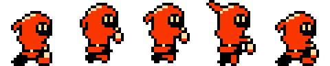
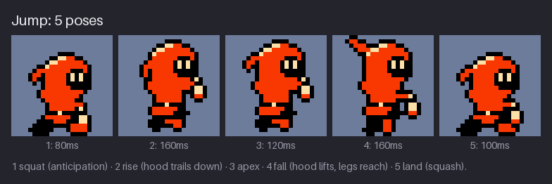

# Chapter 10 — Jump, Fall, and Land

A jump is the most important move in a platformer, and it is short. From the moment the player
presses the button to the moment Kit is standing again takes less than a second. In that time the
art has to say four things: Kit is about to push off, Kit is going up, Kit is coming down, and Kit
has hit the ground. This chapter does it with five poses (squat, rise, apex, fall, land) and
shows how they sit along the arc the game moves Kit through.

The jump is also where *squash and stretch* comes in, the oldest principle of cartoon animation:
a body gets shorter and wider when it hits something and longer and thinner when it moves fast. In
a 2 m tall cartoon character that can be a dramatic change of shape. In a 16×24 sprite you have
one pixel to spare, and you will see that one pixel is enough. Finally, Kit gets the first effect
sprite of the project: a puff of dust on landing, drawn so that it costs no extra sub-palette.

By the end of the chapter, `hollow-vault` has `kit-jump` (5 frames) and the landing dust
`fx/dust` (3 frames of 8×8).

Previous: [Chapter 9](09-walk-and-run.md). Next: [Chapter 11](11-attacks-effects-and-hits.md).

## Five poses

![Kit's jump as five frames on a slate-blue background. 1, 80ms: a low crouch, the head 2 px lower
than standing, the legs spread wide. 2, 160ms: the body 1 px higher than standing, legs tucked up,
the lantern raised in front of the chest, the hood tail hanging down behind the head. 3, 120ms:
the same tuck with the hood tail back at rest. 4, 160ms: the legs hanging straight down and
reaching, the hood tail flying up above the head, the lantern held forward. 5, 100ms: the same
crouch as frame 1, the lantern hanging. Caption: squat (anticipation), rise (hood trails down),
apex, fall (hood lifts, legs reach), land (squash).](images/ch10-jump-strip.png)

| Frame | Pose | Body | Legs | Hood tail | Lantern | Duration |
|---:|---|---|---|---|---|---:|
| 1 | squat | down 1 px, head down 1 more | wide crouch | at rest | swung back | 80 ms |
| 2 | rise | up 1 px | tucked | trails down | raised | 160 ms |
| 3 | apex | up 1 px | tucked | at rest | raised | 120 ms |
| 4 | fall | up 1 px | hang and reach | flies up | forward | 160 ms |
| 5 | land | down 1 px, head down 1 more | wide crouch | at rest | hanging | 100 ms |

Each pose has one job:

- **Squat: anticipation.** Before a body goes up, it goes down. The crouch tells the eye "energy
  is being stored", so the jump that follows reads as a push, not as a lift by an invisible hand.
  For the player's own jump the anticipation must be short: a player who pressed the button wants
  to leave the ground *now*. Kit's squat is the shortest frame of the jump, 80 ms, and many games
  start moving the sprite during it. Enemies are the opposite: their anticipation is long on
  purpose, because it is the player's warning (Chapter 12).
- **Rise: speed upward.** The legs tuck up out of the way and the arm comes up. The hood tail hangs
  *down*: Kit's body is moving up fast, and the loose cloth lags behind it.
- **Apex: the turn-around.** For a moment Kit is neither rising nor falling. The body is the same
  as the rise; only the hood tail changes, back to its resting shape. That one change is enough to
  mark the top of the arc.
- **Fall: speed downward.** The legs straighten and reach for the ground, and the hood tail flies
  *up*, lagging behind a body that is now dropping. Reaching legs tell the player that Kit expects
  to land; it is the pose they will see longest when Kit drops down a pit.
- **Land: impact.** The crouch again. The body absorbs the fall, and the game holds the pose for
  just long enough (100 ms) for the impact to register before handing back to the idle or walk.

Notice how much the hood tail does. Frames 2 and 3 have exactly the same body, legs and arm; only
the tail differs. Loose parts show the *direction* of motion, because they always lag behind it:
down when going up, up when coming down, back when running. You will use this again for scarves,
ears and antennae in Chapter 13.

**Try it (5 minutes).** Draw a 24×24 stick figure with a long ponytail, standing. Make three
copies: one with the figure 4 px higher and the ponytail pointing down, one 4 px higher with the
ponytail hanging normally, one 4 px higher with the ponytail pointing up. Without any other clue,
you should be able to tell which one is rising, which is at the top, and which is falling.

### How long to crouch

Anticipation is a contract between the art and the player. A long crouch makes a jump feel
powerful and readable, and makes the controls feel slow. A missing crouch makes the controls
snappy and the jump weightless. Games resolve it differently for different characters:

| Who | Anticipation | Why |
|---|---|---|
| The player's hero, normal jump | 1 frame, 60–100 ms (Kit: 80 ms) | The player must feel in control; the crouch is a hint, not a wait |
| The hero, charged or heavy jump | longer, held while the button is held | The player chose to wait, so the wait can show |
| An enemy's jump or attack | 300 ms or more | It is the player's warning; too short and the hit feels unfair |
| A large boss | 500 ms to a second | Big bodies are read as slow; the long wind-up is part of the threat |

Some games skip the crouch frame for the player entirely and start the arc on the button press,
using the land frame of the previous jump as the only squash. If your game feels sluggish, try
that before you redraw anything.

## The arc

The game moves Kit along a curve; the frames ride on it. A thrown ball, a jumping person and Kit
all follow the same shape, a parabola, because gravity changes the vertical speed by the same
amount every moment. The figure places the poses on that curve at equal steps of time:


Read the heights of the seven positions, measured from the ground, at equal time steps:

| Step | 1 | 2 | 3 | 4 | 5 | 6 | 7 |
|---|---:|---:|---:|---:|---:|---:|---:|
| Height (px) | 0 | 24 | 37 | 41 | 36 | 22 | 0 |
| Change from previous step (px) | | +24 | +13 | +4 | −5 | −14 | −22 |

Kit covers 24 px in the first step and only 4 px in the step that reaches the top. On the way down
the steps grow again. Horizontally the copies are evenly spaced (about 25 px apart): the game keeps
Kit's sideways speed constant while gravity works on the vertical speed. This "slow at the top,
fast at the ends" spacing is what animators call *slow in and slow out*, and it is why a jump
seems to hang for a moment at its peak. That hang is the moment the player has to steer, so games
often make it a little longer than real gravity would.

The animated version moves Kit in place with the same kind of physics: a launch speed of 230 px
per second and a gravity of 600 px per second squared. Kit rises about 44 px (almost twice Kit's
height) and is in the air for about 770 ms:


The poses in the GIF are not timed by the frame durations at all. The game looks at Kit's vertical
speed: rising fast shows the rise, near zero shows the apex, falling shows the fall. With these
numbers that gives about 250 ms of rise, 230 ms of apex and 280 ms of fall, followed by 100 ms of
landing. The section *Poses vs motion* below explains why.

**Try it (5 minutes).** Draw a ground line on a 160×64 canvas. Place a 4×4 dot at seven equally
spaced x positions, at the heights 0, 24, 37, 41, 36, 22, 0. Then do it again with the heights
0, 14, 27, 41, 27, 14, 0 (equal steps). Play each as a 7-frame animation at 100 ms. The first is a
jump; the second is a lift on a crane.

## Squash and stretch at 24 px

Squash and stretch says that a soft body keeps its *volume* while it changes *shape*: when it
gets shorter it gets wider, and when it gets longer it gets thinner. It is how a drawing feels
alive and heavy rather than rigid. On a large cartoon character the shape changes can be huge. On
Kit the budget is one pixel per part:


| Pose | Height of the figure | What moved |
|---|---:|---|
| stand | 22 px | nothing |
| squat and land (squash) | 20 px | body down 1 px; head down 1 more px into the mantle; feet spread from 6 px to 13 px apart |
| fall (stretch) | 24 px | body up 1 px; hood tail rises 1 px above the head; legs hang straight |

From the squat to the fall the height changes from 20 px to 24 px, about a sixth of Kit's size.
That is a big squash by cartoon standards, done with a handful of 1 px moves. Each move on its
own would look like a mistake; together they read as a body being compressed or pulled.

Rules that keep squash and stretch honest:

- **Keep the volume.** A shorter pose must be wider. Kit's squat loses 2 px of height and gains a
  much wider stance. A shorter pose that is not wider looks like the sprite shrank.
- **Keep the feet on the ground row.** Squash the body *down onto* the feet. The soles stay on
  row 22 in the squat and the land. A squash around the middle of the sprite sinks the feet into
  the floor.
- **Redraw, never scale.** A scaled sprite at 92 % height loses rows at random places and breaks
  every outline. Move whole parts by whole pixels instead: the head, the body, the legs.
- **The face stays the same.** Kit's eyes and the face opening keep their size and shape in every
  pose. The viewer reads the face as "the same character" while the body deforms around it.
- **Stretch with loose parts first.** Kit's body cannot get much taller without looking like a
  different character. The hood tail can. On the fall the stretch is mostly the tail and the
  straightened legs.

> **Tool aside.** To compare heights, draw a 1 px guide line (or use the editor's guides) at the
> top of the standing head and another at the soles, and keep them visible while you draw every
> pose. Aseprite, LibreSprite, Pixelorama and Krita have draggable guides; in GrafX2 and Piskel a
> line on a separate layer you hide before export does the same job.

**Try it (3 minutes).** Take your idle frame and make a squash using only 1 px moves: move the
body down 1, the head down 1 more, and move each foot 2 px outward. Flip between the stand and the
squash. If it looks as if the character shrank, the feet did not move out far enough.

## Landing dust

A landing is the hardest impact Kit takes, and a small cloud of dust makes it land with weight.
Kit's dust is three frames of a single 8×8 sprite, played once on each side of Kit's feet, the
second copy flipped horizontally:


| Frame | Duration | Pixels | What it does |
|---:|---:|---:|---|
| 1 | 80 ms | 6 | birth: a small mound right at the foot |
| 2 | 80 ms | 12 | peak: the cloud spreads up and outward |
| 3 | 100 ms | 6 | break-up: scattered specks, then nothing |

Three things make it work:

- **It is born at full strength.** The first frame is already a solid shape at the point of
  impact. Effects do not fade in; the eye is drawn to sudden change, and an impact is sudden.
- **It ends in pieces.** The last frame has the same number of pixels as the first, but scattered
  into specks with gaps between them. Separated pixels carry less weight for the eye than a solid
  clump, so the cloud seems to thin out and disappear. You cannot fade a sprite with transparency
  on the NES; breaking it apart is how effects fade.
- **The last frame lasts longest.** 80, 80, then 100 ms: a quick birth and a slightly slower
  break-up, so the player sees where the dust went. Chapter 11 applies the same timing to every
  effect.

The dust is a separate sprite, not part of Kit's landing frame. It plays on its own clock: if the
player starts walking 20 ms after landing, Kit switches to the walk but the dust finishes where it
was. It also gets reused: the same dust can play for a skid, for an enemy that lands, or for a
crate that drops. The game places it with Kit's anchor point (the bottom centre of the cell, at
the feet), so the dust needs no offset of its own beyond "one tile to each side".

> **NES rule:** A screen has only four sprite sub-palettes, shared by everything that moves:
> Kit, enemies, pickups and effects. An effect that needs its own colours uses up a whole
> sub-palette. Kit's dust is drawn only in `$37`, the cream of Kit's own SP0, so it costs no
> sub-palette at all. Kept authentic: every effect in the course is drawn in a sub-palette that
> is already on screen.

The dust uses one colour of the three in SP0, on purpose. Cream is the lightest value Kit has, so
the dust reads against the dark Greenhouse floor and wall. Red would look like part of Kit; black
would vanish into the background. If an area's floor were light, the same dust in black would be
the better choice, and it would still cost nothing.

Effects can be drawn in front of the character or behind it. The dust is drawn in front: its
first frame sits right at Kit's feet and would be hidden behind them otherwise. On the NES, the
order is the order of the sprites in OAM (the one listed first is drawn on top), and each sprite
also has a priority bit that puts it behind the background. The game sets both; your job is to
say which one you meant when you hand over the effect.

There is also a sprite cost on the scanlines. While the dust plays, the lines at Kit's feet carry
Kit's bottom row (two sprites) and two dust sprites: four of the eight allowed on a line. That is
cheap, but it is not free, and Chapter 11 counts those sprites for a whole scene.

**Try it (5 minutes).** On an 8×8 canvas, draw a 3-frame puff using only one colour: a 4 px wide
mound on the bottom two rows, a 6 px wide lumpy cloud one row higher, then six single pixels
spread out. Play it at 80, 80, 100 ms, followed by a 500 ms empty frame. Then try 100, 80, 80 ms:
the puff seems to appear slowly and snap off.

## Poses vs motion

The jump strip has durations (80, 160, 120, 160, 100 ms), and the pack's JSON lists them so that a
preview can play the jump as a loop. A real game does not play the jump that way. Kit's height in
the air depends on how long the player holds the button, whether there is a ceiling, whether Kit
fell off a ledge without jumping at all. The art cannot know any of that, so the game picks the
frame from Kit's *state*:

| Game state | Frame shown | How long |
|---|---|---|
| button pressed, still on the ground | 1 squat | 80 ms (timed), or until the physics starts |
| in the air, moving up fast | 2 rise | as long as it lasts (held) |
| in the air, vertical speed near zero | 3 apex | as long as it lasts (held) |
| in the air, moving down | 4 fall | as long as it lasts (held) |
| feet touch the ground | 5 land | 100 ms (timed), then idle, walk or run |

Only the first and last frames are *timed*. The three in the middle are *held*: the game shows
them for as long as the state lasts. That is how the GIF above works: the rise lasts about 250 ms
because that is how long Kit moves up faster than 80 px per second, not because of a number in
the JSON. The JSON marks the jump `"loop": true` only so that previews keep playing; the game
plays it once.

This changes how you judge the drawings:

- **Every held frame must look good frozen.** A pose that only works in motion (a blur, a
  half-step) looks broken when the game holds it for half a second. Kit's fall pose is held for
  the whole drop down a pit, so it has to read as "falling" on its own: legs reaching, hood up.
- **The game can skip frames.** Walking off a ledge goes straight from the walk to the fall, with
  no squat, rise or apex. A short hop into a low ceiling goes from rise to fall. Check that every
  held frame looks right after any other frame, not only after its neighbour in the strip.
- **The land frame must lead anywhere.** It hands over to the idle if the player lets go, to the
  walk if they hold a direction, or straight into the next squat if they jump again. Kit's land
  frame has the same feet as the squat and the same head height, so all of these cuts are smooth.
- **Do not draw the motion into the frames.** The arc lives in the game code. If you drew Kit
  higher in the rise frame than in the apex, the game's arc and the drawing would fight. Kit's
  rise, apex and fall all sit at the same height in the cell (body up 1 px); only the pose
  changes.

> **Tool aside.** To preview a held-frame animation, make a temporary copy of the strip and give
> each held frame a long duration (500 ms), or play the frames in a different order (walk, fall,
> land). Most editors let you set a duration per frame (Aseprite, LibreSprite, Pixelorama) or
> duplicate frames to hold them (Krita, Piskel). Turn off looping to judge a one-shot properly.

**Try it (3 minutes).** Write down, for your own game idea, which frames of the jump are timed and
which are held. Then list two ways the game could reach the fall frame without playing the rest of
the jump first.

## Other ways into the air

The full jump is only one path through the five poses. A platformer reaches them in many other
ways, and the same frames have to cover all of them:

- **Short hop.** Many platformers cut Kit's upward speed when the player lets go of the button
  early. The arc is lower and shorter; the game simply holds the rise for less time and reaches
  the apex sooner. No new frames are needed, which is one more reason the rise, apex and fall are
  held rather than timed.
- **Walking off a ledge.** No squat, no rise, no apex: the walk cuts straight to the fall. Kit's
  fall has the same head height in the cell as the walk's passing frames (body up 1 px), so the
  cut does not jump.
- **Running jump.** The game adds Kit's run speed to the arc, so the jump covers more ground. The
  poses stay the same. If your hero leans while running, check that the lean does not vanish
  awkwardly at take-off; Kit's run lean is 1 px, small enough to lose.
- **Bounce.** Landing on an enemy or a spring sends Kit straight back up. The game can skip the
  land frame and go from the fall to the rise. Flip between frames 4 and 2 to check that cut.
- **Knocked into the air.** When Kit is hit, the game may push Kit up and back. That uses the hurt
  pose from Chapter 11, not the jump, and then lands with frame 5.

A good test is to play the frames in the orders the game will use: 1 2 3 4 5 (full jump), walk 4
5 (ledge), 1 2 4 5 (short hop with no apex), 4 2 3 4 5 (bounce). If any change looks like a
glitch, the pose on one side of it needs work.

**Try it (3 minutes).** Make a temporary copy of your jump strip and rearrange it into the four
orders above, each followed by two idle frames. Play each one at the jump's durations and note
which cut looks worst. Fix that pose first.

## What the jump costs

Every jump pose moves the whole body: down for the squat and land, up for the three air poses.
On the NES that means new tiles for almost every part of Kit. Cut on a fixed 2×3 grid, the five
jump frames use 24 different 8×8 tiles, more than the walk (18) or the run (19), and the most of
any animation so far.

The air poses are also wider than the stand. The fall's hood tail sticks out 1 px behind the
16 px box, and the raised lantern pokes out in front on the rise and apex. On a fixed grid those
frames need 7 or 8 hardware sprites instead of 6. Placed row by row, with each row of sprites
shifted to fit the pixels it holds, every jump frame fits back into 6. Chapter 11 shows why those
extra sprites matter when there are effects and enemies on the same lines.

You could save tiles by drawing the air poses at the stand height and moving only the legs. Try it
on your own hero: the result usually looks stiff, as if the legs belonged to someone else. The
body bob is worth its tiles.

## Common problems

| What you see | Likely cause | Fix |
|---|---|---|
| The jump has no force | No squat, or the squat is no lower than the stand | Body down 1 px, head 1 more, feet apart |
| The controls feel slow | The squat is too long | One short frame (60–100 ms), or move the sprite during it |
| The squash looks like shrinking | Height changed but width did not | Spread the feet as the body gets lower |
| Kit sinks into the floor on landing | Squashed around the middle | Keep the soles on the ground row |
| No sense of up or down in the air | Rise, apex and fall look the same | Let a loose part lag: down on the rise, up on the fall |
| A pit fall looks frozen | The fall pose only works in motion | Redraw it as a pose that reads when held |
| The dust looks like a stain | Faded with transparency, or drawn in a dark colour | Break it into specks; use the lightest colour |
| The dust vanishes when Kit walks off | Dust drawn into Kit's land frame | Make it a separate sprite on its own clock |

## Project: the jump and the dust

The snapshot for this chapter is [`project/ch10/`](project/ch10/README.md). Its README marks the
new files with `*`:

| File | Size | What it is |
|---|---|---|
| `sprites/kit-jump.png` | 120×24 | 5 frames of 24×24 |
| `sprites/kit-jump.json` | | durations 80/160/120/160/100 ms |
| `fx/dust.png` | 24×8 | 3 frames of 8×8 |
| `fx/dust.json` | | durations 80/80/100 ms |
| `preview/kit-jump-4x.png`, `preview/kit-jump.gif` | | 4× strip and animated preview |
| `preview/dust-4x.png`, `preview/dust.gif` | | 4× strip and animated preview |

Both use SP0 (transparent, `$0F`, `$16`, `$37`); the dust uses only `$37`. Everything else is
unchanged from Chapter 9. The jump's data, shortened (the file has one value per line):

```json
{
  "image": "kit-jump.png",
  "frameWidth": 24,
  "frameHeight": 24,
  "palette": ["$0F", "$0F", "$16", "$37"],
  "paletteRGB": ["#000000", "#000000", "#f83800", "#fce0a8"],
  "animations": {
    "kit-jump": {"row": 0, "frames": 5, "durations": [80, 160, 120, 160, 100], "loop": true}
  }
}
```

A game that picks frames by state, as described above, reads only the first and last durations
and uses the frame numbers (0 to 4) for the rest. Slot 0 of the palette is listed as `$0F` but is
transparent in a sprite; slot 1 is the real black.




### The jump, step by step

Coordinates are `(x, y)` in the 24×24 cell. As in Chapter 9, leg spans are the inside colour of
each leg; the black outline goes around them afterwards.

1. **Canvas.** A 120×24 sheet, five 24×24 cells. Turn on a guide at row 2 (the top of the standing
   hood) and row 22 (the soles).
2. **Frame 1, squat.** Paste the stand. Move everything above row 20 down 1 px, then move the head
   (the hood and face, down to the top of the mantle) down 1 more px, so it sinks into the mantle.
   The top of the hood is now on row 4. Redraw the legs in a wide crouch:

   | Rows | Near leg (red) | Far leg (black) |
   |---|---|---|
   | 20 | x 13–15 | x 7–9 |
   | 21 | x 14–16 | x 6–8 |
   | 22 | x 14–17 | x 5–8 |

   Swing the lantern back 1 px, as in walk frame 1.
3. **Frame 2, rise.** Paste the stand and move everything above row 20 *up* 1 px. Tuck the legs:
   near leg x 11–14 on row 20 and x 13–14 on row 21; far leg x 8–10 on row 20 and x 8–9 on
   row 21. The feet end on row 21 and their outline on row 22, one row higher than standing.
   Raise the arm: the hand comes up in front of the chest at about `(18, 10)` and the lantern
   hangs just below it. Redraw the hood tail hanging *down* behind the head (x 6–7, rows 6–9).
4. **Frame 3, apex.** Copy frame 2 and put the hood tail back in its resting shape (as in the
   stand, 1 px higher). Nothing else changes.
5. **Frame 4, fall.** Copy frame 3. Let the legs hang: near leg x 12–13 on rows 20–22, far leg
   x 9–10 on rows 20–21 and x 8–9 on row 22. Bring the lantern down and forward (as in walk
   frame 3). Redraw the hood tail flying *up* and back: rows 1–3, from x 4–5 at the top to x 6–8
   lower down, so its outline touches row 0.
6. **Frame 5, land.** Copy frame 1 and let the lantern hang straight down.
7. **Check.** Flip between frames 1 and 5 and the stand: the soles must stay on row 22. Then play
   the five frames out of order (4, 5, idle) as the game would after a fall off a ledge.
8. **JSON.** Copy `kit-walk.json`, set `image` to `kit-jump.png`, the name to `kit-jump`, `frames`
   to 5 and the durations to `[80, 160, 120, 160, 100]`.

### The dust, step by step

1. **Canvas.** 24×8, three 8×8 cells, SP0. You will use only `$37`.
2. **Frame 1, mound (6 px).** Row 5: x 3–4. Row 6: x 2–5. Row 7 stays empty: placed on Kit's
   bottom tile row, the puff's lowest pixels then line up with Kit's soles on row 22.
3. **Frame 2, cloud (12 px).** Row 4: x 2–3 and x 5. Row 5: x 1–6. Row 6: x 2 and x 5–6. Lumpy,
   not round: a smooth dome looks like a solid object.
4. **Frame 3, specks (6 px).** `(1, 3)`, `(6, 3)`, `(2, 4)`, `(5, 4)`, `(1, 5)`, `(6, 5)`: two
   short diagonal pairs moving apart, with nothing in the middle.
5. **Check.** Paste the frames at both sides of Kit's land frame, the right-hand copy flipped
   horizontally, and play them at 80/80/100 ms. Then put the scene on the Greenhouse floor and
   check that the cream reads against both the dark wall and the green floor top.
6. **JSON.** `frameWidth` and `frameHeight` 8, `frames` 3, durations `[80, 80, 100]`.

## Exercises

### 1. A five-pose jump

Draw a jump for your hero with five poses: squat, rise, apex, fall, land.

**What to look for:**

- The squat is lower and wider than the stand, and the soles stay on the ground row.
- The rise, apex and fall can be told apart without motion, using legs or a loose part.
- The fall pose reads as falling when it is held for a second.
- The land frame leads smoothly into the idle and into the walk.
- The squat is the shortest frame (about 60–100 ms).

<details><summary>Example solution</summary>



Kit's rise and apex share the same body; only the hood tail changes, trailing down on the rise and
at rest at the apex. The fall straightens the legs and lifts the tail, so it reads even when the
game holds it for a long drop.

</details>

### 2. Plot an arc

On a wide canvas, place copies of your jump poses along an arc at equal time steps: seven
positions, from take-off to landing.

**What to look for:**

- Vertical gaps are large near the ground and small near the top.
- Horizontal gaps are all the same.
- The pose changes from rise to fall at the top, not before.
- Take-off and landing are at the same ground height.

<details><summary>Example solution</summary>


The heights in the figure are 0, 24, 37, 41, 36, 22 and 0 px at equal time steps. The apex step
gains only 4 px; that "hang" is the moment the player steers.

</details>

### 3. Squash and stretch by 1 px

Make a squash and a stretch of your hero's stand using only 1 px moves of whole parts. No
scaling, no redrawing of the face.

**What to look for:**

- The squash is shorter *and* wider; the stretch is taller and no wider.
- Each part moved by at most 1 px from its neighbour; the face is unchanged.
- The soles stay on the ground row in the squash.
- All outlines are clean: no broken lines from scaling.

<details><summary>Example solution</summary>


Kit's squash moves the body down 1 px and the head 1 px more and spreads the feet; the stretch
moves the body up 1 px and lets the hood tail rise 1 px above the head. Together they change the
height by 4 px, about a sixth of the sprite.

</details>

### 4. Dust in the hero's palette

Draw a 3-frame landing puff on an 8×8 tile using only colours from your hero's sub-palette.

**What to look for:**

- It uses one or two colours that are already in the hero's sub-palette.
- Frame 1 is a solid shape at the point of impact; the last frame is scattered specks.
- The last frame is the longest.
- It reads against your floor and background at 1×.
- Mirrored, the same tile works on the other side of the feet.

<details><summary>Example solution</summary>


Kit's dust uses only the cream of SP0, so it needs no sub-palette of its own. It has 6, 12 and 6
pixels: the last frame is as heavy as the first but broken apart, so it disappears.

</details>

## Recap

- A jump is five poses: squat (anticipation), rise, apex, fall and land (squash).
- Keep the player's anticipation short (Kit's squat is 80 ms); keep enemy anticipation long.
- Loose parts lag behind the motion: Kit's hood tail hangs down on the rise, rests at the apex and
  flies up on the fall. Rise and apex differ only in the tail.
- The game moves Kit along a parabola: big steps near the ground, small ones at the top. Kit's
  test jump rises about 44 px and stays in the air about 770 ms.
- Squash and stretch keep the volume. At 24 px, three 1 px moves make Kit 20 px tall in the squat
  and 24 px in the fall, against 22 px standing. Redraw, never scale; keep the soles on the ground.
- Only the squat and land are timed. Rise, apex and fall are held for as long as the physics says,
  so each must look good frozen, and the game may skip any of them.
- Effects are separate sprites on their own clock. Kit's dust: 3 frames of 8×8 (80/80/100 ms),
  6, 12 and 6 pixels, one sprite each side, the second flipped.
- NES rule: four sprite sub-palettes are shared by everything that moves. Kit's dust uses the cream
  of SP0, so it costs none (kept authentic).

## Further study

- AdamCYounis, **"Pixel Art Class - Platformer Jump Animation"** (YouTube) —
  <https://www.youtube.com/watch?v=kmRUUK30E6k>. A platformer jump built pose by pose. Watch which
  frames he expects the game to hold and how he keeps the fall readable.
- Brandon James Greer, **"Making a Bouncy Slime Pixel Art Animation"** (YouTube) —
  <https://www.youtube.com/watch?v=J8MH-k0Fa6Y>. Squash and stretch on a body with no limbs at all.
  Watch how the slime keeps its volume and how the landing squash is stronger than the take-off.
- AlanBeckerTutorials, **12 principles of animation playlist** (YouTube) —
  <https://www.youtube.com/playlist?list=PL-bOh8btec4CXd2ya1NmSKpi92U_l6ZJd>. One short video per
  principle. Watch the ones on squash and stretch, anticipation, arcs, and slow in and slow out,
  then look for each of them in Kit's five poses.

Sources for this chapter: [REFERENCES.md](REFERENCES.md#chapter-10--jump-fall-and-land)
