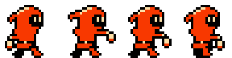
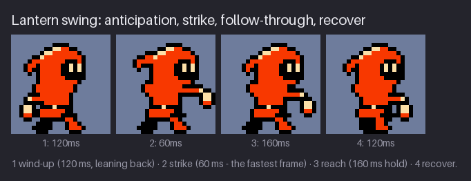
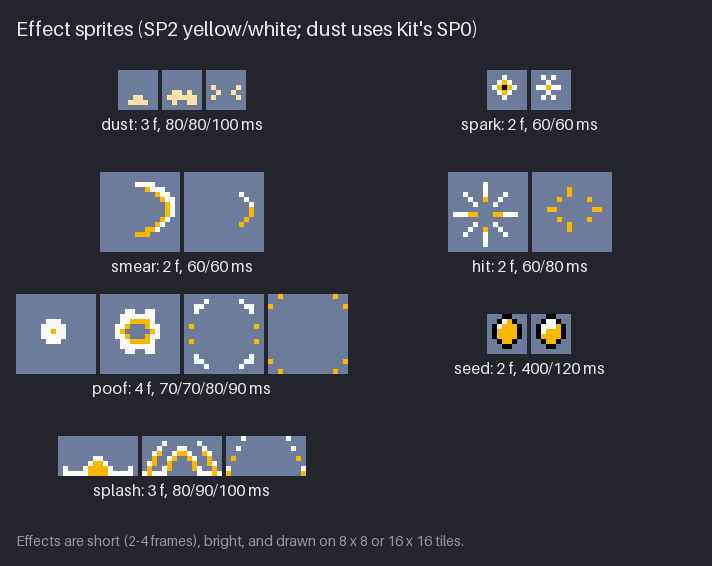

# Chapter 11 — Attacks, Effects, and Hits

An attack has two jobs that pull in opposite directions. It must feel *fast*, because the player
pressed a button and wants a result now. It must also be *readable*, because the player needs to
see where the blow went, whether it connected, and when it is safe to act again. The answer is
contrast in timing: a short but clear wind-up, one very fast strike, a pose that is held long
enough to register, and a recovery. Kit's weapon is the lantern, swung on its handle like a flail.

Around the attack sits a family of small effect sprites: a smear that shows the path of the
lantern, a burst where it hits, a poof when the enemy vanishes, a glint on the seed pickup. Effects
in an NES-style game follow strict rules: two to four frames, the brightest colours of a shared
sub-palette, and as few hardware sprites as possible, because every one of them competes with Kit
and the enemies for the eight sprite slots on each scanline. The chapter ends with the other side
of combat: what Kit looks like when Kit is the one being hit.

By the end of the chapter, `hollow-vault` has `kit-attack` (4 frames), `kit-hurt` (2 frames) and
five effects: `spark`, `smear`, `hit`, `poof` and `seed`.

Previous: [Chapter 10](10-jump-and-fall.md). Next: [Chapter 12](12-enemies-and-creatures.md).

## The lantern swing

Every melee attack, from a dagger jab to a giant's hammer, goes through the same phases:

1. **Anticipation (wind-up).** The body winds up in the opposite direction from the strike. It
   tells the viewer "something is about to happen, and it will go *that* way".
2. **Strike.** The fastest part. The weapon travels from the wind-up to the target, usually in a
   single frame.
3. **Follow-through (hold).** The most extended pose: arm out, weapon past the target, body
   committed. It stays on screen long enough for the eye to register it. This is where the game
   checks for a hit.
4. **Recovery.** The body settles back toward the stand, ready for the next input.

Here is Kit's attack, the animation the project gains in this chapter:

![Kit's attack as four frames on a slate-blue background. 1, 120ms: Kit leans back with the
lantern swung behind the body and the eyes looking ahead. 2, 60ms: Kit leans forward, the arm
straight out at chest height and the lantern at the end of it, the hood tail flat behind. 3,
160ms: the arm still forward, the lantern swung a little lower. 4, 120ms: Kit standing upright
with the lantern hanging just in front. Caption: wind-up (120 ms, leaning back), strike (60 ms,
the fastest frame), reach (160 ms hold), recover.](images/ch11-attack-strip.png)

| Frame | Phase | Body | Arm and lantern | Duration |
|---:|---|---|---|---:|
| 1 | wind-up | upper body 1 px back, braced legs, eyes forward | lantern behind the back | 120 ms |
| 2 | strike | head 1 px forward, hood tail flat | arm straight out, lantern at full reach | 60 ms |
| 3 | reach | head 1 px forward | arm forward, lantern swung lower, under the hand | 160 ms |
| 4 | recover | stand | lantern hanging in front | 120 ms |

Things to notice:

- **The wind-up goes the other way.** Before Kit swings forward, the whole upper body leans 1 px
  back and the lantern goes behind it. The bigger the distance between the wind-up and the
  strike, the more force the eye reads into the move. At 24 px that distance is the width of the
  body: the lantern goes from behind Kit's back to a full arm's length in front.
- **The eyes lead.** In the wind-up Kit's eyes shift forward to the target, before the body moves.
  It is a one-pixel change that tells the player where the blow will land.
- **The lantern follows through.** On the strike the lantern is at the end of a straight arm. On
  the reach the arm stays forward, but the lantern has kept swinging and drops below the hand. A
  weapon on a handle, a chain or a rope keeps moving after the arm stops; showing that is what
  makes it feel heavy.
- **The hood reacts.** The tail goes flat on the strike, like in the run, and returns to rest on
  the reach. Loose parts show speed for free.
- **The legs stay braced.** The feet are set wide in frames 1 to 3 and do not move. A planted
  stance says "this blow has weight behind it", and it keeps the anchor at the feet in place so
  the game does not have to move Kit.

The strike frame is also the widest frame of Kit in the game: from the braced back foot to the
lantern it covers 20 px. Kit's body box is 16 px (2×3 sprites); the strike and the reach use a
third column of sprites on the lines where the arm is. The section *Budget* counts what that
costs.

**Try it (5 minutes).** On a 24×24 canvas, draw a stick figure holding a short stick. Make three
frames: a wind-up with the stick behind the body, a strike with the stick straight out in front,
and a stand. Play them at 150, 150, 150 ms. Then change the durations to 120, 60, 200 ms. Even
with only three drawings, the second version hits.

## Slow-fast-hold

Read the durations again: 120, 60, 160 and 120 ms. They add up to 460 ms, but they are far from
even. The strike, the frame where the most happens, is on screen for the shortest time.

Your visual system does not treat every frame equally. A drawing that stays on screen for about
a tenth of a second or more is seen as a *pose*: you could describe it afterwards. A drawing that
flashes past in a few hundredths of a second is not seen as a pose; it is folded into the motion
between its neighbours and read as *speed*. Uneven timing uses both modes:

- the wind-up (120 ms) and the hold (160 ms) are long enough to be read as poses, so the player
  sees where the blow started and where it ended;
- the strike (60 ms) is too short to be read as a pose, so it is read as the motion itself.

If you play the same four drawings at an even 115 ms each, the total is the same 460 ms, but every
frame gets equal weight. The wind-up loses its load, the strike hangs around long enough to look
like a pose of its own, and the swing feels like a slow gesture. That is the rule of this chapter
in three words: **slow, fast, hold**.

The phases also matter to whoever writes the game code. Write them down with the art:

- **Startup:** 120 ms (the wind-up). This is the delay between pressing the button and the attack
  being able to hit. A platformer player feels anything much above 150–200 ms as sluggish, so
  player wind-ups stay short. Enemy wind-ups are the opposite: they should be long (300 ms or
  more), because they are the player's warning. Chapter 12 calls this *telegraphing*.
- **Active:** 220 ms (strike and reach). The hitbox is on during these frames.
- **Recovery:** 120 ms. Many games let the player cancel the recovery into a jump or another
  swing; if they do, the recover frame is a transition, not a promise.

> **Rule of thumb.** Player attack: wind-up 1 frame (80–150 ms), strike 1 frame (40–60 ms),
> hold 150–250 ms, recovery 1 frame (100–150 ms); about 400–600 ms in total. Heavy attacks get a
> longer wind-up and recovery, never a slower strike.

> **Tool aside.** Per-frame durations are set in the frame properties in Aseprite, LibreSprite
> and Pixelorama. Krita and Piskel play at a fixed frame rate, so a 60 ms frame must be one
> exposure at about 16 fps or more; plan the timing in whole exposures there, or duplicate frames
> to hold them.

**Try it (3 minutes).** Take any 4-frame action you have drawn (even the walk) and set it to
120/60/160/120 ms. Then to 115 ms each. Write one word for how each version feels.

## Effects

Kit's own frames carry the attack. Everything else that flashes, bursts or sparkles is an
*effect*: a separate sprite, with its own sheet and its own durations, that the game places and
plays on top of the scene.

![A sheet of effect strips on slate-blue panels. Dust (cream, from Chapter 10): 3 frames, 80/80/100
ms. Spark: two 8×8 frames, a white diamond around a yellow plus with a black centre, then a white
cross with four corner pixels and a yellow centre; 60/60 ms. Smear: two 16×16 frames, a white
crescent with a yellow inner edge sweeping round the right side, then a thin remnant of it; 60/60
ms. Hit: two 16×16 frames, a white eight-pointed star with an empty centre and yellow inner pixels
on the straight rays, then a ring of yellow dots; 60/80 ms. Poof: four 16×16 frames, a white disc, a
white ring, broken white arcs with yellow dots, eight yellow dots at the edges; 70/70/80/90 ms.
Seed: two 8×8 frames, a yellow seed with a black outline and a white glint that grows on the second
frame; 400/120 ms. Splash: three 16×8 frames of white and yellow droplets; 80/90/100 ms. Title:
effect sprites (SP2 yellow/white; dust uses Kit's SP0).](images/ch11-fx-sheet.png)

| Effect | Size | Frames (ms) | Used for |
|---|---|---|---|
| dust | 8×8 | 80/80/100 | landing (Chapter 10); drawn in Kit's SP0 |
| spark | 8×8 | 60/60 | small contacts: the lantern striking a wall or a switch |
| smear | 16×16 | 60/60 | the path of the lantern during the strike |
| hit | 16×16 | 60/80 | the lantern connecting with an enemy |
| poof | 16×16 | 70/70/80/90 | an enemy vanishing |
| seed | 8×8 | 400/120 | the glint on the seed pickup (a looping shimmer) |
| splash | 16×8 | 80/90/100 | water; it belongs to Chapter 13's project |

All of them except the dust use SP2, the Greenhouse effects sub-palette: `$0F` black, `$28`
yellow and `$30` white. Effects in an NES-style game share these rules:

- **Short.** Two to four frames, about 60–100 ms each. An effect is an event, not a decoration.
  The one exception is the seed's shimmer, which loops: it holds 400 ms and glints for 120 ms,
  like the blink in Kit's idle.
- **Born at full strength.** The first frame is the biggest, brightest, most solid shape: a white
  star, a white disc, a white arc. The eye is drawn to sudden change, and nothing is more sudden
  than something appearing where there was nothing.
- **Brightest colours, no outline.** Energy reads as light, so effects use white and the brightest
  yellow. The hit, smear and poof have no black outline at all: an outline makes a shape look
  solid, like an object you could pick up. The spark and the seed do use black, the spark as a
  hard pinpoint at its centre and the seed because it *is* an object.
- **Fade by breaking up.** The NES has no transparency. Effects disappear by shrinking, splitting
  into separate pixels and moving those pixels apart. The hit's second frame is a ring of yellow
  dots; the smear's second frame is a thin remnant of the arc.
- **Darker at the end.** White first, yellow later. On a black background, a yellow pixel looks
  dimmer than a white one, so the effect seems to cool and fade without a single new colour.

### The smear

The smear is the effect that belongs most closely to the attack. When something moves a long way
in one frame, the eye loses track of it unless the frame shows where it went. Film gets motion
blur for free; pixel art draws the blur as a shape. Kit's smear is a crescent drawn in
front of Kit, across the top, round the far side and down:

- **The path, not the object.** The crescent is an arc of swept space, not a picture of the
  lantern. Nothing in it looks like a lantern; it only says "something went round here, fast".
- **A heavy end and a thin tail.** The top and the outer edge are white, 2 px thick; the inner
  edge is yellow; the lower end runs out in yellow only. The eye reads the bright, thick part as
  the force of the swing and the thin, darker end as the trail it leaves.
- **Very short.** 60 ms, then a 60 ms remnant. A smear held for 100 ms or longer stops being motion
  and becomes an object: a glowing banana floating in front of Kit.

Kit's smear is a separate effect sprite rather than part of Kit's strike frame, for an NES reason:
Kit's frames are drawn in SP0 (red and cream), and the smear needs the white and yellow of SP2. A
sprite has one sub-palette, so a two-sub-palette drawing has to be two sprites anyway. Many NES
games drew no smear at all and relied on the fast strike frame; the smear is a little extra that
costs one sprite per line while it plays.

**Try it (5 minutes).** On a 16×16 canvas over a dark fill, draw a crescent 3 px thick at one end
and 1 px thick at the other, curving through a quarter of a circle. Make the outer edge white and
the inner edge yellow. Then draw a second frame with only the thick end's last few pixels. Play
them at 60/60 ms with a 400 ms empty frame after. Then try 150/150 ms: it turns into an object.

## Poof

When an enemy is defeated, it should not simply vanish: the player needs to see that the hit
ended it. The poof replaces the enemy's sprite at the same position and plays once:

| Frame | Duration | Pixels | Phase |
|---:|---:|---:|---|
| 1 | 70 ms | 21 | birth: a solid white disc, the brightest moment |
| 2 | 70 ms | 52 | peak: a ring, as big as the enemy was |
| 3 | 80 ms | 20 | break-up: the ring splits into arcs and dots |
| 4 | 90 ms | 8 | dissipation: scattered yellow pixels at the edges |

Three patterns to copy into every effect you draw:

- **Durations grow.** 70, 70, 80, 90 ms. The birth is a snap, the ending is slow enough to be
  seen. Turn the timing around (slow first, fast last) and the effect seems to grow in cautiously
  and then vanish abruptly, which reads like a glitch.
- **The biggest change is from frame 1 to frame 2.** A disc becomes a ring. After that each frame
  changes less than the one before.
- **The last frame is mostly empty.** Eight pixels in a 16×16 tile, in yellow, far apart. The
  effect ends because there is nothing left, not because it was switched off.

The poof also hides the moment the enemy disappears. It starts at the hopper's centre with the
brightest frame of the effect, so the game can remove the hopper's sprite on that frame: the eye
is on the flash and never sees the enemy go.

There is a sprite cost here too. The poof's last frame has only 8 pixels, but they sit in all four
corners of the 16×16 tile, so it still needs four hardware sprites, two on each line. Sprites are
counted, not pixels. When an effect ends in scattered dots, keep the dots inside as few 8×8 tiles
as the shape allows.

**Try it (5 minutes).** Draw a 16×16 poof in four frames on a dark background. Frame 1: a white
disc of radius 3. Frame 2: a white ring of radius 6 with an empty middle. Frame 3: the ring broken
into four arcs with yellow dots between them. Frame 4: eight single yellow pixels. Time it 70, 70,
80, 90 ms with a 500 ms empty frame after, then try 80 ms each and compare.

## Hurt

When Kit is the one being hit, the game needs an animation that says "that hurt" at once and then
gets out of the way, because the player wants control back. Kit's hurt is two frames of 80 ms,
played in a loop for as long as the knockback lasts:

- **The flash frame.** Every red pixel of Kit becomes cream; the black outline and the face stay.
  It is the biggest change in value Kit can make, so it shows even in a busy scene and even in the
  corner of the player's eye. Think of it as the visual equivalent of a sound effect: "hit
  registered".
- **The hurt pose.** The upper body leans 1 px back (away from the blow), the hood tail flies up,
  the lantern arm goes up and the eyes squeeze. The legs are braced. Every part of the pose points
  away from the hit.
- **The loop.** Flash, pose, flash, pose: the two frames alternate every 80 ms. In the GIF, Kit is
  knocked 6 px back over 640 ms, four flashes in all, then returns to the idle.

On real hardware nobody would store a cream copy of Kit. The flash is a palette change: for one
frame the game writes `$37` into slot 2 of SP0, and every red pixel on screen that uses SP0 turns
cream. Kit is the only thing in SP0 except the dust, and the dust uses only slot 3, so nothing
else changes. The course draws it as a frame so that it works in any engine and in an exported
GIF.

> **NES rule:** Sub-palettes live in a small palette memory that the game can rewrite between
> frames. A hit flash is usually a palette write or a switch of the sprite's palette bits, not a
> new set of tiles. In the course the flash is a drawn frame (NES-inspired); the colours are the
> same as the palette write would produce.

The same trick works on enemies. In the attack GIF, the hopper flashes white every 40 ms for
200 ms as it is knocked back. On hardware the game would write `$30` into the colour slots of SP1,
the hopper's sub-palette, for those frames. That flashes *every* sprite in SP1 at once, which is
fine with one hopper on screen and a design decision with three.

### What belongs in code

Several parts of a hit are never drawn. They are game code, tuned per hit, on top of your frames:

| Effect | Who does it | Typical size |
|---|---|---|
| Hit stop | the game stops updating attacker and target | 2–6 video frames (about 30–100 ms) |
| Screen shake | the game offsets the camera | 1–3 px, whole pixels only, for 100–200 ms |
| Knockback | the game moves the target | a few pixels over 100–300 ms (the hopper: 2–3 px; Kit: 6 px) |
| Invulnerability | the game blinks the sprite on and off | about a second after a hit |
| Flash | a palette write, or the drawn flash frame | 1 frame at a time |

What the art must supply is a pose worth freezing on. Hit stop freezes whatever frame is on screen
when the hit lands. If that frame is a weak in-between, the freeze shows a weak in-between. That
is why Kit's strike and reach are the most extended, most readable poses of the attack. And leave
room for the code: an effect that already has a shake or a freeze drawn into it will feel doubled
when the game adds its own.

**Try it (3 minutes).** Take your character's stand. Make two frames: (1) a copy with every
non-outline colour replaced by the lightest colour in its sub-palette, (2) a hurt pose leaning
back with closed eyes. Play them alternating at 80 ms for eight frames, then a stand. Try the
flash at 160 ms: it starts to look like a ghost rather than a hit.

## Budget

On the NES, effects are not free decoration. The hardware draws at most **eight sprites on any
scanline**. Kit, the enemies and every effect all draw from that same pool, and the busiest
moment of the game is exactly the moment of a hit: Kit at full stretch, an enemy, a smear and a
burst, all on the same few lines.

![Two copies of the attack scene at the moment of the strike, each with a bar chart on the right
showing the number of hardware sprites on each line, with a white line marking 8. Each scene shows
Kit at full stretch, the smear, and the hopper flashing white. Left, labelled "Avoid: one more 8 x 8
spark - 9 on a line": an extra spark sits in front of Kit's lantern and the bars for the middle
lines are red and cross the line at 8. Right, labelled "Better: as shipped - busiest line = 8": no
extra spark, and the longest bars are yellow and stop exactly at 8.
Caption: Kit's strike pose is 3 sprites wide on these lines, smear 1, foe 2, hit burst 2: exactly
8.](images/ch11-budget.png)

On the busiest lines of the strike the count is:

| Object | Sprites on those lines | Why |
|---|---:|---|
| Kit, strike frame | 3 | the arm and lantern add a third column to the 2×3 body |
| smear | 1 | its pixels on these lines fit in one 8 px column |
| hopper | 2 | a 16×16 enemy is 2×2 sprites |
| hit burst | 2 | 16 px wide |
| **total** | **8** | |

That is exactly the limit. One more 8×8 spark on top, a reasonable-looking addition, makes 9, and
the 9th sprite on a line is not drawn. Which one disappears depends on the order of the sprites
in OAM, not on what is important: it could be the burst, or a slice of Kit.

> **NES rule:** The hardware shows at most 8 sprites on one scanline; any further sprites on that
> line are dropped. Kept authentic: every scene figure in the course is checked and stays at 8 or
> fewer. Games of the era often rotated the sprite order every frame so that the dropped sprite
> changed and the scene *flickered* instead of losing one object for good; Chapter 24 shows how.

How to stay inside the budget:

- **Keep effects 1–2 tiles wide.** An 8×8 spark costs one sprite on its lines; a 16×16 burst costs
  two; a 32 px wide explosion costs four, half the line.
- **Fit the pixels, not the canvas.** Each hardware sprite has its own x and y. The smear is drawn
  on a 16×16 canvas, but its pixels on any 8 rows fit inside 8 columns, so the game can place it
  as two sprites (one above the other) instead of four.
- **Count the worst frame.** A pose that sticks out (Kit's strike) and an effect that spreads
  (the poof's corners) cost more than the average frame. Count the moment where they overlap.
- **Spread out vertically.** A spark slightly above the enemy's head is on different lines from
  the enemy's feet. Moving an effect by 8 px up can free a sprite on the busy lines.
- **Do without.** The cheapest effect is none. Kit's attack still reads without the smear, thanks
  to the 60 ms strike; the smear is there because there is room for it.

The same goes for tiles. Kit's attack uses 30 different 8×8 tiles on a fixed grid, more than any
other animation, because the strike and the reach fill a third column. The five effects add a few
more each. Chapter 24 counts every sprite tile in the game against the 256-tile sprite pattern
table.

**Try it (5 minutes).** Take a screenshot (or a mock-up) of your busiest moment: hero attacking,
an enemy, the effects. Draw horizontal lines every 8 px and, for each band, count how many 8×8
sprites touch it. Find the worst band and remove or move one thing until it is 8 or fewer.

## Common problems

| What you see | Likely cause | Fix |
|---|---|---|
| The attack feels sluggish | Wind-up too long, or even timing | Wind-up 1 frame of about 120 ms; strike the shortest frame |
| The attack has no force | Wind-up does not go the opposite way | Lean back and take the weapon behind the body first |
| You cannot see where the blow landed | Hold too short | Hold the reach for 150–250 ms |
| The smear looks like an object | Held too long, or in mid colours | 60 ms, white and yellow, thin at the trailing end |
| Effects look like stains | Faded with transparency or extra colours | Shrink, split, move apart, end in yellow |
| The effect ends abruptly | Last frame still solid, or shortest | Make the last frame the longest and mostly empty |
| The hurt flash looks like a ghost | Flash held too long, or shaded | One colour, 80 ms, alternate with the pose |
| Part of Kit vanishes during hits | 9 or more sprites on a line | Count per scanline; smaller or higher effects |

## Project: attack, hurt and effects

The snapshot for this chapter is [`project/ch11/`](project/ch11/README.md). Its README marks the
new files with `*`:

| File | Size | What it is |
|---|---|---|
| `sprites/kit-attack.png`, `.json` | 96×24 | 4 frames, 120/60/160/120 ms |
| `sprites/kit-hurt.png`, `.json` | 48×24 | 2 frames, 80/80 ms |
| `fx/spark.png`, `.json` | 16×8 | 2 frames of 8×8, 60/60 ms |
| `fx/smear.png`, `.json` | 32×16 | 2 frames of 16×16, 60/60 ms |
| `fx/hit.png`, `.json` | 32×16 | 2 frames of 16×16, 60/80 ms |
| `fx/poof.png`, `.json` | 64×16 | 4 frames of 16×16, 70/70/80/90 ms |
| `fx/seed.png`, `.json` | 16×8 | 2 frames of 8×8, 400/120 ms |
| `preview/*-4x.png`, `preview/*.gif` | | 4× strips and animated previews of all of the above |

Kit's sheets use SP0 (`$0F $16 $37`). The effects use SP2 (`$0F $28 $30`); their JSON files list
it as `"palette": ["$0F", "$0F", "$28", "$30"]`. The splash in the effects sheet is not part of
this snapshot; it arrives with the water in Chapter 13. Every JSON says `"loop": true` so that
the previews repeat; the game plays the attack, the hit and the poof once.

### The attack, step by step

Coordinates are `(x, y)` in the 24×24 cell. "Upper body" means everything above the legs: hood,
face, mantle, tunic, arm and lantern.

1. **Canvas.** A 96×24 sheet, four cells. The attack is the one animation that uses all 24
   columns, so check that nothing is clipped at the right edge.
2. **Braced legs (frames 1–3).** Near leg in `$16`: x 13–14 on row 20, 14–15 on row 21, 14–16 on
   row 22. Far leg in black: x 8–9, 7–8, 6–8. Copy them into the first three cells.
3. **Frame 1, wind-up.** Paste the upper body of the stand 1 px to the left of its usual place.
   Redraw the arm going back: a short sleeve at the back of the tunic on row 15, the hand at
   `(4, 15)` and the lantern hanging behind it at x 3–4, rows 17–19. Move both eyes 1 px forward.
4. **Frame 2, strike.** Paste the upper body at its usual place, then move only the head 1 px
   forward. Draw the arm straight out at chest height: sleeve x 15–19 on row 13, the hand at
   `(20, 13)`, the lantern at x 21–22, rows 14–16, hanging from it. Draw the hood tail flat, as in
   the run.
5. **Frame 3, reach.** Copy frame 2 and put the hood tail back at rest. Lower the arm 1 row
   (sleeve x 15–18 on row 14, hand at `(19, 14)`) and let the lantern swing down and back under it
   (x 20–21, rows 16–18).
6. **Frame 4, recover.** The stand with the lantern swung 1 px forward, as in walk frame 3.
7. **Check.** Play at 120/60/160/120 ms, then at 115 ms each, and compare. Cut the frames into
   8×8 tiles and count the sprites per row of tiles: frames 2 and 3 need three on the rows with
   the arm.

### The hurt, step by step

1. **Frame 2 first, the pose.** Braced legs as in the attack. Upper body 1 px back. Arm up as in
   the jump's rise. Hood tail flying up as in the fall. Replace the eyes with a squeezed shape: two
   pixels low and one between them, one row higher.
2. **Frame 1, the flash.** Copy frame 2 and replace every `$16` pixel with `$37`. Leave black
   alone.
3. **JSON.** `frames` 2, durations `[80, 80]`. The game loops the pair while Kit is knocked back.

### The effects, step by step

Each effect is drawn in SP2 on a dark background (use `$0F` as a temporary fill on a layer you
hide before export). Coordinates are inside the effect's own tile.

1. **Spark (8×8).** Frame 1: centre `(3, 3)` in black, the four pixels next to it in yellow, and
   a white diamond around that (the eight pixels 2 steps from the centre). Frame 2: a white cross
   (2 px left and right, 1 px up and down) with a yellow centre, plus four white corner pixels at
   `(2, 1)`, `(4, 1)`, `(2, 5)` and `(4, 5)`.
2. **Smear (16×16).** Frame 1: a crescent from `(7, 2)` across the top, round the right side (x
   13–14 at rows 6–8) and down to `(7, 12)` at the bottom left. Mostly 2 px thick: white on the
   outer edge, yellow on the inner edge; the last pixels at the bottom are yellow only. Frame 2:
   only a thin piece of the right side, x 11–13, rows 4–10, white at the top and yellow below.
3. **Hit (16×16).** Frame 1: eight white rays around the centre `(7, 8)`, each 3 px long, with an
   empty gap of 1–2 px at the centre so the star looks like light, not a solid object. Give the
   four straight rays yellow inner ends (1 px on the vertical rays, 2 px on the horizontal rays).
   Frame 2: four yellow dots on the diagonals and four short yellow dashes on the straight lines,
   in a ring.
4. **Poof (16×16).** Frame 1: a white disc 5 px across with one yellow pixel in the middle (21 px).
   Frame 2: a white ring about 9 px across with a yellow inner ring and an empty centre (52 px).
   Frame 3: four short white arcs in the corners and four yellow dots between them (20 px). Frame
   4: eight single yellow pixels near the edges of the tile (8 px).
5. **Seed (8×8).** A seed 6 px wide and 7 px tall with a black outline and a yellow body. Frame
   1 has a 2 px white glint at the upper left; frame 2 grows it to 6 px. Durations 400 and
   120 ms.
6. **Check.** Play each effect with a 500 ms empty frame after it, over the Greenhouse background
   at 1×. Every first frame should catch your eye; every last frame should be hard to see.

## Exercises

### 1. A four-frame attack

Draw a 4-frame attack for your hero: wind-up, strike, hold, recover. The strike must be a single
frame.

**What to look for:**

- The wind-up moves the body and the weapon in the opposite direction from the strike.
- The strike is the most extended pose, and it is a single frame.
- The weapon (or anything loose) keeps moving on the hold frame.
- The feet stay planted, so the anchor point does not move.
- The recover frame leads back into the idle.

Example solution

Kit leans back and takes the lantern behind the body, then throws it out to full reach in one
frame. On the hold frame the arm stays forward while the lantern swings on past it.

### 2. Slow-fast-hold

Take an attack (yours from exercise 1, or any four frames) and time it two ways: evenly, and with
slow-fast-hold timing. Keep the total the same.

**What to look for:**

- The even version has every frame at the same duration.
- In the uneven version, the strike is the shortest frame (40–60 ms).
- The hold is the longest frame (150–250 ms).
- The total is about the same; only the distribution changed.
- You can describe the wind-up and the hold after one viewing, but not the strike.

Example solution

Kit's attack is 460 ms either way. With 120/60/160/120 the strike reads as speed and the reach as
impact; at 115 ms each the swing turns into a gesture.

### 3. A hit spark in three colours

Draw a 2-frame hit effect, 8×8 or 16×16, using only black and two light colours from one
sub-palette.

**What to look for:**

- Frame 1 is the brightest and most solid: white, at full size.
- Frame 2 breaks the shape apart and uses the darker of the two light colours.
- No outline around the shape, or only a pinpoint of black for contrast.
- It fits in two sprites per line or fewer.
- It reads on a dark background at 1×.

Example solution

Kit's hit burst is a white star with yellow inner tips, then a ring of yellow dots, at 60 and
80 ms. The 8×8 spark does the same job for small contacts in one sprite: a white plus with a black
pinpoint, then a smaller cross.

### 4. A poof that ends empty

Draw a 4-frame poof for an enemy that is defeated.

**What to look for:**

- Frame 1 is a solid bright shape; frame 2 is the largest.
- Frames 3 and 4 break up and move apart; frame 4 is mostly empty.
- Colours go from the lightest to a darker one.
- Durations grow from first to last.
- It starts at the enemy's centre and, at its largest, covers most of the enemy's body.

Example solution

Kit's poof has 21, 52, 20 and 8 pixels: it peaks on frame 2 and then thins out to eight yellow
dots. It starts at the hopper's centre, so the hopper can be removed behind the flash.

## Recap

- An attack is wind-up, strike, hold and recover. The wind-up goes the opposite way; the strike is
  one frame; the hold shows where the blow ended.
- Slow-fast-hold: Kit's attack is 120/60/160/120 ms (460 ms). The shortest frame is read as speed,
  the long ones as poses.
- A lantern on a handle follows through: the arm stops, the lantern keeps swinging.
- Keep player wind-ups short (about 120 ms) and enemy wind-ups long (300 ms or more).
- Effects: 2–4 frames, born at full strength, brightest colours, no outline, fade by breaking up,
  last frame longest and mostly empty. Kit's effects use SP2 (`$0F $28 $30`); the dust uses SP0.
- The smear shows the path of the lantern for 60 ms. Held longer, it becomes an object.
- Hurt: a flash frame (red becomes cream) alternating with a hurt pose every 80 ms while Kit is
  knocked back. On hardware the flash is a palette write (NES-inspired as a drawn frame).
- Hit stop, shake, knockback and invulnerability blinking are code; the art supplies poses worth
  freezing on.
- NES rule: 8 sprites per scanline. At the moment of a hit, Kit (3) + smear (1) + hopper (2) +
  burst (2) = 8. One more spark would make 9, and a sprite would vanish.

## Further study

- AdamCYounis, **"Pixel Art Class - Attack Animations"** (YouTube) —
  <https://www.youtube.com/watch?v=nJbzBSVy1u0>. A sword attack built from anticipation, smear and
  recovery. Watch how short he keeps the fast frame and how long the poses around it.
- AdamCYounis, **"Pixel Art Class - Attack Effects!"** (YouTube) —
  <https://www.youtube.com/watch?v=Gi8Vncrd_uY>. Slash arcs and impact effects that follow the
  weapon. Watch how each effect is born large and breaks up.
- Raymond Schlitter (Slynyrd), **"Pixelblog 9 – Melee Attacks"** —
  <https://www.slynyrd.com/blog/2018/9/8/pixelblog-9-melee-attacks>. Weapon swings with smear arcs
  that are thick and bright at the leading end and taper behind.
- Jan Willem Nijman (Vlambeer), **"The Art of Screenshake"** (YouTube) —
  <https://www.youtube.com/watch?v=AJdEqssNZ-U>. Game feel added layer by layer to a plain
  prototype: hit stop, shake, knockback, impact effects. Note which layers are art and which are
  code.
- Ansimuz, **"Level Up Your Game Art: Pixel Explosions Tutorial"** (YouTube) —
  <https://www.youtube.com/watch?v=R9oyVwNyHug>. An explosion frame by frame: flash, fireball,
  smoke. Compare its colour progression from light to dark with Kit's white-then-yellow effects.
- NESdev wiki, **"PPU sprite evaluation"** — <https://www.nesdev.org/wiki/PPU_sprite_evaluation>.
  How the hardware picks the eight sprites for each scanline, and what happens to the rest.

Sources for this chapter: [REFERENCES.md](REFERENCES.md#chapter-11--attacks-effects-and-hits)
