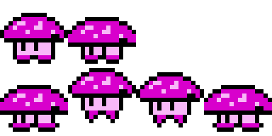
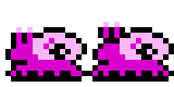
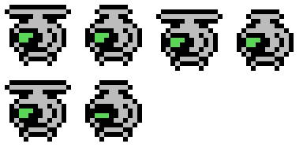
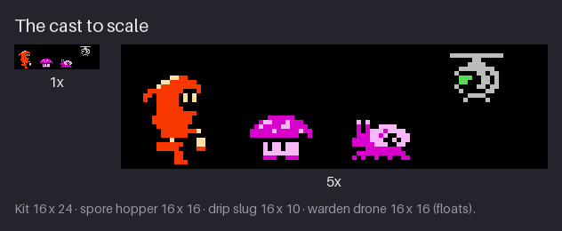
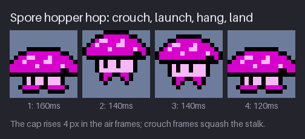
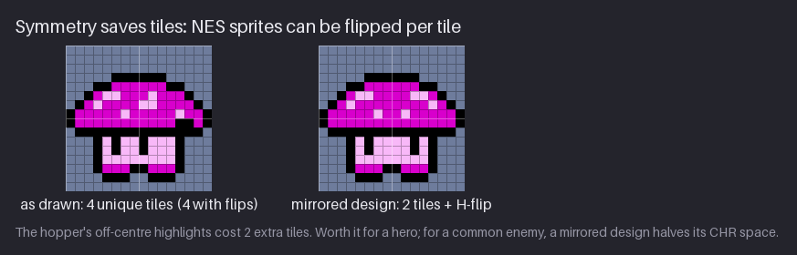
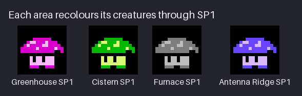

# Chapter 12 — Enemies and Creatures

Chapter 8 let three creatures breathe; this chapter turns them into enemies. A game needs
things that move on their own, things the player has to read, judge and avoid in a fraction of a
second. The vault has three: a **spore hopper** that bounces along the floor, a **drip slug**
that crawls along ledges and a **warden drone** that hovers and watches. Each one
is 16×16 (2×2 hardware sprites) with one sprite palette of three colours plus transparent: the
budget of a real NES enemy. Unlike some parts of this NES-inspired pack, the creatures need none
of the course's relaxations.

You will learn to design a creature from its role outwards, to keep it readable next to the
hero, to make a short looping animation for it, to save tiles with symmetry and the NES flip
bits, to recolour one drawing for every area of the game, and to *telegraph* an attack so the
player can react. By the end, the project gains three creature sheets with their JSON files:
`enemies/hopper`, `enemies/slug` and `enemies/drone`.

Previous: [Chapter 11](11-attacks-effects-and-hits.md). Next: [Chapter 13](13-secondary-motion-and-life.md).

## The cast to scale

Start every creature with four questions, in this order. The answers decide the shape before
you place a single pixel.

1. **Role.** What does it do in the game? Block a path, patrol a floor, guard a room, chase?
2. **Danger.** How much should the player fear it? A nuisance, a real threat, a wall?
3. **Movement.** How does it get around? Hops, crawls, floats, flies, stays put?
4. **Tell.** What does it show *before* it hurts you?

For the three `hollow-vault` creatures the answers are short:

| Creature | Role | Danger | Movement | Tell |
|---|---|---|---|---|
| Spore hopper | patrols floors and low platforms | low: touch damage | hops in arcs | a deep crouch before each hop |
| Drip slug | sits on ledges, blocks narrow paths | low: touch damage | slow crawl | none needed: slow and steady |
| Warden drone | guards a room from the air | medium: it attacks | floats and bobs | lens blink and freeze (alert) |

The answers turn into shapes. This is **shape language**: viewers read simple geometric
impressions before they read any detail, and they attach meaning to them. Round shapes read as
soft and bouncy, long low shapes as slow and ground-bound, hard straight edges as built or
mechanical, points and spikes as dangerous. The hopper is a round cap on short legs. The slug
is a long, low wedge. The drone is a circle hung under a hard horizontal bar, with one big eye.
None of them has a point anywhere: they are the vault's mild, early creatures. A later, nastier
creature would earn spikes.


Look at the 1× panel on the left first. That is the size the player sees, and it is the only
size that matters for the read. Three things make each creature separate from Kit and from each
other at that size:

- **Proportion.** Kit is tall (16×24) and vertical, with a pointed hood. The hopper is as wide
  as it is tall, the slug is wider than tall (16×10), and the drone floats off the ground. No
  two silhouettes share a bounding shape.
- **Hue.** Kit is the only red thing on the screen. The hopper and slug are magenta in the
  Greenhouse; the drone is grey with a green lens. The section *Friend or foe* below turns this
  into a rule.
- **Eyes.** Every creature has visible eyes or an eye, and they look the same way: left,
  towards Kit, who faces right. Eyes tell the player "this thing is alive and it has seen me".
  Two black pixels in the hopper's pale stalk are enough.

All three sit on the same 16 px width as Kit's body column. That is no accident: a 16 px wide
sprite costs 2 of the 8 sprites the NES can show on one scanline. Kit and three creatures side
by side on one row already use all 8. Level design keeps them apart vertically, and the art
keeps them narrow: a creature that is 17 px wide costs a third sprite on every row it touches.

> **Size check.** Draw a new creature inside a 16×16 box from the start. If it does not fit,
> the design is too detailed for its role, not the box too small.

**Try it.** Draw three 16×16 silhouettes in solid black on a light background, one for each of
the words *bounce*, *creep* and *watch*. No eyes, no colour. Show them at 1× to someone and ask
them to match the words. If they cannot, push the proportions further (wider, lower, rounder)
until they can.

## The hop

A creature's animation is shorter than the hero's, and it has a different job. Kit's cycles
show the player what *they* are doing. A creature's cycle shows what *it is about to do*, and it
must be readable in the corner of the eye while the player watches Kit.

The hopper has two animations in one sheet. Row 0 is the idle from Chapter 8: two frames of
400 ms, the cap squashing down 1 px and spreading 1 px each side, then springing back. Row 1 is
the hop: four frames, 560 ms in total, looping.


Read the strip as a little jump, the same anatomy as Kit's in Chapter 10:

1. **Crouch, 160 ms.** The cap drops and spreads; the stalk shortens from 4 rows to 3; the feet
   splay outwards. This is the *anticipation*, and it is the longest frame on purpose: it is the
   hopper's tell. A player who sees the cap flatten knows a hop is coming.
2. **Launch, 140 ms.** The cap snaps up 4 px and narrows back to its rest shape. The feet dangle
   under the stalk, two thin black legs: nothing is touching the ground.
3. **Hang, 140 ms.** The same drawing 1 px lower: the top of the arc, where the creature slows
   down. The feet still dangle.
4. **Land, 120 ms.** The crouch pose again. Landing is a squash, just like the take-off, so the
   same frame does both jobs.

Two reuse tricks hide in those four frames. The land frame *is* the crouch frame, so the sheet
stores five different drawings, not six, across idle and hop. And the hang frame is the launch
frame moved down 1 px: in a game you could store one drawing and let the code place the sprite
1 px lower. The sheet keeps the offset baked in so the previews play correctly, but it is worth
noticing, because tiles are a budget (see the next section).

The hop is drawn **in place**. The 4 px rise inside the frame is the creature stretching off the
ground; the arc across the floor is the game's job. If the code glides the hopper 16 px forwards
over the two air frames (280 ms), every hop covers exactly one metatile.
Keep body movement and travel separate and the same sheet works for a short hop, a long hop or a
hop on the spot.


The GIF shows all five loops at their real speeds. Watch how different the rhythms are:

- the hopper idle (2 × 400 ms) is a slow breath;
- the hop (160/140/140/120 ms) is quick with a held crouch;
- the slug crawl (2 × 260 ms) is slow and even, an inchworm: on the second frame the foot
  stretches 1 px forwards and the eye stalks rise 1 px;
- the drone hover (4 × 100 ms) is fast and mechanical: the rotor alternates between a 12 px
  wide bar and a 6 px wide blur every frame, and the body bobs 1 px every two frames;
- the alert (2 × 80 ms) is faster still and holds the body still.

Different rhythms are part of the read. A player learns that the slow pulse is harmless
background and that a fast or sudden change means attention. Timing is character as much as
shape is.

**Try it.** Take one of your silhouettes and draw a 2-frame idle for it: frame 2 is frame 1
squashed by 1 px (1 px shorter, 1 px wider on each side). Play it at 400 ms per frame, then at
150 ms. Write down what the creature seems to be feeling at each speed.

## Symmetry saves tiles

Every 8×8 tile your creature uses lives in the sprite pattern table, which holds 256 tiles for
*all* sprites in the game at once: Kit, every creature, every effect, the HUD. Chapter 24
counts the finished pack: Kit's frames take 90 of them, and the three creatures, all 14 of their
frames together, cost 28. That count is of *unique, non-empty* 8×8 tiles, with a tile and its
horizontal mirror counted once, and with each frame cut into tiles from its own bounding box (so a
creature that bobs by a pixel re-uses the same tiles). Cut every frame on the fixed 16×16 grid
instead, and the same frames need 39 unique tiles; the raw total, before removing repeats, is 56.
So the question "how many tiles is this creature?" is a real design question, and symmetry is the
cheapest answer.

> **NES rule:** every hardware sprite has its own **horizontal and vertical flip bits** (and its
> own palette and priority bits) in its 4-byte entry in sprite memory (OAM). The PPU can draw any
> 8×8 tile mirrored, for free. So a left-right symmetric 16×16 creature needs only its left
> two tiles: the right two are the same tiles with the H-flip bit set. Flips are **per tile**,
> not per creature; the game code mirrors a whole creature by flipping each sprite *and* swapping
> the left and right columns.


The figure shows the hopper's idle frame cut into its four 8×8 tiles (the light grid lines mark
tile edges). As drawn, the cap's spots are irregular (no spot has a mirror twin), and the eyes
sit slightly left of centre so the hopper faces Kit. No tile is a
mirror of another, so the frame costs 4 tiles. The mirrored design on the right places the spots
and eyes symmetrically: the right half is the left half flipped, so the frame costs 2 tiles.
Across a 6-frame creature that is the difference between 24 tiles and 12.

The price is character. The mirrored hopper looks straight ahead instead of at Kit, and its
spots become a mirrored pattern, which reads a little more printed and a little less grown.
Whether that trade is worth it depends on the creature: for a hero, almost never; for a common
enemy that appears in dozens of rooms, often.
The `hollow-vault` creatures keep their asymmetry (the tile budget has room), but you should know
which of your designs could be mirrored and what that would cost.

Flipping has a second use: turning a creature around. The hopper is drawn facing left. To face
right, the game flips the whole metasprite, and here the per-tile rule bites:


The middle panel is what happens if you flip each tile but leave it where it was: every quarter
is mirrored in place, and the cap splits down the middle. The right panel flips each tile *and*
swaps the two columns, which is the correct mirror. In an editor you never see this, because
"flip horizontal" flips the whole selection. It matters as soon as your art goes into a tile
editor or an engine that thinks in 8×8 sprites, and it explains a habit worth keeping: draw
creatures so that their **facing is carried by the whole shape**, not by one tile, so the
flipped version reads just as well.

A flipped sprite also flips its lighting: shading placed for a light from the upper left now
says the light is upper right (look at Kit's hood rim and the slug's shell when they turn).
NES-era games accepted this almost universally, because the alternative (a second set of tiles
drawn with the light on the correct side) doubles the cost. Accept it too, and keep highlights
small so the swap is not noticeable in motion.

The vertical flip bit works the same way, top to bottom. A drip slug crawling along a *ceiling*
needs no new tiles: V-flip all four sprites and swap the top and bottom rows. Its light now comes
from below, which on a ceiling creature reads as reflected light, so it gets away with it.

**Try it.** Draw a 16×16 creature that is fully left-right symmetric: draw only the left 8×16
half, then copy, flip and place it as the right half. Now add one asymmetric detail (an eye
looking sideways, a highlight) and count how many 8×8 tiles are now unique. One pixel can cost
two tiles.

## Variants for free

The second budget is colour. An NES game has four sprite palettes on screen at once. The
`hollow-vault` pack spends them the same way in every area:

| Sprite palette | Used by | Greenhouse colours |
|---|---|---|
| SP0 | Kit | $0F $16 $37 (red, cream) |
| SP1 | creatures (hopper and slug) | $0F $14 $34 (magenta, pink) |
| SP2 | effects and pickups | $0F $28 $30 (yellow, white) |
| SP3 | the drone | $0F $10 $2A (light grey, green lens) |

Slot 0 of each sprite palette is transparent and slot 1 is black, the outline, so each sprite
gets two real colours on top of black. The hopper and slug share SP1: two creatures, one palette.

Because every creature is drawn in **slots**, not in colours (slot 1 outline, slot 2 main,
slot 3 light, exactly like Kit), changing the palette recolours every creature at once. Each
area loads its own SP1, and the same tiles become four different-looking families:


| Area | SP1 (main, light) | The hopper reads as |
|---|---|---|
| Greenhouse | $14, $34 | a magenta toadstool |
| Cistern | $19, $39 | a green, mossy thing that lives in damp |
| Furnace | $00, $10 | a grey, ash-covered survivor |
| Antenna Ridge | $13, $33 | a cold, purple night creature |

Zero new tiles, four looks, and each one belongs to its area. This is the classic NES palette
swap. Many NES games went further and used a different palette for a *tougher* version of the
same enemy, so the colour itself warns the player. With only four sprite palettes on screen,
that warning costs a palette slot, so `hollow-vault` keeps one creature family per area.

For a variant to work, check three things, and check them at 1× on the area's real background:

- **The light colour stays lighter than the main colour.** If slot 3 and slot 2 have the same
  value, the shading disappears and the creature goes flat. Squint, or desaturate it as in
  Chapter 4.
- **The main colour is not the background's colour.** The Antenna Ridge variant is the weak one
  here: its main colour $13 is also the middle colour of the Ridge rock (BG0 $0F $03 $13 $23).
  The hopper still reads there because its black outline is closed all the way round and its
  light $33 is brighter than any rock colour, but it is a near miss. If you design an area
  palette, pick the creature hue *after* the background hues, from a part of the colour wheel
  the background does not use.
- **Every variant still has visible eyes.** In the grey Furnace variant, the eyes are the same
  black as the outline, but they sit in the light stalk, so they stay clear.

The slug shares SP1, so it recolours along with the hopper. The drone has its own palette, SP3,
because it is a machine: its body stays light grey ($10) in every area and only its lens colour
changes (Greenhouse $2A green, Cistern and Furnace $26 salmon orange, Ridge $2C cyan). One colour
that changes per area is enough to tie it to the room.

**Try it.** Recolour one of your creatures four times by changing only the two colours in its
palette (indexed mode makes this a two-click job in any editor that supports it: Aseprite,
LibreSprite, Pixelorama or GrafX2). For each version, paste it onto a screenshot of a background
with a different dominant hue. Which version disappears? Why?

## Telegraphing

A **telegraph** is the visible change that comes before an attack: the wind-up a player learns
to read. Without one, damage feels unfair, because the player had no chance to react. With one,
the same damage feels like the player's own mistake, which is what makes them try again.

Three rules make a telegraph work:

- **It must be a change of state, not a detail.** The player is watching Kit, not the enemy. The
  tell has to register in peripheral vision, which is good at noticing *change* (motion starting
  or stopping, a flash, a sudden shape) and poor at noticing detail.
- **It must last long enough to react to.** A typical human reaction to a visual cue takes
  around a quarter of a second, and the player also has to decide what to do. A tell held for
  half a second or more is fair; a tell of one 80 ms frame is a trap.
- **It must be the same every time.** One creature, one tell, always the same pose and timing.
  Consistency is what lets players *learn* the creature; after two encounters they react before
  thinking.

The warden drone shows all three in two animations:


- **Hover** (4 × 100 ms): the lens is open (a green pupil inside a thick black ring), the rotor
  alternates wide and narrow, and the body bobs 1 px down and up. It looks busy but calm.
- **Alert** (2 × 80 ms): the lens **blinks**: on the second frame its top row closes to black,
  leaving a thin green line, like an eye narrowing. The rotor keeps alternating, but faster,
  and the **bob stops**. The drone holds dead still.

The stillness is the strongest cue of the three. A thing that has bobbed gently for seconds and
suddenly freezes is noticed at once, even in the corner of the eye. The blink adds a flicker at
the drone's most important point, its eye. The faster rotor adds urgency. The game holds the
alert loop for as long as the designer wants the warning to be; several loops (half a second or
more) before the drone acts is a fair default.

The hopper's tell is its 160 ms crouch, and here the timing is short but fair, because the
attack is short too: a hop is not aimed at Kit, it just goes. The slug needs no tell at all. It
moves slowly and steadily, so its threat is always visible. Scale the tell to the danger: the
more an attack can hurt, the louder and longer its warning.

> **Danger in two steps.** Telegraph with *motion first, colour second*. Motion (freeze, crouch,
> lunge back) reads in peripheral vision; colour changes need the player to look. If you want a
> colour flash too, use the effect palette or a whole-palette swap (Chapter 19), never a new
> colour in the creature's own palette: it does not have one to spare.

**Try it.** Give one of your creatures a 2-frame alert state that differs from its idle in only
two ways: one change of motion (stop, shake, lean back) and one change in its eyes. Play idle for
2 seconds, then the alert. Ask a friend to press a key the moment the creature "changes its
mind". If they are slow, make the motion change bigger, not the details.

## Friend or foe

The final check is the oldest one in game art: can the player tell, instantly, what helps and
what hurts? `hollow-vault` answers with a colour code that every area follows:

- **Red is Kit.** Kit's palette, SP0 $0F $16 $37, is the same in every area, and no creature and
  no pickup uses $16. Red always means "you".
- **The area's SP1 hue is the creatures.** Magenta in the Greenhouse, green in the Cistern,
  grey in the Furnace, purple on the Ridge: "something else, alive".
- **Grey with a coloured lens is a machine.** The drone's SP3.
- **Yellow and white are effects and good things.** SP2 holds sparks, dust, splashes and the
  seed pickups.

The rule this produces is simple: **never give a foe the hero's palette.** Kit's palette is free
in the SP0 slot, and the hopper is drawn in the same slots as Kit, so it is tempting to save a
palette by letting small creatures borrow it. The figure shows why not:


In the left panel the hopper is red and cream, exactly Kit's colours. It looks like it belongs
to Kit: a pet, a companion, a power-up to collect. Players run into things that look friendly.
In the right panel the magenta hopper says "something else" before the player has even read its
shape. The shapes are identical; only the palette changed.

The same logic runs the other way. Do not put *good* things in the creature palette, and keep
the background out of all of these hues where you can. The one area that bends the rule is the
Furnace, whose bricks use Kit's red $16 (BG0 $0F $07 $16 $27). It works because a background
brick never has Kit's closed black outline, cream face or silhouette, and because Kit is
never *behind* a brick. Even so, it is a deliberate exception; do not make it a habit.

**Try it.** Put three sprites on one screenshot: your hero, one of your creatures and a pickup.
Shrink the screenshot to 1× and look at it for one second. Can you say which is which from
colour alone? If two share a hue family, move one of them.

## Project: the creature sheets

At the end of Chapter 11 the pack had Kit's full move set, five effects, the seed pickup and the
hopper's 2-frame idle as `enemies/hopper-idle.png`. This chapter turns the hopper into a full
sheet and adds the slug and the drone. The snapshot is
[`project/ch12/`](project/ch12/README.md); its README marks these files as new or changed:

- `enemies/hopper.png` (64×32) and `enemies/hopper.json` — the hopper: idle on row 0, hop on
  row 1;
- `enemies/slug.png` (32×16) and `enemies/slug.json` — the slug's 2-frame crawl;
- `enemies/drone.png` (64×32) and `enemies/drone.json` — hover on row 0, alert on row 1;
- `preview/hopper-6x.png`, `preview/hopper-hop.gif`, `preview/slug-6x.png`,
  `preview/slug-crawl.gif`, `preview/drone-6x.png`, `preview/drone-hover.gif` and
  `preview/drone-alert.gif` — integer-scaled previews.

The old `enemies/hopper-idle.png` and `.json` (and their previews) are gone: their two frames
are now row 0 of `hopper.png`, pixel for pixel. One creature, one sheet.

All three sheets use 16×16 frames, one animation per row, read left to right. Unused cells stay
transparent. All three face left, are lit from the upper left, and use the slots the same way as
Kit: `1` black outline, `2` main colour, `3` light colour. In the pixel maps below, `.` is
transparent.

### The hopper



Here is the idle's first frame, the rest pose that every other frame is built from:

```text
................
................
................
.....111111.....
...1122222211...
..123322232221..
.12322223322221.
1222223222223221
1222222222221121
.11111111111111.
...1313313331...
...1313313331...
...1333333331...
...1222112221...
....111..111....
................
```

To draw your own, work from the big shape down:

1. **Block in the cap** as a half-disc 16 px wide and 6 rows tall, in the main colour, sitting
   on row 9. Outline it in black. The outline steps out 2 px, then 1 px, 1 px and 1 px on the
   way down: the smooth curve from Chapter 2.
2. **Draw the gills**: a full black band under the cap (row 9). This is the darkest place on the
   creature, the shadow under the cap, and it separates cap from stalk at any size.
3. **Draw the stalk** in the light colour, 10 px wide including its black outline and 3 rows
   tall, with two short feet in the main colour at the bottom: the stalk is lit, the feet are in
   the shadow of the body.
4. **Place the eyes**: two black 1×2 marks in the stalk, at x 5 and x 8 of the frame, left of
   centre so the hopper looks left. The pale stalk is the only place where a black eye can show.
5. **Add the spots**: eight pale pixels on the upper half of the cap, in groups of 1–2 px. Keep
   them irregular, with no two groups the same, so they read as spots and not as a pattern; one
   black pixel pair low on the right (row 8) adds a dent of shadow.

Then the animation, all derived from that pose:

- **Idle frame 2:** move the cap down 1 px and widen it by 1 px each side (the bottom two rows of
  the cap now fill the whole 16 px width); the stalk loses its top row. Same pixel count, wider
  shape: that is a squash.
- **Hop frame 1, crouch:** the squashed idle cap and stalk, with the feet splayed 1 px further
  out each side (row 13: `..122221122221..`).
- **Hop frame 2, launch:** the rest cap moved up so its top is on row 0 (4 px higher than the
  crouch); under the stalk the legs hang as two thin strokes that taper to single black pixels.
- **Hop frame 3, hang:** frame 2 moved down 1 px.
- **Hop frame 4, land:** a copy of frame 1.

The JSON stores the frame size, the palette (as NES indices and as RGB) and one entry per
animation:

```json
{
  "image": "hopper.png",
  "frameWidth": 16,
  "frameHeight": 16,
  "palette": ["$0F", "$0F", "$14", "$34"],
  "animations": {
    "hopper-idle": { "row": 0, "frames": 2, "durations": [400, 400], "loop": true },
    "hopper-hop":  { "row": 1, "frames": 4, "durations": [160, 140, 140, 120], "loop": true }
  }
}
```

(The real file also has a `paletteRGB` list and is spread over more lines; the content is the
same.) The palette is the Greenhouse SP1. Other areas swap it at load time; the PNG never
changes.

### The slug



```text
................      ................
................      ................
................      ................
................      ................
................      ...3.3..........
...3.3..1111....      ..12121.1111....
..121211333311..      ..121211333311..
..1212333233331.      ...111333233331.
..12223323113331      ..12223323113331
.122223331131331      .122223331131331
.12222233311331.      .12222233311331.
..111222222221..      ..112222222221..
..1222222222221.      .12222222222221.
.121211211211221      1212112112112121
..1111111111111.      .11111111111111.
................      ................
```

1. **Block in a low wedge**, 16 px wide and 10 rows tall, sitting on the bottom of the frame:
   the head and eye stalks on the left, the shell on the right.
2. **Draw the shell** in the light colour: a rounded hump with a black-and-main spiral inside,
   one black pixel at its centre. The light shell over the darker body puts the slug's highest
   contrast on its back, away from its face, which keeps the eye stalks reading as stalks.
3. **Draw the eye stalks** as two 1 px main-colour lines with light tips on top. Light pixels on
   the ends of thin lines are how a 16×10 creature has eyes at all.
4. **Draw the foot**: the bottom row of the body in the main colour, broken by black ripple marks
   every third pixel. The ripples are the "muscle waves" that make it a slug and not a stone.
5. **Frame 2** stretches the foot 1 px forwards (it now fills all 16 px), raises the eye stalks
   by 1 px, and pulls the front of the head up into the stalks. Two frames, 260 ms each: stretch,
   gather, stretch, gather.

The slug's JSON has one animation, `slug-crawl` (row 0, 2 frames, 260/260 ms), and the same SP1
palette as the hopper. In the Cistern scene (Chapter 13) one of the two slugs is the same sheet
flipped horizontally, so the two slugs face opposite ways at no tile cost.

### The drone



Hover frame 1 and alert frame 2, side by side:

```text
................      ................
..111111111111..      .....111111.....
.12222222222221.      ....12222221....
..111112211111..      .....112211.....
....11222211....      ....11222211....
...1222222221...      ...1222222221...
..121111221221..      ..121111221221..
..113331122121..      ..111111122121..
..113311122121..      ..113331122121..
..121111221221..      ..121111221221..
...1211111221...      ...1211111221...
....11222211....      ....11222211....
....12111121....      ....12111121....
.....1....1.....      .....1....1.....
................      ................
................      ................
```

1. **Draw the rotor** first: a light-grey bar 12 px wide and 1 px thick, outlined in black,
   across the top. It is the only hard, straight horizontal on any creature, which is what makes
   the drone read as built rather than grown.
2. **Draw the mast**: a short neck from the rotor down to the body.
3. **Draw the body** as a circle about 10 px wide and 8 rows tall, light grey with a black
   outline. Add a vertical grey seam on its right side: a panel line that gives the sphere some
   volume without a third value.
4. **Draw the lens** on the left side: a thick black ring with a 3+2 pixel pupil in slot 3. With
   only two colours plus black, the lens colour is the drone's whole identity, and the ring of
   black around it makes it the highest-contrast point on the sprite. That is where the player's
   eye goes, and that is where the telegraph happens.
5. **Add two small claws** under the body, 1 px black legs ending in single pixels, so it has
   something to grab with.

The animation frames are all small edits of that drawing:

| Frame | Rotor | Body | Lens |
|---|---|---|---|
| hover 1 | wide (12 px) | rest | open |
| hover 2 | narrow (6 px) | rest | open |
| hover 3 | wide | 1 px down | open |
| hover 4 | narrow | 1 px down | open |
| alert 1 | wide | rest | open |
| alert 2 | narrow | rest | blink (top row black) |

The narrow rotor is not a smaller rotor. It is the same rotor seen edge-on halfway through a
turn, and alternating it with the wide bar every frame reads as spinning. The drone's JSON has
the palette $0F $0F $10 $2A and two animations: `drone-hover` (row 0, 4 × 100 ms) and
`drone-alert` (row 1, 2 × 80 ms), both looping.

> **Check your sheet.** Play each animation at its real timing in your editor's timeline (all
> the common editors can loop a tag or a frame range at per-frame durations), at 1× and at 4×.
> Then flip the sheet horizontally and play it again: does each creature still read when it
> faces right?

## Exercises

1. **A 16×16 enemy, silhouette first.** Pick a role from the four questions (role, danger,
   movement, tell) that is *not* one of this chapter's three. Draw its silhouette in solid black
   in a 16×16 box, then fill it in three colours plus transparent: black outline, a main colour,
   a light colour.

   *What to look for:*
   - its silhouette differs from your hero's in proportion (not just in size);
   - it has eyes or an eye, looking the way it faces;
   - the light colour is clustered on the side the light comes from;
   - it reads at 1× next to your hero.

   <details><summary>Example solution</summary>

   

   The course's three creatures each answer the questions with a different proportion: the
   hopper is round, the slug long and low, the drone a circle under a bar. None of them shares
   Kit's tall, pointed silhouette, and each has visible eyes looking left, towards Kit.
   </details>

2. **A 4-frame hop.** Animate your creature (or the hopper) hopping in place: crouch, launch,
   hang, land. Choose your own timings, but make the crouch the longest frame.

   *What to look for:*
   - the crouch is visibly squashed (shorter and wider) and the launch visibly stretched;
   - the body rises at least 3–4 px in the air frames;
   - the land frame reuses the crouch, or is very close to it;
   - the loop has no hitch when frame 4 returns to frame 1.

   <details><summary>Example solution</summary>

   

   The hopper crouches for 160 ms (its tell), launches 4 px up, hangs 1 px lower and lands in
   the crouch pose again. Five drawings cover both of its animations, because the land frame is
   the crouch.
   </details>

3. **Halve the tiles.** Redesign your creature so that it is left-right symmetric, and count its
   unique 8×8 tiles before and after, allowing flips.

   *What to look for:*
   - the redesign needs only the left column of tiles; the right column is the same tiles
     H-flipped;
   - the creature still has a readable face or front, even though it now looks straight ahead;
   - you can say what the redesign lost (facing, light direction) and whether the saving is
     worth it for this creature.

   <details><summary>Example solution</summary>

   

   The mirrored hopper costs 2 tiles per frame instead of 4. It loses its sideways glance and its
   irregular spots, so the course keeps the asymmetric version; for an enemy that fills a
   whole level, the mirrored one would be the better buy.
   </details>

4. **Two palette variants.** Recolour your creature for two different areas by changing only the
   two non-black colours of its palette. Test each on a background from its area.

   *What to look for:*
   - each variant's light colour is clearly lighter than its main colour;
   - neither variant uses the hero's colours;
   - each variant stands out from its area's background, especially from the walkable surfaces;
   - the tiles are identical; only the palette changed.

   <details><summary>Example solution</summary>

   

   The hopper in Greenhouse magenta, Cistern green, Furnace grey and Ridge purple, from one set
   of tiles. The Ridge variant is the weakest, because its main colour is also the Ridge rock's
   mid colour; its closed outline and bright $33 highlights carry it.
   </details>

## Recap

- Design a creature from four questions: **role, danger, movement, tell**. The answers decide
  the shape before any pixels.
- **Shape language**: round reads soft, long and low reads slow, straight edges read built,
  points read dangerous. Make every creature's proportion different from the hero's.
- Keep creatures in **16×16 (2×2 sprites)**. Every 8 px of width costs one of the 8 sprites per
  scanline.
- Creature loops are short and each has its own **rhythm**: hopper idle 2 × 400 ms, hop
  160/140/140/120 ms, slug crawl 2 × 260 ms, drone hover 4 × 100 ms, alert 2 × 80 ms.
- Draw the hop **in place**, with a long crouch as the tell; the game provides the travel. Reuse
  the crouch as the landing.
- NES sprites flip **per tile**. A symmetric design halves its tiles; mirroring a metasprite
  needs the flip bits *and* swapped columns. Flipping also flips the light; accept it.
- Draw in **slots, not colours**, and one set of tiles becomes a family of **palette variants**,
  one per area. Check value contrast and the background for each.
- A **telegraph** is a change of state that is long enough and always the same. Motion first
  (freeze, crouch), colour second.
- **Never give a foe the hero's palette.** Keep a colour code: red is Kit, the area hue is
  creatures, grey with a lens is machines, yellow and white are effects and pickups.

## Further study

- **"Pixel Art Class - Woodland Creature Sprite Set"** — AdamCYounis —
  https://www.youtube.com/watch?v=c8vXmdPoD00. A set of small creatures designed together; watch
  how each one gets its own silhouette and personality from a few pixels, and how the set shares
  one visual language.
- **"Pixelblog 31 - Shmup Sprite Design"** — Raymond Schlitter (Slynyrd) —
  https://www.slynyrd.com/blog/2020/12/14/pixelblog-31-shmup-sprite-design. Enemy design for
  readability at speed: hero versus enemy contrast, symmetry and how to make a threat obvious.
- **PPU OAM** — NESdev wiki — https://www.nesdev.org/wiki/PPU_OAM. The 4-byte sprite entry: tile
  number, position, palette and the H/V flip bits this chapter relies on.
- **"NES Graphics Explained"** — NesHacker — https://www.youtube.com/watch?v=7Co_8dC2zb8. A clear
  visual walk through tiles, palettes and metasprites; watch the part on how sprites are built
  from 8×8 pieces.
- **"Making a Bouncy Slime Pixel Art Animation"** — Brandon James Greer —
  https://www.youtube.com/watch?v=J8MH-k0Fa6Y. Squash, stretch and anticipation on a tiny
  creature, the same principles as the hopper's hop at a slightly larger size.

Sources for this chapter: [REFERENCES.md](REFERENCES.md#chapter-12--enemies-and-creatures)
