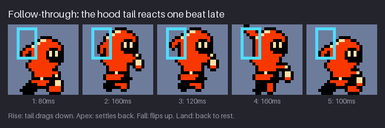
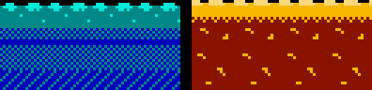
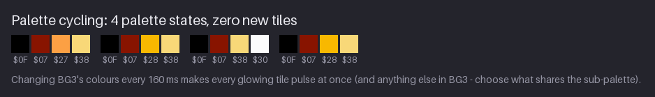
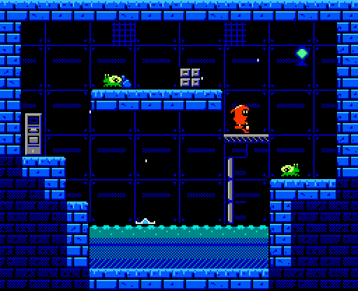

# Chapter 13 — Secondary Motion and a Living World

A sprite that moves only as one block looks like a cut-out. A screen where nothing moves unless
the player touches it looks like a photograph. This chapter is about the motion that *nobody
asked for*: the loose end of Kit's hood that trails behind them, the spores that drift through
the Greenhouse, the drips that fall in the Cistern, the water that flows and the slag that
glows. None of it changes the game. All of it changes how the game feels.

You will learn four cheap techniques, the same four NES games relied on: **follow-through** on a
character's loose parts, **ambient particles** drawn as sprites, **animated tiles** that loop
seamlessly, and **palette cycling**, which animates without drawing anything new. By the end,
the project gains two animated tile strips (`tiles/water-anim.png` and `tiles/molten-anim.png`)
and a splash effect (`fx/splash`).

Previous: [Chapter 12](12-enemies-and-creatures.md). Next: [Chapter 14](14-tiles-metatiles-and-attributes.md).

## The hood tail

Animators split motion into two kinds. **Primary motion** is the action itself: the body
walking, jumping, swinging. **Secondary motion** is everything that *reacts* to the primary
motion without driving it: hair, cloth, tails, antennae, a lantern on a strap. Secondary motion
is what tells the eye that a character has weight and is made of more than one material. A
cape that moves exactly with the body reads as painted on; a cape that lags reads as cloth.

At 16×24 there is room for one secondary element, and Kit's is the **hood tail**: the loose
point at the back of the hood. It is a small shape, 3 to 4 pixels tall, that can take four
positions:


| Position | Shape | Means |
|---|---|---|
| back | a short point hanging down and back, 3 rows | at rest, or moving slowly |
| flat | a horizontal streamer, 4 px long | moving fast forwards: air pushes it straight back |
| up | flicked up and back, 3 rows | the body is dropping, or knocked backwards |
| down | hanging straight down, 4 rows | the body is shooting upwards |

The rule behind all four: **the loose part points away from the direction of acceleration**.
When the body speeds up in one direction, the tail is left behind on the opposite side, just as
your head tips back when a bus pulls away. You do not need to simulate anything; you need to
know which way the body is being pushed in each frame.

Here is where each of Kit's animations uses the four positions:

| Animation | Hood tail per frame | Why |
|---|---|---|
| idle (500/400/120/400 ms) | back ×4 | no motion to react to |
| walk (4 × 140 ms) | back ×4 | too slow to lift it |
| run (4 × 90 ms) | flat ×4 | steady speed, steady drag |
| jump (80/160/120/160/100 ms) | back, down, back, up, back | see the next section |
| attack (120/60/160/120 ms) | back, flat, back, back | the strike lunges forwards |
| hurt (2 × 80 ms) | up, up | knocked back and up |

Notice the run. The tail stays flat in all four frames rather than flapping. A flapping tail at
90 ms per frame would flicker, and flicker draws the eye to the least important part of the
sprite. Constant speed means constant drag, so one position is the honest answer. Notice the
attack too: the tail streams flat for exactly one 60 ms frame, the strike, and is back by the
follow-through frame. One frame is enough, because the eye reads the lunge from the body and
only needs the tail to confirm it.

The tail is also cheap. Kit is 2×3 hardware sprites of 8×8, and the tail lives entirely in the
top-left and middle-left tiles (the back of the hood). Changing its position changes only those
two tiles; the other four can stay the same if the rest of the pose does.

> **A note on the project.** The hood tail is not new in this chapter. Kit's frames have carried
> these positions since Chapters 8 to 11, because they were drawn with this chapter's rule in
> mind. The `project/ch13` snapshot does not change any of Kit's files; this section explains the
> rule so you can check your own hero against it.

**Try it.** Open your hero's walk or run sheet from Chapter 9 and pick one loose element (hair,
a scarf, an ear, a strap). For each frame, draw an arrow showing which way the body is being
pushed, then check that the loose element points the other way. Fix any frame where it doesn't.

## Follow-through

**Follow-through** is what happens after the main action stops: the loose parts keep going for a
moment, then settle. **Overlapping action** is the same idea during the action: different parts
move at different times, so not everything starts and stops together. Both come from one fact:
loose parts are driven by the body, so they are always **one beat late**.

The jump is where Kit shows it most clearly:


Follow the box from frame to frame:

1. **Squat, 80 ms — back.** The body crouches, but slowly enough that the tail just rests.
2. **Rise, 160 ms — down.** The body shoots upwards and the tail is left behind, hanging
   straight down. This is drag: the body has moved and the tail has not caught up.
3. **Apex, 120 ms — back.** The body slows to a stop at the top of the arc. The tail catches up
   and settles into its rest position.
4. **Fall, 160 ms — up.** The body drops and the air pushes the tail up and back. It flips the
   opposite way from the rise.
5. **Land, 100 ms — back.** The body hits the ground and the tail returns to rest.

Each tail position describes what the body did *in the previous moment*. That is why the tail is
"one beat late": in frame 2 it shows the launch from frame 1, in frame 4 it shows the turn at
the apex. Your eye reads that lag as weight.

Three rules keep secondary motion from becoming noise:

- **It never leads.** If the tail moves before the body, the eye reads the tail as the thing
  doing the moving. Secondary motion reacts; it never starts anything.
- **It is smaller than the primary motion.** Between squat and rise Kit's whole body changes
  pose and the game lifts it many pixels; the tail moves by 2 or 3. At this size, 1 to 3 px of
  secondary motion is plenty.
- **It settles.** Every secondary chain ends at rest. A tail that is still swinging when the
  next action starts makes the character look nervous.

The jump also shows the limit of a 5-frame animation. A real tail would *overshoot* on landing:
the body stops, the tail keeps falling for a moment, hangs down, then springs back. Kit's land
frame is 100 ms, too short to show both. If your hero has a bigger loose element (a long scarf,
a cape), split the landing into two frames: one short frame with the element still moving
(tail down), then one with it settled. That is overlap at its most visible, and it costs one
frame.

**Try it.** Take your hero's jump from Chapter 10 and add one trailing element, or check the one
you have. Write the element's position next to each frame (rest, dragging, flipped, rest) before
you draw it. Then play the jump and watch only the element: does it ever move *before* the body?

## Ambient life

A screen feels alive when things move that the player did not cause. That **ambient motion**
is mostly tiny: a pixel of dust drifting, a drop falling, a glint. Done well, the player never
consciously notices it; take it away and the screen feels dead.


Each area has one ambient particle that tells you something about the place:

| Area | Particle | Motion | What it says |
|---|---|---|---|
| Greenhouse | spores, 1 px, white | drift up at about 7–17 px/s, sway 2 px every 600 ms | warm, damp, growing |
| Cistern | drips, 2 px tall, white | fall at about 36–84 px/s into the pool | cold, wet, underground |
| Furnace | embers, 2 px tall, white over yellow | rise faster than spores, jitter 1 px every 200 ms | hot, rising air |
| Antenna Ridge | twinkles, a 3×3 cross | blink on and off | open sky, distance |

The speeds come from a base speed (12 px/s for spores, 60 px/s for drips) multiplied by a
per-particle factor between 0.6 and 1.4. That spread matters: particles at different speeds
read as being at different distances, which gives a flat screen depth for free. Slow things
should also move one pixel at a time. A spore at 12 px/s moves 1 px about every 80 ms; it never
jumps, so it looks like it is floating rather than stepping.

Four rules make ambient motion help instead of distract:

- **It is small and quiet.** One or two pixels, in a colour that does not belong to anything
  interactive. The spores are white, not the seeds' yellow, so the player never mistakes them
  for pickups.
- **Its direction has a reason.** Spores rise on warm air, drips fall, embers rise fast. Motion
  with a cause reads as atmosphere; random motion reads as a glitch.
- **Nothing moves in step.** Every particle starts at a different point in its cycle (a random
  phase offset of up to 4 seconds), and the screen's loops all have different lengths: Kit's idle
  is 1420 ms, the hopper's 800 ms, the drone's hover 400 ms, the animated tiles 800 ms. When
  everything shares one beat the screen looks mechanical; staggered beats look like a world.
- **It stays away from the action.** Particles live in the open air of the room, not on the
  platforms where the player is reading Kit and the creatures.

> **NES rule:** a particle drawn as a sprite costs a **whole 8×8 sprite**, even if it is a
> single pixel. The NES has 64 sprites in total and draws at most **8 on one scanline**; a ninth
> on the same line simply does not appear. The Greenhouse spends 26 sprites (Kit 6, hopper 4,
> drone 4, two seeds and ten spores) and never puts more than 4 on one line; the busier Cistern
> peaks at 5. Ambient particles are the first thing to cut when a line gets crowded, so scatter
> them vertically and keep them few.

Particles that do not need to move freely can be **background tiles** instead, and then they
cost no sprites at all. The Antenna Ridge's ordinary stars are tiles; only the few twinkling
ones are sprites. The rule of thumb: if it moves across the screen, it is a sprite; if it stays
in place and only changes, it can be a tile (the next section) or a palette (the one after).

**Try it.** Pick an area of your own game and choose its particle. Write one line for each of
the four rules: size and colour, direction and cause, how you will stagger it, where it will not
go. Then count: how many will be on screen at once, and could more than three ever share a row?

## Animated tiles

The water in the Cistern and the molten slag in the Furnace are not sprites. They are
background tiles that are redrawn every 200 ms, cycling through four frames:


Both use the same trick. Each surface metatile is 16×16, but only its **top half** changes: the
crests on the top rows shift **4 px to the left** every frame, while the body below (dithered
water, crusted slag) never moves. The eye reads the moving surface as the motion of the whole
pool. Ch. 7 built the water's construction (crest, body, dither into the deep colour); this
chapter makes it flow.

The arithmetic that makes the loop seamless is simple, and easy to get wrong:

> The crest pattern repeats every **16 px**. It moves **4 px** per frame. After **4 frames** it
> has moved 16 px, exactly one repeat, so frame 5 is identical to frame 1 and the loop has no
> seam.

Get the numbers wrong and the loop lurches:


In the top row the crests move 3 px per frame. Three steps of 3 px look smooth, but after four
frames the pattern has moved 12 px, not 16, so going from frame 4 back to frame 1 is a jump of
7 px (or 9 px the other way, whichever the eye picks). The water stutters once per loop, and
once you have seen it you cannot stop seeing it. In the bottom row every step, including the
wrap from frame 4 to frame 1, is 4 px. The animated version makes the difference obvious:


So the rule for any scrolling tile is:

- **step × frames = the pattern's repeat** (or a whole multiple of it);
- the **repeat divides the tile width**, so neighbouring tiles join without a seam (for a 16 px
  metatile: a repeat of 16, 8 or 4 px);
- the **step is not too big**: more than about a quarter of the repeat per frame and the eye
  stops seeing motion and starts seeing flicker. 4 px of a 16 px repeat is the maximum here.

At 4 px per 200 ms, the surface flows at 20 px per second, a lazy current. The molten slag uses
the same step, but its edge rows also shimmer: the dither row under the crust shifts 1 px per
frame, and since its own pattern repeats every 2 or 4 px, four frames bring it back to the start
too. Any pattern whose repeat divides the loop's total shift will loop cleanly.

The slow pace is a choice. 200 ms per frame makes water and slag feel heavy and calm, quieter
than the creatures (80–140 ms frames) and much quieter than Kit's run. Background animation
should always be the slowest motion on screen, so the eye ranks it last.

**On the hardware.** The NES draws backgrounds from the tile patterns in its pattern table, so a
game animates a tile by changing the pattern. Games with tile RAM on the cartridge rewrite a few
tiles during the short blank period between frames; games with tile ROM switch a whole bank of
tiles at once (Chapter 24 shows this for the Cistern pool). Either way, every copy of the tile
on screen changes together, which is why one 16×16 surface metatile can cover a whole pool. The
cost is small: the top half of the water metatile is 2 tiles, so four frames are 8 tiles for
every water surface in the game. This is NES-inspired rather than exact: the course does not
count the processor time a real game would spend on the update.

> **Tool aside.** To make the frames, draw frame 1, then duplicate it and shift the surface rows
> 4 px left *with wrap-around*, so the pixels that leave the left edge come back on the right.
> Aseprite's Shift command, GIMP's Offset (with wrap-around) and Pixelorama's offset effect all
> do this. A tile or wrap-around preview mode shows the joins while you work.

**Try it.** Draw a 16×8 strip with a crest pattern that repeats every 8 px. Make four frames,
shifting it 2 px per frame with wrap-around. Play it at 200 ms. Then make a version that shifts
3 px per frame and watch where it lurches.

## Palette cycling

The cheapest animation on the NES draws nothing at all. Instead of changing tiles, the game
changes the **colours** in a sub-palette, and every pixel that uses those slots changes at once.


The Furnace's glowing sub-palette, BG3, normally holds $0F (black), $07 (dark red), $28 (yellow)
and $38 (pale yellow). Every 160 ms the game rewrites its two bright slots:

| State | Slot 2 | Slot 3 | Reads as |
|---|---|---|---|
| 1 | $27 orange | $38 pale yellow | dim |
| 2 | $28 yellow | $38 pale yellow | base |
| 3 | $38 pale yellow | $30 white | bright |
| 4 | $28 yellow | $38 pale yellow | base |

Four states of 160 ms make a 640 ms pulse: dim, base, bright, base, and round again. The base
state appears twice, so the brightness eases in and out rather than snapping between extremes;
it is a ping-pong, the same shape as a breathing idle. Slot 1, the dark red of the crust, never
changes, so the cracks and crests glow while the slag itself stays put.


Watch the GIF closely and you will see the catch: the stacked crates on the right pulse too.
They sit in metatiles that use BG3, so their colours come from the same four palette entries.
Palette cycling changes **everything** in the sub-palette, everywhere on the screen. You have two
choices:

- **Plan for it.** Put only things that should glow in the cycling sub-palette. Everything else
  moves to another one, which means the attribute grid of Chapter 14 has a say in the layout.
- **Make it a feature.** Here the crates sit next to a glowing pool, so their pulsing reads as
  firelight reflected on them. It works because they are close to the source. A crate on the
  far side of the room pulsing in time with the pool would look wrong.

When you design a sub-palette that will cycle, list every metatile that uses it and ask of each
one: "should this glow?"

> **NES rule:** the palette is 32 bytes of memory inside the PPU: 4 background and 4 sprite
> sub-palettes. The game can rewrite any entry during the blank period between frames, so
> colours can change **every frame**, 60 times a second, at almost no cost and without touching a
> single tile. NES games used this constantly: shimmering water, glowing lava, flashing hit
> effects, and fades to and from black, which step each colour down one brightness row ($3x to
> $2x to $1x to $0x) and then to $0F.

Palette cycling has limits. It changes colour, not shape, and an NES sub-palette has only three
colours to rotate, so it is best for **pulses and flashes**, not for flowing motion. Long
colour-cycling waterfalls need many colours in a row; on the NES, flow is the job of animated
tiles, and glow is the job of the palette. Use both together and a pool can flow *and* breathe.

**Try it.** Take any lamp, crystal or window you have drawn in a 4-colour sub-palette. Write
down four states for its two brightest slots (dim, base, bright, base) using colours from the
same hue column of the NES palette. Swap the palette by hand four times, exporting each state,
and play them at 160 ms.

## Project: animated water, molten slag and a splash

At the end of Chapter 12 the pack had Kit's full move set, the effects and the three creatures,
and every background tile was still. The snapshot is
[`project/ch13/`](project/ch13/README.md); its README marks these files as new:

- `tiles/water-anim.png` (64×16) — four frames of the Cistern water surface metatile, side by
  side;
- `tiles/molten-anim.png` (64×16) — four frames of the Furnace molten surface metatile;
- `fx/splash.png` (48×8) and `fx/splash.json` — a 3-frame splash for drips landing in water;
- `preview/water-anim-6x.png`, `preview/water-anim.gif`, `preview/molten-anim-6x.png`,
  `preview/molten-anim.gif`, `preview/splash-4x.png` and `preview/splash.gif` — previews.

Kit's sprite files are unchanged; as explained above, the hood-tail positions were already in
them. The README's line about follow-through refers to those existing frames.

### The water surface


The palette is the Cistern's BG1: `0` black ($0F), `1` dark blue ($02), `2` teal ($1C), `3` cyan
($2C). Here are the top halves (rows 0–7) of all four frames, then the bottom half, which is the
same in every frame:

```text
frame 1           frame 2           frame 3           frame 4
0000000000000000  0000000000000000  0000000000000000  0000000000000000
0033300000333300  3000003333000033  0033330000333000  3300003330000033
2333332223333332  3322233333322333  2333333223333322  3332233333222333
2223322222332322  3222223323222223  2233232222233222  2322222332222233
2222222222222222  2222222222222222  2222222222222222  2222222222222222
2222222322222222  2223222222222222  2222222222222223  2222222222232222
2222222222222222  2222222222222222  2222222222222222  2222222222222222
2222222222222223  2222222222232222  2222222322222222  2223222222222222

rows 8-15, all frames
2222222222222222
2222222222222222
1212121212121212
2121212121212121
1212121212121212
2121212121212121
1111111111111111
1111111111111111
```

To draw your own:

1. **Start from a still water metatile**, built as in Chapter 7: a black row of air on top, a
   band of the main colour, a checkerboard dither into the deep colour, then solid deep colour at
   the bottom.
2. **Design the crest pattern in one row first**: two crests of different widths (3 px and 4 px
   in row 1) in 16 px. Two unequal crests stop the eye from seeing a regular comb, and 16 px is
   the repeat, so the pattern joins across metatiles.
3. **Build the crest down 3 rows**: the light colour on top, widening by a pixel on the next row,
   and a few light pixels breaking into the main colour on the third, so each crest looks like a
   curling wave and not a rectangle.
4. **Add two specks** of the light colour in the body (rows 5 and 7): foam under the surface. They
   belong to the pattern, so they shift with it, which makes the body seem to move too, at the
   cost of no extra tiles (they are in the top half, which animates anyway).
5. **Make frames 2, 3 and 4** by shifting rows 0–7 left by 4, 8 and 12 px with wrap-around.
   Leave rows 8–15 alone.
6. **Play it at 200 ms per frame** with two or three copies side by side, and check the joins.

### The molten surface


The palette is the Furnace's BG3, the one that cycles: `0` black, `1` dark red ($07), `2` yellow
($28), `3` pale yellow ($38). Frame 1 in full:

```text
3330003333300003
3333223333332223
2222222222222222
2222222222222222
2222222222222222
2222222222222222
1212121212121212
2111211121112111
1111111111111111
1111111111111111
1112211111111111
1111121111111111
1111111111112111
1111111111122111
1111111111111111
1111111111111111
```

It is built like the water, upside down in value: the bright part is the liquid and the dark part
is the cooled crust below the surface band.

1. **Row 0 is the rolling crest**: pale yellow with black notches where the crest dips, in a
   16 px pattern of unequal runs. Row 1 is pale yellow with yellow gaps.
2. **Rows 2–5 are the glowing band** in plain yellow.
3. **Rows 6–7 are the cooling edge**: a 1-in-2 dither, then a 1-in-4 dither of yellow into dark
   red. These two rows shift 1 px per frame (their patterns repeat every 2 and 4 px), so the edge
   of the crust shimmers while the crest rolls.
4. **Rows 8–15 are the crust**: dark red with two short yellow cracks. They never move, but
   because they are in BG3 they brighten and dim with the palette cycle.
5. **Shift rows 0–1** by 4 px per frame, like the water.

### The splash


The splash plays when a drip lands in the Cistern pool. It is an effect, so it uses the effects
palette, SP2: in the Cistern that is $0F (transparent), $0F (black), $21 (sky blue) and $30
(white). The frames are 16×8: two sprites side by side, one sprite row tall, so it costs only 2
sprites on its scanline.

```text
frame 1 (80 ms)   frame 2 (90 ms)   frame 3 (100 ms)
................  ................  ...3........3...
................  ....3......3....  ................
................  ...3...33...3...  ..3..........3..
................  ..32..3223..23..  ................
.......33.......  ..2..32..23..2..  .2............2.
......3223......  .32..2....2..23.  ................
.3...322223...3.  .2..32....23..2.  3..............3
.33333222233333.  32333......33323  2..............2
```

Here `.` is transparent, `2` is blue and `3` is white. It has no black at all: a splash is light
on dark water, and an outline would make it look solid.

1. **Frame 1, impact (80 ms):** a low dome of water 4 rows tall in the centre, with a white rim
   and blue inside, and a white skirt of spray running out along the surface to both sides.
2. **Frame 2, crown (90 ms):** the dome opens into a tall crown, 7 rows: a central arc and two
   outer arcs, white on their outer edges and blue inside, with single drops thrown off at the
   tips. It is the biggest frame, the moment the eye needs to catch.
3. **Frame 3, fall (100 ms):** the crown is gone; only single drops remain, spread out to the
   edges of the frame and falling.

The timings lengthen, 80, 90, 100 ms: the impact is sudden and the drops take longer to fall.
That is the same ease-out you gave the dust puff in Chapter 10. The JSON:

```json
{
  "image": "splash.png",
  "frameWidth": 16,
  "frameHeight": 8,
  "palette": ["$0F", "$0F", "$21", "$30"],
  "animations": {
    "splash": { "row": 0, "frames": 3, "durations": [80, 90, 100], "loop": true }
  }
}
```

(The real file also has a `paletteRGB` list.) The JSON marks it as looping, which is how the
Cistern scene shows it, as a steady splash at the pool's edge. In a game you would play it once
each time a drip lands, then remove it.

> **Check your strips.** Play each animated tile at 200 ms with at least three copies side by
> side (or in your editor's tile mode). You should see a surface that flows in one direction
> without a hitch at the loop point or at the joins between copies.

## Exercises

1. **A trailing element on the jump.** Give your hero's jump (or a new 5-frame jump: squat,
   rise, apex, fall, land) one trailing element: hair, a scarf tail, an ear, a feather.

   *What to look for:*
   - in the rise the element hangs down or back, behind the motion;
   - at the apex it settles; in the fall it flips up;
   - it never moves before the body does;
   - its changes are small: 1 to 3 px at this size.

   <details><summary>Example solution</summary>

   

   Kit's hood tail rests in the squat, hangs straight down in the rise, settles back at the apex,
   flips up in the fall and returns to rest on landing. A longer element would earn one more
   frame on the landing to show the overshoot.
   </details>

2. **A 4-frame water tile.** Draw a 16×16 water surface metatile in a 4-colour sub-palette and
   animate it in four frames that loop.

   *What to look for:*
   - only the top half changes; the body is the same in every frame;
   - the shift per frame times four equals the crest pattern's repeat;
   - three copies side by side join without a seam in every frame;
   - played at about 200 ms per frame, it reads as calm flowing water, not flicker.

   <details><summary>Example solution</summary>

   

   The Cistern water shifts a 16 px crest pattern 4 px left per frame, so four frames make one
   repeat; the dithered body never moves. The molten surface uses the same step with a rolling
   crest and a shimmering edge.
   </details>

3. **Palette-cycle a lamp glow.** Pick a lamp or other light source and design a 4-state palette
   cycle for it. List the four states as NES hex values.

   *What to look for:*
   - the black and darkest slots stay fixed; only the bright slots change;
   - the four states go dim, base, bright, base (or another order that eases rather than snaps);
   - each state's colours come from the same hue family, one brightness row apart;
   - you have listed every other metatile that shares the sub-palette and decided whether it
     should glow too.

   <details><summary>Example solution</summary>

   

   The Furnace glow: ($27, $38) dim, ($28, $38) base, ($38, $30) bright, ($28, $38) base, with
   $0F and $07 fixed, at 160 ms per state. For a Greenhouse lamp (BG3 $0F $0C $17 $38) the
   same pattern could cycle the cream slot through $28, $38, $30 and $38.
   </details>

4. **Three ambient particles.** Choose three kinds of particle for one area of your game (for
   example: something that falls, something that rises, something that blinks) and animate them
   over a still screenshot for at least 2 seconds.

   *What to look for:*
   - each particle is 1–2 px and uses a colour that no pickup or enemy uses;
   - each has a direction with a reason (gravity, warm air, light);
   - particles of one kind move at different speeds and start at different times;
   - no row ever holds more than about three particles, and none cross the main platforms.

   <details><summary>Example solution</summary>

   

   The Cistern's drips fall at different speeds from fixed columns into the pool, where a splash
   plays; the water surface flows underneath. Your three kinds can be lighter still: ambient
   motion works best when the player feels it more than sees it.
   </details>

## Recap

- **Secondary motion** reacts to the primary motion and never drives it. At 16×24, one loose
  element is enough; Kit's is the hood tail, with four positions: back, flat, up, down.
- The loose part **points away from the acceleration**: down in the rise, up in the fall, flat
  when running, back at rest.
- **Follow-through** is one beat late, smaller than the body's motion, and always settles. An
  overshoot on landing needs its own frame.
- **Ambient particles** are tiny, quiet, motivated by the place, staggered in phase and speed,
  and kept away from the action. Spores rise at about 12 px/s, drips fall at about 60 px/s, each
  ±40 %.
- Every moving particle is a **whole 8×8 sprite**: 64 in total, 8 per scanline. Keep them few and
  scattered vertically; things that stay in place can be tiles.
- **Animated tiles**: 4 frames × 200 ms. Animate only the surface half. Step × frames = the
  pattern's repeat, or the loop lurches. Background motion is the slowest on screen.
- **Palette cycling** animates with zero new tiles: the Furnace's BG3 goes dim, base, bright,
  base, 4 × 160 ms. It changes **everything** in that sub-palette, so plan who shares it.
- On the NES, palettes can change every frame and tiles can be rewritten or bank-switched; flow
  is a job for tiles, glow is a job for the palette.

## Further study

- **"Pixelblog 10 - Water in Motion"** — Raymond Schlitter (Slynyrd) —
  https://www.slynyrd.com/blog/2018/10/12/pixelblog-10-water-in-motion. Animated water surfaces
  and waterfalls in a few frames; watch how the loops are planned so they repeat seamlessly.
- **"Pixelblog 33 - Wind Effects"** — Raymond Schlitter (Slynyrd) —
  https://www.slynyrd.com/blog/2021/7/16/pixelblog-33-wind-effects. Grass, cloth and particles
  reacting to wind: secondary motion and ambient motion in the same lesson.
- **"Pixel Art Class - Sub-Pixel Animation"** — AdamCYounis —
  https://www.youtube.com/watch?v=cs1Gp61yafQ. How to suggest motion smaller than a pixel by
  shifting colour instead of shape; useful for slow drifts and gentle idles.
- **"Pixel Art Class - Animating Fire!"** — AdamCYounis —
  https://www.youtube.com/watch?v=b0iyDxpECJE. A looping effect built from rising shapes; compare
  its timing and loop planning with the molten tile and the Furnace embers.
- **"NES Background Parallax Explained"** — Retro Game Mechanics Explained —
  https://www.youtube.com/watch?v=wt73KPS_23w. How NES games swap tile banks to animate
  backgrounds and fake parallax; the hardware side of this chapter's animated tiles.

Sources for this chapter: [REFERENCES.md](REFERENCES.md#chapter-13--secondary-motion-and-a-living-world)
