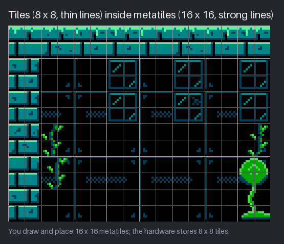
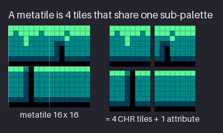
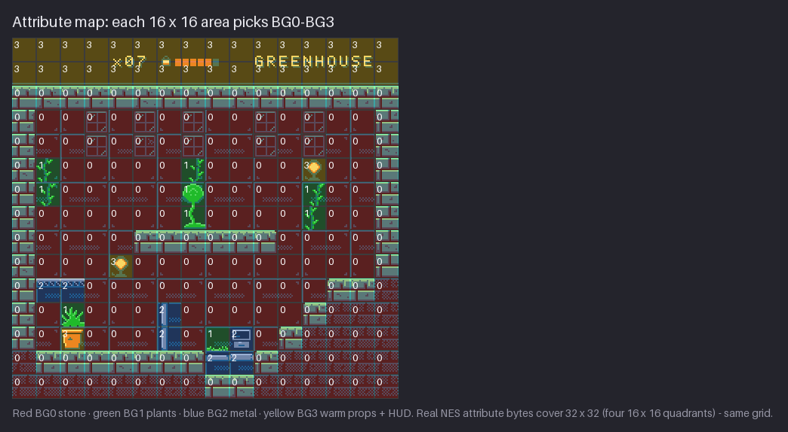
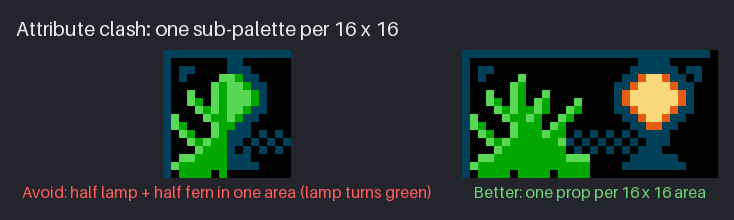
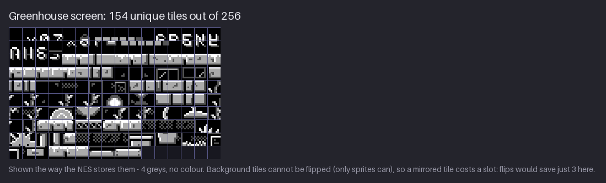
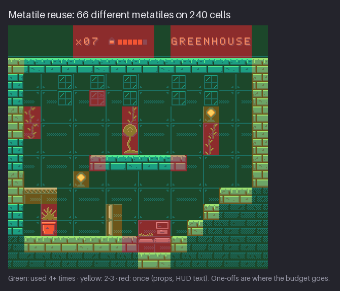
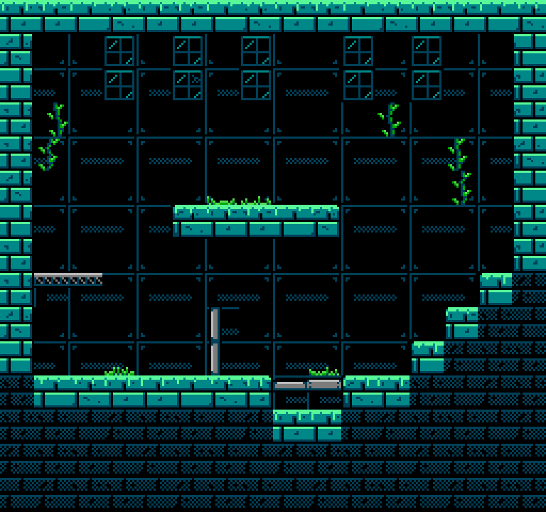
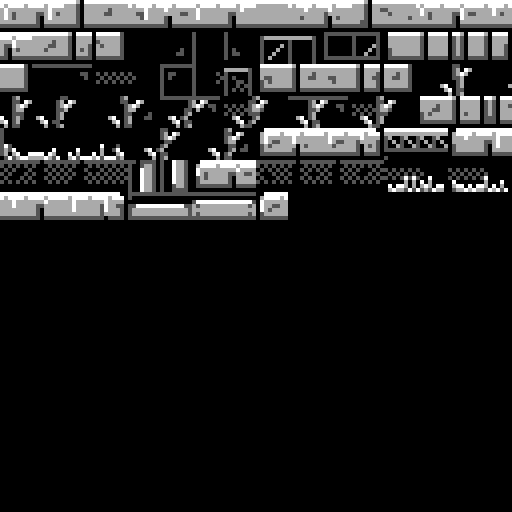

# Chapter 14 — Tiles, Metatiles, and Attributes

An NES background is not one picture. It is a grid of small drawings, each stored once and
placed many times, with colour added at the last moment by a table that says which sub-palette
each area uses. This chapter shows how that system works and how to draw for it. The aim is for
the limits to feel like a design method, not a cage. You will learn to see a screen as two
grids at once: the 8×8 tiles the hardware stores, and the 16×16 metatiles you actually design
with.

By the end you will be able to cut a room into its unique tiles, count them against the
256-tile budget, paint an attribute map that gives every 16×16 area one of four
sub-palettes, and spot (and fix) an attribute clash before it reaches the screen. The project
turns the Greenhouse test room into a pattern table and an attribute map, the two halves of
every NES background.

Previous: [Chapter 13](13-secondary-motion-and-life.md). Next: [Chapter 15](15-tilesets-and-autotiling.md).

## Two grids

The NES draws its background from a **nametable**: a 32×30 grid of cells, one per 8×8 tile,
that covers the 256×240 screen. Each cell holds one byte, the number of a tile. The tiles
themselves live in a **pattern table** (also called **CHR**, short for "character" data): a
sheet of up to 256 small 8×8 drawings. The nametable never stores pixels. It only says "put
tile 37 here, tile 12 there". That is why a full screen of 61,440 pixels fits in about a
kilobyte of map data.

Nobody designs at 8×8, though. A single 8×8 tile is too small to hold a brick, a pane of glass
or a step of a staircase in a way that reads. Almost every NES game groups tiles into
**metatiles**: 2×2 blocks of tiles, 16×16 pixels, that the level designer places as one unit.
The metatile is not a hardware feature. It is a convention from the game's own code, and it is
so common that the NESdev community treats it as standard practice. The course uses 16×16
metatiles everywhere, for three reasons:

- **Attributes.** The hardware chooses colours per 16×16 area (next sections). A metatile that
  matches that area can never be split between two sub-palettes by accident.
- **Characters.** Kit is 16 pixels wide, enemies are 16×16, and a jump is measured in
  metatiles. Ground, steps and platforms on a 16 px grid line up with the bodies that walk on
  them.
- **Data.** A room stored as metatiles is 16×15 = 240 entries instead of 960. Less to draw, less
  to edit, less to go wrong.



Look at the figure with the two grids in mind. Inside each strong 16 px square there are four
8×8 tiles, and you can see where the brick courses and the wall-panel frames cross the thin
lines. The art was drawn as metatiles (each square reads as one thing: a brick block, a pane, a
piece of wall), but every square is stored as four tiles. Both views matter. You compose in the
16 px grid; you pay in the 8 px grid.

The numbers that rule the whole chapter:

| Unit | Size | On one screen |
|---|---|---|
| Pixel | 1×1 | 256×240 |
| Tile (pattern table entry) | 8×8 | 32×30 = 960 |
| Metatile (attribute area) | 16×16 | 16×15 = 240 |

It helps to see what this saves. Stored as a plain picture with 2 bits per pixel, one screen
would take 256 × 240 × 2 / 8 = 15,360 bytes. The NES stores it as a nametable of 960 bytes (one
tile number per cell) plus a 64-byte attribute table: 1,024 bytes in all. The tiles themselves
sit in the pattern table, which is shared by every screen that uses them. A console with 2 KB
of video memory could only work this way, and that one design choice explains almost every
rule in this part of the course:

- art repeats on an 8 px grid because the nametable can only point at whole tiles;
- colour changes on a 16 px grid because the attribute table is coarse;
- a screen can only hold 256 different 8×8 drawings because a tile number is one byte.

Modern NES-style games keep these rules by choice, because they produce a look, a rhythm and a
discipline that players recognise. You will feel the same discipline as you draw.

**Try it:** open a 256×240 canvas and turn on two grids: 8×8 (thin, light) and 16×16
(stronger). Most editors offer a pixel grid plus a custom grid; if yours has only one, set it
to 16×16 and add a layer with a hand-drawn 8 px dot pattern. Draw three quick shapes (a brick, a
step and a crate) that each fill one 16×16 square. Then look at the thin lines inside them.
Which of your shapes would split into four identical tiles? Which into four different ones?

## The metatile

A metatile is four tiles plus one attribute. That is all the hardware ever sees: four numbers in
the nametable (top-left, top-right, bottom-left, bottom-right) and one 2-bit sub-palette choice.



The figure takes one ground metatile from the Greenhouse: a block with open air above it and
ground to the left, right and below (in the next chapter you will meet it as mask 14, the top
surface). It is drawn with the four slots of sub-palette BG0. The split shows what that costs:

- the **top two tiles** carry the moss rim and the upper brick course;
- the **bottom two tiles** carry the lower course;
- the **attribute** says "BG0", which maps slot 1 to $0C, slot 2 to $1C and slot 3 to $2B.

The four tiles are different here, so this metatile costs four entries in the pattern table.
That is normal for a hero piece like a ground surface, which the eye checks closely. Quieter
metatiles can cost less: a block of plain wall where the right half repeats the left half
needs only two tiles, and a fully black square (the blank tile) costs one tile that every
other blank square shares.

In a game's data, a metatile is just a row in a small table: four tile numbers and one
sub-palette number. A room is then a 16×15 grid of metatile numbers, one byte each. The game
expands each metatile number into four nametable entries and one attribute choice when the room
is drawn. That is why the course stores rooms as character maps and metatile lists, never as
960 separate tiles: it is how the hardware's own games did it, and it is far easier to edit.

| Metatile table entry | Top-left | Top-right | Bottom-left | Bottom-right | Sub-palette |
|---|---|---|---|---|---|
| ground, top surface | tile a | tile b | tile c | tile d | BG0 |
| back wall, top-left quarter | tile e | tile f | tile g | tile h | BG0 |
| blank | tile 0 | tile 0 | tile 0 | tile 0 | any |

(The letters stand for whatever numbers the tiles end up with in the pattern table.)

This is where 8 px thinking pays off while you draw. Some habits that keep a metatile cheap:

- **Let detail land on 8 px boundaries when it can.** A mortar line at x = 8 means the left and
  right halves can become mirror images or copies; a mortar line at x = 7 makes both halves
  unique.
- **Repeat whole tiles, not whole metatiles.** Two different metatiles that share a top row
  (same moss, different bricks below) share two tiles. You get variety at half the price.
- **Keep the noise in one tile.** A crack or a bolt in one quarter makes one tile unique; the
  same crack spread across the centre lines makes four.

None of this means "draw in 8×8 boxes". The metatile still has to read as one shape at 1×.
It means knowing which pixel decisions cost tiles, so you spend them on purpose.

A useful way to think about it: every 8×8 tile is a word, and a metatile is a short phrase made
of four words. A good tileset has a small vocabulary that combines into many phrases. The ground
block, the step and the ledge in the next chapter share most of their words and differ only at
the edges, which is why a whole set of 16 ground metatiles can cost far less than 16 × 4 tiles.

**Try it:** draw a 16×16 brick metatile with four colours (backdrop black plus three). Select
each 8×8 quarter in turn and copy it into its own 8×8 canvas, or into a strip of four. Are any
two quarters identical? Move one mortar line by a pixel so that two quarters match, then look
at the metatile at 1× again. Did it get worse, or just cheaper?

## Attributes

Tiles carry no colour. Each pixel of a tile stores a number from 0 to 3, a **slot**. Colour
comes from the **attribute table**, a small block of data after the nametable that gives every
16×16 area a 2-bit choice: BG0, BG1, BG2 or BG3, one of the four background **sub-palettes**.
The pixel's slot then picks a colour from that sub-palette. Slot 0 is special: it is the
backdrop colour, shared by all four sub-palettes. In `hollow-vault` the backdrop is always
black, $0F.

For the Greenhouse the four sub-palettes are:

| Sub-palette | Role | Slot 0 | Slot 1 | Slot 2 | Slot 3 |
|---|---|---|---|---|---|
| BG0 | stone | $0F | $0C | $1C | $2B |
| BG1 | plants | $0F | $0C | $1A | $2A |
| BG2 | metal | $0F | $0C | $00 | $10 |
| BG3 | warm | $0F | $0C | $17 | $38 |



The figure tints every metatile by its attribute: red for BG0, green for BG1, blue for BG2,
yellow for BG3. Count them and you see how lopsided a real screen is. Of the 240 areas, 189
use BG0 (stone and the back wall), 35 use BG3 (the two lamps, the planter and the whole HUD
band), 9 use BG1 (vines, tufts, the fern and the pod) and 7 use BG2 (girders, pipes, the
terminal). Most of the screen is one material; the other three sub-palettes are spent on small
accents. That is a good sign. A screen whose attributes are evenly mixed is usually a noisy
screen.

> **NES rule:** the background picks one sub-palette per 16×16 area, so a metatile can show at
> most three colours plus the shared backdrop. **Authentic:** the course keeps this exactly, and
> the checker reports zero attribute errors for every room. (On hardware one attribute byte
> covers 32×32 pixels and packs four 16×16 choices; the grid you draw on is the same. Ch. 24
> shows the byte layout.)

Why 16×16 and not per tile? Memory. One choice per 8×8 tile would need 960 two-bit values; per
16×16 area it needs 240, packed into 64 bytes. In 1985 that saving mattered, and the 16 px
colour grid it left behind shaped how every NES background looks: colour changes in steps of 16
pixels, never in the middle of a block.

There is one trick that makes the grid far easier to live with, and `hollow-vault` uses it in
every area: **all four sub-palettes share slot 1** (the area's dark, $0C in the Greenhouse).
Anything drawn only in slots 0 and 1 (the back-wall panel, the frame lines, the dark vent
dither) looks identical under any attribute. So a vine (BG1) or a pipe (BG2) can sit on the
wall without the wall around it changing colour. Chapter 15 builds overlays on exactly this.

How do you decide which material gets which sub-palette? Group colours by what has to sit next
to what, not by how they look in isolation. The Greenhouse plan is a good template:

- **BG0, the main material.** Stone and wall cover most of the screen, so they get the first
  sub-palette and the most care. Its slot 3 ($2B, the bright moss) is the brightest thing on the
  ground, so walkable edges read at once.
- **BG1, the living things.** Vines, tufts, the fern and the seed pod. Greens that need to
  differ from the stone's teal.
- **BG2, the metal.** Girders, pipes, the terminal: neutral greys that say "built", not "grown".
- **BG3, warm accents.** Lamps and the clay planter, and the HUD, which shares the warm text
  colours. Warm colours pull the eye, so they are rationed to a few cells.

Write the plan down before you draw. A sentence per sub-palette ("BG2: anything metal") settles
most arguments with yourself later, and it keeps rooms in the same area consistent.

**Try it:** take any 64×64 crop of your own room and lay a 16×16 grid over it. On a new layer,
paint each square with one of four flat colours that stand for BG0–BG3. Which squares were hard
to decide, because they hold two materials? Those are your clash risks. Write them down; the
next section fixes them.

## Attribute clash

An **attribute clash** happens when one 16×16 area needs colours from two sub-palettes. The
hardware cannot do it, so one of the two objects loses its colours and gets the other's. It is
the most common way NES-style art breaks, and it is easy to miss if you paint in full colour and
check the grid last.



In the "Avoid" panel a fern and a lamp were placed so that they overlap the same metatile. That
area is BG1, the plant sub-palette, so the lamp's warm slots 2 and 3 now point at greens: the
glow becomes a sickly green blob. In the "Better" panel the fern sits in a BG1 area and the lamp
in the BG3 area next to it. Same props, same pixels, a 16 px shift, and both read correctly.

When you find a clash there are three fixes, roughly in order of preference:

1. **Move the prop** so each object owns whole 16×16 areas. This is the cheapest fix and the
   usual one. Props in `hollow-vault` are sized in metatiles (lamp 16×16, door and pod 16×32)
   for exactly this reason.
2. **Redraw it on the grid.** If a shape must cross a boundary, redraw the part on the far side
   in the neighbour's colours. A plant pot can have a stone-coloured rim in a stone area, as long
   as the shape still reads. Shared slot 1 helps: a dark outline survives any attribute.
3. **Make it a sprite.** Sprites ignore the background attribute grid. A small piece of colour
   that cannot obey the grid (a glint, a lit window, a coin) can be drawn as an 8×8 sprite on top
   of the background. This costs sprite budget, including the 8-per-scanline limit, so use it for
   a few accents, not whole props. Ch. 24 covers this "sprite overlay" trick in detail.

Clashes also hide at the edges of things you do not think of as props: the place where a vine
meets a moss rim, the end of a pipe that pokes into a stone wall, a HUD icon that strays below
the HUD band. Check every boundary between materials, not just the obvious objects.

Before you colour a room, run this short check on the grey (slot-only) version with the 16 px grid
on:

1. Does every object sit in whole cells of its own sub-palette?
2. Where two materials meet in one cell, is one of them drawn only in slots 0 and 1?
3. Are tall props (16×32) aligned to the grid vertically as well as horizontally?
4. Do any small accents need a fourth colour that the cell's sub-palette lacks? Mark them as
   sprite candidates now, not after colouring.

It takes two minutes and saves redrawing whole props.

The attribute grid also works for you. Because colour can only change on 16 px lines, the eye
reads each 16×16 cell as one material, and a screen built that way looks orderly even when it is
full of detail. Many NES backgrounds owe their clean, "designed" look to this: materials meet in
straight lines and right angles, and soft gradients between them are impossible. Lean into it.
Let edges of materials fall on the grid, and save organic shapes for the inside of a cell or for
sprites.

**Try it:** in your attribute layer from the last drill, pick one square that holds two
materials. Try all three fixes on copies: move the object, redraw the far half in the
neighbour's sub-palette, or cut out a single 8×8 piece and mark it "sprite". Compare the three
at 1×. Which fix did the art the least harm?

## Pattern tables

The pattern table is where your tile budget lives. The NES has two of them, each with room for
256 tiles of 8×8 pixels; in the usual set-up one holds background tiles and the other holds
sprite tiles. Each tile is 2 bits per pixel, stored as two 8-byte "bitplanes", so one tile is
16 bytes and a full table is 4 KB. The same bytes are often called CHR, and the memory they sit
in is CHR-ROM or CHR-RAM on the cartridge.



The figure shows the finished Greenhouse screen cut into its unique tiles: **154 of 256**. It is
drawn in four greys because that is all a tile really is: four slots with no colours attached.
Look along the rows and you will find brick quarters, moss rims, glass panes, vine pieces, the
lamp and planter, and the letters and numbers of the HUD (the HUD alone is 36 unique tiles).
The very first tile is blank: all slot 0. Every black square on screen points at that one tile.

Three facts about pattern tables shape how you draw:

- **Tiles are palette-free.** The same tile can be stone in BG0 and moss in BG1, because the
  attribute decides what the slots mean. A shape you draw once (a leaf, a rivet, a step edge)
  can serve several materials if its slots are chosen with care.
- **Background tiles cannot flip.** Sprites can be mirrored horizontally and vertically for
  free; background tiles cannot. A left wall and a right wall are two sets of tiles. For the
  Greenhouse, allowing flips would only have saved 3 tiles (154 down to 151), because good
  pixel art is rarely symmetric. Do not design around flipping the background.
- **The budget is per table, not per screen.** Every screen that uses the same pattern table
  draws from the same 256 tiles. That is why an area (Greenhouse, Cistern, Furnace) has its own
  tileset: each area is one pattern table, and every room in it has to fit.

Palette-free tiles are worth exploiting on purpose. A small leaf shape in slots 1–3 is a green
leaf in BG1 and a teal stone chip in BG0; a round rivet is grey metal in BG2 and a warm bulb in
BG3. When you draw a new tile, ask whether one you already have would do the job under another
sub-palette. The attribute change is free; the new tile is not.

How does a tile store its four slots in 16 bytes? Each pixel's slot number has two bits. The
first 8 bytes hold the low bit of every pixel (one byte per row), the next 8 bytes the high bit.
Lay the two "bitplanes" on top of each other and each pixel reads 0, 1, 2 or 3. You never need to
write these bytes by hand (the tools do it), but it explains why a tile can only ever have four
values, and why the course's pattern-table images are drawn in four greys: that is exactly the
information the hardware has.

The course keeps the 256-tile limit: every area's tileset must fit in one pattern table, and
the checker reports the count. Real games also swapped tables mid-game or between screens
(CHR banking) to get past it; Ch. 24 shows how.

> **Tool aside:** NEXXT and NES Screen Tool both import a 256×240 PNG, cut it into 8×8 tiles,
> merge duplicates and show the resulting pattern table and nametable. Pixelorama 1.1 added
> tilemap layers, and Aseprite and LibreSprite can show an 8×8 grid and work in indexed mode, so
> you can count duplicates by eye. Tiled reads a tileset image and lets you paint a map with it.
> Any of these will do.

**Try it:** take one 32×32 corner of your room and copy each 8×8 cell into a strip, left to
right, top to bottom. Before copying a cell, check whether an identical one is already in the
strip; if it is, skip it. How many of the 16 cells were unique? Now do the same for a quiet
area (plain wall) and for a busy one (a prop). The difference is your reuse ratio.

One trap is worth naming: **near-duplicates**. Two tiles that differ by a single pixel look the
same on screen and cost two slots. They creep in when you redraw a tile instead of pasting it,
or nudge one brick "just a little". When a count comes out higher than you expect, look for
near-duplicates first. Then decide: is that pixel doing a job the player will notice? If not,
paste the other tile over it.

## Reuse is the budget

A tile count tells you how much you spent. A reuse map tells you where.



The Greenhouse places **66 different metatiles** on its 240 cells. The figure colours each cell
by how often its metatile appears on the screen:

- **red, used once (37 metatiles):** the HUD text, the planter and fern, the terminal, the
  vines, the seed pod, the glass pane with the crack and the ends of the floating platform;
- **yellow, used two or three times (14):** the two lamps, the girder, the pipe, the stair steps
  and some brick variants in the side walls;
- **green, used four times or more (15):** the plain back wall, the glass panes, the deep stone,
  most of the ground, and the blank square (note the empty HUD cells: the hearts are sprites,
  so the background there is blank).

Read the colours as a spending plan. Green is the quiet majority: it covers most of the screen
with a handful of tiles, and its job is to be calm. Red is where the eye goes. Each red cell is
expensive (up to four unique tiles) but it is also the thing the player looks at: the pod, the
planter, the crack that says "this greenhouse is broken". A good screen is mostly green with a few
deliberate reds. A screen that is mostly red is over budget and visually noisy at the same time,
and the two problems have the same cure.

You can see the same split in the tile counts. The bare Greenhouse (ground, wall, glass, vines,
girders and pipes, no props, no HUD) is 95 unique tiles. The props and the HUD add the other 59
to reach 154. Each area of the pack needs a similar plan: a cheap ground and wall, a mid-priced
set of structures, and a small pool of expensive one-offs. With 256 slots you have room for the
whole area's rooms if the shared base stays cheap.

A rough budget for one area, to adapt to your own:

| Group | Share of 256 | Notes |
|---|---|---|
| Ground set and variants | about 30–50 | 16 masks with a few variants on the top surface |
| Back wall and glass | about 15–25 | quiet, drawn in the shared slots |
| Structures (girders, pipes, ladders, doors) | about 30–40 | reused across rooms |
| Overlays and props | about 40–60 | the one-offs; each must earn its tiles |
| HUD (font, digits, meter) | about 40 | the Greenhouse HUD alone is 36 |
| Free | 30 or more | for later rooms and animated tiles |

The exact numbers matter less than the habit: decide the budget before you draw, then count.

Rules of thumb for spending the budget:

- **Ground and wall: under a third of the table.** They appear in every room of the area.
  Chapter 15's variants are the place to spend a little here, and only where repetition shows.
- **One-offs earn their tiles.** A unique metatile should be a focal point, a landmark or a
  piece of story. If you cannot say why it is unique, make it a repeat.
- **Reserve room.** Leave at least 30–40 tiles free while you build an area. Every later prop,
  animated tile and HUD change comes out of the same 256.

**Try it:** print or screenshot one of your rooms and mark each metatile with a dot: one colour
for "used once", another for "used 2–3 times", a third for "4+". Where are the once-only cells?
If they are scattered evenly, choose two to turn into repeats and one to make more special.

## Project: the test room as tiles and attributes

The milestone for this chapter is the first background of `hollow-vault` taken apart the way the
hardware sees it. The snapshot is [`project/ch14/`](project/ch14/README.md); the new files are:

- `rooms/test-room.png`: the Greenhouse test room, 256×240, no props and no HUD;
- `tiles/greenhouse-chr.png`: its pattern table, 128×128 (16×16 cells of 8×8), in four greys;
- `rooms/test-room-attributes.json`: its attribute map, one value per metatile.





The snapshot's constraint report reads: **tiles over 4 colours: 0, attribute errors: 0, unique
8×8 tiles: 105.** Here is how to build your own version, step by step.

Compare the preview with the full Greenhouse in the earlier figures. The test room has the same
bones (the stone frame, the floating platform, the girder ledge, the step down on the right), but
no props, no HUD and no actors, and its top row is ground rather than the HUD band. It is a
room built only from structure, which makes it the right thing to cut into tiles first: every
tile in it will be reused by every other Greenhouse room.

1. **Plan the room as a character map.** Write 15 lines of 16 characters. One character per
   metatile: `#` for ground, `.` for back wall, `g` for a glass pane, `v` for a vine, `t` for a
   grass tuft, `=` for a girder, `|` and `-` for pipes. This takes five minutes and catches
   layout problems before you draw a pixel. The test room is a walled box with a floating
   platform in the middle, a girder ledge on the left, a pipe, a stair of ground blocks on the
   right and a deep floor that drops away into dark stone.
2. **Draw each metatile once, in slots.** Use an indexed canvas or a four-colour working
   palette (black, dark grey, mid grey, light grey) for slots 0–3. Draw the ground block, the
   wall quarter, the pane, the vine, the tuft, the girder and the pipe pieces as 16×16
   drawings. Keep the wall in slots 0 and 1 only, so it reads the same under every attribute.
3. **Assemble the room.** Place the metatiles on the 16×15 grid, following the character map.
   Copy-paste, do not redraw: a pasted metatile is guaranteed to reuse its tiles.
4. **Paint the attribute map.** On a separate layer, give every 16×16 cell a sub-palette. In
   the test room 225 cells are BG0 (stone and wall), 9 are BG1 (the vines and tufts) and 6 are
   BG2 (the girder and pipes). BG3 is unused here; the warm props arrive with the full room.
5. **Colour it.** Replace each cell's grey slots with the colours of its sub-palette (the
   table in the Attributes section). The result is `rooms/test-room.png`. It uses 8 colours in
   total, yet no 16×16 cell has more than 4.
6. **Cut the pattern table.** Go through the grey version in 8×8 steps and keep each tile the
   first time you see it, as in the Pattern tables drill. Lay the unique tiles out 16 per row
   on a 128×128 canvas. The test room gives 105, so 7 rows are used and 9 are free. That empty
   space is the budget left for props, the HUD and the other Greenhouse rooms.
7. **Write the attribute file.** The JSON lists one value per metatile, row by row:

   ```json
   {"area": "greenhouse", "size": [16, 15],
    "attributes": [[0, 0, 0, 0, 0, 0, 0, 0, 0, 0, 0, 0, 0, 0, 0, 0], ...]}
   ```

   `size` is width × height in metatiles; each inner list is one row of 16 values from 0 to 3.
   A game (or the course's checker) reads this file to colour the tiles.
8. **Check it.** Every 16×16 cell must use only its own sub-palette's colours, and no tile may
   use more than 4. Count the unique tiles and compare with 256.

The course does steps 6 and 8 with a small script (`tools/build_project.py` cuts the tiles with
`chr_tiles()` and `tools/nes.py` writes the report), but nothing in them needs code. A tile
editor such as NEXXT or NES Screen Tool will do the cutting for you, and a careful eye can do it
by hand for one room.

When you have your own version, look at it three ways before moving on. At 1×, does it still
read as a room, with the floor and platform clearly walkable? In the attribute view, is it
mostly one sub-palette with a few accents? In the pattern table, is there a large empty area
left? If all three answers are yes, the room is ready to have props and a HUD added (Ch. 16 and
Ch. 17).

## Exercises

### 1. Split three metatiles

Pick three metatiles from your own tileset: one quiet (wall), one structural (ground or a
step), one detailed (a prop or a decorated block). Split each into its four 8×8 tiles and lay
them out in a strip. Count the unique tiles across all three.

**What to look for:**

- Each metatile still reads as one object at 1×, with no visible 8 px seams inside it.
- The quiet metatile costs one or two unique tiles, not four.
- The detailed one is allowed four, and its detail is where the eye should go.
- Any tile shared between two metatiles was shared on purpose (same moss rim, same bolt).

<details><summary>Example solution</summary>


The Greenhouse ground block costs four tiles because its top carries the moss rim and its two
brick courses differ. A plain back-wall quarter costs much less: its frame line, bolt and blank
interior repeat across the panel. When you count your three, write the number next to each
strip; it is the first line of your budget.

</details>

### 2. Paint an attribute map

Take a 16×15 room (your own, or a 256×240 sketch) and paint its attribute map: one flat colour
per 16×16 cell for BG0–BG3. Then write down how many cells each sub-palette got.

**What to look for:**

- Every cell has exactly one sub-palette; no cell is "half and half".
- One sub-palette carries most of the screen (the main material), and the others are accents.
- Props and plants sit in whole cells of their own sub-palette.
- The HUD band (if any) has its own sub-palette and stays inside its rows.

<details><summary>Example solution</summary>


The Greenhouse gives 189 cells to BG0 (stone), 35 to BG3 (warm props and the HUD), 9 to BG1
(plants) and 7 to BG2 (metal). The stone carries the screen; each accent sub-palette shows up
only where something needs that colour. If your counts are close to even, your room may have
too many materials competing.

</details>

### 3. Find and fix a clash

Place two props with different sub-palettes so that they share one 16×16 cell, and colour the
cell with one sub-palette, as the hardware would. Then fix it in two different ways (move, or
redraw on the grid, or mark one piece as a sprite).

**What to look for:**

- The broken version shows the clash clearly: one object in the wrong colours.
- After the fix, each object owns whole cells, or the part that crosses was redrawn in the
  neighbour's colours.
- Dark outlines in the shared slot 1 read the same on both sides of the boundary.
- If you used a sprite, it is small (one or two 8×8 tiles), not a whole prop.

<details><summary>Example solution</summary>


With the fern and lamp in one BG1 cell, the lamp's glow points at plant greens. Giving the lamp
its own BG3 cell next to the fern fixes it at no cost. Moving is usually the best
fix; redrawing or a sprite overlay is for shapes that truly must cross the grid.

</details>

### 4. Cut a screen to unique tiles

Take a full 256×240 screen of your own and cut it into unique 8×8 tiles. Lay them out 16 per row
on a 128×128 canvas, in four greys, and report the count against 256.

**What to look for:**

- The blank tile appears once and every empty area points to it.
- Ground and wall tiles are a small share of the total.
- No two tiles in the sheet are identical (search for near-duplicates too: one stray pixel can
  cost a whole tile).
- The count leaves room: a single screen should use well under 256.

<details><summary>Example solution</summary>


The full Greenhouse screen, HUD and props included, is 154 tiles; the bare room is 95. NEXXT or
NES Screen Tool will import the PNG and remove duplicates for you, and the course's
`chr_tiles()` function (in `tools/figures/_v.py`, used by `tools/build_project.py`) does the
same thing. By hand, compare each 8×8 cell with the ones already kept. Near-duplicates are the
cheapest tiles to win back.

</details>

## Recap

- The NES background is a **nametable** (32×30 tile numbers) pointing into a **pattern table**
  (up to 256 tiles of 8×8, also called CHR). Tiles store slots 0–3, not colours.
- You design in **16×16 metatiles** (2×2 tiles); one screen is 16×15 = 240 metatiles.
- The **attribute table** gives each 16×16 area one of four **sub-palettes** (BG0–BG3), all
  sharing the backdrop $0F. Real attribute bytes cover 32×32, on the same grid.
- An **attribute clash** is two sub-palettes wanted in one area. Fix it by moving the object,
  redrawing on the grid, or (sparingly) a sprite overlay.
- Background tiles cannot flip, and tiles are palette-free: one tile can be stone or moss
  depending on its area.
- The Greenhouse: 154 of 256 tiles, 66 metatiles on 240 cells, 37 of them used once. Spend
  unique tiles where the eye goes and keep the ground and wall cheap.
- Sharing slot 1 across all sub-palettes makes the dark wall look the same under any attribute.

## Further study

- **NESdev Wiki, "PPU attribute tables"**: how the 64-byte table packs four 16×16 choices into
  each 32×32 byte. Read the diagram, then look again at the tinted Greenhouse.
  <https://www.nesdev.org/wiki/PPU_attribute_tables>
- **NESdev Wiki, "PPU pattern tables"**: the two-bitplane tile format and why a tile is 16
  bytes. <https://www.nesdev.org/wiki/PPU_pattern_tables>
- **NESdev Wiki, "PPU nametables"**: the 32×30 grid and where the attribute table sits after
  it. <https://www.nesdev.org/wiki/PPU_nametables>
- **nesdoug, "11. Metatiles"**: a game programmer's view of why 16×16 metatiles are standard
  and how a room is stored as metatile numbers. <https://nesdoug.com/2018/09/05/11-metatiles/>
- **NesHacker, "NES Graphics Explained"**: a clear animated walk through pattern tables,
  nametables and attributes; watch for the attribute grid overlays.
  <https://www.youtube.com/watch?v=7Co_8dC2zb8>
- **Morphcat Games, "How we fit an NES game into 40 Kilobytes"**: metatiles of metatiles and
  ruthless tile reuse in a modern NES game; watch how few tiles a whole level uses.
  <https://www.youtube.com/watch?v=ZWQ0591PAxM>
- **Mega Cat Studios, "Creating NES Graphics"**: an artist's checklist for real NES limits, from
  a studio that ships cartridges. <https://megacatstudios.com/blogs/retro-development/creating-nes-graphics>
- **Slynyrd, "Pixelblog 28 – Side View Tiles"**: designing side-view ground and wall tiles;
  watch how he plans edges and repetition. <https://www.slynyrd.com/blog/2020/5/21/pixelblog-28-side-view-tiles>
- **AdamCYounis, "Pixel Art Class - Tile Set Art"**: tile-set thinking from a working game
  artist; watch for how he keeps the base tiles quiet. <https://www.youtube.com/watch?v=Q-vZ6ZvvSys>

Sources for this chapter: [REFERENCES.md](REFERENCES.md#chapter-14--tiles-metatiles-and-attributes)
