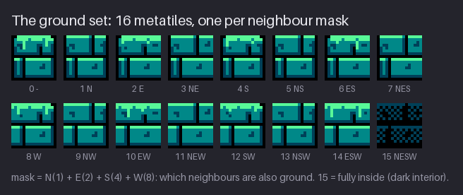
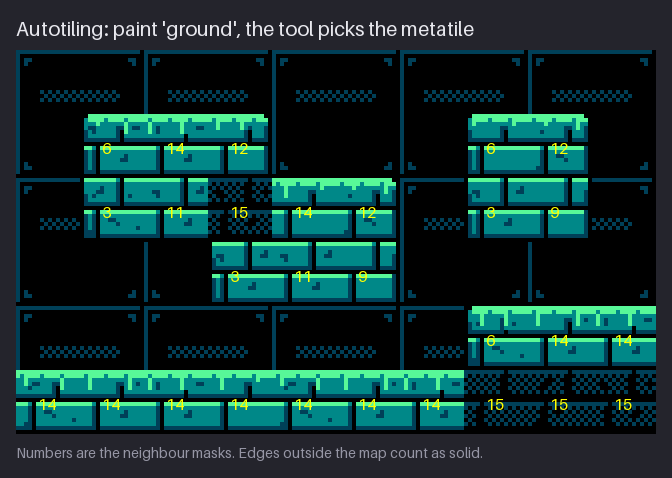
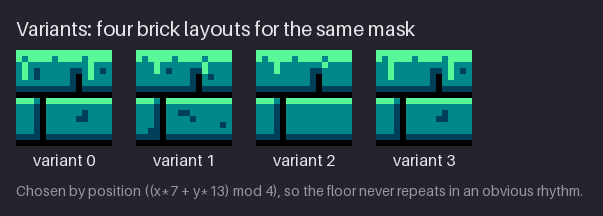
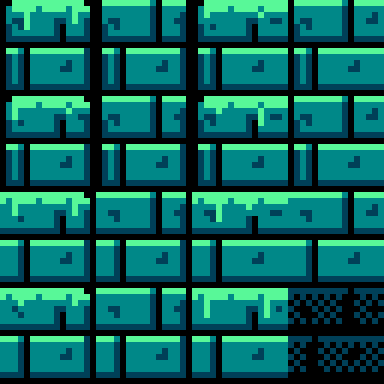
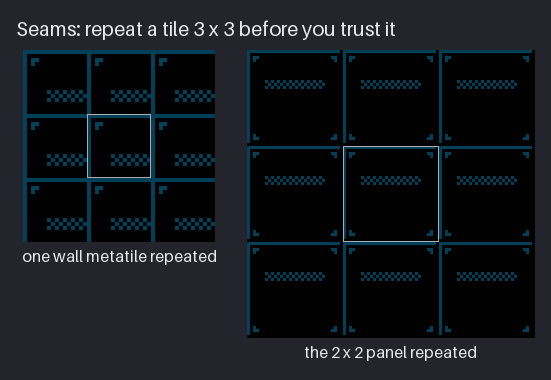
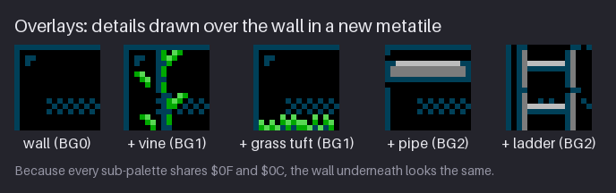

# Chapter 15 — Tilesets and Autotiling

A room needs more than one ground metatile. Ground has a top that meets the air, sides that
meet empty space, an underside, single blocks, thin ledges and solid interior, and every one of
those cases needs its own drawing. A **tileset** is the set of metatiles that covers all of them,
drawn so that any two can sit side by side. **Autotiling** is the rule that picks the right one
for each cell, so you can paint "ground here" and let the rule handle the edges.

By the end of this chapter you will be able to draw a complete 16-metatile ground set, work out
which metatile goes in any cell by hand, test a tile for seams, add variants without wasting the
pattern table, and draw overlays (vines, tufts, pipes) as new metatiles that keep the wall behind
them intact. The project adds the Greenhouse ground set and its foliage overlays to
`hollow-vault`.

Previous: [Chapter 14](14-tiles-metatiles-and-attributes.md). Next: [Chapter 16](16-rooms-and-composition.md).

## The 16-metatile ground set

Start with a question you can ask about any ground cell: **which of my four neighbours are also
ground?** North, east, south and west each answer yes or no. Four yes/no answers give 2⁴ = 16
combinations, and each combination needs a different drawing. Give each direction a bit value
and add up the yeses:

| Neighbour | Bit value |
|---|---|
| North (above) | 1 |
| East (right) | 2 |
| South (below) | 4 |
| West (left) | 8 |

The sum, from 0 to 15, is the cell's **mask**. A block with ground on its left, right and below,
but open air above, is 2 + 4 + 8 = 14: the top surface, the most common ground metatile in any
side-view game. A block surrounded on all four sides is 15: the interior. A lone floating block
is 0.



The figure shows the Greenhouse set, one metatile per mask. Read it by asking, for each
metatile, which sides are **open** (the bits that are missing):

- **No north neighbour:** a bright moss rim in slot 3 ($2B) along the top, with irregular drips
  hanging into the first brick course. Light comes from above, so the top edge is the brightest
  thing on the block. This is the edge the player stands on, and it must read at a glance.
- **No east, west or south neighbour:** a 1 px black edge on that side (the backdrop showing
  through), with the corners cut where two open sides meet. Sides and undersides stay dark; they
  frame the block without competing with the top.
- **Ground to the north:** plain brick tops. The block continues upward, so there is nothing to
  mark.
- **Mask 15:** a dark checker interior. This is Ch. 7's "deep" rule: ground that the player can
  never touch drops to slot 1 and black, so the lit surfaces read as the front edge and the mass
  behind them recedes.

That is the **edge language** of the set: lit top, dark sides, dark lip below, dim interior.
Every metatile follows it, so any two placed next to each other agree about where the light is.

Here are all 16 masks with the open sides each one shows and where it turns up in a room:

| Mask | Ground neighbours | Open sides | Where you see it |
|---|---|---|---|
| 0 | none | all four | a lone floating block |
| 1 | N | E, S, W | the bottom of a hanging pillar |
| 2 | E | N, S, W | the left end of a one-row ledge |
| 3 | N, E | S, W | the bottom-left outer corner of a mass |
| 4 | S | N, E, W | the top of a one-column pillar |
| 5 | N, S | E, W | the middle of a one-column pillar |
| 6 | E, S | N, W | the top-left outer corner |
| 7 | N, E, S | W | a wall face looking left |
| 8 | W | N, E, S | the right end of a one-row ledge |
| 9 | N, W | E, S | the bottom-right outer corner |
| 10 | E, W | N, S | the middle of a one-row ledge |
| 11 | N, E, W | S | an underside (ceiling seen from below) |
| 12 | S, W | N, E | the top-right outer corner |
| 13 | N, S, W | E | a wall face looking right |
| 14 | E, S, W | N | the top surface (floors, platform tops) |
| 15 | all four | none | the interior |

Notice the pairs: 3 and 9, 6 and 12, 7 and 13, 2 and 8 are left-right mirror images in shape.
Their art is not mirrored, though. The black side edge always sits on the open side, but the
brick pattern and drip placement stay the same, so do not just flip them in your editor (and
remember from Ch. 14 that the background cannot flip tiles anyway).

**Why 16 and not more?** The 16-mask set only looks at the four sides. It cannot see the
diagonal neighbours, so it cannot draw an **inner corner** (the notch where a floor meets a wall
that rises from it). The **47-tile blob set** also checks the four corners, and only when both
sides next to a corner are ground, which leaves 47 distinct cases. It looks better on large,
irregular terrain. `hollow-vault` uses 16 because the rooms are built from rectangles and steps,
because 16 metatiles fit a pattern-table budget that 47 would strain, and because 16 is enough to
learn the method. The next section shows exactly where 16 falls short.

Draw the set in this order, so the most-seen metatiles get your best pixels first:

1. **14** (top surface) and **15** (interior): together they cover most of any floor.
2. **0** (lone block): all four edges at once. If it reads, the edge language works.
3. The side edges **6, 12, 3, 9** (outer corners) and **7, 13** (side walls).
4. The thin pieces: **10** (one-row ledge), **5** (one-column pillar), and the rest.

Most of the set is shared quarters. A brick quarter that touches no open side is the same plain
brick in every mask that contains it. That is why the project's 16 metatiles, 64 tile slots in
all, cost only **27 unique tiles**.

**Try it:** on a 64×16 canvas, draw four ground metatiles in a row: mask 0, 14, 15 and 10. Use
only four slots. Give each open side the treatment above (bright top, dark sides and lip). Place
them side by side in a small arrangement: a floor of 14s with a 15 beneath and a 0 floating
above. Does the light agree across all four?

## Autotiling

Working out the mask for every cell by hand is slow and error-prone. **Autotiling** does it for
you: you paint which cells are ground, and the editor (or a script) looks at each cell's
neighbours and places the metatile with that mask.



The figure is a small map painted that way, with the mask written on every ground cell. Follow a
few of them:

- the bottom row is all **14** (open above, ground left, right and below) until the right end,
  where a raised step sits on top and the cells become **15**;
- the floating platform at top left starts with **6** (ground east and south), runs **14**, and
  ends in **12** (ground south and west); the row under it reads **3, 11, 15, 14, 12** as the
  shape steps down and to the right;
- the small block at top right is **6, 12** over **3, 9**: a 2×2 block is all outer corners.

One rule decides what happens at the edge of the map: **cells outside the map count as solid on
the left, right and bottom, and as open above.** So the floor at the left edge is 14, not 6: its
left side runs off the map and is treated as more ground, and no black edge appears against the
frame. The sky stays open, so the top row of a room still gets its moss. Without this rule every
room would have a black outline drawn around its border.

If you ever want to automate it yourself, the whole rule fits in a few lines of any language:

```
for each ground cell (x, y):
    mask = 0
    if ground(x, y-1): mask += 1      # north
    if ground(x+1, y): mask += 2      # east
    if ground(x, y+1): mask += 4      # south
    if ground(x-1, y): mask += 8      # west
    place metatile number mask

ground(x, y) is true for ground cells, false above the map, true off the other three edges
```

That is all the course's room builder does for the ground. Everything else in a room (wall,
glass, girders, props) is placed directly from the character map.

Now find the cell labelled **15** in the second row, the one with a moss top right next to it.
All four of its sides are ground, so it gets the dark interior. But the cell above and to its
right is empty air, and you can see the result: a dark checker block sitting beside a bright moss
surface, with no corner piece to join them. That is the inner-corner case the 16-set cannot see.
There are three ways to deal with it:

- **Accept it** when the dark block reads as a shadowed notch in the step, as it does here.
- **Edit the layout** so the case does not occur (step the platform differently).
- **Upgrade to the 47-tile blob set** (or add one hand-made "inner corner" metatile and place it
  by hand in the few cells that need it).

What would the upgrade cost? The blob set adds the four corners to the question, but a corner
only counts when both sides next to it are ground (a corner between two open sides is already
drawn as an outer corner). That leaves 47 distinct cases instead of 16. Most of the extra 31 are
the same body with one to four small inner-corner notches, so a careful artist can draw them as
quarters and share most tiles. Even so, a blob ground set will usually cost two or three times the
tiles of a 16-set. On a 256-tile budget that is a real choice. Big, organic caves earn it;
rooms made of rectangles and steps, like `hollow-vault`'s, do not.

> **Tool aside:** all the common map editors can autotile. In **Tiled**, terrains come in
> *Corner*, *Edge* and *Mixed* sets; the 16-mask set is an *Edge* set (mark each side of a
> metatile as ground when its bit is in the mask), and the 47-tile blob is a *Mixed* set. In
> **LDtk** you paint an IntGrid layer (1 = ground) and an auto-layer turns it into tiles with
> small 3×3 pattern rules, tried top to bottom, most specific first. In **Godot 4**, a TileSet
> terrain set in *Match Sides* mode is the 16-mask set; *Match Corners and Sides* is the blob.
> Mask 0 has no sides to match, so in all three you may need to place lone blocks by hand.

Two more things to know before you rely on autotiling:

- **Only ground autotiles.** In the Greenhouse, girders, pipes, glass and wall are placed
  directly. They do not change shape with their neighbours, so a simple fixed metatile is
  enough. Autotile a material only when its edges really change.
- **Collision is separate from art.** The mask decides the picture. Whether a cell is solid is a
  property of the character in the map (`#` is solid, `.` is not), so a decorative change never
  breaks a jump. Keep that separation in your own projects.

**Try it:** on squared paper (or a 10×6 canvas at 1 px per cell), mark a small shape of ground
cells. For every ground cell, write its mask: add 1 if the cell above is ground, 2 if the right
one is, 4 for below, 8 for left. Use the map-edge rule. Then check two cells against the ground
set figure: does the drawing for that mask fit the shape?

## Seams

A tile that looks fine on its own can still fail when it repeats. The join between two copies is
a **seam**, and a bad seam shows up as a line, a gap or a doubled edge every 8 or 16 pixels,
across the whole screen. The eye is very good at finding regular patterns, so a seam that is
invisible in one tile becomes the most visible thing in a wall of 50.


The rule is simple: **repeat a tile 3×3 before you trust it.** The centre copy then has
neighbours on every side, so every edge is tested at once. The figure does this with the
Greenhouse back wall:

- **Left:** one quarter of the wall panel, repeated. Every 16 px there is a frame line, a corner
  bolt in the top-left and a strip of vent dither. Nothing is broken, but the rhythm is busy:
  small boxes, all identical, with the bolt in the same corner of each.
- **Right:** the whole 32×32 panel (four metatiles) repeated. Now the frame makes calm 32 px
  panels, with bolts in each corner and one vent per panel. It reads as a wall, not a grid.

Look closely at the panel's frame line. It is drawn only on the **top and left** edges; the
bottom row and right column are left black. When the panel repeats, the left edge of one copy
sits against the empty right column of the next, and you get a single 1 px line between panels.
If the frame were drawn on all four sides, every join would get a doubled 2 px line. This
"draw the border on two sides only" habit fixes most frame and brick seams.

Things to look for in a 3×3 test:

- **lines that double or vanish** at the join (borders drawn on both sides, or neither);
- **lines that do not continue**: a mortar course at y = 6 on one edge and y = 7 on the other;
- **hot spots**: one striking pixel cluster that repeats every 16 px and turns into a polka-dot
  pattern;
- **value drift**: a tile that is darker on one side, which turns into stripes.

Notice that the left panel of the figure has no broken seams at all. It still loses to the right
one. A seam test is not only about errors; it also shows you the **rhythm** a repeat will make.
A 16 px repeat is short enough for the eye to count, and it makes a wall feel like graph paper.
A 32 px panel is long enough to read as an object (a panel, a slab, a window). This is why the
wall is a 2×2 group of metatiles placed by position: the rooms pick the quarter from the cell's
column and row, so the four quarters always meet in the right order.

A second test catches what the first misses: **offset the tile by half** (8 px each way, with
wrap-around) so the edges move to the centre, and repair anything that looks broken there. Most
editors can offset with wrap, and many have a tile mode that shows the repeat live while you draw.

> **Tool aside:** Pixelorama and Aseprite have a *Tile Mode* that repeats the canvas around itself
> while you draw, LibreSprite has *Tiled Mode*, and Krita has a wrap-around mode (and an offset
> filter with wrap). GIMP's *Offset* with wrap-around does the half-offset test. Any of these
> turns the 3×3 test into something you see constantly, not once at the end.

Seams also hide **between** different metatiles. Mask 14 next to mask 15, a wall quarter next to
a glass pane, a vine overlay next to the plain wall: each pair is a join. Before you finish a
set, place every metatile next to its likely neighbours at least once. The autotile drill above
does this for the ground; for the wall, a 3×3 of the full panel with one overlay in the middle
does it for the overlays.

**Try it:** take your mask-15 interior (or any wall metatile) and repeat it 3×3. Find one seam
or hot spot. Offset the tile by 8 px with wrap, fix the problem in the middle, offset it back
and repeat the 3×3 test.

## Variants

A seamless tile can still look repetitive. Twenty identical top-surface blocks in a row make a
visible beat every 16 px. The cure is **variants**: several versions of the same metatile that
share their edges, so they still join, but differ inside.



The figure shows four variants of mask 14. Three use different brick layouts; the fourth reuses
the first layout with its moss drips in new places. All four keep the same edge treatment, so any
of them can sit next to any other. In the rooms, the variant is chosen by position:

```
variant = (x*7 + y*13) mod 4
```

where x and y are the cell's column and row. The rule is deterministic, so the same room always
looks the same, and two neighbouring cells always get different variants (moving one cell right
changes the result by 3, moving one cell down by 1). Along a row the cycle repeats every four
cells (64 px), but with the drips and bricks changing at different rates the eye does not latch
onto it. Real games often use exactly this kind of fixed scramble rather than true randomness.

Variants are not free. Each one adds tiles to the pattern table, and the cost depends on how
much of the metatile changes:

| Metatile | Tiles with 1 variant | Tiles with 4 variants |
|---|---|---|
| Mask 14 (top surface) | 4 | 12 |
| Mask 15 (interior) | 4 | 8 |
| Mask 10 (one-row ledge) | 4 | 13 |
| Whole set, 16 masks | 27 | 80 |

Giving every mask four variants triples the cost of the ground set, from 27 tiles to 80. That is
almost a third of a pattern table spent on one material. The sensible plan is to add variants
**only where repetition shows**: the top surface (mask 14), which runs the full width of most
rooms, and perhaps the interior (15). A thin ledge or a lone block rarely appears often enough to
need them.

Where variants are worth it, three rules keep them from becoming a new problem:

- **Same edges, different middle.** A variant must keep every pixel on its outer border (and the
  moss rim) identical to the original, or it will not join. Change only the inside: mortar
  positions, a crack, the shape of a drip.
- **Change the big things.** Moving a mortar line or a drip changes the rhythm the eye reads at
  1×. A single changed pixel inside a brick does not, and it still costs a tile.
- **Look at the room, not the sheet.** A variant that looks great on its own may be the one cell
  the player's eye keeps landing on. If a variant draws attention, make it quieter or rarer.

> **Tool aside:** editors can pick variants for you. Tiled has a per-tile probability, LDtk rules
> take a random chance (put the variant rule above the plain one), and Godot 4 gives each tile
> alternatives with a probability. Keep any striking variant rare: if it shows up every few cells,
> it becomes a pattern of its own.

**Try it:** draw two variants of your mask-14 metatile that keep the same top edge and the same
outer pixels on every side. Lay out a row of 12 cells using the position rule above. Then count
how many unique 8×8 tiles the two variants added.

## Overlays

Vines hang over the back wall. Grass grows out of a step. A pipe runs across a panel. In a modern
editor you would draw these on a layer above the wall. The NES background has no layers: one
cell shows one tile.

> **NES rule:** the background has a single layer, so a vine in front of a wall is not a vine on
> top of a wall; it is a new metatile that contains both. **Authentic:** every overlay in
> `hollow-vault` is drawn as its own metatile and costs its own tiles. (Sprites can sit on top of
> the background, but they are a scarce budget; Ch. 24 shows that trick.)

So an overlay is drawn by **merging**: take the wall metatile, draw the vine onto it, and save the
result as a new metatile. In practice you still draw on a layer while you work, then flatten.


The figure shows the Greenhouse wall metatile, and then four overlays on it: a vine and a grass
tuft (BG1, plants), a pipe and a ladder (BG2, metal). Look at the wall around each overlay. It
does not change, even though each overlay metatile uses a different sub-palette from the wall.

This is the shared-dark trick from Ch. 14 paying off. The back wall is drawn **only in slots 0
and 1**, and every Greenhouse sub-palette has $0F in slot 0 and $0C in slot 1. So the wall is
the same colour under BG0, BG1, BG2 or BG3, and an overlay can switch the cell to whatever
sub-palette its own colours need without the wall around it noticing. Without that shared slot,
every vine would sit on a green-tinted patch of wall: an attribute clash on every overlay.

The rules for overlays:

- **Use only slots 2 and 3 for the overlay itself**, plus slot 1 for its dark details. Those are
  the colours the cell's sub-palette changes.
- **Do not touch the wall's own pixels** except where the overlay covers them, so the frame and
  bolts line up with the plain wall next door.
- **Match the overlay to the wall quarter underneath.** The wall is a 2×2 panel; a vine on the
  top-left quarter must use the top-left quarter as its base. The rooms pick the quarter by the
  cell's position, the same way they do for the plain wall.
- **Count the cost.** The plain wall panel (four metatiles) costs 10 unique tiles; three vine
  overlays on one quarter come to 12 unique tiles of their own. Overlays are one-offs, so keep a few
  variants and reuse them.

Overlays can also span cells. A vine that hangs two cells deep is two overlay metatiles, the top one
with the root and the lower one continuing the stem; draw them as one 16×32 drawing and cut it in
half, so the stem crosses the boundary at the same x and the join disappears. The same goes for a
pipe that runs along a wall: one straight piece, repeated, plus a joint and two end pieces.

Grass works the same way. The tuft beside the Greenhouse terminal is a wall-plus-tuft metatile
in the cell **above** the floor; the floor cell below it stays an ordinary metatile. Putting the
grass in the air cell keeps the ground set clean and lets one tuft sit on any surface.

**Try it:** take one quarter of your wall and draw a hanging vine onto it in two new colours,
keeping the wall pixels untouched. Put the plain quarter and the vine quarter side by side and
switch the vine cell to a different sub-palette. If the wall changes colour, it is using a slot
that is not shared; move those pixels to slot 1.

## Project: the ground set and overlays

This chapter adds the Greenhouse's autotile set and its first overlays to `hollow-vault`. The
snapshot is [`project/ch15/`](project/ch15/README.md); the new files are:

- `tiles/ground-set.png`: 64×64, the 16 ground metatiles in 4 columns, mask 0 to 15 in order
  (mask 0 top-left, mask 15 bottom-right);
- `tiles/ground-set.json`: the data an editor or engine needs to use the sheet;
- `tiles/overlays.png`: 80×16, five overlay metatiles on the wall's top-left quarter: three
  vines and two grass tufts, all in BG1.




The JSON file is short:

```json
{
  "image": "ground-set.png",
  "tileSize": 16,
  "columns": 4,
  "index": "mask = N(1) + E(2) + S(4) + W(8): neighbours that are ground",
  "subPalette": "BG0"
}
```

Because the sheet is in mask order, the metatile for mask m sits in column m mod 4, row m div 4.
A game can autotile with no lookup table at all: compute the mask, multiply, read the tile.

How to build your own version:

1. **Start from Ch. 6 and Ch. 7.** The ground-top metatile you drew in Ch. 6 is mask 14; the
   brick variants from Ch. 7 give you the plain brick body. Put the 16 cells on a 64×64 canvas
   with a 16 px grid and write the mask number in each (on a scratch layer).
2. **Draw mask 15 first, then 14.** The interior is the brick body pushed dark (slot 2 becomes a
   50% checker of slot 1 on black). The top surface adds the moss rim: a full slot-3 line, a
   broken second line, two drip clusters of 2–4 px.
3. **Derive the others by edges.** For each mask, start from the plain brick body and apply only
   the treatments for its open sides: moss on top if bit 1 is missing, a black edge on the east if
   bit 2 is missing, and so on. Cut the corners where two open sides meet. Do not invent new
   detail per mask; the set is consistent because every mask is the same body with different
   edges.
4. **Test the set together.** Build a small map by hand (as in the Autotiling drill), place the
   metatiles by mask, and look at it at 1×. Every join should agree about light. Fix the drawing,
   not the map.
5. **Make the overlays.** Copy the wall's top-left quarter five times. Draw three vines (a 1–2 px
   stem that wanders, leaves as 3 px clusters every four rows) and two tufts (blades of 1–4 px,
   brightest at the tip). Use slots 2 and 3 for the plant and slot 1 for its shadow; leave the wall
   pixels alone.
6. **Count.** Cut the ground set into tiles: 27 unique for 64 slots. If yours is far higher, look
   for quarters that should be identical but differ by a pixel.
7. **Write the JSON** with the sheet name, tile size, column count, the mask rule and the
   sub-palette.

Common problems at this stage, and their fixes:

- **The moss rim looks like a stripe across the floor.** The rim is the same in every cell, so it
  repeats every 16 px. Vary the drips per variant, not the rim; the rim must stay continuous.
- **Outer corners look square and heavy.** Cut one more pixel at the corner, in black, so the
  corner reads as worn stone rather than a box.
- **Mask 15 looks like a hole.** The interior is too dark, or its pattern is too strong. It
  should read as "more stone, in shadow". Keep a faint brick structure in slot 1.
- **The set is far over 27 tiles.** Quarters that should be shared differ by a pixel. Paste the
  shared quarter from one master metatile into all the others.

In the full Greenhouse the ground is autotiled from this set, with the variants from the last
section chosen by position, and the overlays are placed where the layout asks for a vine or a
tuft.

The overlays are rendered with BG1 for the whole metatile, wall included. That is the shared-dark
trick at work: the wall in slots 0 and 1 is $0F and $0C under BG1 exactly as it is under BG0, so
the five overlay cells sit in a BG0 wall without a seam. If you build yours in an editor with
layers, keep the wall on the bottom layer, the plant on the top, and flatten a copy for export.

## Exercises

### 1. Draw a 16-mask ground set

Draw all 16 masks for a ground material of your own (rock, ice, metal floor, earth) on a 64×64
sheet in mask order, with one sub-palette.

**What to look for:**

- One edge language: the same treatment on every open top, every open side, every open bottom.
- Mask 14 is the best-drawn metatile; mask 15 is quiet enough to fill large areas.
- Mask 0 reads as a solid floating block, not a hole.
- Quarters away from open edges are identical across masks (count your unique tiles).

<details><summary>Example solution</summary>


Every Greenhouse metatile is the same brick body with edges applied: moss where north is open,
a black 1 px edge where east, south or west is open, and a dark checker for the interior. Because
the body is shared, the whole project set is 27 unique tiles. Your set should feel like one
material in 16 situations.

</details>

### 2. Autotile a map by hand

Draw a small map of ground cells (about 10×6) with at least one floating platform, one step and
one lone block. Write the mask on every ground cell, then place your ground set by those masks.

**What to look for:**

- Every mask is the correct sum of N1, E2, S4, W8.
- Cells at the left, right and bottom edge of the map count those edges as ground.
- Outer corners are 3, 6, 9 and 12, and a 2×2 block uses all four.
- You found at least one place where the 16-set shows its inner-corner limit, and chose how to
  handle it.

<details><summary>Example solution</summary>


The bottom row is 14 until the raised step turns it into 15s, and the left end of the floor stays
14 because the map edge counts as ground. In the second row, the 15 next to the moss top is the
inner-corner case: it reads as a shadowed notch in the step, so it was accepted rather than
fixed.

</details>

### 3. Seam test and fix

Take one wall or interior metatile, repeat it 3×3, find at least one seam problem, fix it, and
test again. Then try the 2×2 version (a 32×32 panel) and compare the two rhythms.

**What to look for:**

- No doubled or missing lines at the joins.
- Lines and mortar courses continue across the edges at the same height.
- No single cluster turns into a polka-dot pattern.
- The bigger panel reads calmer than the small repeat.

<details><summary>Example solution</summary>



The Greenhouse wall draws its frame only on the top and left edges, so repeats meet as single
1 px lines. One quarter repeated gives a busy 16 px beat; the 32×32 panel gives calm, wall-sized
panels. If your test shows a doubled line, delete the border on one side.

</details>

### 4. Two overlays on a shared wall

Draw two overlays (a plant and a piece of machinery, say) on your wall metatile, each in a
different sub-palette from the wall. Place them beside plain wall cells.

**What to look for:**

- The wall around each overlay is identical to the plain wall next to it.
- The wall uses only slots 0 and 1, which every sub-palette shares.
- Each overlay uses its own sub-palette's slots 2 and 3 and stays inside its 16×16 cell.
- The overlay metatile uses the right wall quarter as its base, so the frame lines up.

<details><summary>Example solution</summary>



The vine and tuft cells are BG1 and the pipe and ladder cells are BG2, yet the wall around them
does not change, because the wall is drawn only in $0F and $0C. Each overlay is a separate
metatile in the pattern table, which is why a few well-made vines reused around the room beat a
different vine in every cell.

</details>

## Recap

- A ground cell's **mask** is the sum of its ground neighbours: N = 1, E = 2, S = 4, W = 8. The
  16 masks each get one metatile; 14 is the top surface, 15 the interior, 0 a lone block.
- One **edge language** for the whole set: lit moss on open tops, dark 1 px edges on open sides
  and bottoms, a dark interior. Every mask is the same body with different edges.
- **Autotiling** computes the mask for you. Off-map cells count as solid on the left, right and
  bottom, and open above.
- The 16-set cannot see diagonals, so it has no **inner corners**; the 47-tile blob set is the
  upgrade. Tiled (Edge/Mixed sets), LDtk (auto-layer rules) and Godot 4 (Match Sides / Match
  Corners and Sides) all do both.
- **Seams:** repeat 3×3 and offset by half before you trust a tile. Draw frames on two sides only.
- **Variants** cost tiles: the ground set goes from 27 to 80 with four variants of every mask.
  Add them where repetition shows (mask 14).
- **Overlays** are new metatiles, not layers. Draw the wall in the shared slots 0 and 1 so any
  sub-palette can sit on it.

## Further study

- **Boris the Brave, "Classification of Tilesets"**: the clearest map of edge, corner and blob
  sets and how they relate; read it to see where the 16-mask set sits.
  <https://www.boristhebrave.com/2021/11/14/classification-of-tilesets/>
- **cr31, "Wang Tiles" (mirror hosted by Boris the Brave)**: the classic illustrated pages on
  edge and corner Wang sets and the blob set; look at the diagrams of each family.
  <https://www.boristhebrave.com/permanent/24/06/cr31/stagecast/wang/intro.html>
- **Tiled documentation, "Using Terrains"**: how to set up corner, edge and mixed terrain sets
  and paint with them. <https://doc.mapeditor.org/en/stable/manual/terrain/>
- **LDtk documentation, "Auto-layers"**: IntGrid layers and rule-based tiling, including random
  variants. <https://ldtk.io/docs/general/auto-layers/>
- **Godot documentation, "Using TileSets"**: terrain sets and their match modes in Godot 4.
  <https://docs.godotengine.org/en/4.0/tutorials/2d/using_tilesets.html>
- **MortMort, "My Tileset Workflow (Pixel Art & Gamedev Tutorial)"**: an artist building a full
  tileset from a few base tiles; watch how he plans edges before details.
  <https://www.youtube.com/watch?v=btnH0x7_1g8>

Sources for this chapter: [REFERENCES.md](REFERENCES.md#chapter-15--tilesets-and-autotiling)
