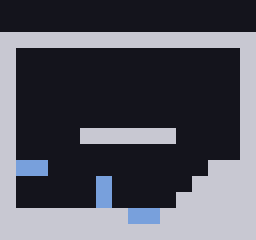
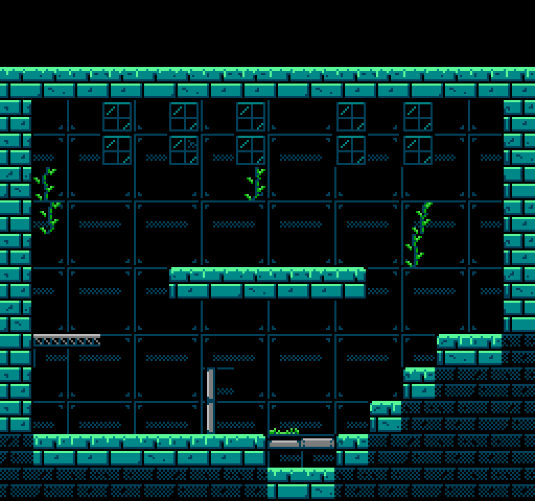
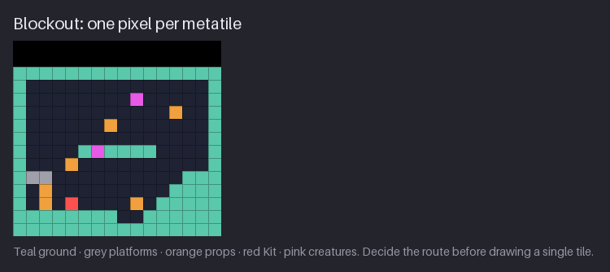
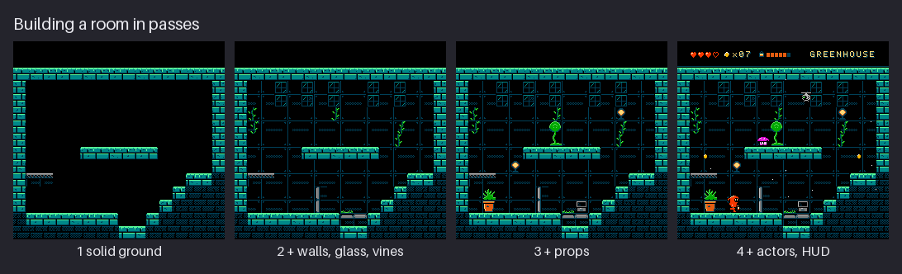
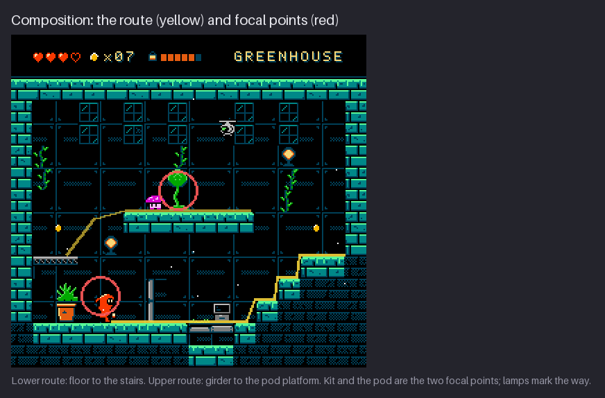
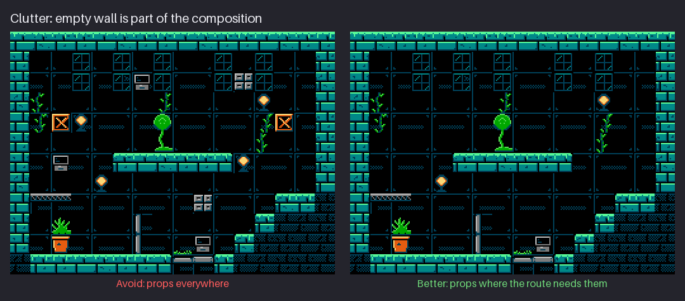

# Chapter 16 — Rooms and Composition

`hollow-vault` is built from rooms. Each room is exactly one screen, 256×240, and the player
moves between rooms by walking off an edge, the way *Environmental Station Alpha* and many NES
adventures do. A **flip-screen** room has no camera to rescue it. Everything the player needs
(where to stand, where to go, what to look at) has to be on that one screen at once, readable at
a glance, while the HUD takes its share at the top and old TVs crop the edges.

This chapter is about arranging the tiles from Ch. 14 and 15 into rooms that read. You will learn
to block out a room at one pixel per metatile, build it in back-to-front passes, compose a route
and focal points, keep clutter out of the play area, and respect the overscan margin and the HUD.
By the end you will have the first finished Greenhouse room (without props yet), and a method you
can repeat for every room in the pack.

Previous: [Chapter 15](15-tilesets-and-autotiling.md). Next: [Chapter 17](17-props-and-foliage.md).

## Blockout

Do not start a room with tiles. Start with a **blockout**: a tiny map where one pixel stands for
one 16×16 metatile. A full room is then a **16×15 pixel** image. At that size you can draw a
dozen rooms in the time it takes to tile one, change your mind for free, and see the whole layout
as shapes, without detail getting in the way.


The figure shows the Greenhouse blockout enlarged, with a flat colour for each kind of thing:

- **teal:** solid ground (it will become the autotiled ground set);
- **grey:** platforms you can stand on but that are not ground (the girder);
- **orange:** props (lamps, the planter, the terminal, the pod);
- **red:** Kit's start position;
- **pink:** creatures;
- **black:** empty space, and the two HUD rows at the top (32 px).

Read a blockout for play first, then for picture:

1. **Can Kit get everywhere that matters?** Trace the walking and jumping route with a finger.
   A jump is easy to judge here, because gaps and heights are counted in whole metatiles.
2. **Where are the exits?** In a flip-screen game, an exit is an open edge. Make sure the
   openings in the outer wall are deliberate, and that they line up with the next room.
3. **Is there a big simple shape?** A good room has a clear mass of ground, a clear area of air,
   and a few smaller shapes in between. If the blockout is a speckle of colours, the tiled room
   will be noise.
4. **Where is the focal point?** One or two cells should be special (here, the pod on the
   central platform). If nothing is special, the room has no reason to exist.

The blockout is also the first test of the attribute plan. Every pixel is one attribute cell, so
a blockout with a prop pixel jammed between two different materials is already telling you about
a clash.

Some measurements to keep in mind while you block out, all in metatiles:

- **Kit is 16×24**: one metatile wide and one and a half tall. A corridor Kit walks through needs
  at least two rows of air, and three if Kit should be able to jump in it.
- **The playfield is 16×13** once the HUD takes its two rows. Rows 13 and 14 are the floor and
  the ground under it in most rooms; the bottom 8 px may be cropped by the TV (see below).
- **A platform needs a ledge to land on.** A floating platform one cell thick (mask 10 in the
  ground set) is fine, but give it at least three cells of width, or it reads as a block rather
  than a place.
- **Exits line up.** In a flip-screen game, an opening on the right edge of one room must meet an
  opening at the same height on the left edge of the next. Block out neighbouring rooms side by
  side to check.

It also pays to block out more than one version. Three 16×15 blockouts of the same room take ten
minutes. Put them side by side at 8× and pick the one with the clearest shape; then improve that
one. Choosing between options is much easier than judging a single drawing on its own.

**Try it:** open a 16×15 canvas and zoom to at least 16×. Use four colours: one for ground, one
for platforms, one for props and one for Kit. Leave the top two rows black for the HUD. Block out
a room with a floor, one floating platform, a step and a way out on the right. Then look at it at
1×. Is the shape still clear at 16×15 real pixels?
Then make a second version with the platform moved and the step on the other side, and put
both side by side. Which one has the clearer big shape, and which the more interesting route?
They are not always the same room; choose consciously.

## Building in passes

Once the blockout works, build the room **back to front, in passes**, and check the whole screen
after each one. Each pass is judged against everything behind it, so you never draw a detail
before you know what it has to read against.


The Greenhouse goes through four:

1. **Solid ground.** The autotiled ground set from Ch. 15, following the blockout's teal pixels.
   This alone should already read as a room: floor, walls, platform, steps.
2. **Walls, glass and vines.** The back-wall panel fills the air, the glass panes go along the
   top (this is a greenhouse), and the vine overlays hang from the side walls. Everything here is
   dark and low-contrast, so the ground's lit edges stay the brightest shapes.
3. **Props.** Lamps, the planter and fern, the terminal and the pod drop onto their surfaces.
   Each sits in whole attribute cells.
4. **Actors and HUD.** Kit, the hopper, the drone and the seeds are sprites; the HUD band fills
   the top two rows.

After each pass, check the screen three ways:

- **At 1×.** The player will see it at a small multiple of 1×, never at 8×. Detail that only
  reads zoomed in is not doing its job.
- **In greyscale.** The play layer (ground edges, platforms, actors) should be the strongest
  value contrast on screen; the back wall should be the weakest.
- **Squinting.** Blur the screen with your eyes. The big shapes from the blockout should still be
  there. If a pass broke them, the pass added too much.
- **On the attribute grid.** Turn on the 16 px grid and check that everything new in this pass
  sits in whole cells of its sub-palette. Passes 2 and 3 are where clashes appear.

Save each pass as its own file (`room-pass1.png`, `room-pass2.png` and so on). It costs nothing,
and when a later pass goes wrong you can go back one step instead of unpicking pixels.

Why this order? Because the back layers are the largest and the most repeated, and they set the
value range everything else must sit in. If you draw a lovely lamp first, you will then have to
fit a whole wall around it; if you draw the wall first, the lamp only has to beat one dark,
quiet surface. The order also matches the budget: ground and wall are the cheap, shared tiles,
and props and the HUD are the expensive ones, so you learn how much budget is left before you
spend it.

A value plan for the passes keeps them in order. In the Greenhouse, each layer has its own
place on the value scale:

| Layer | Colours | Value |
|---|---|---|
| Back wall | $0F with a $0C frame and dither | darkest, lowest contrast |
| Glass panes | $0C frames with a little $1C | dark |
| Ground body | $1C brick faces, $0C shading, black mortar | middle |
| Ground edges | $2B moss rim and brick highlights | brightest in the background |
| Props | warm $17 and $38 (BG3), greens (BG1), greys (BG2) | middle to bright, small areas |
| Actors | sprite sub-palettes (Kit $16 and $37) | the strongest contrast against their surroundings
|

Because each pass sits higher on that scale than the one before, adding a pass never hides the
one under it. If a new pass has to be darker than the last to read, something is out of order.

**Try it:** take your blockout from the last drill and do pass 1 only: place your ground
metatiles (from the Ch. 15 exercise, or plain filled squares if you have none) over the teal
pixels. Save a copy. Look at it at 1× and in greyscale. Does it read as a room before anything
else is added?

## Route and focal points

A room is read in two ways at the same time: as a **route** (where can I go?) and as a
**picture** (what should I look at?). Good composition makes these agree, so the eye moves along
the path the feet will take and lands on the thing that matters.


The figure marks both:

- **Two routes.** The lower route runs along the floor from Kit's start at the bottom left, over
  the pipe bridge, to the stairs on the right. The upper route starts from the girder on the left
  and climbs to the central platform with the seed pod.
- **Two focal points.** Kit (bottom left, beside the planter) and the pod (centre). They are the
  two things with the most contrast in their neighbourhood: Kit in warm red against the cool
  room, the pod as a bright green shape on a dark wall.
- **Lamps mark the way.** One lamp sits just above the girder at the start of the upper route, the
  other high on the right, above the point where the stairs end. Warm light is the strongest colour
  cue in a cool room, so the eye goes there, and the feet follow.
- **The rest supports.** The drone hovers top centre as a threat over the pod, the hopper waits
  on the central platform, and the two seeds at the sides pull the player toward both walls.

The tools of composition are the same as in any picture, just counted in metatiles:

- **Contrast where you want the eye.** The brightest values, the warmest colours and the busiest
  detail go at the focal points. Everywhere else, keep them down. In the Greenhouse the warm
  sub-palette (BG3) is used by only two lamps and the planter in the playfield.
- **Leading lines.** Platform edges, the pipe and the step tops are lines. Let them point toward
  the focal point or along the route, not out of the screen.
- **Framing.** The stone walls on the left and right and the glass along the top frame the play
  area, the way a doorway frames a figure. The frame should be quieter than what it holds.
- **Empty space.** The dark back wall is not wasted. It gives the actors something to read
  against, and it lets the few bright things breathe. Empty wall is part of the design.

The numbers back this up. Of the Greenhouse's 208 playfield cells, 105 are plain back wall before
the props go in, and 98 after: almost half the room is quiet on purpose. Another 81 are ground,
10 are glass and only 13 are vines, tufts, girders and pipes. The props add 7 cells. A room that
reads at a glance is mostly two things (ground and wall), with a small number of accents placed
where they help.

There is also a **reading order**. Players of left-to-right languages tend to scan a new screen
from the top left; the HUD sits there, then the eye drops to the action. Kit starts at the bottom
left and the stairs leave at the right, so the route follows that natural sweep. You do not have
to obey it, but if you send the player right-to-left, give the eye a stronger cue (a lamp, a
bright exit) to make up for it.

Finally, every room in a flip-screen game needs a **landmark**: one thing that makes it
recognisable when the player comes back. In a pack where many rooms share one tileset, the
layout alone is rarely enough. The Greenhouse's landmark is the seed pod on its central
platform; a Cistern room might have a broken pipe pouring water, a Furnace room a big gear. A
landmark is usually also a focal point, and it is the best reason to spend a few unique tiles.

**Try it:** take any finished screen of your own (or the Greenhouse figure) and, on a layer above
it, draw the route in one colour and circle the two most important things in another. Then
squint. Do the circles match where your eye actually goes? If not, change contrast: dim what
steals attention, or brighten what should get it.

A **value thumbnail** helps here. Reduce the room to three flat values: dark for the wall, middle
for the ground, light for the accents. At 1× the Greenhouse becomes a dark field, a middle-grey
frame and floor, and a handful of light spots (moss edges, lamps, pod, Kit). If your thumbnail
has light spots everywhere, the eye has nowhere to land; if it has none, nothing leads it. Aim for
a few light spots on or near the route.

Think of the area where the action happens as the **play band**: the cells Kit and the creatures
can actually reach. In the Greenhouse it runs from the floor up to just above the central
platform, the middle of the screen. The glass at the top and the dark mass of ground at the bottom
sit outside it, and that is where the room can afford texture. Inside the play band, keep the
background quiet and let the walkable edges and the actors do the talking. A side-view room that
gets this right reads like a stage: a lit floor, a dark backdrop, and the actors in front.

## Clutter

When a room feels empty, the instinct is to add things. Usually the room needs a stronger
composition instead, and adding things makes it worse.


In the "Avoid" panel crates, lamps, terminals and drawers are scattered over the back wall. Each
prop on its own is well drawn. Together they destroy the room: there is no focal point, the play
area is full of shapes that look solid but are not, and the eye has nowhere to rest. In the
"Better" panel the props sit on surfaces, in small groups, with clear wall between them.

The rules for props in a room:

- **Props sit on something.** A crate floats only if the player is meant to wonder why. Put props
  on floors and platforms, or hang them from the ceiling with a visible fixing.
- **Group, then space.** Two or three props together read as a place ("a work bench", "a planting
  corner"). Then leave a gap. Evenly spread props read as noise.
- **Keep the play band clear.** The space where Kit walks and jumps should hold only things the
  player can interact with. A decorative prop in a jump path looks like an obstacle.
- **Every prop costs.** A prop is usually a one-off metatile (Ch. 14's red cells): up to four
  unique tiles and a whole attribute cell. Ten scattered props can cost 40 tiles and break the
  attribute plan.
- **Each prop has a reason.** It marks a route, tells a story or rewards a look. If you cannot
  say which, remove it.

A quick declutter method: hide every prop, then add them back one by one, and stop at the first
one that does not make the room better.

Clutter is not only props. A back wall with too much texture, glass panes on every row, or vines
in every cell does the same damage. The test is the same: squint at the screen. If the play layer
(ground edges, platforms, actors) is not the first thing you see, something behind it is too
loud. Lower its contrast, reduce how many cells it covers, or move it out of the play band. The
Greenhouse puts its glass in two rows at the top and its vines along the side walls for exactly
this reason: the middle of the room, where Kit jumps, stays dark and clear.

**Try it:** take a room of your own and count its props. Remove half of them. Compare the two
versions at 1×, side by side. Which one tells you faster where to go?

Clutter has a budget cost too, and it is easy to measure. In Ch. 14 the props and HUD together added
59 tiles to the bare Greenhouse (95 to 154), for six props and a status bar. Ten more different
props would add up to 40 tiles more (four per 16×16 prop), a large share of the 102 still free in
the pattern table, and every other room in the area has to fit in what remains. Repeating a prop is
free; a new one is not. On the NES, a cluttered room is not only harder to read; it is often
impossible to build.

## Overscan and the HUD

Two things take space from every room before you place a single tile: the edges the TV may hide,
and the HUD.


**Overscan.** NTSC televisions of the NES era did not show the whole 240-line picture. Most hid
about 8 lines at the top and 8 at the bottom, and some cut into the sides too. Emulators and
modern screens often show everything, so you cannot design for either case alone. The safe rule:
**keep anything important inside 256×224** (the red bands in the figure are the 8 px margins),
and fill the margins with something that is fine to lose. In the Greenhouse the bottom row is
plain ground, so a TV that crops it loses nothing.
Some sets also cropped a few pixels at the left and right. Treat the outer
8 px on every side as a soft margin: put walls, frames and ground there, never a pickup, a
switch or the only sign of an exit.

**The HUD.** The status bar is the top **two metatile rows**, 256×32 pixels, and it uses one
sub-palette, BG3, the warm one (its text colours are the lamp colours). Its contents start at
y = 12, so even on a TV that hides the top 8 lines nothing is cut. The figure's right panel shows
how the HUD is built:

- the **text, digits, meter and divider** are background tiles in BG3, drawn into the nametable
  like any other tiles (the HUD alone costs 36 unique tiles);
- the **hearts and the seed icon** are 8×8 sprites (the blue boxes), because they need colours
  that BG3 does not have. That is 5 sprites on the HUD lines, safely under the limit of 8 per
  scanline (Ch. 20 counts them with everything else);
- the rest of the band is the blank tile, which is why the reuse map in Ch. 14 shows the HUD's
  empty cells as heavily reused.

That leaves the **playfield**: rows 2 to 14, thirteen metatiles tall, 256×208 pixels, of which
the last 8 px may be cropped. Every room in the pack is designed for that space.

> **NES rule:** NTSC TVs hid about 8 lines top and bottom, so important art stays inside 256×224,
> and a status bar is built from background tiles (plus a few sprites). **Authentic** for the
> safe area and the HUD's tiles and sprites. **NES-inspired** for scrolling: on hardware a HUD
> that stays still while the playfield scrolls needs a *scroll split* timed during the frame.
> Our rooms are flip-screen, so nothing scrolls; Ch. 18 and Ch. 24 describe splits without code.

Why put the HUD in the background instead of using sprites for everything? Budget. A 256 px wide
bar of sprites would need 32 sprites on each line, four times the scanline limit. Background tiles
have no such limit, so the bulk of a status bar is always background, with sprites only for the
few small icons that need their own colours.

Guidelines for the HUD itself:

- **Keep it in its band.** Two rows, always the same height in every room, so the player's eye
  learns where to look. Nothing in the playfield should reach into it.
- **Separate it.** A 1 px divider at the bottom of the band (y = 30 in `hollow-vault`) makes the
  edge of the play area clear without spending a whole row.
- **Read at a glance.** Pale text on black, a few icons, short words. Hearts, a seed count, the
  oil meter and the area name are all the Greenhouse shows.
- **Spend few tiles.** The HUD's font, digits and meter are shared by every room, but 36 tiles is
  still a seventh of the pattern table. Draw only the letters you need, and reuse digits.

**Try it:** on your blockout from earlier, mark the top two rows as HUD and draw a red line 8 px
in from the top and bottom of the full-size room. Is anything important (an exit, a pickup, a
platform edge Kit needs to see) inside the red margin? Move it.

## One set of rules, four rooms

The method in this chapter is not just for the Greenhouse. Every area of `hollow-vault` uses the
same grammar: the same 16×15 grid, the same two HUD rows, the same back-to-front passes, the same
idea of one main material plus a few accents, and a ground set built the same way.


The figure previews all four areas:


| Area | Look | Main material (BG0) | Shared dark |
|---|---|---|---|
| Greenhouse | teal stone, glass and vines; the room you are building now | $0F $0C $1C $2B | $0C |
| Cistern | cold blue stone with a pool of water at the bottom | $0F $02 $12 $21 | $02 |
| Furnace | red brick and brass, a molten pool and stacked crates | $0F $07 $16 $27 | $07 |
| Antenna Ridge | purple rock outdoors: starry sky, moon, far hills, towers | $0F $03 $13 $23 | $03
|

Each area keeps the shared-dark trick (one slot-1 colour in all four of its sub-palettes), so
the back wall and overlays work the same way everywhere. The Ridge is the odd one out: it has no
back wall at all, and its open sky is drawn with its own star and hill tiles. Even so, its
layout is the same 16×15 grid with the same HUD on top.

When you plan an area of your own, block out all its rooms on one sheet, side by side in the
order the player meets them, at one pixel per metatile. A 4×3 grid of rooms is a 64×45 pixel
image. On that sheet you can check that exits line up, that the area has a rhythm (a tight room,
then an open one; a climb, then a rest) and that each room has its own landmark. It is the
cheapest map you will ever draw, and it catches problems that no single room shows.

Each has the same HUD (hearts, seed count, oil meter, area name) and the same structure: a floor,
a route, a focal point, framing walls or sky. What changes is the four sub-palettes and the
tileset, which is exactly what one pattern table and one set of attribute choices per area allow.
That consistency is what makes a pack feel like one game. Ch. 19 builds out the other areas and
their light; for now, notice how much of the look comes from the palette alone.

**Try it:** take your blockout and recolour it with three other sets of flat colours ("cold",
"hot", "outdoor"). Do not change the layout. Which version suggests a different place most
strongly? That is a hint about which area your layout belongs in.

## Project: the Greenhouse blockout and room

This chapter adds the first full Greenhouse room to `hollow-vault`, without props and without the
HUD contents, plus the blockout it was built from. The snapshot is
[`project/ch16/`](project/ch16/README.md); the new files are:

- `rooms/greenhouse-blockout.png`: 16×15, one pixel per metatile;
- `rooms/greenhouse.png`: 256×240, the room tiled from that blockout (no props, HUD rows black).





The project's blockout uses a simpler colour code than the figure, because it records only what
the tile layer needs: **light grey** for ground, **blue** for girders and pipes, **near-black**
for empty space, back wall and HUD. Props and actors are added later (Ch. 17 and Ch. 20), so they
are not in it.

The snapshot's constraint report reads: **tiles over 4 colours: 0, attribute errors: 0, unique
8×8 tiles: 95.** The room uses 8 colours: $0F, $0C and the stone, plant and metal sub-palettes.
BG3 is not used yet; it arrives with the lamps, the planter and the HUD.

How to build your own version:

1. **Write the character map.** 15 lines of 16 characters, with the top two lines blank for the
   HUD. Use the legend from Ch. 14 (`#` ground, `.` wall, `g` glass, `G` broken glass, `v` vine,
   `t` tuft, `=` girder, `|` and `-` pipes, `+` pipe joint). This is the Greenhouse's map, rows 2
   to 14, exactly as the course's room builder reads it (rows 0 and 1 are blank):

   ```
   ################
   #..g.g.g..g.g..#
   #..g.G.g..g.g..#
   #v.....v.......#
   #v..........v..#
   #...........v..#
   #....######....#
   #..............#
   #==..........###
   #.....|.....####
   #.....|.t..#####
   ########-+######
   ################
   ```

   It has a stone frame one cell thick, two rows of glass panes near the top (one of them
   broken), a floating platform six cells wide in the middle, a two-cell girder ledge on the
   left, a vertical pipe, a pipe bridge in the floor, and stairs on the right.
2. **Draw the blockout** from it: one pixel per character on a 16×15 canvas. Look at it at 16×
   and at 1×. Fix the layout here, where it costs nothing: a gap too wide, a platform too low, a
   stair that does not reach.
3. **Pass 1, ground.** Autotile every `#` with the ground set (by hand: work out each mask, as in
   Ch. 15). Use the variant rule on the top surfaces. Check at 1×.
4. **Pass 2, wall and structure.** Fill every `.` with the matching quarter of the wall panel,
   chosen by the cell's position (column mod 2, row mod 2). Place the glass panes, then the vine
   and tuft overlays, then the girder and pipe pieces. Check in greyscale: the wall must be the
   darkest, quietest thing on screen.
5. **Paint the attributes.** BG0 for ground, wall and glass; BG1 for the vine and tuft cells;
   BG2 for the girder and pipe cells. Leave the HUD rows black.
6. **Check and count.** No tile over four colours, no cell outside its sub-palette, and count the
   unique tiles: the Greenhouse comes to 95, well inside 256, with room for the props, the HUD
   and the area's other rooms.

Before you move on, compare your room with the checklist from this chapter:

- the blockout's big shapes survive at 1× and when you squint;
- the wall is the quietest layer and the ground's lit edges the brightest;
- the route is clear without props, so props will only reinforce it;
- nothing important sits in the top or bottom 8 px, and the HUD rows are empty;
- the tile count leaves room (95 of 256 here).

Keep the files. Ch. 17 adds the props to this room (and the tile count will rise), and Ch. 20
adds the actors and HUD for the final screen.

## Exercises

### 1. Blockout with two routes

On a 16×15 canvas, block out a room that has two distinct routes from one side to the other: a
low one and a high one. Leave the top two rows for the HUD.

**What to look for:**

- Both routes are possible with simple jumps (count gaps and heights in metatiles).
- The room has one big ground mass and one big area of air, not a speckle.
- There is one clear focal cell, and both routes pass near it.
- The exits are deliberate openings in the frame.

<details><summary>Example solution</summary>



The Greenhouse's low route runs along the floor to the stairs, and its high route uses the girder
to reach the central platform. Both meet the pod, the room's focal point. The two black rows on
top are the HUD; nothing in the play layout touches them.

</details>

### 2. Four passes

Build one room in the four passes (ground; wall, glass and overlays; props; actors and HUD) and
save a copy after each.

**What to look for:**

- After pass 1 the room already reads as a room.
- After pass 2 the ground's lit edges are still the brightest shapes.
- Pass 3 adds props in groups, on surfaces, in whole attribute cells.
- After pass 4 the actors are the highest-contrast things on screen.

<details><summary>Example solution</summary>



Each pass of the Greenhouse is a complete, readable picture: ground alone, then the dark wall and
glass behind it, then the warm props, then Kit, the creatures and the HUD. Looking at your four
saves side by side shows at once which pass made the room busier than it needed to be.

</details>

### 3. Route and focal points

First, think of a favourite NES game and write, in words, how one of its rooms or screens leads
the eye: where the route goes, what the focal point is, what frames it. Then draw the route and
circle the focal points on a room of your own.

**What to look for:**

- In your description: one route, one or two focal points, and the tool that creates each
  (contrast, colour, a leading line, framing).
- On your room, the route and the eye's path agree.
- The warmest or brightest colours are at the focal points, not scattered.
- There is restful empty space around the focal points.

<details><summary>Example solution</summary>



In the Greenhouse, Kit and the pod are the focal points, the lamps mark the start of the upper route
and the right-hand end of the lower one, and the dark wall leaves space around both. The same
analysis works on any game screen: describe it in words, and compare the tools it uses with yours.

</details>

### 4. Declutter

Take a crowded room (yours, or deliberately overfill one) and remove props until every one left
has a reason. Note the reason for each.

**What to look for:**

- Props sit on surfaces, in small groups.
- The play band is clear of decorative shapes.
- At least half of the wall is empty and quiet.
- The tile count went down, and no attribute cell holds two props.

<details><summary>Example solution</summary>



The scattered version has more props and less to say. In the better version every prop marks
the route or tells you what the room is: lamps along the way, a planter by the start, a terminal
on the floor by the bridge. The room also costs fewer tiles.

</details>

## Recap

- One room = one screen = 16×15 metatiles. The top two rows (32 px) are the HUD, leaving a
  13-row playfield.
- **Blockout first**, at one pixel per metatile on a 16×15 canvas. Fix the layout there.
- **Build in passes**, back to front: ground; wall, glass and overlays; props; actors and HUD.
  Check each pass at 1×, in greyscale and squinting.
- Compose a **route** and one or two **focal points**; put contrast and warm colour there, use
  leading lines and framing, and keep empty wall around them.
- **Clutter** hides the route and costs tiles. Props sit on surfaces, in groups, each with a
  reason.
- Keep important art inside **256×224** (overscan). The HUD is background tiles in one
  sub-palette, with a few sprites for icons.
- Every area uses the same rules; the sub-palettes and tileset change the place.

## Further study

- **Slynyrd (Raymond Schlitter), "Pixelblog 38 - Metroid Study"**: an NES-era exploration game's
  rooms redrawn and analysed; watch how few metatiles make each room and how the frame is built.
  <https://www.slynyrd.com/blog/2022/5/24/pixelblog-38-metroid-study>
- **Brad Smith, "Alwa's Awakening NES - Part 1: Backgrounds"**: converting a modern pixel-art
  game's rooms to real NES backgrounds; watch the attribute and tile-count trade-offs.
  <https://www.youtube.com/watch?v=skaWRrvasW8>
- **Hempuli, "Environmental Station Alpha Release Trailer"**: flip-screen rooms at a tiny
  resolution; watch how each room has one clear route and one landmark.
  <https://www.youtube.com/watch?v=6GnMvsTU--E>
- **Marcos Mateu-Mestre, "Framed Ink"**: a book on composition for visual storytelling; the
  chapters on leading the eye and framing apply directly to a single screen.
  <https://books.google.com/books/about/Framed_Ink.html?id=adpAuQAACAAJ>
- **AdamCYounis, "Speed Painting Backgrounds"**: a working artist building backgrounds from big
  shapes to detail; watch the order of his passes. <https://www.youtube.com/watch?v=YoB6omdIrYw>
- **NESdev Wiki, "Overscan"**: what TVs of the era actually cropped, and why 256×224 is the
  usual safe area. <https://www.nesdev.org/wiki/Overscan>

Sources for this chapter: [REFERENCES.md](REFERENCES.md#chapter-16--rooms-and-composition)
