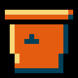
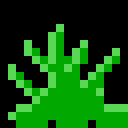
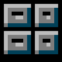
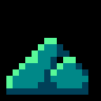
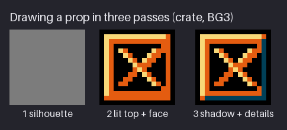
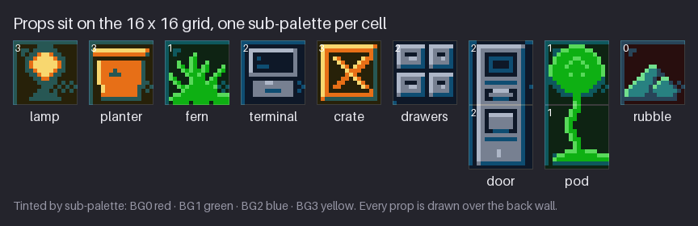
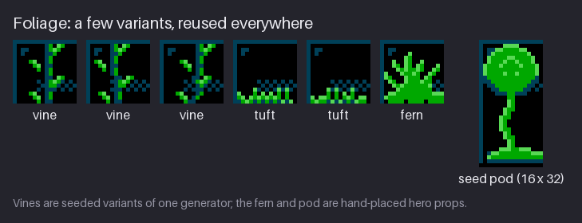
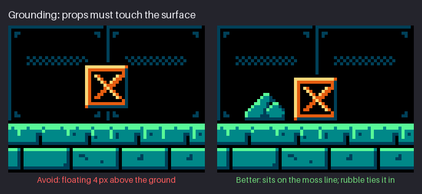

# Chapter 17 — Props and Foliage

A room built from walls, floors and platforms tells the player where they can go. Props tell
them *where they are* and *what happened here*. A lamp says someone needed light; a seed-bank
cabinet says this vault stored something; a pile of rubble says the ceiling came down. Props also
mark the route. A door is an exit, a glowing pod is a save point, and a crate sitting on a ledge
suggests the ledge is worth reaching. In a well-dressed room the player reads all of this in the
first second, before thinking about it.

On the NES, props are not free-floating pictures. They are background tiles like everything else
in the room, placed on the same 16×16 grid as the platforms, and each 16×16 cell gets exactly
one sub-palette. This chapter teaches you to design props within that rule, to draw them in three
passes (silhouette, light, detail), to make foliage that can be reused across a whole area, and to
ground every prop so it belongs to the room instead of hovering in front of it. The project
gains seven props, placed in the Greenhouse.

Previous: [Chapter 16](16-rooms-and-composition.md). Next: [Chapter 18](18-backgrounds-and-parallax.md).

## Props on the grid

A **prop** is a piece of set dressing: an object that sits in the room but is not terrain and
does not move. In `hollow-vault` every prop is a background **metatile**, the 16×16 block of four
8×8 tiles you met in Chapters 14 and 15, or a stack of two metatiles for a tall prop. Here is the
complete set: two props from earlier chapters and seven new ones.


The small number in the corner of each cell is the background sub-palette that cell uses, and
the frame colour repeats it (BG0 red, BG1 green, BG2 blue, BG3 yellow). In the Greenhouse the four
background sub-palettes are:

| Sub-palette | Material | Slot 0 | Slot 1 | Slot 2 | Slot 3 |
|---|---|---|---|---|---|
| BG0 | stone | `$0F` black | `$0C` dark teal | `$1C` teal | `$2B` mint |
| BG1 | plants | `$0F` black | `$0C` dark teal | `$1A` green | `$2A` light green |
| BG2 | metal | `$0F` black | `$0C` dark teal | `$00` grey | `$10` light grey |
| BG3 | warm | `$0F` black | `$0C` dark teal | `$17` rust | `$38` cream |

And the nine props:

| Prop | Size | Sub-palette | Added in | Role |
|---|---|---|---|---|
| seed pod | 16×32 | BG1 + BG1 | Chapter 2 | save point |
| crate | 16×16 | BG3 | Chapter 6 | clutter, ledge marker |
| lamp | 16×16 | BG3 | this chapter | light source |
| planter | 16×16 | BG3 | this chapter | holds the fern |
| fern | 16×16 | BG1 | this chapter | hero plant |
| terminal | 16×16 | BG2 | this chapter | "people worked here" |
| drawers | 16×16 | BG2 | this chapter | seed bank cabinet |
| door | 16×32 | BG2 + BG2 | this chapter | exit |
| rubble | 16×16 | BG0 | this chapter | decay, grounding |

Three things follow from building props this way.

**The material picks the sub-palette.** You do not invent colours for a prop; you ask which of
the area's four materials it is made of. The terminal, drawers and door are metal, so they use
BG2 greys. The crate and planter are wood and clay, so they use BG3 rust and cream, which they
share with the lamp. The fern and pod are plants, BG1. The rubble is fallen wall, so it uses the
stone sub-palette, BG0, and matches the walls it came from. Four sub-palettes are enough for a
whole area of props, as long as each prop is honestly one material.

**Props sit over the back wall.** In the grid above, the `.` pixels of each prop show what is
behind it: the dark back wall with its thin panel lines and dither. That looks like layering, but
on the NES there is only one background layer. What really happens is that each 8×8 tile of the
prop *contains* the bit of wall behind it. That is legal because the back wall is drawn with only
two colours, black (slot 0) and `$0C` dark teal (slot 1), and every background sub-palette in the
Greenhouse has those two colours in those slots. A lamp tile in BG3 can draw a wall line with its
own slot 1, and the line comes out the same dark teal as everywhere else. This is the payoff of
the shared dark colour you set up in Chapter 5.

**Placement costs tiles.** Every 16×16 prop is 4 unique 8×8 tiles, and a 16×32 prop is 8. But
because each tile also contains the wall behind it, the *same* prop over a *different* part of
the wall pattern produces different tiles. The Greenhouse has two lamps. The second one sits over
exactly the same part of the back wall as the first, so it costs no new tiles at all: the room
uses 119 unique tiles with one lamp or with two. Move the second lamp one cell to the right and
the count goes up to 122; move it one cell up instead and it goes to 123. When you repeat a prop,
place the copies at the same phase of the wall pattern and they are free.

> **NES rule:** a prop drawn as background is just tiles. It has to fit the 16×16 attribute grid:
> one sub-palette per 16×16 cell, so a 16×16 prop has 3 colours plus the backdrop, and two props
> of different materials can never share a cell. A tall prop can change sub-palette between its
> halves, because each half is its own cell. Props that need to move, or to sit off the grid,
> must be sprites instead, and those come out of the 8-per-scanline sprite budget.

Why not draw props as sprites, which can go anywhere? Because sprites are the scarcest resource on
the machine. The NES shows 64 sprites at once and 8 per scanline, and Kit, the enemies, the
particles and the HUD icons all need them. A lamp that never moves has no reason to spend any of
that. Background props cost tiles, which are cheaper, and in a single area they are often free
because they reuse tiles you already have.

**Try it.** Open your Chapter 16 room and list five objects that could live there. For each one
write its material, and from that its sub-palette number. If any object needs two materials (a
lamp with a brass base and a glowing bulb, say), decide which material wins or split it into two
stacked cells. Three minutes, no drawing.

### Size against the hero

Props are measured against Kit. Kit is 16×24, so the door at 16×32 is clearly taller than Kit,
which is what makes it read as something you walk through. The crate is 16×16, two-thirds of
Kit's height: something you could stand on. The terminal is chest height and the lamp is a
wall fitting. If a door were 16×16 it would read as a hatch or a cupboard, and the player would
not try to use it.

Keep the scale consistent across the whole set. Pick two or three reference heights (a crate, a
door, a table) and size everything else from them. Players notice a mismatch in scale between
props faster than they notice a mismatch in style.

## Three passes

Every prop in the set was drawn the same way, in three passes, each one a decision you can test
before moving on. Here is the crate from Chapter 6, rebuilt from scratch.


**Pass 1: silhouette.** Block in the whole outline in one flat colour. Here it is a full 16×16
square, because a crate is a box. At this stage you are only deciding size and shape. Put the
silhouette in the room at 1× and look: is it the right size against Kit, does it read as a
box at all, does it crowd the platform? Changing a silhouette costs seconds. Changing it after
shading costs the whole drawing.

**Pass 2: lit top and face.** Now apply Chapter 4's single light, from the top and slightly left.
The crate is in BG3, so:

- the top row and left column of the frame get **slot 3**, cream `$38`, the brightest colour the
  cell has. Those are the planes facing the light.
- the face of the frame and the X brace get **slot 2**, rust `$17`. This is the mass of the
  object.
- everything between the planks stays **slot 0**, black. It reads as the gaps of the box.

The X brace has a cream edge on its upper-left side and a rust body, so even the brace is lit
from the same direction as the frame.

**Pass 3: shadow and details.** Add **slot 1**, the dark teal `$0C`, on the planes facing away
from the light: the right column and bottom row of the frame. For the crate that is the whole
pass, because its one feature, the X brace, already went in with the light. On other props this
is where the small details go: the handle on the door, the lines on the terminal screen. Stop as
soon as it reads; at 16×16 every extra pixel is noise.

Here is the finished crate as a pixel map. The digits are the slots of BG3: `0` black, `1` dark
teal, `2` rust, `3` cream.

```text
0000000000000000
0333333333333320
0322222222222210
0320000000000210
0320320000032210
0320032000322010
0320003203220010
0320000322200010
0320000232000010
0320002203200010
0320022000320010
0320220000032010
0320000000000210
0322222222222210
0211111111111110
0000000000000000
```

Read the frame: cream on top and left (row 1, column 1), rust inside, dark teal on the right
(column 14) and bottom (row 14). That is the whole shading model for a box under one light. The
outline is black all round, which separates the crate from any wall it sits in front of.

Why use passes instead of drawing straight to the finished state? Because each pass answers one
question, and the questions get cheaper to answer in order:

1. Is it the right size and shape? (silhouette)
2. Does it read as a solid form under the area's light? (lit planes)
3. Does it read as *this* object? (shadow and details)

If you skip to details first you end up shading a shape that turns out to be the wrong size, or
polishing a pattern that was never going to read as a form. The passes are also how you stay
inside four colours: pass 1 uses one, pass 2 adds two, pass 3 adds the last one. You never have
to wonder whether a fifth colour is creeping in.

**Try it.** Draw a 16×16 barrel in the three passes, saving a copy after each pass. Use any
three colours plus black. After pass 1, check the size against a 16×24 character. After pass 2,
squint: the lit side should be obvious. After pass 3, count your colours. Five minutes.

### Common prop mistakes

- **Pillow shading.** The lightest colour in the middle and the darkest round every edge. It
  looks soft and directionless. Light comes from one side; the shadow goes on the other side.
- **Outline in the face colour.** Without a black (or darkest-colour) outline, a prop melts into
  a wall that uses the same sub-palette. Keep the outline closed at least on the sides that meet
  the wall.
- **Too much detail.** Wood grain, rivets, labels and scratches at 16×16 turn into noise. One
  strong feature per prop: the X on the crate, the screen on the terminal, the window in the door.
- **A different light per prop.** If the crate is lit from the left and the terminal from the
  right, the room stops feeling like one place. Every prop in `hollow-vault` takes its light from
  the top left.

## Foliage

Plants are what make the Greenhouse a greenhouse, and they are also the biggest risk to your
tile budget. Hand-drawn foliage is all irregular edges, and irregular edges make unique tiles. The
answer is to draw a *few* variants and reuse them everywhere.


The figure shows the three kinds of foliage in the project:

- **Vines** hang from ledges and window frames. They are drawn by a small generator with fixed
  rules, so every vine looks like the same species: a stem 2 px wide in slot 1 and slot 2, a leaf
  cluster of 3 px every 4 rows on alternating sides, and a stem that wanders at most 1 px left or
  right per step. A different **seed** (the starting number for the generator's random choices)
  gives a different vine that still obeys the rules. The three vines in the figure are three
  seeds.
- **Tufts** of grass sit along the tops of platforms: short blades in slot 2 with slot-3 tips.
  They also come from a seeded generator, so two tufts never look like copies but always look
  like the same grass.
- **Hero plants**, the fern and the seed pod, are drawn by hand and placed by hand. They are
  props, used once or twice per room, where you want the eye to stop.

You do not need a generator to work this way. The idea is the rules, not the code. Write your
species down before you draw: "stem 2 px, leaves every 4 rows, alternate sides, never straight for
more than 3 rows". Then draw three variants by hand that follow the rules. The rules keep them
consistent; the variation keeps them from looking stamped.

All foliage in the Greenhouse uses BG1: `$0C` dark teal for the shadowed stem and leaf
undersides, `$1A` green for the body, `$2A` light green for lit leaf tips. That is three steps of
one hue plus black, the cleanest ramp in the area, and the reason the plants are the most
saturated thing on the screen apart from Kit.

A few rules make hand-drawn foliage read at NES scale:

- **Clusters, not pixels.** A leaf is 2 or 3 px. Single isolated pixels read as noise or as dust.
- **Leaves point somewhere.** Fronds fan out and up from the base; vine leaves angle downward
  from the stem. A clear direction makes it a plant rather than a texture.
- **Light on top.** Slot 3 goes on the upper sides of leaves, slot 1 underneath and at the base.
  It is the same single light as the crate.
- **Leave black gaps.** Black between fronds is what gives a fern its shape. A solid green blob
  reads as a bush, and at 16×16 it reads as nothing in particular.

Here is the fern, with BG1 slots as digits. Its base is on the bottom row of the cell, so it can
sit directly on a floor or in a pot.

```text
................
................
................
.......3........
......32........
...3..32..3.....
...32.32.32...3.
....3232232..32.
.3...32232..32..
.32...3222.32...
..32..3222322...
...3232222223...
....322222222...
..33222222222333
.322222222222222
..2222.2222.2222
```

Every frond is a slot-3 edge on its upper side over a slot-2 body, and they all spring from the
solid slot-2 mass at the bottom. There is no slot 1 in the fern at all: the dark teal comes from
the wall showing through the gaps.

The seed pod is foliage too, but it is also the save point, so it is drawn as a hero prop: a
round head with a light rim, a stalk that winds left and right, and a spread of leaves at the
base. It is 16×32, two BG1 cells stacked. It is the only round shape in the Greenhouse, which is
much of the reason it reads as special.

**Try it.** Write a three-line rule for a hanging moss: width, spacing, how it ends. Then draw
three 16×16 variants that follow it, using one green ramp plus black. Put them side by side: do
they look like one species? Five minutes.

### Reuse beats variety

Three vine variants across a whole area is not too few. The eye accepts repetition as long as the
*rhythm* is broken, which you control with placement, not drawing: different lengths, different
spacing, different sides of a window. A dozen unique vines would cost dozens of tiles and look
no richer from a normal playing distance. If you have budget to spend, spend it on one more hero
prop.

## Grounding

A prop that does not touch anything floats. The player's eye reads a floating object as either a
pickup or a mistake, and neither is what you want from a crate.


Both panels use the same crate on the same floor. The only difference is position and the extra
rubble. Things that ground a prop:

- **Contact.** The prop's lowest row touches the walkable surface: here, the bright moss line on
  top of the floor. On a 16×16 grid that means drawing standing props *bottom-aligned* in their
  cell, so that when the cell sits on top of a floor cell the prop lands on the floor. The fern
  above has its base on its bottom row for exactly this reason.
- **A dark contact edge.** The crate's bottom rows are dark teal and black. A dark band where an
  object meets the ground reads as the shadow underneath it. You do not need a separate shadow
  shape; a dark lower edge is enough at this size.
- **Ties to the terrain.** The rubble pile uses the stone sub-palette, BG0, the same colours as
  the floor and the walls. It reads as part of the architecture, and the crate next to it reads
  as having been there long enough for things to collapse around it. Debris, tufts of grass and
  vines growing over a prop all do the same job.
- **Mounting for things that hang.** A lamp on a wall needs a bracket, a stem, or a base. The
  Greenhouse lamp has a short stem and a base under the bulb. Remove them and the lamp becomes a
  glowing orb, which the player will try to collect.

Grounding also applies to how a prop's colours relate to the surface. If the floor top is the
brightest thing on the screen (it is, in `hollow-vault`, because walkable edges carry the
highest values), then a prop sitting on it should not have a bright bottom edge. Light
from above means the lit planes of a prop are on top; its bottom is in shadow, right where it meets
the bright floor. That contrast is part of what makes it sit.

**Try it.** Draw a 32×16 strip of floor with a bright top edge. Place a 16×16 box on it twice: once
with a 2 px gap and once in contact. Then add a 4×3 lump of floor-coloured debris beside the
grounded one. Look at both at 1×. Three minutes.

## Props as story

A room's props answer two questions: *who was here?* and *where do I go?* A good room answers both
with very few objects.


This is a part of the Cistern, the flooded area you will build in Chapter 19. It uses four props,
and each one does a job:

- **The door** at the left is the exit. It is the tallest prop and one of the few large shapes on
  the screen that is not blue, so the eye finds it immediately. Exits should be the most
  recognisable silhouettes in a room, and they should look the same in every room, so the player
  learns them once.
- **The drawers** are the seed-bank cabinet. They tell the story of the vault: people stored seeds
  here, in drawers like these, and the player is now collecting what is left.
- **The rubble** on the upper platform says the place is falling apart. It uses the stone
  colours, so it reads as a piece of the platform it sits on, not as an object to pick up.
- **The lamp** on the right wall is the light source of the room and also a landmark. In the
  Cistern it glows mint (`$2B`) rather than warm cream. Warmth in the Cistern is kept for Kit.

The same props also mark the route. A lamp above a platform says "something is up here". A door
at floor level on the left says "the way out is behind you". A crate on a ledge reads as a step.
None of this needs text.

The two props the player *must* find, the save point and the exit, should carry the strongest
contrast available to them. On the NES that is not a matter of choosing a brighter colour, since
each prop only has its sub-palette. It is a matter of using that sub-palette's brightest slot
against black, and giving them a silhouette nothing else in the room shares. The seed pod is the
only round shape in the Greenhouse, rimmed in `$2A`, its sub-palette's brightest colour; the door
is the only tall rectangle with a window, edged in `$10`, the lightest grey. When you dress a
room, check those two first: squint at the room and see whether the pod and the door still stand
out.

**Try it.** Take your Chapter 16 room and choose three props: one that says who used the room,
one that marks the route and one that shows decay. Write each one's cell position and sub-palette
on your blockout. If two of them land in the same cell with different sub-palettes, move one.
Five minutes.

### How many props?

Fewer than you think. The Greenhouse has six (two lamps, the planter with its fern, the terminal
and the pod) plus vines and tufts, on a screen of 16×15 cells. The Cistern section above has four.
Chapter 16's clutter rule applies: props go at the edges of the play space and on surfaces the
player does not need to read in a hurry. Never put a prop where it can be confused with a platform
edge. If a crate is meant to be decoration, it must not have a bright top that looks walkable;
if it is meant to be a step, it must.

## Project: props for the Greenhouse

At the end of Chapter 16 the Greenhouse was a finished tiled room with no props in it, and the
pack had two prop files, the pod and the crate. This chapter adds the seven new props as
individual files and places six props in the room.
The snapshot is [`project/ch17/`](project/ch17/README.md); its README marks the new and changed
files:

- `props/lamp.png`, `props/planter.png`, `props/fern.png`, `props/terminal.png`,
  `props/drawers.png`, `props/door.png`, `props/rubble.png`: the props at 1×, each 16×16 except
  the door at 16×32;
- `preview/*-8x.png`: an 8× preview of each new prop;
- `rooms/greenhouse.png` and `preview/greenhouse-3x.png`: the Greenhouse with props.

The README's constraint report for the Greenhouse is: 0 tiles over 4 colours, 0 attribute errors,
119 unique 8×8 tiles. In Chapter 16, without props, it was 95, so the six props placed in the
room cost 24 tiles in total.


Each new prop was drawn in the three passes. Here is what each pass decided.

**Lamp (BG3).**


1. Silhouette: a round bulb about 10 px across, a 2 px stem and a wider base. The base makes it a
   wall fitting rather than a floating light.
2. Light: the bulb is the light *source*, so it is lit from inside, not from the top left. The
   core is slot 3 cream `$38`, surrounded by a ring of slot 2 rust `$17`.
3. Shadow and detail: a ring of slot 1 `$0C` round the bulb forms the fitting, and the stem and
   base are slot 1 too. The result is a bright core that fades out through rust and dark teal into
   the wall: a glow made with three colours.

**Planter (BG3).**


1. Silhouette: a rim the full width of the cell and a pot that tapers slightly towards the bottom.
2. Light: the rim's top row is slot 3, and so is a 1 px edge down the left side of the pot. The
   body is slot 2 rust.
3. Shadow and detail: slot 1 down the right side and along the bottom, a black line under the
   rim, and one small dark mark on the body. The plant does not go in this cell: it goes in the
   cell above, in BG1, because a fern in rust and cream would not be a fern.

**Fern (BG1).**


1. Silhouette: a fan, narrow at the bottom, wide and ragged at the top, with its base on the
   cell's bottom row so it sits straight into the planter.
2. Light: every frond has a slot-3 upper edge.
3. Shadow and detail: slot-2 bodies, and black gaps between fronds to keep the fan shape.

**Terminal (BG2).**


1. Silhouette: a monitor box on a narrower base.
2. Light: slot 3 light grey on the top and left of the frame, slot 2 grey on the right and on
   the base.
3. Shadow and detail: a black screen with two short slot-1 lines of "text", and a slot-1 slot in
   the base. The dark screen keeps it from competing with the lamps; the two lines are enough to
   say "computer".

**Drawers (BG2).**


1. Silhouette: a block of four drawers in a 2×2 arrangement, leaving the bottom row of the cell
   empty.
2. Light: each drawer front has a slot-3 top and left edge and a slot-2 face.
3. Shadow and detail: slot-1 right and bottom edges, a small handle on each drawer. The left and
   right edges are drawn so the cell tiles horizontally: two or three in a row make a long
   cabinet.

**Door (BG2 + BG2).**


1. Silhouette: a tall slab, 16×32, two cells stacked. Both cells use BG2.
2. Light: a slot-3 left edge running the full height, a slot-2 face.
3. Shadow and detail: a slot-1 right edge, a window near the top, two recessed panels and a
   short handle near the bottom. It is the busiest prop in the set, and that is intentional:
   the exit should reward a second look.

**Rubble (BG0).**


1. Silhouette: a low mound, wider than it is tall, made of two or three chunks.
2. Light: slot-3 mint on the top-left edges of each chunk.
3. Shadow and detail: slot-2 teal faces and a slot-1 base and cracks. It uses the stone colours
   of the walls on purpose.

Then the props were placed in the Greenhouse, on the metatile grid (column, row, counting from 0
at the top left of the 16×15 screen):

| Prop | Cell | Why there |
|---|---|---|
| lamp | (4, 9) | lights the lower-left part of the room, beside the grate ledge |
| lamp | (12, 5) | lights the upper right; same wall phase as the first lamp, so no new tiles |
| planter | (2, 12) | on the floor in the bottom-left corner, near Kit's start |
| fern | (2, 11) | directly above the planter, growing out of it |
| terminal | (9, 12) | standing on the pipe run above the pit |
| pod | (7, 6) | the save point, centred on the middle platform |

The planter and fern are the clearest case of the attribute rule at work: one object made of two
materials, split into two cells so each gets the right sub-palette.

To make your own:

1. List the props for one area and give each a material and therefore a sub-palette.
2. Draw each in three passes, saving after each pass, with the standing props bottom-aligned in
   their cells.
3. Place them on your room's grid, never two sub-palettes in one cell, and check the room at 1×.
4. If your editor or tool can count unique tiles, compare the count before and after, and move
   repeated props to the same wall phase if the count jumps.

## Exercises

1. **A prop in three passes.** Draw a 16×16 prop of your choice (a barrel, a toolbox, a vending
   machine) in one sub-palette: three colours plus black. Save three files, one per pass:
   silhouette, lit planes, shadow and details.

   *What to look for:*
   - pass 1 already reads as the right kind of object at 1×;
   - the light comes from the top left in pass 2, and the shadow lands on the right and bottom in
     pass 3;
   - the outline is closed on the sides that meet a wall;
   - one strong feature, not five small ones.

   <details><summary>Example solution</summary>

   

   The course's crate: a grey 16×16 square, then cream top and left edges and a rust face with an
   X brace, then a dark-teal right and bottom edge. Your prop should show the same progression:
   each stage adds one decision, and the final one adds only the darkest colour.
   </details>

2. **A tall prop, two sub-palettes.** Design a 16×32 prop made of two materials, such as a plant in a
   pot, a lamp on a metal post or a statue on a stone plinth. Draw it as two 16×16 cells and give
   each cell its own sub-palette from your area.

   *What to look for:*
   - each half uses only the colours of its own sub-palette;
   - the split between the cells falls where the material changes;
   - the two halves still read as one object (the upper part touches the lower one);
   - both halves share the same dark slot 1, so the join looks continuous.

   <details><summary>Example solution</summary>

   

   In the project the planter (BG3) and the fern (BG1) are such a pair: they are drawn as
   separate props and stacked at (2, 11) and (2, 12) in the Greenhouse, with the fern's base on
   its bottom row so it grows straight out of the pot. The door and the pod show the other case,
   a tall prop that keeps one sub-palette in both halves because it is one material.
   </details>

3. **Three foliage variants.** Write a rule for one kind of plant (stem width, leaf spacing,
   direction, colour slots) and draw three 16×16 variants that follow it.

   *What to look for:*
   - all three use the same ramp and the same light direction;
   - leaves are 2–3 px clusters with black gaps, not scattered single pixels;
   - side by side they look like one species, not three copies.

   <details><summary>Example solution</summary>

   

   The three vines are three seeds of one rule: 2 px stem, a 3 px leaf cluster every 4 rows on
   alternating sides, at most 1 px of wander per step. Yours may be hand-drawn; what matters is
   that a stranger could tell they are the same plant.
   </details>

4. **Ground a floating prop.** Take one of your props and place it in a room so that it floats
   (a gap of 2–4 px under it). Then fix it, using contact, a dark lower edge, and one piece of
   terrain-coloured debris or plant.

   *What to look for:*
   - the fixed prop's lowest row touches the walkable surface;
   - its bottom edge is darker than its top;
   - the debris uses the floor's sub-palette, not the prop's;
   - nothing in the fixed version could be mistaken for a pickup.

   <details><summary>Example solution</summary>

   

   The crate is the same in both panels. Moving it down onto the moss line and adding a BG0
   rubble pile beside it is the whole fix. The rubble reads as part of the floor, and the crate
   now reads as part of the room.
   </details>

## Recap

- Props tell the story and mark the route. On the NES they are background tiles on the 16×16
  grid, not free-floating images.
- One sub-palette per 16×16 cell. The material picks the sub-palette: in the Greenhouse, stone
  BG0, plants BG1, metal BG2, warm BG3.
- Props can sit over the back wall because the wall uses only slots 0 and 1, which every
  background sub-palette shares.
- A 16×16 prop is 4 tiles, but placement over the wall pattern decides how many are new. The
  Greenhouse's second lamp costs nothing; one cell over, it would cost 3.
- Draw props in three passes: silhouette, lit planes, shadow and details. Light from the top
  left. One strong feature per prop.
- Foliage: write the species rule, then draw a few variants and reuse them. Clusters, direction,
  light on top, black gaps.
- Ground every prop: contact with the surface, a dark lower edge, debris in the terrain's colours,
  and mountings for things that hang. Standing props sit on the bottom row of their cell.
- Exits and save points get the strongest contrast their sub-palette allows and a silhouette
  nothing else shares.
- The pack now has nine props, and the Greenhouse uses 119 unique tiles with them in place.

## Further study

- **"Pixelblog 13 - Rocks"** — Raymond Schlitter (Slynyrd) —
  https://www.slynyrd.com/blog/2019/1/22/pixelblog-13-rocks. Rocks and rubble at pixel scale;
  watch how each chunk gets one lit plane and one shadow plane, which is all a 16×16 rubble pile
  needs.
- **"Pixelblog 21 - Top Down Objects"** — Raymond Schlitter (Slynyrd) —
  https://www.slynyrd.com/blog/2019/9/18/pixelblog-21-top-down-objects. Written for top-down
  games, but the process (block the shape, light it, then detail) is the same three passes; note
  how small the final detail step is.
- **"Creating NES Graphics"** — Mega Cat Studios —
  https://megacatstudios.com/blogs/retro-development/creating-nes-graphics. A developer's view of
  the background and attribute limits that props live within; read the part on attribute areas
  and planning sub-palettes per object.
- **"Breaking the NES"** — David D'Angelo, Yacht Club Games —
  https://old.yachtclubgames.com/2014/07/breaking-the-nes/. How a modern NES-style game decided
  which rules to keep and which to bend; useful when you are tempted to make a prop a sprite.

Sources for this chapter: [REFERENCES.md](REFERENCES.md#chapter-17--props-and-foliage)
