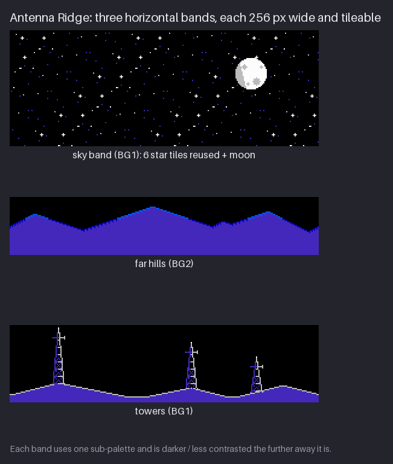
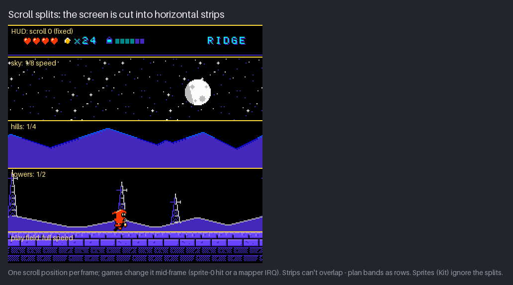
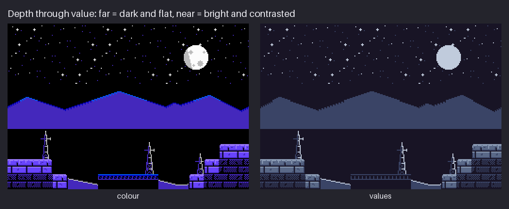
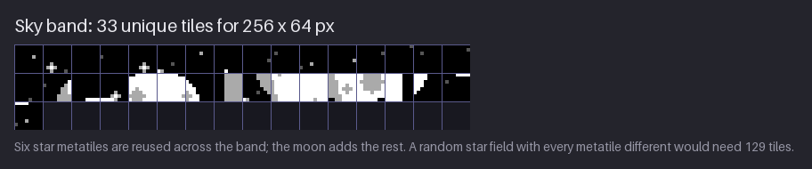

# Chapter 18 — Backgrounds and Parallax

Antenna Ridge is the one place in `hollow-vault` where Kit is outside. Above the rocks there is a
night sky with a moon, a line of far hills, and a row of old radio masts on a low ridge. None of
it can be touched; all of it is there to say *this is far away and you are high up*. That is the
job of a background: to give the play space depth and a sense of place without ever getting in
the way of reading the platforms.

This chapter builds the Ridge's background as three horizontal **bands**, each one sub-palette
and 256 px wide. You will see how scrolling the bands at different speeds creates **parallax**,
the illusion of depth from movement; how NES games did this with only one background layer, by
changing the scroll position partway down the screen; how value (not detail) makes things look
far away; and how to fill a sky with stars for 33 tiles instead of 129. The project gains the
three band images and a parallax preview.

Previous: [Chapter 17](17-props-and-foliage.md). Next: [Chapter 19](19-light-atmosphere-and-mood.md).

## Three bands

The Ridge background is three strips stacked from top to bottom: sky, far hills, towers. Each is
a separate image, and each one wraps: its right edge continues seamlessly into its left edge.


| Band | Size | Sub-palette | Colours (slots 1, 2, 3) | Unique 8×8 tiles |
|---|---|---|---|---|
| sky | 256×64 (drawn 256×96) | BG1 | `$03` purple, `$10` grey, `$30` white | 33 |
| far hills | 256×48 | BG2 | `$03` purple, `$02` blue, `$12` light blue | 44 |
| towers | 256×64 | BG1 | `$03` purple, `$10` grey, `$30` white | 63 |

All three share slot 0, the black backdrop `$0F`, and slot 1, the Ridge's shared dark colour
`$03`. The sky and the towers even share a whole sub-palette (BG1, "metal and starlight"), so
starlight and the lit metal of the masts are literally the same colours.

Three rules shaped these bands.

**One sub-palette per band.** A band is a horizontal strip of the screen, and you want to be able
to treat it as a unit: fade it, swap it, scroll it. If the whole band is in one sub-palette, the
attribute grid never cuts through it, and you never have to think about which 16×16 cell of the
hills is in which palette. It also forces a good habit: a distant band should not need more than
three colours.

**256 px wide.** The NES background is 32 tiles across, exactly 256 px, the width of the screen.
When it scrolls past the edge it wraps around, so anything that scrolls forever must repeat
every 256 px (or every 512 px if you use two screens of background). A band that is exactly one
screen wide and tiles with itself can scroll forever with no seams and no extra memory.

**Wrapping edges.** Making a band tileable is easier than it sounds if you plan for it: put
nothing important within a few pixels of the edges, then check by placing two copies side by side.
In the project, the hill and ridge profiles are computed with wrap-around distance, so a peak near
the right edge carries on at the left. By hand, the simplest method is to draw the band, then
shift it by half its width (most editors have an offset or wrap-shift command), fix the seam that
is now in the middle, and shift it back.

### How each band is drawn

- **Sky.** Black, scattered with stars of three brightnesses (slot 1, 2 and 3), a few small
  crosses (a white centre with grey arms), and the moon: a disc of 13 px radius, white with a
  grey crescent on its left side and four grey craters. The moon is lit from the right, and it is
  the light source for everything below it.
- **Far hills.** A single purple mass (slot 1) under a ridge line. Every slope is a clean line:
  it climbs exactly 1 px for every 2 or 3 px across, so there are no jaggies (Chapter 6). The ridge
  line carries a 1 px or 2 px blue rim (slot 2), and the three highest peaks have light-blue caps
  (slot 3). There is no other detail: no rocks, no trees, no texture.
- **Towers.** A low purple ridge with a grey rim, and three lattice radio masts, 58, 46 and 34 px
  tall. Each mast tapers from 3 px wide at the top to about 9 px at the base, with a horizontal
  bar every 6 rows, X bracing in between, a short dish arm near the top and a white beacon pixel
  at the tip.
  The legs are grey (slot 2) on the right, the side facing the moon, and purple (slot 1) on the
  shadow side.

Notice the direction of the light. The play-field tiles in every area keep the course's top-left
light, but the Ridge's background takes its light from its own visible source, the moon, on the
right. Light from above is what defines walkable surfaces, and both layers keep it: the hill rims
and mast bars are lit on top too. The moon only decides which *side* of the far objects is lit.

Here is what a clean slope looks like up close. Each `#` is one pixel of hill; the slope on the
left climbs 1 px every 2 px, the one on the right falls 1 px every 3 px:

```text
..........##................
........#######.............
......############..........
....#################.......
..######################....
###########################.
```

Every step is the same length, so the eye reads a straight line. Mix step lengths at random
(2, 1, 3, 1) and the line turns into a staircase of jaggies; use step lengths that change
steadily (1, 1, 2, 2, 3, 3) and you get a curve. Far hills only need straight slopes and
the occasional rounded top.

**Try it.** Draw a 64×16 strip of distant hills in one colour plus a rim colour, with every slope
a clean 1:2 or 1:3 step. Place two copies side by side and check the join. Three minutes.

## Parallax

When you look out of a moving train, the fence next to the track rushes past, the trees further
away slide by slowly, and the hills on the horizon barely move. The brain reads those different
speeds as distance. Games copy this by scrolling each background band at a fraction of the
camera's speed: the further away the band, the smaller the fraction. That is **parallax
scrolling**.


The GIF runs for 4.32 s (108 frames of 40 ms). The camera moves at 60 px per second, and the
bands move at:

| Layer | Speed | Pixels per second in the GIF | Camera travel before the band repeats |
|---|---|---|---|
| sky | 1/8 | 7.5 | 2048 px |
| far hills | 1/4 | 15 | 1024 px |
| towers | 1/2 | 30 | 512 px |
| play field | 1 | 60 | (the level itself) |

The last column is the band width divided by its speed: 256 ÷ 1/8 = 2048. A slow band has to
travel a long way before it shows its own repeat, which is why distant bands can be one screen
wide and nobody notices. A fast band repeats quickly, so if you have a near background layer
moving at 3/4 speed, give it some variety or the player will spot the loop.

Choosing the speeds:

- **Halve each step.** 1/8, 1/4, 1/2, 1 gives evenly spaced depths, and halving is also what NES
  code does cheaply (a speed of 1/2^n is a bit shift).
- **The sky can be still.** The furthest layer can move at 1/8 or not at all; a sky that does not
  scroll reads as infinitely far away. Moving it at 1/8 adds a little life.
- **Keep the layer count small.** Three bands plus the play field is already a lot of motion. More
  layers add more movement than depth.

### Whole pixels only

At 1/8 speed, the sky should move 0.125 px each time the camera moves 1 px. A screen cannot draw
an eighth of a pixel, so the position is rounded down to whole pixels: the sky stays still for 7
camera pixels and then steps by 1. That is correct and it looks fine, because the sky is far away
and its steps are rare and regular. What you must not do is draw the band at a fractional position
with smoothing (the image would blur), or round different parts of one band differently (it would
tear apart). Every layer always sits on a whole pixel; only the *rate* differs. On the NES this
is not a choice: the scroll registers hold whole pixels.

### Vertical movement

Scroll splits (next section) work line by line, which suits sideways scrolling: each strip gets
its own horizontal offset. When the camera moves up or down, the simple approach moves every strip
by the same amount, so there is no vertical parallax. Doing better takes extra work in the game's
code every frame. That is one reason NES-era parallax mostly appears in levels that scroll
sideways, and why your background bands should look right when the whole stack moves vertically
together.

**Try it.** Take the strip of hills from the last drill and a strip of ground. In an animation
tool, make 8 frames in which the ground moves 2 px per frame and the hills 1 px every other frame.
Play it back at about 10 frames per second. Five minutes.

## Scroll splits

On a modern engine, parallax is just several layers drawn on top of each other. The NES has one
background layer and one scroll position, which it reads once at the top of the frame. So how did
NES games scroll a sky, hills and a ground at different speeds?

They cut the screen into horizontal strips and changed the scroll position *while the frame was
being drawn*. The picture is sent to the TV one line at a time, top to bottom. If the game
changes the horizontal scroll at the moment the beam reaches line 96, everything above line 96 has
already been drawn at the old position and everything below is drawn at the new one. Do that at
several lines and each strip scrolls at its own speed. This is a **scroll split** (also called a
raster split).


Reading the figure from the top:

| Strip | Lines | Scroll |
|---|---|---|
| HUD | 0–31 | fixed at 0, so the hearts and counters never move |
| sky | 32–95 | 1/8 |
| hills | 96–143 | 1/4 |
| towers | 144–207 | 1/2 |
| play field | 208–239 | full speed |

The game has to know *when* the beam reaches each line. Two common ways:

- **Sprite-0 hit.** The hardware sets a flag when the first sprite in the list (sprite 0) overlaps
  a solid background pixel. Put sprite 0 at the bottom of the HUD, wait for the flag, then change
  the scroll. This gives you one split per frame, which is why so many NES games have a fixed
  status bar and a single scrolling playfield.
- **A mapper IRQ.** Many cartridges contain an extra chip (a **mapper**) that can count scanlines
  and interrupt the game at a chosen line. That allows several splits per frame, and it is how the
  games with multi-band parallax did it.

The art consequence is the important part for you: **strips cannot overlap.** A scroll split
changes the scroll of *everything* on the lines below it. A mast in the towers strip cannot poke
up into the hills strip, and a hill cannot reach down behind the ground. Each band must be a
clean horizontal row of the screen, and you plan your background as a stack of rows from the
start. That is why the Ridge bands are separate images with flat tops and bottoms.

**Sprites ignore splits.** Kit, the enemies and the particles are sprites, and sprites are
positioned on screen directly, not through the background scroll. Kit can stand across a split
line, as in the figure, and nothing happens to Kit. That is also why you can put something in
front of a split without worrying.

> **NES rule:** the NES has one background layer and one scroll position per frame. Parallax
> comes from changing the scroll at chosen scanlines (with the sprite-0 hit or a mapper's scanline
> interrupt), so parallax layers are horizontal strips that never share a scanline. Sprites are
> not affected by scroll splits.

This course is NES-inspired here: the figures and the project show the strips scrolling, but not
the interrupt code that a real game needs to time them. The art rules (bands as rows, one
sub-palette per band, 256 px wrap) are the ones a real game would impose.

Some NES games used a different trick for parallax: they kept the background still and
*animated the tiles themselves*. If a distant band is made of one repeating 8×8 pattern, the game
can swap in a set of tiles in which the pattern is shifted by one pixel, then by two, and so on,
so the band seems to slide while the scroll stays put. That works even in rows that share
scanlines with other things, at the cost of extra tile graphics. The Further study video on NES
parallax shows both techniques.

### A note on still screens

None of this applies to a room that does not scroll. A flip-screen room (Chapter 16) is one fixed
screen, so the towers can stand on the same lines as the rock platforms, which is what the still
Ridge room in Chapter 19 does. If you later make the Ridge scroll, the towers have to move into
their own strip, as in the figure above. Decide early which areas scroll; it changes how you lay
out their backgrounds.

### Planning splits for your own area

Work from the bottom up, because the play field is fixed by the level design:

1. Mark the rows the play field needs: the highest platform Kit can stand on, plus room to jump.
   Everything above that line is free for background; everything below scrolls at full speed.
2. Mark the HUD strip at the top. It is fixed, and its bottom edge is the first split.
3. Divide the space between them into two or three bands, nearest at the bottom. Give the near
   bands more height: they move faster and carry more shape.
4. Write each band's first scanline, height and speed in a small table, like the one above. That
   table is what the programmer needs, and it is the brief for each band you draw.

If the play field needs more height in some rooms than others, the split lines move from room to
room. That is possible, but simpler games keep them fixed for a whole area.

**Try it.** Take a screenshot-sized sketch of one of your rooms (256×240). Draw horizontal lines
where a scroll split would go, label each strip with its speed, and mark anything in the
background that crosses a line. Each one is a problem to fix. Three minutes.

## Depth through value

Look at a real landscape on a clear day and the far hills are paler and bluer than the near
ones, with less contrast. Painters call this **atmospheric perspective**: the air between you and
a distant object scatters light, so the object's darks get lighter and its colours shift towards
the colour of the sky. In a daytime scene, far means *lighter, bluer and flatter*.

At night it works the other way round, because the sky is dark. Far means *darker and flatter*:
distant shapes sink towards the colour of the night sky, and only the near things catch enough
light to show detail.


Read the values from far to near (luminance on the 0–255 scale from Chapter 4):

- **Far hills:** a mass of `$03` at 65 with a rim of `$02` and `$12` at 21 and 80. The whole band
  sits in a narrow range of dark values. Flat, quiet, far.
- **Towers:** the ridge is the same `$03` at 65, but the masts are drawn in `$10` grey at 188
  with `$30` white tips at 252. Thin lines, high contrast: closer.
- **Play field:** the rocks are `$13` at 100 and `$23` at 144 with black gaps and `$03` shadows,
  in solid blocks. The widest range of values over the largest areas: nearest.

The rule is about *contrast inside each band*, not just about brightness. The hills have almost
no internal contrast, so the eye slides over them. The play field has the most, so the eye lands
there.

There is one deliberate exception: **light sources ignore the rule.** The moon and the brightest
stars are the most distant things in the scene and also the brightest. Things that emit light are
exempt from atmospheric perspective. Keep them small, though: a moon is a few cells, not a band,
so it marks the light without pulling the whole sky forward.

A quick test for any background: convert it to greys and check that

1. the play field has the strongest contrast on the screen;
2. each band further back has less internal contrast than the one in front of it;
3. nothing in the background looks like a walkable edge: a line as bright *and* as solid as the
   tops of your platforms. Light sources are the exception.

### Background versus play layer

Rule 3 matters more than any other, because a background that looks walkable is a gameplay bug,
not just an art problem. The player will jump at it.

The Ridge shows where the risk comes from. The towers band shares BG1 with the sky, so its only
colours are `$03`, `$10` grey and `$30` white. The rim along the top of the low ridge is drawn in
`$10`, at 188, which is actually *brighter* than the tops of the rock platforms (`$23`, at 144). In
the scrolling version that rim runs right above the play-field strip. Why does it still read as
background?

- It is a 1 px line over a dark, flat mass. The platform tops are a light edge over solid bricks
  with their own highlights and black gaps: a heavy, structured shape.
- It is broken up by the masts, which stand on it and are clearly not something to climb.
- It moves at half speed. As soon as the camera moves, it slides against the play field, and the
  eye files it as "far".

That is enough here, but it is close to the line. If playtesters jump at it, the fix is to drop
the rim to slot 1 (losing the rim), or to give the towers a sub-palette of their own with a darker
mid colour. When you plan an area's palettes, check every background band against the platform
tops in this way.

Other ways to keep the two layers apart:

- **No horizontal bright lines at jump height** in the background, unless they are clearly broken.
- **Different shapes.** Platforms are rectangles with flat tops; background shapes are slopes,
  silhouettes and thin vertical lines.
- **Darker fills.** Background masses use slot 1 or the backdrop; play-field blocks use the middle
  and light slots.

### Common background mistakes

- **Detail in the distance.** Rocks, trees and windows on the far hills. They cost tiles and pull
  the eye away from the play field; at a distance, silhouette is enough.
- **Bands that overlap.** A tower poking up into the hills strip, or hills drawn behind the play
  field. On a scrolling NES screen this cannot work at all.
- **Equal speeds.** Two bands moving at the same speed read as one layer, so one of them is wasted.
- **A visible seam.** A band whose left and right edges do not match shows a vertical crack every
  256 px of scrolling.
- **A competing sky.** A sky brighter or busier than the play field. The sky should be the
  quietest part of the screen apart from its light source.

**Try it.** Draw three overlapping hill silhouettes, each 64 px wide, in a night palette. The far
one in one dark colour, the middle one in two colours, the near one in three with a bright rim.
Convert to greys and see whether the depth survives. Five minutes.

## Cheap skies

A night sky looks like random noise, and random noise is the most expensive thing you can put in a
tile-based background, because no two 8×8 tiles come out the same. The Ridge sky is 256×64
pixels visible on screen: 32×8 = 256 tile positions. Filled with truly random stars, almost every
one would be a unique tile.


The project's sky uses **33** unique tiles. A random star field of the same size, with every
16×16 cell different, would need **129**, about half of the 256 tiles a whole background can use.

The trick is to draw six **star metatiles** (16×16 cells, each with three dim or bright dots, two
of them also with a small cross) and repeat them across the band. Which star cell goes where is
picked by a simple formula of its column and row, so that cells next to each other, left-right
or up-down, are always different. The six star cells can produce at most 24 tiles; the moon
covers a small block of cells and adds the rest.

Why does the eye not notice the repeats? Because star fields have no structure for it to latch on
to. You notice a repeated tree because it has a recognisable shape; three dots in a 16×16 cell
have none. As long as the same cell never appears twice next to itself, the sky reads as random.

The same idea works for any background texture that should look natural: water ripples, distant
foliage, clouds, cave speckle. Draw a handful of cells, rotate through them with a rule that
avoids neighbours matching, and spend your tile budget on the parts players look at.

### Making stars twinkle

A still star field is fine, but a few twinkling stars make a night scene feel alive. There are two
NES ways to do it, and the sky's sub-palette decides which one you can use.

- **Palette cycling** (Chapter 13). Change one colour of the sub-palette every few frames, say
  slot 3 from white to grey and back, and every pixel drawn in that slot flickers at once, for no
  tiles and no sprites. The catch: *every* pixel in that slot changes. In the Ridge, BG1's slot 3
  is also the moon's face and the masts' beacons, so cycling it would make the moon flash.
- **Sprites.** Place a few small sprite twinkles over the sky. They cost sprites (and count
  towards the 8-per-scanline limit), but they can go anywhere and nothing else changes.

The Ridge uses sprites, as you will see in Chapter 19. If you want palette-cycled stars in your own
game, give the sky a sub-palette of its own, or reserve one slot for "twinkle" pixels only.

**Try it.** Draw four 16×16 star cells, each with 2–4 dots of different brightness and one with
a cross. Fill a 128×64 area by repeating them so no cell sits next to a copy of itself. Look at
the result at 1× and try to spot the repeat. Five minutes.

## Project: the Ridge bands

The Ridge background goes into the pack as three band images, separate from any room, so they can
be scrolled, faded or reused. The snapshot is [`project/ch18/`](project/ch18/README.md); its
README marks these files as new:

- `bg/sky.png` — the sky band, 256×96. Rooms and the parallax GIF show only its top 64 rows;
  the extra rows are there for a taller sky if a scene needs it.
- `bg/hills.png` — the far hills, 256×48, BG2.
- `bg/towers.png` — the towers, 256×64, BG1.
- `preview/sky-2x.png`, `preview/hills-2x.png`, `preview/towers-2x.png` — 2× previews.
- `preview/parallax.gif` — the three bands scrolling at 1/8, 1/4 and 1/2 speed.


The preview runs 32 frames of 80 ms. Between frames the camera moves 8 px, so the towers move 4 px,
the hills 2 px and the sky 1 px per frame. It shows the speeds; it is not meant as a seamless loop.

How each band was built:

**Sky (BG1).**

1. Six 16×16 star cells, each with three dots in slots 1, 2 and 3 (dim purple, grey, white), and a
   five-pixel cross (white centre, grey arms) in two of them.
2. The cells repeated across the band, the choice for each position made by a formula of its
   column and row so that no cell sits beside or above a copy of itself.
3. The moon: a disc of radius 13 centred at (200, 36), white, with the left edge in grey for a
   crescent of shadow and four round grey craters of radius 1–3. It sits high on the right so that
   it lights the scene from that side.

**Far hills (BG2).**

1. A height profile from five peaks, between 24 and 40 px high, on a base 10 px high. Each slope
   rises exactly 1 px every 2 or 3 px. The profile wraps around at 256 px.
2. Everything under the profile filled with slot 1, `$03`.
3. The top pixel of every column in slot 2, `$02`, doubled to 2 px on the slopes that rise to the
   right, so the rim varies in weight.
4. On peaks above 30 px, the top pixels in slot 3, `$12`, as light caps.

**Towers (BG1).**

1. A low ridge from three gentle peaks (12–16 px high on a 5 px base), filled with slot 1 and
   rimmed with slot 2.
2. Three masts at x = 40, 150 and 204, 58, 46 and 34 px tall, each tapering from 3 px wide at the
   top to about 9 px at the base.
3. Every 6th row a horizontal bar; between bars, X bracing. Right-hand legs and bars in slot 2
   grey, left-hand ones in slot 1, so the masts are lit by the moon.
4. A dish arm 11 px wide four rows below the top, a 3 px antenna above, and a slot-3 white beacon
   pixel at the tip.

To make your own background bands:

1. Plan the background as horizontal rows: decide each band's height and its scroll speed first.
2. Give each band one sub-palette, darker and lower in contrast the further away it is.
3. Draw each band 256 px wide and check the wrap with two copies side by side.
4. Fill skies and textures with a few repeated cells; save the unique tiles for shapes.
5. Test the speeds in an animation before drawing details.

## Exercises

1. **A tileable far band.** Draw a 256×48 band of distant scenery (hills, a city skyline, a forest
   edge) in one sub-palette: a dark mass, a rim and one accent colour.

   *What to look for:*
   - two copies side by side show no seam;
   - slopes are clean steps (1:1, 1:2 or 1:3), with no jaggies;
   - the mass is one flat colour; detail is limited to the rim and a few accents;
   - no part of the band is as bright as your play field's walkable edges.

   <details><summary>Example solution</summary>

   

   The far hills band is the model: one purple mass, a blue rim, light-blue caps on the three
   highest peaks, and nothing else. The profile is computed with wrap-around, so the peak near
   the right edge continues at the left.
   </details>

2. **Assign speeds and split rows.** Take a 256×240 mockup of a scrolling scene with at least three
   background layers and a HUD. Give each layer a speed and mark the scanline where each strip
   starts.

   *What to look for:*
   - every strip is a full-width horizontal row, and no background element crosses a split line;
   - speeds fall from the play field upwards (or towards the furthest layer), for example 1, 1/2,
     1/4, 1/8;
   - the HUD strip is fixed;
   - you can say which split lines need a sprite-0 hit or an interrupt.

   <details><summary>Example solution</summary>

   

   The Ridge needs four split lines: under the HUD at line 32 (a sprite-0 hit is enough for that
   one), and at lines 96, 144 and 208, which need a scanline interrupt (or very carefully timed
   code). Kit crosses a line and is
   unaffected, because Kit is a sprite.
   </details>

3. **Greyscale depth check.** Convert one of your scenes with a background to greys. Rank its
   layers by internal contrast, from flattest to most contrasted.

   *What to look for:*
   - the ranking matches the depth order: far layers flattest, the play field most contrasted;
   - only light sources (moon, lamps, sun) break the rule;
   - the play field's walkable edges are brighter than any background band.

   <details><summary>Example solution</summary>

   

   In the Ridge, the hills are a single dark value with a rim of similar value, the masts are thin
   bright lines, and the rocks have the widest range over the largest areas. The moon is the
   brightest thing on screen and the furthest away, which is fine: it is the light source.
   </details>

4. **A star sky under 40 tiles.** Draw a 256×64 night sky, with a moon or planet, that uses at most
   40 unique 8×8 tiles. If your editor can count unique tiles, use it; otherwise count your
   distinct 16×16 cells and multiply by four.

   *What to look for:*
   - five to eight star cells, repeated with no cell next to itself;
   - stars of at least two brightnesses;
   - the moon is the only large unique shape;
   - at 1× nobody can see the repeat.

   <details><summary>Example solution</summary>

   

   The course's sky uses six star cells and the moon for 33 tiles in total. A random field of the
   same size would need 129. If you are over budget, cut a star cell before you shrink the moon.
   </details>

## Recap

- A background gives depth and place without competing with the play field. On the NES it is
  built as horizontal bands, each 256 px wide, tileable, and in one sub-palette.
- Antenna Ridge has three bands: sky (BG1, 33 tiles), far hills (BG2, 44 tiles) and towers (BG1,
  63 tiles).
- Parallax: the further away, the slower. The Ridge uses 1/8, 1/4 and 1/2, with the play field
  at full speed. A band repeats every 256 ÷ speed pixels of camera travel.
- Positions are always whole pixels; slow layers step rarely rather than blurring.
- The NES has one scroll position per frame. Scroll splits change it partway down the screen
  (sprite-0 hit for one split, a mapper interrupt for several), so bands are rows that cannot
  overlap. Sprites ignore splits.
- Some games fake parallax by animating tiles instead of scrolling.
- Depth through value: by day, far is lighter and bluer; at night, far is darker. Always, far is
  flatter. Light sources are the exception.
- Skies and textures: a few repeated cells, never next to themselves. 33 tiles instead of 129.
- The pack now has `bg/sky.png`, `bg/hills.png`, `bg/towers.png` and a parallax preview.

## Further study

- **"NES Background Parallax Explained"** — Retro Game Mechanics Explained —
  https://www.youtube.com/watch?v=wt73KPS_23w. How real NES games achieved parallax, with scroll
  splits and with animated tiles; watch for how the art is laid out in strips to make the tricks
  possible.
- **"The Perfect Pixel Art Parallax Tutorial [and Unity script!]"** — AdamCYounis —
  https://www.youtube.com/watch?v=tMXgLBwtsvI. A modern engine view of parallax; skip the script
  and watch how layer speeds and pixel snapping are chosen.
- **"How to make Parallax Backgrounds (Pixel Art Tutorial)"** — Pixel Overload —
  https://www.youtube.com/watch?v=7_qw0tWR3yk. Painting the layers themselves; note how detail and
  contrast drop off with each layer back.
- **"Pixelblog 23 - Parallax Scrolling"** — Raymond Schlitter (Slynyrd) —
  https://www.slynyrd.com/blog/2019/11/12/pixelblog-23-parallax-scrolling. Planning layers,
  speeds and seamless loops; compare his free layers with the NES rule that bands must be rows.
- **"Pixelblog 11 - Landscape Pixeling"** — Raymond Schlitter (Slynyrd) —
  https://www.slynyrd.com/blog/2018/11/16/pixelblog-11-landscape-pixeling. Hills, mountains and
  atmospheric perspective in pixel art; look at how few colours each distance gets.

Sources for this chapter: [REFERENCES.md](REFERENCES.md#chapter-18--backgrounds-and-parallax)
