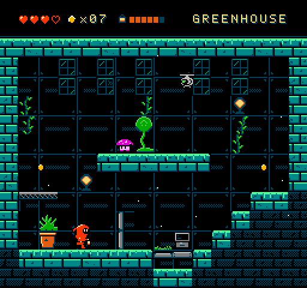
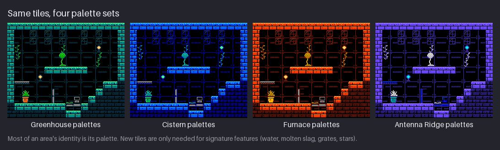
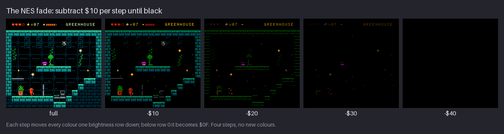
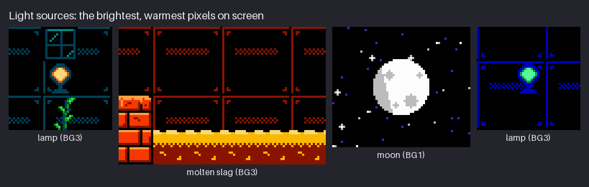
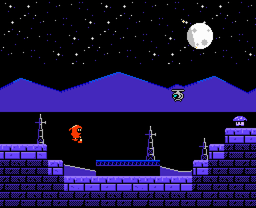

# Chapter 19 — Light, Atmosphere, and Mood

Walk from the Greenhouse into the Cistern and the game feels different before you have seen a
single new enemy: the warm lamps are gone, everything is blue, and water drips from the ceiling.
Walk on into the Furnace and the same kind of walls are now red and orange, the floor is molten,
and sparks rise past Kit. Most of that change is not new art. It is the *same* tiles under a
different palette, a different light source, and a handful of 1 px sprites.

Hempuli's *Environmental Station Alpha*, the game that inspired this course, works the same way:
each area of the station is recognisable at a glance, mostly by its colours. This chapter teaches
that lesson at NES scale. You will give `hollow-vault`'s four areas their palettes, see how much of
an area's identity a palette carries on its own, place light sources, design ambient particles
within the sprite budget, and build the classic NES fade to black. The project gains the
palettes of all four areas, three new rooms, and a fade table.

Previous: [Chapter 18](18-backgrounds-and-parallax.md). Next: [Chapter 20](20-final-area-and-export.md).

## Four moods

Here are the four areas of `hollow-vault`, each one screen, each with its HUD.


Each area is four background sub-palettes and four sprite sub-palettes. The background ones are:

| Area | Shared dark (slot 1) | BG0 terrain | BG1 | BG2 metal | BG3 |
|---|---|---|---|---|---|
| Greenhouse | `$0C` dark teal | `$1C` `$2B` stone, mint moss | `$1A` `$2A` plants | `$00` `$10` | `$17` `$38` warm lamp |
| Cistern | `$02` deep blue | `$12` `$21` blue stone | `$1C` `$2C` water | `$00` `$10` | `$1B` `$2B` algae |
| Furnace | `$07` dark brown-red | `$16` `$27` red brick | `$18` `$28` brass | `$00` `$10` | `$28` `$38` embers, glow |
| Ridge | `$03` dark purple | `$13` `$23` purple rock | `$10` `$30` metal, starlight | `$02` `$12` far hills | `$1C` `$3C` beacons |

Slot 0 is always the black backdrop, `$0F`. Read the table by columns and the design falls out:

- **Slot 1 sets the temperature of the shadows.** Every background sub-palette in an area shares
  its slot 1, so the darkest non-black colour (wall lines, shadow edges, the backs of things) is
  one hue across the whole screen. Dark teal, deep blue, brown-red, purple: before anything else
  is drawn, the room already has a mood.
- **BG0 is always the terrain**, with its lightest colour on the walkable tops. The hue changes
  per area; the role does not.
- **BG2 is always the same greys.** Metal is metal everywhere. The greys also act as a neutral
  reference that makes the coloured sub-palettes look more saturated beside them.
- **BG1 and BG3 carry the area's signature**: plants and a warm lamp in the Greenhouse, water and
  algae in the Cistern, brass and glowing embers in the Furnace, starlight and beacons on the
  Ridge.

And the moods, in words:

- **Greenhouse:** teal and green, with cream lamps. Calm, alive, slightly warm. The starting area.
- **Cistern:** blues and teal, no warm colours at all. Cold, wet, quiet.
- **Furnace:** reds, oranges and yellows on brown-red shadows. Hot, dangerous, loud.
- **Ridge:** purple and blue on black, a white moon. Open, cold, high up, night.

This is **colour temperature** at work. Warm colours (reds, oranges, yellows) feel near, active
and hot; cool colours (blues, teals, purples) feel distant, calm and cold. An area does not have
to be one temperature, but its shadows (slot 1) should be, and its light source usually goes the
other way so it stands out.

The sprite sub-palettes follow roles too. Slot 1 of every sprite sub-palette is black `$0F`, the
outline:

| Area | SP0 Kit | SP1 enemy | SP2 effects | SP3 drone |
|---|---|---|---|---|
| Greenhouse | `$16` `$37` | `$14` `$34` | `$28` `$30` | `$10` `$2A` |
| Cistern | `$16` `$37` | `$19` `$39` | `$21` `$30` | `$10` `$26` |
| Furnace | `$16` `$37` | `$00` `$10` | `$28` `$30` | `$10` `$26` |
| Ridge | `$16` `$37` | `$13` `$33` | `$28` `$30` | `$10` `$2C` |

The enemy palette changes per area so each area's local creatures belong to it; the effects
palette stays bright (white plus one accent) so that pickups and sparks always read.

### Kit never changes

Kit's sprite sub-palette, SP0, is `$16` red and `$37` cream in every area (plus black, since the
sprite's slot 1 is `$0F`). The player's eye has to find Kit instantly in any room, so Kit is the
one thing that never takes on the area's colours. Red reads against teal, blue and purple with no
effort.

The Furnace is the exception, and it was a deliberate test. Its brick sub-palette contains the
same `$16` red as Kit's suit. In the Furnace, Kit is found by the things that are *not* red: the
black outline all the way round, and the cream face highlights and lantern. Those are the
strongest contrasts on Kit and they never share a colour with the bricks. If your hero shares a
colour with an area, make sure the outline and the light accents carry the read there.

### How many colours on screen?

The NES can show at most 25 colours at once: the backdrop, plus 3 for each of the 4 background
sub-palettes, plus 3 for each of the 4 sprite sub-palettes. `hollow-vault` deliberately spends
fewer. With slot 1 shared across the background sub-palettes and black in slot 1 of every sprite
sub-palette, an area can show at most 18. The measured counts in the four finished rooms are lower
still: Greenhouse 16, Cistern 15, Ridge 15, Furnace 11 (the Furnace reuses `$16`, `$28`, `$00` and
`$10` across several sub-palettes, so it has fewer distinct colours to show). Limiting colours per
area is what makes each area read as one place.

### Common mood mistakes

- **Every area in every hue.** If each area uses the full range of the master palette, none of
  them has a mood. Pick one main hue and one accent per area.
- **Changing the hero.** Recolouring the hero to match each area makes them disappear in exactly
  the place where they should stand out.
- **A bright back wall.** The back wall must stay in slot 1 and the backdrop. A mood carried by a
  bright wall competes with the platforms (Chapter 4).
- **Same values, new hues.** Two areas whose palettes differ only in hue, with identical value
  structure, can feel alike. Let the darkness change too: the Ridge is mostly black sky, the
  Furnace mostly bright brick.

**Try it.** Pick an area for your own game and write its slot-1 colour first, before anything
else. Then write one word for the mood and check that the colour fits the word. Two minutes.

## Same tiles, new palettes

Tiles do not store colours. They store slot numbers, 0 to 3 (Chapter 14). The sub-palette decides
what those numbers look like. So you can take a finished room and drop in a different set of
palettes, and every tile changes colour with no redrawing at all.


Each copy of the room is the same tile map and the same attribute grid; only the 16 background
colours differ. Look at how much changes:

- The terrain switches mood completely, because BG0 holds the area's main hue.
- The plants (BG1) become teal water weed in the Cistern palette, brass-gold in the Furnace and
  pale metal in the Ridge. The seed pod on the Ridge looks like a white metal sculpture. That
  tells you something about the design: BG1 means "plants" only in the Greenhouse. In the other
  areas, BG1 is for whatever that area's signature material is.
- The metal props (BG2) stay grey everywhere.
- The lamps (BG3) change colour with the area's light: cream, mint, yellow, cyan.

So a large part of an area's identity costs nothing in tiles. Then where do the differences
between the real rooms come from? From a small set of **signature tiles**, drawn once per area:

| Area | Signature features | Unique tiles in the room |
|---|---|---|
| Greenhouse | vines, tufts, windows | 119 |
| Cistern | water surface and pool, grates | 93 |
| Furnace | molten slag pool, grates | 88 |
| Ridge | sky, hills, masts, slopes | 134 |

Everything else (the brick walls, the back wall panels, the platforms, the props) is shared
between areas and only recoloured. When you plan a new area, ask first what can be a palette
change, and only then what genuinely needs new tiles. Usually one or two signature features are
enough: water says "cistern", molten slag says "furnace", stars say "outside".

**Palettes by role, not by colour.** The trick only works because each sub-palette has the same
*job* in every area: BG0 terrain, BG1 signature, BG2 metal, BG3 light and accents. Within each
sub-palette, slot 2 is always the mid tone and slot 3 the light one. Design all of your areas'
palettes against one table of roles, and every tile you draw will work in every area.

**Try it.** Take any small tile scene you have drawn in four colours. Make three copies and
recolour each with a different set of four colours that keeps the same value order (dark, mid,
light). Name the mood of each. Five minutes.

## Light sources

Every area has at least one thing that gives off light, and the rest of the room is arranged around
it. The rule of thumb: **the light source is the brightest pixel on screen, and usually the
warmest.**


| Area | Light source | Sub-palette | Its brightest colour | Luminance |
|---|---|---|---|---|
| Greenhouse | wall lamps | BG3 | `$38` cream | 215 |
| Furnace | molten slag, lamp | BG3 | `$38` cream, `$28` yellow | 215, 182 |
| Ridge | the moon | BG1 | `$30` white | 252 |
| Cistern | wall lamp | BG3 | `$2B` mint | 189 |

In each area the light source holds the brightest background colour on the screen. In the
Greenhouse, `$38` at 215 is brighter than the mint moss on the platforms (`$2B`, 189), so the eye
goes to the lamps first and to the walkable edges second. On the Ridge, the moon's white is the
brightest colour the NES has. The Cistern is the close call: its lamp's `$2B` (189) only just
beats the metal's `$10` (188), so there the lamp wins by its hue and its dark surround rather than
by value.

The Cistern breaks the "warmest" half of the rule on purpose. Its lamp is mint, not cream, and
there is no warm colour in any of its background sub-palettes. Warmth in the Cistern is reserved
for Kit: the red suit and the cream face are the only warm pixels on the screen, which makes Kit
even easier to find in the coldest area. A light source does not have to be warm; it has to be
the brightest thing in its neighbourhood.

### Glow without lighting

On the NES there is no lighting system. A lamp does not make the wall around it brighter; the
pixels near the lamp are exactly the same colours as the pixels far away. Light is *drawn*, never
calculated. You fake it in three ways:

1. **A bright core with a falloff.** The Greenhouse lamp is a cream core inside a rust ring inside
   a dark teal ring: three steps from light to dark, which the eye reads as glow.
2. **Lit edges facing the source.** On the Ridge, the masts are grey on the side facing the moon
   and dark purple on the other side. The whole set of shapes agrees on where the light is.
3. **The palette as a whole.** The Furnace looks hot because its shadows are brown-red and its
   lights are yellow and cream. The light is in the palette, not in any one place.

What you cannot do is light a *region*: a pool of light on the floor under a lamp would need the
floor tiles under the lamp to be drawn lighter, and that costs new tiles (and probably a new
attribute cell). If you want a pool of light in one place, draw it as a few special tiles, and
use it sparingly.

### Warm light, cool shadow

Painters have a simple rule of thumb: if the light is warm, the shadows look cool, and the other
way round. The NES palettes in `hollow-vault` follow it wherever they can. The Greenhouse's lamps
are cream against dark teal shadows; the Ridge's moon is white over purple. The Furnace is the
opposite case, warm all the way down, with brown-red shadows under yellow light; that is what
makes it feel oppressive rather than cosy. When you want a room to feel comfortable, give its
light and shadow opposite temperatures. When you want it to feel hostile, make them the same.

**Try it.** Draw a 16×16 light (a lamp, a torch, a glowing crystal) in three colours plus black:
a core in the lightest, a ring in the mid, a ring in the dark. Put it on a dark wall and squint.
It should be the first thing you see. Three minutes.

## Particles

Particles are the cheapest way to make a still room feel alive: a few pixels drifting, falling or
flickering. In `hollow-vault` each area has one kind of ambient particle.


| Area | Particle | Shape | How many | Motion |
|---|---|---|---|---|
| Greenhouse | spore | 1 px, white | 10 | drifts slowly upward, swaying 2 px |
| Cistern | drip | 1×2, white | 4 | falls from the ceiling into the pool |
| Furnace | ember | 1×2, white over yellow | 10 | rises fast, jittering 1 px left and right |
| Ridge | twinkle | 3×3 plus, white arms, yellow centre | up to 3 | appears for 0.3 s, then hides |

Here are the four particle shapes, with sprite slots as digits (`3` white, `2` the second
colour, `.` transparent):

```text
spore   drip   ember   twinkle
  3       3      3       .3.
          3      2       323
                         .3.
```

All of them use SP2, the effects sprite sub-palette, which holds white `$30` and a second colour
(yellow `$28` in the Greenhouse, Furnace and Ridge). Each particle matches its area's story:
spores in a greenhouse, drips in a cistern, embers over molten slag, twinkling stars outside.
Both GIFs run 2.4 s (24 frames of 100 ms).

### The sprite budget

Particles are sprites, and that has a cost that has nothing to do with their size: **every
particle is one 8×8 hardware sprite**, even if it is a single pixel. The NES shows at most 8
sprites on any one scanline. If a ninth sprite lands on a line, it is not drawn there (games
usually rotate the sprite order every frame so that the missing one changes, which is the familiar
NES flicker).

So the question for particles is not "how many on screen?" but "how many on one line?". Count
Kit (16 px wide, so two sprites side by side on every line Kit covers), each enemy, each pickup
and each particle that touches the line. In the four `hollow-vault` loops, the busiest play-field
line holds:

| Area | Most sprites on one scanline (play field) |
|---|---|
| Greenhouse | 4 |
| Cistern | 5 |
| Furnace | 6 |
| Ridge | 4 |

The HUD rows have their own load: the hearts and the seed icon are sprites too, 5 on their busiest
line. Everything stays within the limit of 8, with room to spare for a projectile or a hit effect.
These are the maximums over the whole 2.4 s loops; in most frames the busiest line holds fewer.

Rules that keep particles cheap and readable:

- **Spread them vertically.** Ten particles at ten different heights cost one sprite per line;
  ten in a row cost ten on one line.
- **Small and dim.** 1–2 px, and slow. Particles are atmosphere; they must never be mistaken for
  pickups, projectiles or enemies.
- **Few.** Ten is plenty for a whole screen. The Ridge needs only three, because its sky already
  has hundreds of static stars in the background tiles; the sprites only add the movement.
- **Background where possible.** The static stars, the molten slag surface and the water are tiles
  (the slag and water are animated by swapping tiles, Chapter 13). Use sprites only for things
  that move freely.

This part is NES-inspired: the GIFs place every particle in every frame and never need to drop
one, because the counts stay under the limit. A real game would also have to manage the sprite
list, and would have to decide what to drop when an explosion pushes a line past 8.

**Try it.** Sketch a 256×240 screen and mark Kit, two enemies and the HUD. Add eight particles
and count the sprites on the busiest scanline. Then move the particles until no line holds more
than 6. Five minutes.

## The NES fade

Almost every NES game fades to black between rooms, on death, or at the end of a scene. It looks
like a dimmer switch, but the NES has no brightness control. The fade is done entirely with
palettes, and it uses the structure you met in Chapter 4: the master palette is four rows of
brightness, and moving a colour from one row to the next lower row (subtracting `$10`) makes it
one step darker.




The rule:

1. Subtract `$10` from every colour in every sub-palette, background and sprite.
2. If a colour is already in row 0 (`$00` to `$0C`), it becomes `$0F`, black.
3. Repeat. After four steps everything is black.

So the fade has five states: full colour and four steps. Here is the Greenhouse's background,
step by step, exactly as stored in the project's fade table:

| Step | BG0 stone | BG1 plants | BG2 metal | BG3 warm |
|---|---|---|---|---|
| full | `$0F $0C $1C $2B` | `$0F $0C $1A $2A` | `$0F $0C $00 $10` | `$0F $0C $17 $38` |
| −`$10` | `$0F $0F $0C $1B` | `$0F $0F $0A $1A` | `$0F $0F $0F $00` | `$0F $0F $07 $28` |
| −`$20` | `$0F $0F $0F $0B` | `$0F $0F $0F $0A` | `$0F $0F $0F $0F` | `$0F $0F $0F $18` |
| −`$30` | `$0F $0F $0F $0F` | `$0F $0F $0F $0F` | `$0F $0F $0F $0F` | `$0F $0F $0F $08` |
| −`$40` | `$0F $0F $0F $0F` | `$0F $0F $0F $0F` | `$0F $0F $0F $0F` | `$0F $0F $0F $0F` |

Watch what disappears first, because it is an order you can design for:

- **After one step the back wall is gone.** Its lines are `$0C`, a row-0 colour, so they go
  straight to black. The room loses its depth first and the shapes remain.
- **The metal goes next.** `$00` is row 0 too, and `$10` drops to `$00` and then to black.
- **The lamps last longest.** `$38` is in row 3, so it survives three steps as `$28`, `$18` and
  `$08`. In the −`$30` panel the only things left are faint brown specks where the lamps were.
  The light sources are the last things to fade, which is exactly how a real dimming room
  behaves.

Sprites fade the same way: Kit's `$16` and `$37` become `$06` and `$27`, then black and `$17`, and
so on. In the figure Kit and the HUD fade along with the room.

The GIF holds full colour for 160 ms, takes 120 ms per step, holds black for 400 ms and fades back
in at 120 ms per step: 1.28 s in all. That is a typical NES pace. A step every 4 to 8 frames
(about 70 to 130 ms) reads as a fade; one step per frame looks like a flash.

**Never write `$0D`.** The master palette has several blacks: all of columns E and F, and `$1D`.
`$0D` looks black too, but it produces a "blacker than black" signal that can confuse some TVs. A
fade that subtracts blindly would turn `$1D` into `$0D`. The rule above avoids this: anything that
would land in row 0 or below goes to `$0F`. Always use `$0F` for black.

> **NES rule:** the palette is the only lighting the NES has. You cannot brighten or darken
> individual pixels, only change palette entries, and every pixel using an entry changes at
> once. Fades, flashes, day and night, and area moods are all whole-palette swaps.
> Subtracting `$10` per step is the standard fade because the master palette is laid out in
> brightness rows.

The same idea gives you other effects for free:

- **Flash:** add `$10` per step instead, stopping at row 3, or set every entry to `$30` white for
  a frame or two. Used for explosions and big hits.
- **Lightning:** swap one sub-palette to bright colours for two frames, then back.
- **A darker room:** use the −`$10` palette as a room's normal state, for a power cut or a cave.

**Try it.** Write out the fade of one of your own sub-palettes, step by step, until it is all
`$0F`. Mark which colour disappears first and which lasts longest. Three minutes.

## Project: four areas

Until now the pack has had only the Greenhouse's palette and room. This chapter adds palettes for
the other three areas, builds their rooms from the shared tiles plus their signature features, and
adds the Greenhouse fade table. The snapshot is [`project/ch19/`](project/ch19/README.md); its
README marks the new files:

- `palette/cistern.gpl`, `palette/furnace.gpl`, `palette/ridge.gpl`: palette files for the three
  new areas, in the same format as the Greenhouse's `greenhouse.gpl`;
- `palette/{cistern,furnace,ridge}-subpalettes.png`: each area's 32 palette entries as a 4×8
  image, one row per sub-palette (BG0–BG3, then SP0–SP3), one column per slot, with `-16x`
  previews;
- `rooms/cistern.png`, `rooms/furnace.png`, `rooms/ridge.png`, with `-3x` previews;
- `palette/greenhouse-fade.json`: the fade table above.

The constraint report in the README: 0 tiles over 4 colours and 0 attribute errors in all four
rooms, with 119, 93, 88 and 134 unique tiles (Greenhouse, Cistern, Furnace, Ridge).


The `.gpl` files are GIMP palettes, a plain text format that most pixel art editors can load.
Each lists the 32 entries in order, BG0.0 to BG3.3 and then SPR0.0 to SPR3.3, with the NES code in
the name of each entry:

```text
GIMP Palette
Name: Cistern
Columns: 4
#
  0   0   0	BG0.0 $0F
  0   0 188	BG0.1 $02
  0  88 248	BG0.2 $12
 60 188 252	BG0.3 $21
```

Loading the palette in the same order every time means slot numbers line up: entry 2 of each row
is always a sub-palette's mid tone, so recolouring a tile is just choosing which row to use.

How each area's palette was built, in the same order every time:

1. **Choose slot 1, the shared dark.** It is the shadow colour of the whole area: `$02` deep blue
   for the Cistern, `$07` brown-red for the Furnace, `$03` purple for the Ridge. It must be dark
   enough that the back wall lines in it stay quiet.
2. **Build BG0, the terrain ramp**, in the area's main hue, one row apart: `$12` and `$21`, `$16`
   and `$27`, `$13` and `$23`. The lighter colour becomes the walkable tops.
3. **Copy BG2, the metal**, unchanged: `$00` and `$10`.
4. **Pick BG1 and BG3 for the signature and the light.** The Cistern gets water (`$1C`, `$2C`) and
   algae (`$1B`, `$2B`, which also colours its lamp). The Furnace gets brass (`$18`, `$28`) and
   embers (`$28`, `$38`). The Ridge gets starlight (`$10`, `$30`) and beacons (`$1C`, `$3C`), and
   uses BG2 for its far hills (`$02`, `$12`) instead of metal.
5. **Check Kit.** Place Kit in the room and squint. In the Furnace, where the bricks share Kit's
   red, the check is the outline and the cream face.
6. **Check the light source** is the brightest background colour in the room.

The Ridge room has one thing to know about. It is a still, flip-screen room, so the radio masts
stand on the same rows as the rock platforms, and the top 64 rows of the sky and the hills sit
above. That is fine for a screen that does not scroll. A scrolling Ridge would need the towers in
their own strip, as Chapter 18 explained.

To make your own fade table, write out each sub-palette as in the table above, then store the five
states as a list. In the project's JSON each sub-palette (`BG0` to `BG3`) has five lists of four
colours, from full to black.

## Exercises

1. **Re-palette a room.** Take one of your rooms and turn it into a second area using only palette
   changes: same tiles, same attribute grid, new colours.

   *What to look for:*
   - every sub-palette keeps its role (terrain, signature, metal, light) and its value order;
   - slot 1 is shared and sets the temperature of the shadows;
   - your hero still reads at a glance;
   - you can name the one or two signature features you would add as new tiles.

   <details><summary>Example solution</summary>

   

   The Greenhouse layout under all four palette sets. The terrain alone is enough to say which
   area you are in; the plants turning into white metal under the Ridge palette shows where a
   signature feature would need its own tiles.
   </details>

2. **Write a fade table.** Take one four-colour sub-palette (your own or one from this chapter)
   and write out the five states of its fade to black.

   *What to look for:*
   - each step subtracts `$10` from every colour;
   - every colour that would drop below row 0 becomes `$0F`, never `$0D` or a negative value;
   - the last state is all `$0F`;
   - you can say which colour disappears first and which lasts longest.

   <details><summary>Example solution</summary>

   

   For the Greenhouse plants, BG1, slot 3 goes `$2A` → `$1A` → `$0A` → `$0F` → `$0F`; slot 2 goes
   `$1A` → `$0A` → `$0F`; slot 1 `$0C` is gone after one step. Full table:
   `$0F $0C $1A $2A`, `$0F $0F $0A $1A`, `$0F $0F $0F $0A`, then all `$0F` twice.
   </details>

3. **Mark the light sources.** In one of your rooms, mark every light source. Then check that each
   is the brightest background colour in its part of the screen, and that the glow is drawn as a
   core and a falloff.

   *What to look for:*
   - nothing else in the room uses a lighter background colour than the light source;
   - the light has at least two steps of falloff (core, ring, dark);
   - lit edges on nearby shapes face the source;
   - if the source is not warm, there is a reason (like the Cistern keeping warmth for the hero).

   <details><summary>Example solution</summary>

   

   The four light sources each hold their area's brightest background colour: cream `$38` lamps in
   the Greenhouse, cream and yellow slag in the Furnace, the white `$30` moon on the Ridge, and a
   mint `$2B` lamp in the Cistern.
   </details>

4. **Two ambient particles.** Design one ambient particle for each of two areas of your game: its
   shape (1–4 px), colour, count and motion. Mock up one frame of each area with the particles in
   place and count the sprites on the busiest scanline.

   *What to look for:*
   - each particle fits its area's story;
   - it cannot be confused with a pickup, a projectile or an enemy;
   - no scanline holds more than 8 sprites, counting the hero, enemies and HUD;
   - static parts (like a star field) are tiles, and only the moving parts are sprites.

   <details><summary>Example solution</summary>

   

   On the Ridge, three 3×3 twinkles appear for 0.3 s at a time over a star field that is all
   tiles; in the Furnace, ten 1×2 embers rise and jitter. The busiest line in the Furnace holds
   six sprites, the Ridge's four.
   </details>

## Recap

- An area's identity is mostly its palette. Same tiles, new palettes; new tiles only for one or
  two signature features (water, slag, stars).
- Give every sub-palette a role (BG0 terrain, BG1 signature, BG2 metal, BG3 light) and keep the
  roles in every area.
- Slot 1, the shared dark, sets the temperature of an area's shadows: `$0C`, `$02`, `$07`, `$03`.
- The hero's palette never changes. Where an area shares the hero's colour, the outline and light
  accents carry the read.
- The NES can show 25 colours; `hollow-vault` areas use at most 18, measured 11 to 16.
- The light source is the brightest pixel on screen and usually the warmest. Glow is drawn as a
  core and a falloff; there is no lighting system.
- Ambient particles are sprites: one 8×8 sprite each, at most 8 per scanline. Spread them
  vertically, keep them small, and use tiles for anything that does not move.
- The NES fade subtracts `$10` per step; row-0 colours become `$0F`. Five states, four steps.
  Never use `$0D`.
- The pack now has palettes for all four areas, the Cistern, Furnace and Ridge rooms, and the
  Greenhouse fade table.

## Further study

- **PPU palettes** — NESdev wiki — https://www.nesdev.org/wiki/PPU_palettes. The palette memory
  layout (backdrop, 4 background and 4 sprite sub-palettes) and the notes on `$0D` and the
  black columns; read the section on the master palette's rows.
- **Nintendo Entertainment System palette** — Lospec —
  https://lospec.com/palette-list/nintendo-entertainment-system. The master palette as a
  downloadable swatch list; use it to try area palettes in your own editor.
- **Environmental Station Alpha** — Giant Bomb wiki —
  https://www.giantbomb.com/wiki/Games/Environmental_Station_Alpha. Background on the game this
  course is inspired by.
- **"Environmental Station Alpha Release Trailer"** — Hempuli —
  https://www.youtube.com/watch?v=6GnMvsTU--E. Watch how quickly you can tell the areas apart, and
  notice that it is mostly by colour.
- **"Introducing Color and Light"** — James Gurney —
  https://gurneyjourney.blogspot.com/2010/05/introducing-color-and-light.html. Colour temperature,
  light sources and atmosphere from a painter; the ideas behind warm lights and cool shadows.
- **"Pixel Art Class - Lighting & Shading Basics"** — AdamCYounis —
  https://www.youtube.com/watch?v=u7v4uEDwW9o. Light direction and falloff at pixel scale; compare
  his glows with the three-step lamp in this chapter.
- **"Pixelblog 6 - Light and Shadow"** — Raymond Schlitter (Slynyrd) —
  https://www.slynyrd.com/blog/2018/6/15/pixelblog-6-light-and-shadow. Light sources, cast shadows
  and how few values a lit scene needs.

Sources for this chapter: [REFERENCES.md](REFERENCES.md#chapter-19--light-atmosphere-and-mood)
