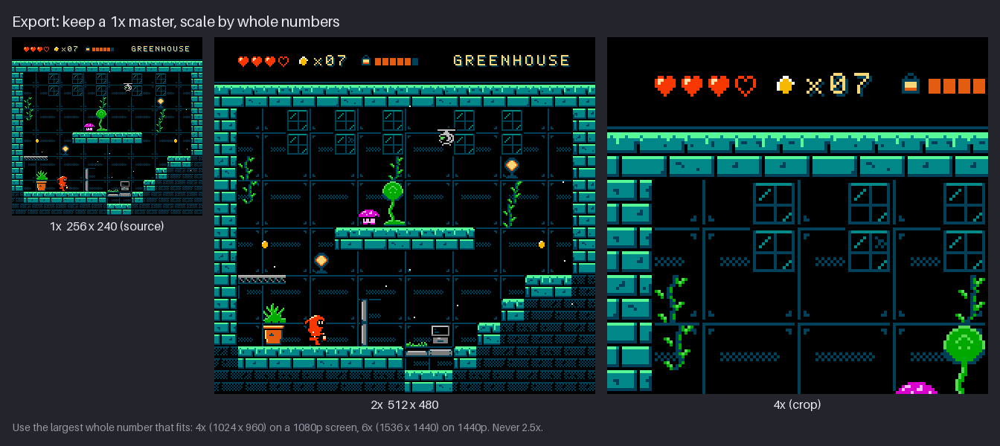

# Chapter 20 — The Final Area and Export

Nineteen chapters of drawing have produced a hero, three creatures, a set of effects, four
tilesets, props, backgrounds and lighting. This chapter puts all of it on screen at once: four
finished areas of `hollow-vault`, each a full 256×240 screen with its HUD, actors and ambient
particles. Then it does the two jobs that turn drawings into a usable asset pack: it **checks**
every screen against the NES rules you have followed since Chapter 1, and it **exports** the art
in the forms other people and programs need.

There are two kinds of export, and the pack ships both. *Engine* files are what a modern game
engine or map editor reads: sprite sheets with JSON, a metatile tileset and a Tiled map.
*Hardware* files are the bytes an actual NES would load: pattern tables (CHR), a nametable with
attributes, and palette RAM. The chapter ends with scaling for display, because the last thing
that can ruin pixel art is the step that makes it bigger. By the end you will be able to run a
rule check on your own area, pack a character into a sheet with metadata, explain what every
byte of a `.nam` file means, and export previews that stay crisp everywhere.

Previous: [Chapter 19](19-light-atmosphere-and-mood.md). Next: [Chapter 21](21-style-one-bit.md).

## Four areas

A finished screen is a stack of everything the course has built, in the order the hardware
draws it: the backdrop colour ($0F black), the background tiles from the room (Chapters 14–16)
with props baked into them (Chapter 17), the parallax layers where an area has them
(Chapter 18), then sprites on top: Kit, the creatures, effects, ambient particles and the HUD
icons (Chapters 8–13 and 19). Here are the four areas, each a 2.4 second loop of 24 frames at
100 ms, shown at ×2:


Look at what the four have in common before looking at what differs:

- **One hue family per area.** Each area's four background sub-palettes share one dark colour in
  slot 1: $0C (dark teal) in the Greenhouse, $02 (dark blue) in the Cistern, $07 (dark brown) in
  the Furnace, $03 (dark purple) on the Ridge. That shared dark ties every tile in the room
  together (Chapter 5) and is the main reason each screen reads as one place.
- **The same Kit everywhere.** Kit always uses SP0 = $0F $16 $37: black outline, red suit, cream
  face and highlights. Against the cool Greenhouse, Cistern and Ridge the warm red pops. In the
  Furnace the bricks use the same $16, and Kit still reads, because the black outline and the
  cream carry the silhouette (Chapter 5's "one hero palette everywhere").
- **Black voids and lit edges.** Every area keeps large areas of backdrop black and puts the
  brightest colours on the edges you can stand on. The eye finds the floor before anything else.
- **One ambient particle per area.** Spores drift up in the Greenhouse, drops fall in the
  Cistern, embers rise in the Furnace, stars twinkle on the Ridge. They cost a few sprites and
  make a still screen feel alive (Chapter 13).
- **Actors in place.** Kit, the hopper, the slugs and the drone animate on the spot. In a game
  they would move; here each loop shows the animation clearly, and the rule check (next section)
  can count exactly what is on every line.

What differs is the material each area is made of: glass and stone, water, brick and molten
metal, open sky. Chapter 16's composition rules hold in all four: a clear floor line, a quiet
area around Kit, one focal point (the bulb plant, the pool, the molten glow, the moon) and
nothing important in the 8 px bands at the top and bottom that old TVs hid.

### Try it

Open one of the four GIFs and watch it three times, each time following one layer only: first
only the background tiles that animate (water, molten metal), then only the actors, then only
the particles. Write one sentence per layer about what it adds to the mood. Then do the same
with a screenshot of your own room: which layer is missing or too busy?

## The rule check

A finished screen is not finished until it passes the rules. The project's constraint report
(produced by `tools/nes.py` and printed in [`project/ch20/README.md`](project/ch20/README.md))
checks each area for the three things that are easy to break without noticing:

| Area | Tiles over 4 colours | Attribute errors | Unique 8×8 tiles | Max sprites on a line (frame 0 / whole loop) |
|---|---|---|---|---|
| Greenhouse | 0 | 0 | 154 | 5 / 5 |
| Cistern | 0 | 0 | 127 | 5 / 5 |
| Furnace | 0 | 0 | 122 | 5 / 6 |
| Antenna Ridge | 0 | 0 | 164 (163 patterns) | 5 / 5 |

"Tiles over 4 colours" catches a stray fifth colour in an 8×8 tile. "Attribute errors" catches a
16×16 area that needs two sub-palettes. Both pass because the rooms were built from metatiles
that were already legal (Chapter 14); the check only proves it.

### Tile budget

The background pattern table holds 256 tiles. Here are all four areas' tiles, as the hardware
stores them: colour numbers 0–3, shown in four greys, with no palette applied.


Two numbers differ for the Ridge: 164 unique tiles, but 163 patterns. One 8×8 pattern appears
under two different sub-palettes. Colour is not part of the tile (the attribute table adds it
later), so the pattern table stores it once. That is the whole trick of NES backgrounds, and the
reason Chapter 14 told you to reuse one shape under several sub-palettes.

The HUD's letters and digits are background tiles too, and they live in the same table. Every
area still has 93 to 134 free tiles. That headroom is not waste: a real game needs it for
the animated water and molten frames, more text, a second room that shares the tileset, or a
boss. If your own area uses 240 tiles, it is legal but has nowhere to grow.

### Sprites per line

The sprite check is the one that changes from frame to frame, so it has to be done on the moving
scene, not on a still.


The figure counts frame 0 of each loop. The busiest lines are in the HUD: the hearts and the seed
icon are sprites, five of them side by side on lines 12–14. In the playfield, the busiest line
has 3 to 5 sprites, because Kit and the creatures are placed at different heights. When the Furnace
loop is counted over all 24 frames, it peaks at 6 on a few lines around y = 130, when rising
embers pass the line that Kit and the hopper already share. That is still under 8, but it shows
why the check must cover every frame: a particle system is the easiest way to break the limit
without noticing, because nobody draws particles one at a time.

The other two sprite numbers are comfortable too. A frame uses 19–31 hardware sprites out of 64
(Kit alone is 6 in most frames), and each screen shows 11–16 distinct colours, well inside the
25 that eight sub-palettes allow.

> **NES rule:** The PPU draws at most 8 sprites on any scanline; while drawing each line it
> searches the 64 entries of sprite memory and keeps only the first 8 it finds, so the 9th and
> later sprites on that line simply vanish. Games flickered (changing the order every frame) to
> share the line. The course keeps this rule authentic: every scene is counted and stays at 8 or
> fewer, and none needs flicker.

### The full checklist

Hardware rules and craft rules belong in one list. Run it on every screen before you call it
finished; the craft half is Chapter 6's professional checklist.

1. Every 8×8 tile uses at most 4 colours, slot 0 being the shared backdrop.
2. Every 16×16 area uses one background sub-palette.
3. The area fits in 256 unique tile patterns, with headroom.
4. Every sprite uses 3 colours plus transparent from one sprite sub-palette.
5. No scanline has more than 8 sprites in any frame, and no frame has more than 64.
6. No $0D anywhere; black is $0F.
7. Key art stays inside 256×224 (8 px clear at top and bottom).
8. No pillow shading, no jaggies, no orphan pixels, black used on purpose (Chapter 6).
9. Kit, every creature and every hazard read at 1×, against every area.

Rules 1–5 are what the constraint report checks for you. Rules 6–9 are your eyes.

### Try it

Take a screenshot of your own room with its actors. Choose the busiest horizontal band, draw an
8 px tall selection across it and count every sprite that touches it, including HUD icons and
particles. Then step through your animation frames and repeat for the frame where things
overlap most. Write down the highest number. If it is above 6, move one actor up or down by a
tile and count again.

## Sprite sheets

So far every animation lives in its own strip: `sprites/kit-walk.png`, `sprites/kit-jump.png`,
and so on. That is the right way to *draw*. An engine prefers to *load* one image per character
with a predictable layout, plus data saying where each frame is and how long it lasts. That
combination is a **sprite sheet**.


The pack's sheet, `export/kit-sheet.png`, is 120×144: 5 columns, because the longest animation
(the jump) has 5 frames, and 6 rows of 24×24 cells, one animation per row. Short rows are padded
with empty cells. That wastes a little space, but it makes the layout trivial to read: frame *f*
of the animation in row *r* is the rectangle at x = *f* × 24, y = *r* × 24. The third attack
frame, for example, is frame 2 of row 4: x = 48, y = 96.

### Anchor, baseline and one facing

When a game draws Kit "at" a position, it needs to know which pixel of the cell that position
refers to. That pixel is the **anchor** (also called pivot or origin). For a character standing
on the ground it is the **bottom centre** of the cell, the point between the feet: [12, 24] for
Kit's 24×24 cell.

The anchor only works if every frame is drawn with the feet in the same place. In every grounded
frame of the sheet, Kit's lowest pixels are on row 23, the bottom row of the cell. Only the
airborne jump frames lift the drawing, on purpose. A frame with feet one pixel too high makes
Kit hop by a pixel every time it plays. The body's centre line stays near x = 12 too, so
mirroring the frame around the anchor does not make Kit slide when turning.

Kit is drawn facing right only. The game mirrors the frames to face left, which halves the art and
guarantees both directions have the same timing. On the NES this is free: every sprite has a
horizontal-flip bit, so the left-facing Kit uses the same tiles. (Background tiles have no flip
bit; that is why the tile budget above counts mirrored patterns twice.)

Why a 24×24 cell for a 16×24 character? The extra 8 px give room for the parts that stick out:
the attack's smear reaches the right edge of its cell, and the run leans forward. A fixed cell
size for every frame is what keeps the anchor arithmetic simple. On the hardware, a frame costs
only the 8×8 tiles that contain pixels, so the empty margin is free; all 23 frames together need
90 unique sprite tiles (Chapter 24 builds that CHR).

### Metadata

The image says what the frames look like. The **metadata** says how to use them. The pack writes
one small JSON file per sheet. Here is `export/kit-sheet.json`, condensed (the real file has one
value per line):

```json
{
  "image": "kit-sheet.png",
  "frameWidth": 24, "frameHeight": 24,
  "palette": ["$0F", "$0F", "$16", "$37"],
  "paletteRGB": ["#000000", "#000000", "#f83800", "#fce0a8"],
  "anchor": [12, 24],
  "animations": {
    "idle":   { "row": 0, "frames": 4, "durations": [500, 400, 120, 400], "loop": true },
    "walk":   { "row": 1, "frames": 4, "durations": [140, 140, 140, 140], "loop": true },
    "run":    { "row": 2, "frames": 4, "durations": [90, 90, 90, 90], "loop": true },
    "jump":   { "row": 3, "frames": 5, "durations": [80, 160, 120, 160, 100], "loop": true },
    "attack": { "row": 4, "frames": 4, "durations": [120, 60, 160, 120], "loop": true },
    "hurt":   { "row": 5, "frames": 2, "durations": [80, 80], "loop": true }
  }
}
```

- **Durations are per frame, in milliseconds.** The uneven timings you designed (the idle's
  quick 120 ms blink, the attack's 60 ms smear frame) survive the trip into the game. A
  programmer without this file would guess, and guessed timings are always even.
- **The palette** lists the sprite sub-palette in NES hex. Slot 0 is written as $0F but means
  *transparent*: a sprite's slot 0 is never drawn. `paletteRGB` gives the same colours as RGB
  for engines that do not know NES numbers.
- **The loop flag.** Every animation in the pack says `"loop": true`, because each file also
  drives the looping previews. A game plays the jump, the attack and the hurt once and then
  switches state, so in your own export set those three to `false`, or let the game's state
  machine decide. Either way, the flag must exist: an attack that loops forever looks broken.

The creatures sheet, `export/creatures-sheet.png`, works the same way with 16×16 cells: 4 columns
and 5 rows (hopper idle and hop, slug crawl, drone hover and alert), 64×80 pixels. Its JSON has
no palette, because the creatures change sub-palette from area to area (the area JSON lists
them, below), and no anchor; use the bottom centre, [8, 16].

### Grid sheets and packed atlases

The grid sheet is the simplest layout. Its alternative is a **packed atlas**: frames trimmed to
their content and packed tightly, with a data file that stores each frame's rectangle and its
offset inside the original cell. Atlases save texture memory when a game has hundreds of
sprites, and tools such as TexturePacker or an editor's "packed" export option make them. For
one character, a grid is easier to check by eye and to edit by hand.

Whatever the layout, the data must provide four things: frame rectangles, durations, a loop
flag and the anchor. Editors' JSON export (a `frames` list with a rectangle and duration per
frame, plus named tags for animations) carries the same information in a different shape.

Two more terms you will meet: **padding** (transparent pixels between cells) and **extrusion**
(copying each cell's edge pixels one pixel outwards). They protect against *bleeding*, where a
filtering engine blends in pixels from the neighbouring cell. With nearest-neighbour sampling
and whole-pixel positions (see [Scaling for display](#scaling-for-display)) nothing bleeds, so
the pack's sheets have neither.

### Try it

Write the metadata for one of your own animations by hand: image name, cell size, anchor, and
for each row its name, frame count, durations and loop flag. Then cover the image and answer from
the metadata alone: where is the third frame of the second row, and how long does it last?

> **In your editor.** LibreSprite and Aseprite have an "Export Sprite Sheet" command with
> by-rows, by-columns and packed layouts and an optional JSON data file. Pixelorama's export
> dialog has a spritesheet tab with rows and columns. Piskel exports a PNG sheet with a chosen
> number of columns. In GIMP or Krita, paste the frames into a grid with the grid snapping set
> to the cell size.

## Engine export

An engine does not want a 256×240 picture of the room. It wants the room's *pieces* and a map
saying where they go, so it can scroll, collide and change single cells. For backgrounds, the
pack exports three files per area in `export/{area}/`.

![On the left, the Greenhouse metatile tileset enlarged three times: 16 tiles per row, five rows,
each 16 by 16 tile numbered in its corner from 0 to 65. The first rows hold the HUD pieces (the
counter digits, the oil lamp and bar, the letters cut in half), then brick edges, windows, vines,
the lamp, the bulb plant, the planter, the terminal and floor pieces. On the right, the full
Greenhouse room at 2x, labelled as rebuilt from greenhouse.tmj with 0 pixels different. A note says
the .tmj stores gid = tile id + 1 per cell, with 0 for empty, and that the same pattern under two
sub-palettes counts as two metatiles.](images/ch20-engine-export.png)

**The metatile tileset** (`greenhouse-metatiles.png`) holds every different 16×16 cell of the
room, 16 per row, in the order they first appear when reading the room from the top left. A
metatile is a pattern *plus* its sub-palette, so the same bricks in two palettes are two
metatiles here (an engine draws colours, not colour numbers). The counts: Greenhouse 66,
Cistern 56, Furnace 54, Ridge 77. The HUD is the first two rows of metatiles of every room,
because on the NES it is part of the background.

**The Tiled map** (`greenhouse.tmj`) is a Tiled JSON map: 16×15 cells of 16×16 pixels, one tile
layer called `background`, and the tileset embedded with a relative path to the PNG. The layer's
`data` is a list of 240 numbers, left to right and top to bottom. Each number is a **global tile
id** (gid): the tile's position in the tileset plus `firstgid`, which is 1. So 0 means "empty",
and tile 0 of the tileset is written as 1. The map's first row begins:

```text
1, 1, 1, 1, 2, 3, 4, 5, 6, 1, 7, 8, 9, 10, 11, 1
```

Tile 0 (gid 1) is plain black: the HUD's empty cells, including the four on the left where the
hearts and the seed icon are drawn on top as sprites. Tiles 1–5 hold the top halves of the seed
count, the oil lamp and the oil bar, and tiles 6–10 the top halves of the area name: the HUD text
straddles the line between the first two metatile rows. The right panel of the figure was drawn
by reading those 240 numbers and copying tiles from the PNG; it matches the room exactly.

**The area JSON** (`greenhouse.json`) is for engines that want the NES structure itself: the area
name, `uniqueTiles` (154) and `metatiles` (66), the four background and four sprite sub-palettes
in NES hex, the 16×15 `attributes` grid (one sub-palette number 0–3 per metatile) and the 32×30
`nametable` grid (one CHR tile number per 8×8 cell). An engine that renders 8×8 tiles with
per-16×16 palettes, or swaps palettes for Chapter 19's fades, can use these directly.

Two rules keep a map and its tileset working together:

- **Never reorder a tileset once maps use it.** The map stores numbers, not pictures. Move tile 12
  and every cell that said 13 now shows the wrong tile. Add new tiles at the end.
- **Keep the grid exact.** The tileset is 256 px wide with no margin and no spacing, so tile *n*
  is at x = (*n* mod 16) × 16, y = (*n* div 16) × 16. One stray pixel column breaks that formula
  for every tile.

What the exported map does not contain: actors, collisions and spawn points. In Tiled, add an
object layer for the starting position of Kit and each creature, and mark solid tiles with a
custom property such as `solid`. For new rooms, Chapter 15's ground set (`tiles/ground-set.png`
with its 4-bit neighbour index in `ground-set.json`) is the piece to set up as a terrain set.

### Try it

Open `project/ch20/export/greenhouse/greenhouse.tmj` in Tiled. Hover over three cells and note
their tile ids in the status bar. Find the same three tiles in `greenhouse-metatiles.png` by
arithmetic (row = id div 16, column = id mod 16). Then add an object layer and drop a point
where Kit stands.

> **Map editors and engines.** Tiled opens the `.tmj` directly. Phaser loads Tiled JSON maps
> with embedded tilesets, and add-ons exist for Godot (for example YATI) and other engines. LDtk
> uses its own project format: add `greenhouse-metatiles.png` as a 16 px tileset and paint the
> room there. Appendix C has the details for each.

## Hardware export

The engine files describe the room as an engine sees it. The hardware files describe it as the
NES sees it: three binary files that, copied into the right places in the PPU, *are* the screen.

![Four panels. First, a pattern table of 256 tiles in four greys on a grid, labelled
greenhouse-bg.chr, 4096 bytes = 256 tiles; the used tiles fill a little over half and the rest
are black. Second, a small 32 by 30 grid of grey squares, brighter for higher tile numbers, in
which the room's layout is faintly visible, labelled greenhouse.nam, 960 tile numbers plus 64
attribute bytes. Third, eight rows of four colour chips labelled BG0 to BG3 and SP0 to SP3,
labelled greenhouse.pal, 32 bytes ($3F00-$3F1F); the first chip of each sprite row is
transparent. Fourth, the Greenhouse room at 1x, labelled decoded from the 3 files, 0 pixels differ
from greenhouse.png.](images/ch20-hardware-export.png)

### The pattern table: `greenhouse-bg.chr`

A CHR file is the pattern table byte for byte. Each 8×8 tile takes 16 bytes in two **bit
planes**: 8 bytes for bit 0 of each pixel's colour number, then 8 bytes for bit 1. In each byte,
the leftmost pixel is the highest bit. A row of pixels with colour numbers 0 1 2 3 3 2 1 0 is
stored as:

```text
colour numbers   0 1 2 3 3 2 1 0
bit 0 (plane 0)  0 1 0 1 1 0 1 0   = $5A   (byte n of the tile)
bit 1 (plane 1)  0 0 1 1 1 1 0 0   = $3C   (byte n + 8)
```

That is why the format is called **2bpp planar**: two bits per pixel, split into planes. The
file holds the 154 Greenhouse tiles in the order they first appear in the room, padded with
blank tiles to 256 × 16 = 4096 bytes, the size of one pattern table. Tile 0 is blank black, which
suits the HUD and every empty cell.

### The nametable: `greenhouse.nam`

The nametable is 1024 bytes. The first 960 are tile numbers, one per 8×8 cell, 32 per row for 30
rows: byte *y* × 32 + *x* says which CHR tile to draw at column *x*, row *y*. The last 64 bytes
are the **attribute table**: an 8×8 grid of bytes, each covering a 32×32 pixel block, with two
bits per 16×16 quarter:

```text
bit  7 6 | 5 4 | 3 2 | 1 0
     BR  | BL  | TR  | TL      (bottom-right, bottom-left, top-right, top-left)
```

So the byte $A9 = %10 10 10 01 gives top-left sub-palette 1 and the other three quarters
sub-palette 2. The first row of attribute bytes is all $FF (%11 11 11 11): the HUD uses BG3
everywhere. The last row covers only 16 px of screen (240 is 7.5 blocks of 32), so only its top
quarters matter.

This packing of four palette choices into one byte is the hardware reason for the 16×16 attribute
area, and so for the 16×16 metatile that the whole course is built on.

### Palette RAM: `greenhouse.pal`

The palette file is the 32 bytes the PPU keeps at $3F00–$3F1F: four background sub-palettes,
then four sprite sub-palettes, four bytes each. For the Greenhouse:

```text
BG0  0F 0C 1C 2B    BG1  0F 0C 1A 2A    BG2  0F 0C 00 10    BG3  0F 0C 17 38
SP0  0F 0F 16 37    SP1  0F 0F 14 34    SP2  0F 0F 28 30    SP3  0F 0F 10 2A
```

The first byte of each background sub-palette is the shared backdrop. The first byte of each
sprite sub-palette is never drawn (it is transparent); the hardware mirrors $3F10 to $3F00, so
the file writes the backdrop there too.

The right-hand panel of the figure was decoded from these three files alone, with no PNG
involved, and matches `greenhouse.png` pixel for pixel. The same round trip passes for all four
areas. Sprites are not part of this export: their tiles go into the second pattern table, and
their positions are written by the game code each frame. Chapter 24 builds Kit's sprite pattern
table (90 tiles; with the creatures and effects, the sprite tiles total 149 of 256) and goes
deeper into banks and animation.

To open the files, use an NES graphics editor: NEXXT (FrankenGraphics) or the older NES Screen
Tool (Shiru), both Windows programs that run under Wine on Debian. Load the CHR, then the
nametable, then the palette, and the Greenhouse appears, editable tile by tile with the
attribute grid enforced. Appendix C lists each tool's quirks and a short assembly program that
displays the screen on an emulator.

> **NES-inspired:** these files describe one static screen. A real game also needs scrolling,
> the sprite list, and the code that writes all of this to the PPU during vertical blank. The
> course leaves those to Chapter 24 and to programmers.

### Try it

Open `greenhouse.pal` in a hex viewer (`xxd greenhouse.pal` in a terminal, or GHex / Okteta) and
match each byte to a chip in the figure. Then take any 8×8 tile of your own and write its first
row as colour numbers 0–3. Convert it to the two plane bytes by hand, as in the table above.

## Scaling for display

Every file the pack ships is 1×. Everything people *see* is bigger. The last step that can ruin
pixel art is the enlargement, so it gets its own rules.


- **Nearest neighbour only.** Each source pixel becomes a block of identical pixels. Smooth
  filters (bilinear, bicubic) average neighbours: outlines blur and colours appear that are not
  in the palette.
- **Whole-number factors only.** At ×2.5, half the pixels become 2 wide and half 3 wide. A 1 px
  outline turns into a line that is thick, thin, thick, thin; dither patterns shimmer. The eye
  catches it at once.

The 240-line height divides several common screen heights exactly, which is a happy accident of
the NES format:

| Screen | Largest whole factor | Result | Fit |
|---|---|---|---|
| 1280×720 | ×3 | 768×720 | exact height |
| 1920×1080 | ×4 | 1024×960 | 60 px border top and bottom |
| 2560×1440 | ×6 | 1536×1440 | exact height |
| 3840×2160 | ×9 | 2304×2160 | exact height |

When the window does not divide evenly, use the largest whole factor that fits and fill the rest
with black. Never stretch to fill. Black borders around a NES-style screen look intentional;
uneven pixels look broken.

> **NES-inspired:** on a 4:3 television, NES pixels were slightly wider than tall (about 8:7).
> The course displays square pixels, as almost every modern NES-style game does. Many emulators
> offer the 8:7 look as an option; it needs a non-integer horizontal stretch, which is exactly
> what this section warns against, so treat it as a viewing preference and never bake it into
> your files.

**In an engine,** the same three settings exist everywhere under different names: texture filter
*nearest* (or *point*); a fixed 256×240 (or 256×224) viewport scaled by a whole number; and the
camera and sprites snapped to whole pixels, so nothing shimmers as it moves.

**For sharing,** scale the image yourself before uploading, because websites and image viewers
smooth small images when they enlarge them. The pack's `preview/` folder does this: every asset
also exists as `-3x.png`, `-4x.png` and so on, and the scene loops as GIFs. GIF is lossless and
the NES never shows more than 25 colours, so GIF suits these loops perfectly. For video sites,
scale by a whole number to at least 1024×960 *before* encoding: video compression smears small
details, and pixels that are already 4×4 survive it much better than single pixels.

Keep the 1× files as masters. Never edit a scaled copy: one stroke at ×4 produces a picture that
is no longer pixel art and can never be scaled back down cleanly.

### Try it

Export one of your screens at ×3, ×4 and, once, at ×2.5. Open all three at 100 % zoom and compare
a 1 px outline and a dithered area. Then open the 1× file in your system's image viewer and zoom
in: if the viewer smooths it, that is what a website will do to an unscaled upload.

> **In your editor.** LibreSprite, Aseprite, Pixelorama and Piskel let you set a whole-number
> scale in the export dialog. In GIMP and Krita, scale the image with interpolation *None* /
> *Nearest Neighbour* to 300 % or 400 %, export a copy and undo. To turn a GIF into a video,
> `ffmpeg -i scene.gif -vf "scale=iw*2:ih*2:flags=neighbor" -pix_fmt yuv420p scene.mp4` doubles
> it with nearest neighbour first.

## Export checklist

Run this list every time you hand over art, to someone else or to your future self:

1. **PNG for art**, never JPEG (JPEG adds blocky noise and new colours). GIF only for previews.
2. **Transparency where needed.** Sprites, effects and props with holes have a transparent
   background and no half-transparent pixels. Background tiles are opaque.
3. **Exact colours.** The exported pixels are exactly the palette's RGB values: no embedded
   colour profile shifting them, no "colour reduction" dithering added by the exporter. The
   pack's PNGs are truecolour with exact NES values; if a tool wants indexed images, convert
   with the area's `.gpl` palette.
4. **Exact sizes.** Every image is a whole number of cells; the cell size in the metadata matches.
5. **Metadata next to every sheet**: cell size, rows, durations, loop flags, anchor, palette.
6. **Rule check passed** for every screen and every frame (the list in [The rule
   check](#the-rule-check)).
7. **Consistent names**: lower case, hyphens, subject first (`kit-sheet.png`, `kit-sheet.json`,
   `greenhouse-metatiles.png`). Never `final2_NEW.png`.
8. **1× masters plus scaled previews**, in separate folders.
9. **The round trip.** Load what you exported, not what you drew: import the sheet into your
   editor using only the metadata, play each row; open the map in Tiled; open the CHR,
   nametable and palette in an NES editor. Mistakes in cell size, order or timing show up in
   seconds here, and take hours once they are in a game.
10. **Credits and licence**: the palette rendering you used, references, and the licence of the
    pack.

## Project: the finished pack

The final snapshot is [`project/ch20/`](project/ch20/README.md): the complete `hollow-vault`
pack. Its README lists every file, marks with `*` the files added in this chapter, and prints the
constraint report quoted above. Everything new is in `export/` and `scene/`:

| Files | What they are |
|---|---|
| `scene/{area}.png` | the four finished screens at 1× (background + sprites + HUD) |
| `export/{area}/{area}.png` | the background only, with the HUD tiles |
| `export/{area}/{area}-chr.png` | the pattern table as a grey 128×128 image |
| `export/{area}/{area}-bg.chr`, `.nam`, `.pal` | hardware files |
| `export/{area}/{area}-metatiles.png`, `.tmj` | metatile tileset and Tiled map |
| `export/{area}/{area}.json` | area data: palettes, attributes, nametable |
| `export/kit-sheet.png` / `.json` | Kit, 23 frames in 24×24 cells |
| `export/creatures-sheet.png` / `.json` | hopper, slug and drone, 14 frames in 16×16 cells |
| `export/hud-bg.png` | the HUD strip, 256×32 |
| `preview/scene-{area}.gif` | the 24-frame loops at ×2 |

Here is how the pack was assembled. Repeat the same steps for your own area.

1. **Compose each screen.** Start from the room (Chapter 16) with its props (Chapter 17) and, on
   the Ridge, the sky, hills and towers (Chapter 18). Add the HUD strip in the top 32 px. Place
   Kit and the creatures on the floor lines at different heights, then the area's particle.
2. **Run the rule check** on all 24 frames of the loop, not just the first. Fix and repeat until
   the report is clean.
3. **Build the sheets.** Paste the strips from `sprites/` (Kit) and `enemies/` (creatures) into one
   grid each, one animation per row, the longest row deciding the width. Copy the durations from
   the strip JSONs into one file and add the anchor.
4. **Cut the metatiles.** Walk the room in 16×16 steps from the top left. Each cell that is new
   (as pattern plus sub-palette) goes into the tileset at the next free position; every cell
   writes its tileset number + 1 into the map.
5. **Cut the CHR.** Walk the same cells, splitting each into four 8×8 tiles. Each new *pattern*
   (colour numbers only) goes into the pattern table; every 8×8 cell writes its tile number into
   the nametable, and every metatile writes its sub-palette into the attribute bits.
6. **Write the palette RAM** from the area's eight sub-palettes.
7. **Make previews** at whole-number scales, and the GIF loops.
8. **Round trip.** Rebuild the screen from the map and from the hardware files, and compare. Both
   must match exactly.


The pack is generated by `tools/build_project.py`, but nothing in it needs a script: every step
above is selecting, copying and counting, and the course's figures exist so you can check your
own results against them. Appendix C documents every folder and format.

## Exercises

1. **Run the rule check.** Take your most finished room with its actors and run the full
   checklist from [The rule check](#the-rule-check) on it, including a sprite count per line
   over every frame of its animation. List each problem with a fix.

   What to look for:
   - No tile with a fifth colour, no 16×16 area needing two sub-palettes.
   - A written tile count, with headroom below 256.
   - The busiest line of the busiest frame counted, HUD and particles included, at 8 or fewer.
   - Kit and every creature still read at 1×.

   <details><summary>Example solution</summary>

   

   The pack's busiest lines are in the HUD (5 sprites) and, over the whole Furnace loop, one
   band where embers cross Kit and the hopper (6). The fix for a line that reaches 8 is almost
   always to move an actor or a particle emitter up or down by a tile, not to delete it.

   </details>

2. **Pack your hero.** Put all your hero's animations into one sheet, one row per animation, and
   write its JSON: image, cell size, anchor, palette, and per row the frame count, durations and
   loop flag.

   What to look for:
   - The sheet is an exact multiple of the cell size; short rows are padded with empty cells.
   - The feet touch the same row in every grounded frame; the anchor is the bottom centre.
   - Durations are per frame and uneven where the animation needs it.
   - One-shot animations (jump, attack, hurt) are marked or documented as not looping.

   <details><summary>Example solution</summary>

   

   Kit's sheet is 120×144 and its data is in `project/ch20/export/kit-sheet.json`, with the
   anchor at [12, 24]. The jump row sets the width at 5 cells; every other row is padded.

   </details>

3. **Export for display.** Export one finished screen at ×3 and ×4 with nearest neighbour, and
   write two sentences on why the course never uses ×2.5.

   What to look for:
   - ×3 is exactly 768×720 and ×4 exactly 1024×960.
   - Every pixel is a clean square block; no new colours appear (check with the colour picker).
   - Your explanation mentions uneven pixel widths and what they do to outlines and dithering.

   <details><summary>Example solution</summary>

   

   At ×2.5 each source pixel must become 2.5 screen pixels, which is impossible, so the scaler
   alternates 2 and 3. Outlines become thick-thin-thick and checkerboard dithers turn into
   stripes. The 1080p answer is ×4 with a black border, not a stretch to fill.

   </details>

4. **Change the shipped room.** Open `project/ch20/export/greenhouse/greenhouse.tmj` in Tiled
   (or `greenhouse-bg.chr`, `.nam` and `.pal` in NEXXT or NES Screen Tool) and change one
   metatile: replace a plain wall cell with a window, or redraw one tile.

   What to look for:
   - In Tiled: the new cell uses an existing tile from the tileset; no tile was reordered.
   - In an NES editor: the edited tile still uses only 4 colours, and the attribute of its
     16×16 area still fits its neighbours.
   - If you redrew a tile, every place that uses it changed too, and you expected that.

   <details><summary>Example solution</summary>

   

   Redrawing a CHR tile changes every cell that uses it, which is the point of shared tiles and
   a surprise if you forget it. With roughly 100 free tiles in the Greenhouse table, a new
   variant can go into an unused slot instead, and only the cells you choose point to it.

   </details>

## Recap

- A finished screen is the whole stack: backdrop, background tiles with props, parallax, then
  sprites (hero, creatures, effects, particles, HUD icons).
- The rule check covers colours per tile, one sub-palette per 16×16, 256 tile patterns, and
  sprites per line in *every* frame; the pack passes with 122–163 patterns and at most 6 sprites
  on a line.
- Colour is not part of a tile: the pattern table stores colour numbers, the attribute table
  chooses the sub-palette per 16×16, palette RAM holds the colours.
- A sprite sheet is a grid of equal cells, one animation per row, with metadata: rectangles,
  durations, loop flag, anchor and palette. Draw one facing; mirror in the game.
- Engine export: a metatile tileset (pattern + sub-palette per 16×16) and a Tiled map of gids
  (tile id + 1). Never reorder a tileset in use.
- Hardware export: `.chr` (2bpp planar, 16 bytes per tile, 4096 bytes), `.nam` (960 tile
  numbers + 64 attribute bytes) and `.pal` (32 bytes of palette RAM). Decoded, they give back
  the exact screen.
- Scale by whole numbers with nearest neighbour: ×3, ×4, ×6, ×9; borders, not stretching.
  Keep 1× masters; share pre-scaled copies.

## Further study

- **NEXXT** — FrankenGraphics — https://frankengraphics.itch.io/nexxt — the current NES
  graphics editor; load the pack's `.chr`, `.nam` and `.pal` and watch how it enforces the
  attribute grid while you edit.
- **NES Screen Tool** — Shiru (readme mirror by arlm) — https://github.com/arlm/nesst — the
  classic nametable and CHR editor NEXXT grew out of; its readme lists the file formats in a
  few lines.
- **Tiled** — https://www.mapeditor.org/ — the free map editor that opens the `.tmj` maps; look
  at object layers and custom properties for spawns and collisions.
- **"Exporting"** — Aseprite documentation — https://aseprite.app/docs/exporting/ — sprite sheet
  layouts and JSON data export; the concepts (sheet types, tags, durations) apply to every
  editor.
- **"Pixel Grimoire 8: Saving and Exporting"** — Pedro Medeiros (Saint11) —
  https://medium.com/pixel-grimoire/how-to-start-making-pixel-art-8-eb218a4637dd — file
  formats, why JPEG ruins pixel art, and how to scale for sharing.
- **"Breaking the NES"** — David D'Angelo, Yacht Club Games —
  https://old.yachtclubgames.com/2014/07/breaking-the-nes/ — how Shovel Knight followed the
  NES rules and where it chose to break them; read it with this chapter's rule check in mind.
- **"Integer scaling"** — Marat Tanalin — https://tanalin.com/en/articles/integer-scaling/ — why
  non-integer scaling blurs or distorts pixel art, with comparisons.

Sources for this chapter: [REFERENCES.md](REFERENCES.md#chapter-20--the-final-area-and-export)
