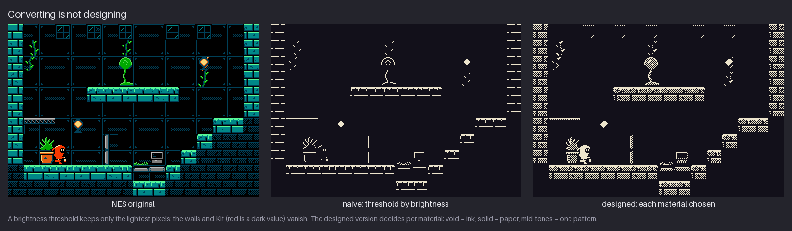
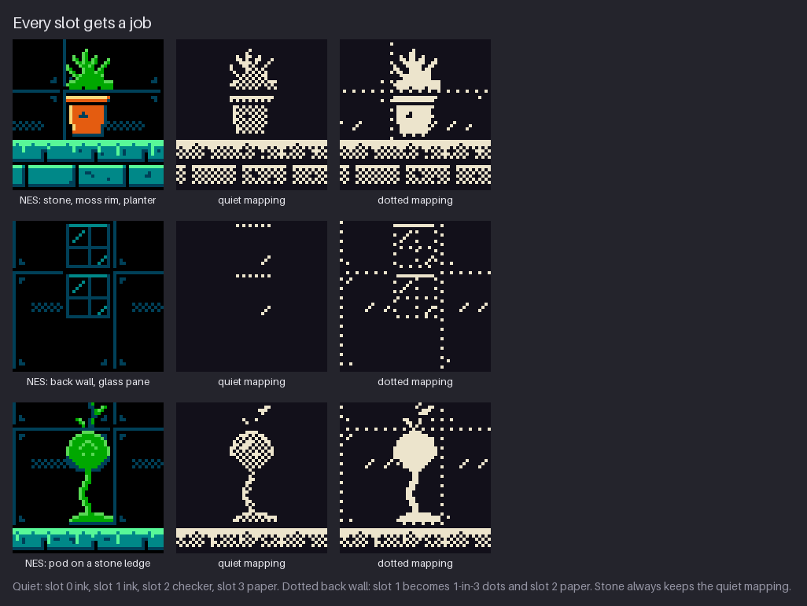
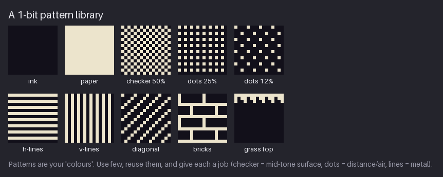
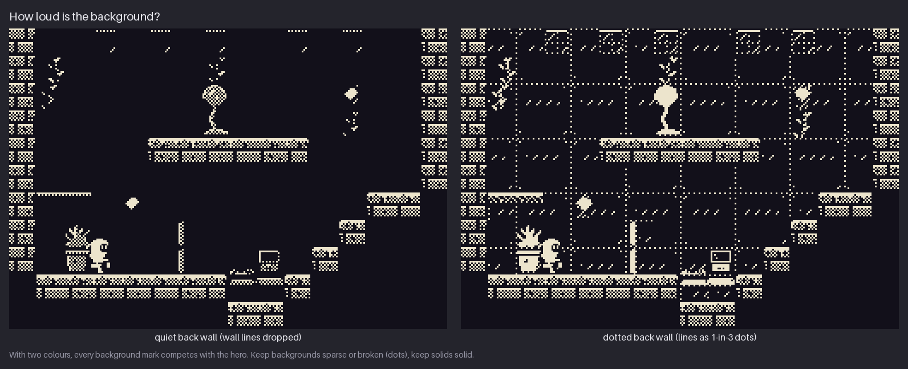
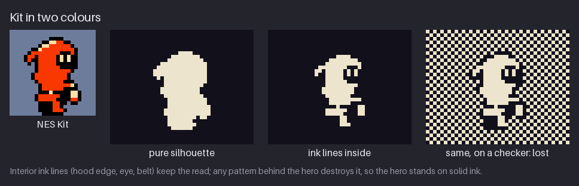
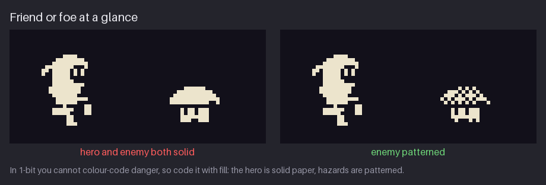
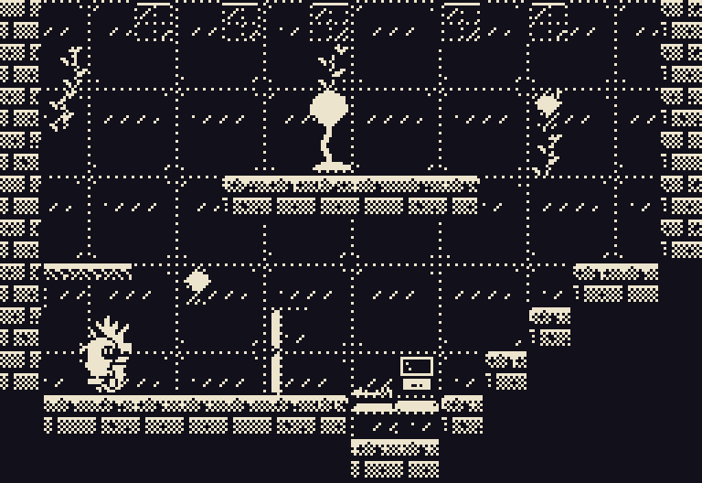
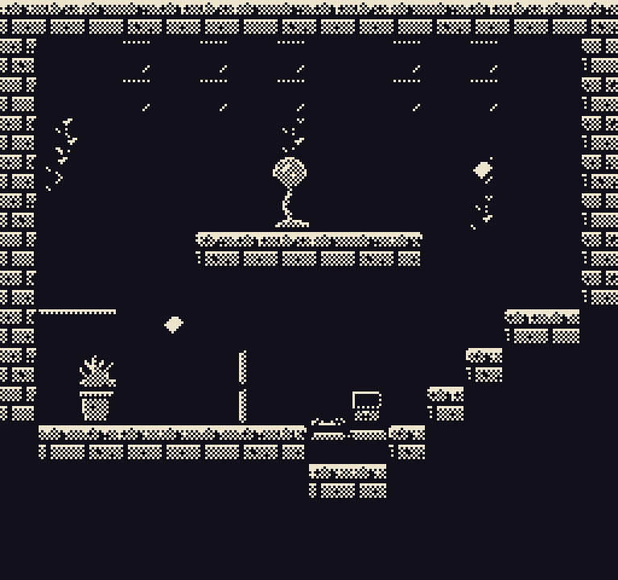
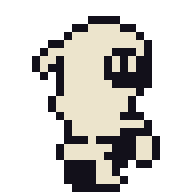

# Chapter 21 — Style: 1-bit

In 1-bit art each pixel is one of two colours, ink or paper. You lose the four-step value ramp
that the main project relies on, so a surface can no longer be "a bit darker" than the one
beside it. **Fill** takes over that job. A surface can be solid ink, solid paper or a
**pattern**: a regular arrangement of ink and paper pixels that the eye blends into an
in-between tone. Each pattern ends up doing the work that a colour did in the earlier chapters,
so a 1-bit artist needs a small, disciplined pattern library more than a palette.

This is the first of the Part IV style chapters. You can read them in any order once you have
finished Chapter 6. In each one you redraw a piece of the `hollow-vault` Greenhouse under a
different set of rules. Here you will turn the Greenhouse into two 1-bit rooms, a quiet one and
a dotted one, and redraw Kit and the spore hopper in two colours. Along the way you will build a
pattern library, give every pattern a job and learn how to separate friend from foe when you
cannot use colour. Everything you make goes into a stand-alone snapshot,
[`project/ch21/`](project/ch21/README.md). It is not part of the cumulative main project.

Previous: [Chapter 20](20-final-area-and-export.md). Next: [Chapter 22](22-style-dithered-monochrome.md).

## What defines the style

1-bit art comes from hardware that could only switch each pixel on or off. Three places show
what the style can do, and each is worth looking up:

- **The early Macintosh.** The [Macintosh 128K](https://en.wikipedia.org/wiki/Macintosh_128K)
  (1984) had a built-in 512×342 monochrome screen. The desktop, the icons, the paint programs and
  the games all had to draw shading, glass, wood and shadow with patterns of black dots on white.
  Its desktop already used a 50% grey checker, and that checker is still the first pattern every
  1-bit artist reaches for.
- **The Playdate.** This small yellow handheld has a
  [400×240 1-bit screen](https://help.play.date/hardware/the-specs/) and no backlight. Its games
  are made today by small teams for a two-colour display. Look at how they keep the player
  character solid, put patterns in the background and keep large areas plain so the screen
  stays readable.
- **Minit** (2018). [Minit](https://en.wikipedia.org/wiki/Minit) is an adventure drawn in pure
  black and white. Nearly every surface is black and the playable things are drawn in white
  outline and fill, so the hero and the objects are obvious at a glance. It shows how far a
  game can get with almost no patterns at all.

For a safe, legal study set, use Kenney's **1-Bit Pack** (CC0): a large set of 16×16 one-bit
tiles and characters that you may copy, open and pick apart. Use it to see how a professional
artist spends two colours on walls, floors, items and characters.

In all three, the screen is mostly one colour and the other colour picks out the important
things. Patterns are rarer than you might expect. They are spent on surfaces that need a
mid-tone, and kept away from the things the player has to read.

## The constraints

| Rule | Value | Where it comes from | What it means for you |
|---|---|---|---|
| Colours | 2: ink #12101a and paper #ece4cc | 1-bit displays (on/off per pixel); this warm pair is the course's choice | Every asset uses exactly these two colours. There is no third colour, not even for an outline. |
| Grid | 256×240 with 8×8 tiles, as in the main project; no attributes, no sub-palettes | We keep the NES grid so the rooms line up with the main project | Rooms keep their size and layout. Without sub-palettes, any tile can sit anywhere. |
| Mid-tones | Patterns only: checker, dots, lines | Two colours cannot mix in a pixel, so the mixing happens in the eye | Each pattern is a "colour" with a job. Keep the library small. |
| Hero | Solid paper (or solid ink) with ink lines inside; never patterned | Readability: patterns blend into patterned backgrounds | The hero stands out because nothing else in the room is that solid. |
| Hazards | Patterned fills | There is no hue to say "danger" | The fill tells the player what an object is. |

The palette files are [`project/ch21/palette/onebit.gpl`](project/ch21/palette/onebit.gpl) and
[`onebit.hex`](project/ch21/palette/onebit.hex). The pair is warm on purpose: a near-black with a
little violet and a cream paper are much gentler over a long session than #000000 and #ffffff,
which glare. Pure black and white are still a valid choice. Chapter 22 compares several pairs.

## Converting is not designing

The quickest way to make a 1-bit version of a room is to convert it. Pick a brightness
threshold, then every pixel lighter than it becomes paper and every pixel darker becomes ink.
Most editors can do this in one step. The result is almost never usable.

The middle panel shows why. A threshold keeps only the lightest pixels, which are the moss rims
on the ledges, the lamps and a few highlights. Three things go wrong:

- **The walls vanish.** The stone walls are mid-tone teal. Teal is lighter than the black back
  wall, but darker than the threshold, so the walls drop to ink and merge with the void. The
  room loses its shape.
- **Kit vanishes.** Red is a *dark* value (Chapter 4 showed that Kit's red is far darker than
  its cream face). Under a brightness threshold Kit's suit drops to ink, and only a few
  cream face pixels remain. The hero, the most important thing on screen, becomes a few
  scattered dots.
- **Nothing tells you what is solid.** The only marks left are thin rims, so walkable ledges
  and background decoration look alike.

The right panel was **designed by material**. For each material, the question was "what should
this be in two colours?" rather than "how bright is it?":

- **The void and the back wall** become ink, because they are the empty space the eye should
  rest on.
- **Solid stone** becomes a checker with solid paper rims. It is mid-tone, it reads as a mass
  and it is clearly different from the void.
- **Kit and the props** become solid paper with ink details, so they are the brightest and
  plainest things on screen.

This is the main lesson of every Part IV chapter. A converter maps *values*, but a designer maps
*meaning*. You know which pixels are the hero, which are the floor and which are decoration. A
converter does not.

### Every slot gets a job

The main project's tiles store **slot numbers** 0–3, and a sub-palette turns them into colours
(Chapter 5). That makes the design easy to write down. You do not convert colours. You decide
what each slot means in 1-bit.

The figure shows three crops: stone with a moss rim and a planter, a back-wall panel with a glass
pane, and the pod on a stone ledge. The mappings are:

| Slot | NES use | Quiet mapping | Dotted mapping (back wall) |
|---|---|---|---|
| 0 | backdrop $0F (void, back wall) | ink | ink |
| 1 | the shared dark (wall lines, panel seams) | ink, so the wall lines are dropped | dots, 1 pixel in 3 |
| 2 | the mid colour (stone, moss) | checker | paper |
| 3 | the light colour (rims, highlights) | paper | paper |

The stone and the moss rim always use the quiet mapping. Only the back wall changes between the
two rooms. In the dotted room, props such as the planter and the pod become solid paper, so
they stay brighter than the dotted wall behind them.

Note that the dotted mapping changes two slots at once. Slot 1 becomes dots, and slot 2 becomes
paper instead of checker. On the back wall, slot 2 is used for small highlights and props, and
they should read as solid things in front of a sparse pattern, not as another pattern.

**Try it.** Pick one 16×16 metatile from the main project, such as a ground top or a wall
panel. Open it in indexed mode and write the four slot numbers down the side of the canvas. For
each slot, write a word: ink, paper, checker or dots. Then repaint the tile by swapping each
slot's colour for its fill. It should take less than five minutes, and you will see that the
decisions are about slots, not pixels.

## Patterns are your colours

With two colours, a pattern is the only way to make a tone between ink and paper. The eye
averages a fine repeating pattern into a grey, so a 50% checker of ink and paper looks like a
mid-tone at 1×. Different patterns also look like different *materials*, even when they have
the same average tone. That gives you two kinds of information for each fill: how light it is,
and what it is made of.

The library in the figure has ten fills, each a 16×16 swatch:

- **Ink and paper.** The two solids. Ink is the void, paper is "important" or "lit".
- **Checker 50%.** The densest pattern that still reads as a single tone. Use it for mid-tone
  *surfaces* such as stone masses and the hopper's cap. It is also the loudest pattern, because
  every pixel differs from its neighbours, so use it on solid objects, not in the background.
- **Dots 25% and dots 12%.** Paper dots on ink. They read as distance, air, mist or glow. The
  fewer the dots, the farther away or quieter the surface.
- **Horizontal and vertical lines.** Ink and paper stripes, one pixel each. They read as metal,
  machinery, blinds and water surfaces. Horizontal lines look calm, while vertical lines look
  tall and hard.
- **Diagonal.** Reads as glass, sheen or movement.
- **Bricks.** A material pattern. At 16×16 the mortar lines are the paper and the bricks are
  ink.
- **Grass top.** An edge pattern rather than a fill: a jagged paper rim that says "the top of
  this is soft".

Three habits keep a pattern library useful:

1. **Few patterns, each with one job.** If checker means "solid stone", do not also use it for
   water. The player learns the meaning quickly, but only if you are consistent.
2. **Align patterns to the screen, not to the tile.** The course's rooms compute every pattern
   from the pixel's position on screen (for the checker, paper where X+Y is even). Two
   neighbouring tiles then continue the same checker without a seam. If each tile has its own
   copy of the checker, a tile that starts on an odd column breaks the pattern, and the seam is
   very visible at 1×.
3. **Patterns need room.** A pattern needs at least 3–4 repeats before the eye reads it as a
   tone. A checker on a 2-pixel-wide strip just looks like noise. Small areas should be solid.

**Try it.** Make a 6-swatch pattern library at 16×16: two solids and four patterns of your
choice. Under each one write its job in a single word (stone, air, metal, glass and so on). Then
look at the sheet at 1×. If two patterns look like the same grey, drop one of them, because the
player will not see the difference either.

## How loud is the background?

Every mark on a 1-bit background competes with the hero. In colour, a background can be busy as
long as it is darker and less saturated than the foreground (Chapter 4). In 1-bit there is no
"darker paper". Every paper pixel on the back wall is just as bright as Kit's face. The only
ways to make a background quieter are to use **fewer paper pixels** and **broken lines**.

The two rooms in the mini-project show the choice:

- **Quiet** (left). The back wall's lines are dropped entirely, so the back wall is plain ink.
  Measured on the 256×240 room, 5,969 of 61,440 pixels are paper, about 9.7%. Kit and the
  ledges have the screen to themselves. The cost is that the room loses its glasshouse frame,
  and it looks more like a cave than a greenhouse.
- **Dotted** (right). The wall lines come back as dots, one pixel in three along each line
  (paper where (X+Y) mod 3 = 0). Paper rises to 7,700 pixels, about 12.5%. The frame is back,
  but because the lines are broken they read as faint and far away, and the eye still lands on
  solid things first.

Dotted lines are a standard 1-bit trick. A broken line has the same shape as a solid line but
much less weight. It works for anything that should be visible but secondary: window frames,
distant structures, outlines of things behind glass.

There is a cost to the dots that only shows up with tiles. The dot period is 3 pixels, and 3
does not divide 8. A screen-aligned pattern with period 3 therefore lines up differently in each
8×8 tile, so tiles that were identical become different. Measured on the two rooms, the quiet
room has 89 unique 8×8 tiles and the dotted room has 132. For a pure image this does not matter.
For a tile-based engine, use patterns with periods of 2, 4 or 8 (checker, 1-in-4 dots, lines)
if tile count matters.

**Try it.** Draw a 32×32 piece of wall twice. In the first, the panel seams are solid paper
lines. In the second, the same seams are dotted, with every third pixel paper. Put a solid paper
16×24 blob (a stand-in hero) in front of each. At 1×, which blob do you see first? Count the
paper pixels in each wall to see how much "noise" you added.

## The hero in two colours

Kit in the main project uses three colours plus transparency: black outline, red suit and cream
face. In 1-bit the outline and the suit cannot be different colours *and* both differ from the
background. So you pick one plain fill for the body and use the other colour for the details
inside.

The figure goes through it in order:

1. **NES Kit.** Black outline, red suit, cream face.
2. **Pure silhouette.** Every visible pixel is paper. The shape still reads, which is why
   Chapter 3 insisted on a strong silhouette first, but the face, the hood and the legs merge
   into one blob.
3. **Ink lines inside.** The NES outline (slot 1) becomes ink, while the suit (slot 2) and the
   cream (slot 3) both become paper. The black that separated the hood from the face, the eye
   and the belt now appears *inside* the shape as ink lines. Outside, the outline is ink on an
   ink background, so the silhouette is drawn by the paper alone. Measured on
   [`sprites/kit.png`](project/ch21/sprites/kit.png): 133 paper pixels, 106 ink pixels and 337
   transparent ones in the 24×24 cell.
4. **On a checker: lost.** The same sprite in front of a 50% checker breaks apart. The
   checker's paper pixels touch Kit's paper body, its ink pixels touch Kit's ink lines, and
   the edge of the silhouette disappears.

The rule follows from panel 4: **the hero stands on solid ink.** The rooms make sure there is
never a pattern directly behind Kit. The stone masses are checkered, but Kit walks in front of
the void and the quiet back wall. In the dotted room the wall dots are sparse enough (one
pixel in three, along thin lines) that Kit stays readable. Watch the mini-project GIF and you
will see that it is close, though. Where Kit crosses a dotted seam, a few dots touch the
silhouette. Hold your own art to this: if your hero has to pass in front of a pattern, make the
pattern sparse, or give the hero a 1-pixel ink border inside the sprite.

Why paper rather than ink for the body? Kit stands in front of an ink void, so a paper body is
the strongest contrast available. In a game whose screen is mostly paper (a snowfield, a page),
you would flip this and draw the hero in solid ink with paper details.

**Try it.** Take any 16×24 character you have drawn. Make the body solid paper, and turn only
the lines that separate parts (hood edge, eye, belt, a hand against the body) into ink. Test it
on three 48×48 backgrounds: solid ink, dots 25% and checker 50%. Look at all three at 1×.

### Moving sprites and patterns

Patterns behave differently on things that move. A background pattern is aligned to the
screen, as described above. A pattern on a sprite, such as the hopper's checkered cap, has to
be aligned to the *sprite*, so it moves with the sprite as one piece. If you aligned it to the
screen instead, the pattern would stay still while the shape slid across it, and the cap would
seem to shimmer. Chapter 22 calls this effect "swimming".

Fine patterns also cost readability in animation. A checker on a hopping enemy is fine
because the cap keeps its shape from frame to frame. A checker on a limb that changes shape
every frame turns into flicker. That is one more reason to keep the hero solid: Kit's four walk
frames change only the paper shape and a few ink lines, and the eye follows them easily.

## Friend or foe by fill

In colour, the main project separates hero and enemy by hue: warm Kit, cool vault and a pink
hopper (Chapter 3). In 1-bit there is no hue, so you code *meaning* with fill.

In the left panel the hero and the hopper are both solid paper. Both read as "important
things", and nothing says that one of them is dangerous. In the right panel the hopper's cap is
a checker. Now the screen has a simple grammar:

- **Solid paper**: the hero, and things you can use (props, doors, items).
- **Patterned**: hazards and enemies.
- **Ink**: empty space.

The hopper's mapping is outline 1 → ink, cap colour 2 → checker and highlights 3 → paper, so
its eyes and the rim of the cap stay solid while the cap's mass is patterned. Its 16×16 file is
[`enemies/hopper.png`](project/ch21/enemies/hopper.png).

The pattern must be one the background does not use near the enemy. The hopper's checker cap
works because enemies move in front of the void, not in front of stone. If your hazards live
against checkered stone, give them a different pattern (diagonal lines, say) or a solid ink
body with a paper rim.

**Try it.** Draw a 16×16 enemy as a solid paper shape. Then make three copies: one with a
checker body, one with diagonal lines and one with a solid paper rim around an ink body. Place
each next to a solid paper hero. Which copy says "danger" fastest? Which one still reads at 1×?

## Mini-project

The snapshot [`project/ch21/`](project/ch21/README.md) is **stand-alone**. It redraws the
Greenhouse and two characters under the 1-bit rules and does not feed into later chapters. It
contains:

- [`palette/onebit.gpl`](project/ch21/palette/onebit.gpl) and
  [`onebit.hex`](project/ch21/palette/onebit.hex): the two colours.
- [`rooms/greenhouse-quiet.png`](project/ch21/rooms/greenhouse-quiet.png) and
  [`rooms/greenhouse-dotted.png`](project/ch21/rooms/greenhouse-dotted.png): the room at 256×240
  in both variants.
- [`sprites/kit.png`](project/ch21/sprites/kit.png) (24×24) and
  [`sprites/kit-walk.png`](project/ch21/sprites/kit-walk.png) (a 96×24 strip of four 24×24
  frames).
- [`enemies/hopper.png`](project/ch21/enemies/hopper.png) (16×16).
- Previews at integer scales, such as
  [`preview/greenhouse-quiet-3x.png`](project/ch21/preview/greenhouse-quiet-3x.png),
  [`preview/greenhouse-dotted-3x.png`](project/ch21/preview/greenhouse-dotted-3x.png),
  [`preview/kit-8x.png`](project/ch21/preview/kit-8x.png),
  [`preview/hopper-8x.png`](project/ch21/preview/hopper-8x.png) and the walk cycle
  [`preview/kit-walk.gif`](project/ch21/preview/kit-walk.gif).

The GIF shows Kit walking across the dotted room. It is 60 frames at 70 ms each, a 4.2-second
loop, shown at 3×. Kit moves one pixel every 35 ms and the four walk frames change every 140
ms.

Here is how each asset was built. Follow the same steps with your own room.

1. **Choose the pair.** Ink #12101a and paper #ece4cc. Save them as a two-entry palette and
   switch the canvas to indexed mode, so no third colour can slip in.
2. **Map the masses.** Stone and moss use the quiet mapping: slots 0 and 1 → ink, slot 2 →
   checker, slot 3 → paper. The lit rims of every walkable surface come out as solid paper
   lines, and the masses below them are checker. Ledges read as "solid, and the top is safe".
3. **Decide the background loudness.** For the quiet room, the back wall uses the same mapping
   and its lines vanish into ink. For the dotted room, the back wall's line slot becomes the
   1-in-3 dot pattern and its slot 2 becomes paper, so props on the wall become solid paper.
4. **Generate patterns from screen position.** Each pattern is a rule on the pixel's screen
   coordinates (checker: paper where X+Y is even; dots: paper where (X+Y) mod 3 = 0). That keeps
   the patterns continuous across tile edges. In an editor you get the same result by filling
   with a pattern brush whose origin is the canvas corner, not the selection corner.
5. **Redraw Kit by role.** Outline → ink; suit and cream → paper. Then check the inside lines:
   hood edge, eye and belt must stay ink. Apply the same mapping to every frame of the
   four-frame walk, so the strip stays consistent.
6. **Pattern the hazard.** The hopper uses outline → ink, cap → checker and highlights → paper.
7. **Check at 1× against both rooms.** Kit must read in every spot they can stand, and the
   hopper must read as "not Kit" at a glance. In the dotted room, Kit crosses a few wall seams,
   where the dots touch the silhouette. It is still readable, but it is the room's weakest
   point, and a redesign would move the seams away from the floor line.

## Exercises

1. **Convert by material.** Take one NES metatile (or any 16×16 piece of a coloured room) and
   make two 1-bit versions: one with a brightness threshold, one where you decide each material
   (void, back wall, solid, rim, prop) by hand.

   **What to look for:**
   - The designed version keeps every walkable surface visible; the threshold version may not.
   - Solids are a pattern or paper, never the same ink as the void.
   - You can name the job of every fill you used.

   

Example solution

   

   The threshold version keeps only rims and lamps. The walls and Kit drop to ink because teal
   and red are darker than the threshold. The designed version maps the void to ink, stone to a
   checker with paper rims, and Kit and props to solid paper. See also
   [`ch21-mapping.png`](images/ch21-mapping.png) for the slot-by-slot version.

   

2. **A pattern library.** Make six 16×16 swatches (two solids and four patterns) and give each
   a one-word job.

   **What to look for:**
   - No two patterns read as the same grey at 1×.
   - The loudest pattern (usually checker) is assigned to a foreground surface, not to air.
   - Every pattern tiles seamlessly when you place two swatches side by side.

   

Example solution

   

   The course's library has ten fills: ink, paper, checker 50%, dots 25%, dots 12%, horizontal
   lines, vertical lines, diagonal, bricks and a grass top. The jobs are checker for mid-tone
   surfaces, dots for distance and air, and lines for metal. A real game uses only a few of
   them, each always for the same thing.

   

3. **Your hero in two colours.** Draw your 16×24 hero in ink and paper and test it on three
   backgrounds: solid ink, sparse dots and a 50% checker.

   **What to look for:**
   - The silhouette reads on solid ink.
   - Ink lines inside the body separate the parts (head, hands, belt), and the eye is visible.
   - You can see the hero break apart on the checker, and you have a rule for the room that
     prevents it.

   

Example solution

   

   Kit's body is solid paper and the old outline slot is ink, so the hood edge, eye and belt
   appear as ink lines inside the shape. On a checker the outline merges with the pattern and
   the figure is lost. That is why the 1-bit rooms keep solid ink behind the hero.

   

4. **Friend or foe.** Draw a 16×16 enemy that reads as dangerous next to your hero without
   using colour.

   **What to look for:**
   - Hero and enemy differ in *fill*, not just in shape.
   - The enemy's pattern is not used by the background it moves in front of.
   - Its eyes or another key detail stay solid, so it still reads as a creature.

   

Example solution

   

   With both sprites solid, the hopper looks like another friendly object. With its cap as a
   checker, it reads as a hazard while its eyes and rim stay solid paper. The rule "solid =
   hero and usable, patterned = danger" replaces the hue coding of the colour rooms.

   

## Recap

- 1-bit replaces value with **fill**: solid ink, solid paper or a pattern.
- A brightness threshold is not a design. Map each **material** (or each palette slot) to a
  fill, because the converter cannot know what matters.
- Keep a **small pattern library** and give each pattern one job: checker for surfaces, dots
  for distance, lines for metal.
- Align patterns to the **screen** so they continue across tiles. Prefer periods of 2, 4 or 8
  if tile count matters; the 1-in-3 dots took the room from 89 to 132 unique tiles.
- Every paper pixel in the background competes with the hero. Use **quiet** or **dotted**
  backgrounds.
- The **hero is solid** (paper on an ink world) with ink lines inside, and never stands on a
  pattern.
- **Hazards are patterned**, so friend and foe differ by fill.

## Further study

- **"1-Bit" tutorial (Pedro Medeiros, on Lospec)**,
  https://lospec.com/pixel-art-tutorials/1-bit-by-pedro-medeiros. A short illustrated
  tutorial. Watch how it uses patterns for mid-tones and keeps contrast where the player looks.
- **"1-bit pixel art" (the-pixel.art)**, https://the-pixel.art/articles/1-bit-pixel-art/. An
  overview with examples. Notice how much of each image is a single solid colour.
- **1-Bit Pack (Kenney)**, https://kenney-assets.itch.io/1-bit-pack. CC0 1-bit tiles and
  characters. Open them in your editor and look at how walls, floors and items share very few
  patterns.
- **"1-Bit Pixel Art Techniques (Tutorial + Timelapse)" (Brandon James Greer)**,
  https://www.youtube.com/watch?v=0BZwEoj50uw. A worked 1-bit piece from blank canvas to finish.
  Watch when he chooses a pattern and when he chooses solid fill.
- **Pixelblog catalogue (Raymond Schlitter, Slynyrd)**, https://www.slynyrd.com/pixelblog-catalogue.
  The texture and pattern posts apply directly to 1-bit work, even though most examples are
  in colour.
- **Playdate hardware specs (Panic)**, https://help.play.date/hardware/the-specs/. Confirms the
  400×240 1-bit screen. Useful if you want to make 1-bit art for a real device.

Sources for this chapter: [REFERENCES.md](REFERENCES.md#chapter-21--style-1-bit)
