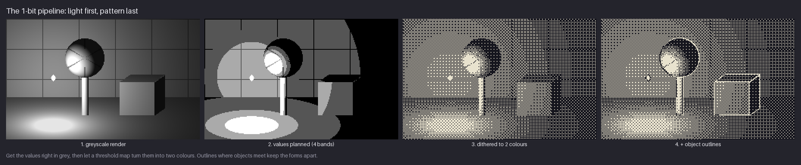
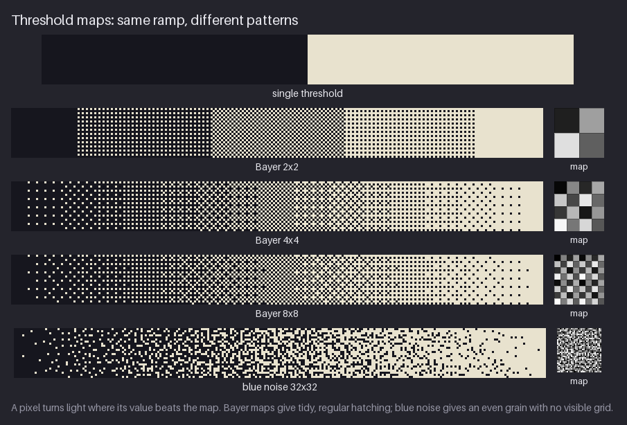
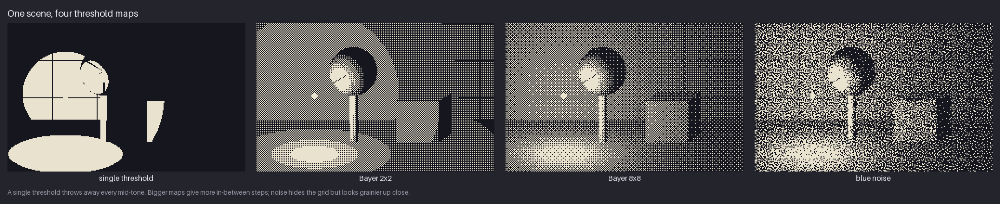
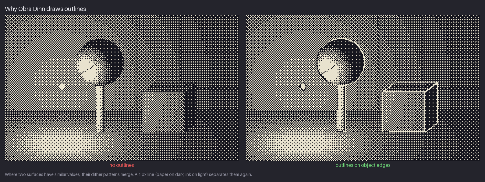
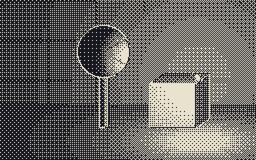
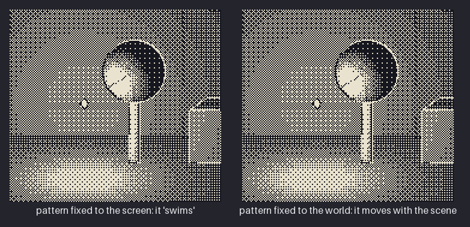
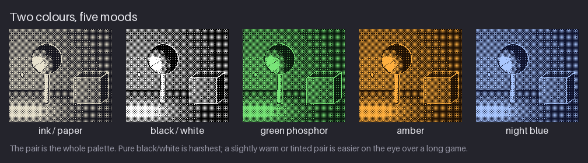
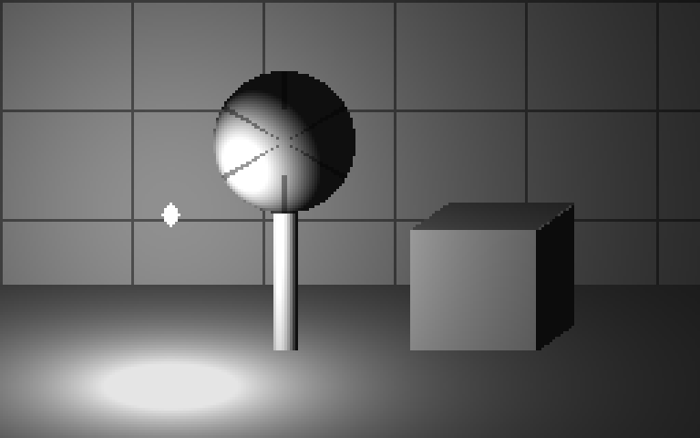
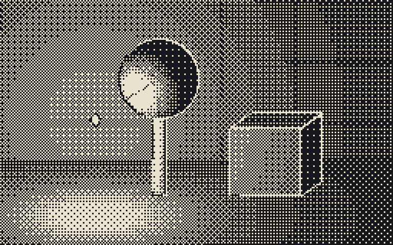

# Chapter 22 — Style: Dithered Monochrome (Obra Dinn-like)

Chapter 21 drew a 1-bit room by hand, choosing one fill per material. This chapter takes the
opposite route. You light the scene in **grey** first, with all the smooth shading you like,
and then let a **threshold map** turn every grey into a pattern of two colours. This is how
Lucas Pope made *Return of the Obra Dinn*. The shading comes from real light, and the patterns
come from a rule. Your job is to get the values right before any pattern appears and to repair
what the patterns break.

By the end of the chapter you will know how ordered dithering works, down to writing a 2×2
Bayer map by hand. You will be able to choose between a single threshold, Bayer maps of three
sizes and blue noise, and to add the outlines that keep dithered objects apart. You will also
see why dithered scenes "swim" when the camera moves. The mini-project is a small vault alcove
in the Greenhouse, with the seed pod on its stalk, a crate and Kit's lantern, rendered in grey
and dithered four ways. It lives in the stand-alone snapshot
[`project/ch22/`](project/ch22/README.md).

Previous: [Chapter 21](21-style-one-bit.md). Next: [Chapter 23](23-style-game-boy.md).

## What defines the style

The style has one famous reference:

- **Return of the Obra Dinn** (Lucas Pope, 3909 LLC, 2018). See
  [Return of the Obra Dinn](https://en.wikipedia.org/wiki/Return_of_the_Obra_Dinn) on
  Wikipedia. It is a first-person mystery set on a ghost ship. Every frame is two colours, yet
  you read wood grain, sailcloth, faces and the curve of a cannon from the density of dots. Hard
  surfaces carry thin outlines. Lit areas are coarse ordered patterns, and the darkest areas
  are almost solid. A "Monitor" setting switches between two-colour palettes named after old
  displays. The default is "Macintosh", and others include "IBM 5151" (green) and "Zenith ZVM
  1240" (amber), so the same dots can look like an old green, amber or white screen.

Pope documented the technique in his devlog. The key post explains that the game renders
everything in 8-bit greyscale and converts the result to 1-bit in a final pass, by comparing
each pixel with a tiling dither pattern. It also describes a long fight against the patterns
crawling when the camera turns. Both ideas are the backbone of this chapter.

The same look, a grey image reduced by an ordered pattern, also appears in older places: the
dithered greys of early Macintosh software, newspaper halftones and the dithered photographs
that 1-bit printers and screens produced. What makes the Obra Dinn style its own is the
discipline. There is one pair of colours, the light is consistent, outlines keep forms apart,
and the dither size stays fixed for the whole game.

The difference from Chapter 21 matters. A 1-bit artist chooses each pattern. A dithered
monochrome artist chooses each **value**, and the pattern follows from it. If the values are
wrong, no map will save the picture.

## The constraints

| Rule | Value | Where it comes from | What it means for you |
|---|---|---|---|
| Colours | 2: ink #16161e and paper #e8e2ce | 1-bit output, as in Obra Dinn | The whole palette is one pair. Choose it for mood (see "The pair is the palette"). |
| Source | A grey lighting render, 256×160 in the mini-project | Obra Dinn renders in 8-bit grey first | You paint (or render) values, not pixels. The source can have hundreds of greys. |
| Threshold maps | Single threshold, Bayer 2×2, 4×4 and 8×8, blue noise | Ordered dithering; Obra Dinn uses an 8×8 Bayer and a 128×128 blue-noise field | The map decides the texture of every mid-tone. Use one map per surface type, not per pixel. |
| Edges | 1 px outlines where objects meet | Dithered surfaces of similar value merge | Draw the edges the dither destroys. |
| Motion | Screen-fixed patterns "swim" when the camera moves | Pope's devlog; the runevision video | Keep the camera still, move only the light, or fix frames by hand. |

The palette file is [`project/ch22/palette/dither.hex`](project/ch22/palette/dither.hex).

## Light first, pattern last

The pipeline has four steps, and the order matters.



1. **Shade in grey.** Light the scene with smooth values. The mini-project's source is a small
   computed 3D render. A back wall with panel seams every 48 pixels across and every 40 pixels
   down, a floor that recedes towards the viewer, the seed pod as a sphere on a stalk, and a
   crate with a front, a side and a top face. One point light, Kit's lantern, hangs to the
   left of the pod. The panel is labelled "greyscale render": an 8-bit grey image which,
   measured, uses 245 distinct grey levels.
2. **Plan the values.** Before you dither, check that the picture works in a few broad bands.
   The second panel posterises the render to 4 bands: the lit pool on the floor, the lit
   side of the sphere, the mid wall and the dark corners. If the bands do not read as a scene,
   the dithered version will not either. This is the squint test from Chapter 4.
3. **Dither to two colours.** Each grey is compared with a threshold map, and every pixel
   becomes ink or paper. The smooth light becomes a pattern of dots whose *density* follows the
   value.
4. **Add outlines.** Where two objects meet at similar values, their patterns merge. A 1-pixel
   line along each object edge separates them again.

### Converting is not designing

You can push any colour image through a dither, and many tools do this in one click. The result
looks like the style for a moment and then falls apart. The reason is the one Chapter 21 gave
for thresholds. The converter sees brightness, not meaning. A red hero and a teal wall with
similar values become the same dot density and merge. A busy texture in the source becomes
random-looking noise in the dots.

The cure is to design the grey image for dithering:

- **Big, simple value areas.** A dither needs room to show a tone. A surface narrower than the
  map (4 pixels for a 4×4 Bayer) cannot show its value.
- **Separation by value, not hue.** Each object must differ from what is behind it by at least
  one band from step 2.
- **No fine texture in the source.** Texture comes from the dither. A painted wood grain under
  a Bayer map just becomes noise.
- **Light that tells a story.** Obra Dinn's scenes are lit to point at something. The lantern
  in the mini-project puts the brightest pool on the floor beside the pod, and the eye goes
  there first.

**Try it.** Paint a 64×64 grey value study: a ball on a floor in front of a wall, lit from the
upper left. Use four greys only and add no texture. Then look at it at 1×
from across the room. If you can tell ball, floor and wall apart, it is ready for dithering.

## Threshold maps

Every method in this chapter uses the same rule:

> A pixel becomes paper if its grey value is greater than the map value at that position.
> Otherwise it becomes ink.

The **threshold map** is a small grid of values between 0 and 1 that repeats across the
image. Only the map changes between methods.



- **Single threshold.** The map is one value, 0.5. Everything below half grey is ink and
  everything above is paper. The ramp becomes two flat blocks and every mid-tone is lost.
- **Bayer 2×2.** The map has four values, so the ramp gets five tones: 0, 1, 2, 3 or 4 paper
  pixels in each 2×2 cell. The middle tone is a perfect checker.
- **Bayer 4×4.** Sixteen values, so seventeen tones. The patterns are still regular and form
  cross-hatched textures, the classic "ordered dither" look.
- **Bayer 8×8.** Sixty-four values. The steps between tones are very fine, and the ramp
  looks almost smooth at 1×. This is the map Obra Dinn uses for smooth shading.
- **Blue noise.** The course's 32×32 map has a different value at every position, arranged so
  that paper pixels are spread evenly with no visible grid. The tones are as smooth as a large
  Bayer, but the texture is grain rather than hatching.

### How a Bayer map is built

A Bayer map is built so that each new paper pixel lands as far as possible from the ones
already lit. The 2×2 **index matrix** is

```
0 2
3 1
```

Read it as an order: the cell marked 0 lights first, then 1 (the opposite corner), then 2,
then 3. To use it as a threshold map, turn each index *v* into a value with (*v* + 0.5) / 4:

```
0.125  0.625
0.875  0.375
```

Now apply it to five greys from black to white:

| Grey | Cells with grey > map | Pattern in each 2×2 cell |
|---|---|---|
| 0.00 | none | all ink |
| 0.25 | top-left (0.125) | 1 paper pixel in 4 |
| 0.50 | top-left and bottom-right | a checker |
| 0.75 | all but bottom-left | 3 paper pixels in 4 |
| 1.00 | all four | all paper |

Larger Bayer maps are built from the 2×2 one. Each cell of the 2×2 is replaced with a whole
copy of the smaller map, multiplied by 4 and offset by that cell's index. The 4×4 is built
from the 2×2 that way, and the 8×8 from the 4×4. That recursion is why every Bayer size keeps
the same property. At any tone, the lit pixels are spread as evenly as the grid allows.

### Why "blue" noise?

Plain random noise as a map gives clumps and gaps, because random values sometimes put several
low thresholds next to each other. **Blue noise** is random noise with the clumps removed. Each
low value is kept away from the other low values. That gives even grain without a grid. The
course's map is an approximation, built by placing points one by one at the best of a few
random candidates. It is good enough for figures but it is not a true void-and-cluster blue
noise, which you would use in production. Pope used a 128×128 field. A larger map repeats less
often, so you are less likely to see the tiling.

### What about error diffusion?

There is a second family of dithers, **error diffusion** (Floyd–Steinberg is the best known).
It rounds each pixel to ink or paper and pushes the rounding error onto the neighbours that
have not been processed yet. It gives beautiful stills. It is a poor fit for pixel art and
games, because each pixel depends on all the pixels before it. Change one pixel and the
pattern shifts across the rest of the row, so animation flickers everywhere. Ordered dithering
compares each pixel with its own fixed map value, so a change stays local. Surma's
*Ditherpunk* article (in Further study) compares both families side by side.

**Try it.** On a 10×2 canvas, draw a five-step grey ramp, two pixels per step. Using the 2×2
map above, dither it by hand into ink and paper, one 2×2 cell per step. Check your result
against the Bayer 2×2 row of the figure.

## Choosing a map

The same scene looks different under each map. Choose one for the whole picture, or one per
kind of surface, and keep that choice.



- **Single threshold** throws away every mid-tone. Everything brighter than half grey becomes
  a hard-edged paper shape: a disc of light on the wall around the lamp, the lit half of the
  pod, part of the crate and an oval pool on the floor. Everything else is solid ink, and the
  pod's lit side merges with the disc behind it. Use a single threshold only for deliberate
  graphic shapes, such as a silhouette against a lit window.
- **Bayer 2×2** has only five tones. You can see the banding: the light on the wall and the
  pool on the floor break into hard-edged rings of 25%, 50% and 75% pattern. It is chunky and
  readable, and suits very small images.
- **Bayer 8×8** gives the smoothest shading. The pod becomes a convincing sphere. (In the
  example image in Pope's devlog, the sphere is the part dithered with Bayer.) Its
  cross-hatched texture is visible but regular, so the eye accepts it as "the style".
- **Blue noise** hides the grid. Large flat areas such as the back wall look like even grain
  rather than hatching. Up close the grain is busier than Bayer, and small details can break
  up. In the same devlog image, Pope used blue noise for everything except the sphere.

The mini-project's final version uses **Bayer 4×4**. With seventeen tones it is smooth enough,
and its 4-pixel repeat is coarse enough to read clearly at 1× on a 256×160 image. Larger
images can afford Bayer 8×8.

**Try it.** If you have ImageMagick installed, dither your value study from the previous Try it
with `magick study.png -ordered-dither o8x8 out.png` (`convert` instead of `magick` on older
versions). Try `o2x2` and `o4x4` too, and compare. In GIMP, convert the image to indexed mode
with the "black and white (1-bit)" palette and choose "Positioned" dithering. Some editors,
Aseprite among them, offer ordered dithering in their gradient tool. Afterwards, map black and
white to your two colours.

## Outlines

Dithering removes edges. If two surfaces have similar values, they get similar dot densities,
and the eye cannot see where one stops and the other begins.



In the left panel the crate's front face has almost the same value as the wall behind it, and
its top edge disappears. The base of the stalk blurs into the bright floor pattern. In the right
panel, a 1-pixel line runs along every edge between objects. The line's colour depends on the
grey underneath: **paper on dark areas and ink on light ones**, so the line always contrasts
with its surroundings.

Two choices make the outlines look right:

- **Outline objects, not shading.** The mini-project draws a line wherever the object changes
  (wall, floor, pod, stalk, crate faces, lantern), not wherever the value changes. Value
  changes are the dither's job. Pope's renderer works the same way. Its "wireframe" lines come
  from coloured regions that mark each object, separate from the lighting.
- **Leave out edges that already read.** The seam between floor and back wall gets no line,
  because the floor's light pool and the wall's darker band already separate them. A line
  there would draw a box around the room and flatten it.

**Try it.** Take your dithered value study and find the edge where ball and wall have the
closest values. Draw a 1-pixel line along it, paper where the area is dark and ink where it is
light. Leave the floor-wall edge alone. Compare at 1×.

## Moving light

Because the source is a lighting render, moving the light changes every value in the scene,
and the dither follows. This is where the style shines. A lamp moving across the room makes
the dot density flow over every surface, and it looks like real light.



The GIF has 24 frames at 90 ms each, a 2.16-second loop. The lantern circles the centre of the
image on a flat loop, swinging about 70 pixels to the left and to the right of it.
Watch the floor pool, the lit side of the sphere and the crate faces. The threshold map does
not move, so the patterns themselves stay in place on the screen. Only the *values* under them
change, so dots appear and disappear smoothly as the light passes.

In pixel art terms this means a light can move, and so can objects that are small compared
with the map, without breaking the style. What should not move is the pattern relative to a
surface that the eye is tracking. That is the next problem.

## Swimming

Ordered dithering uses a map that is fixed to the **screen**. When the camera pans, the scene
moves, but the map does not. Every surface slides under a stationary pattern, so its dots seem
to crawl, flicker and "swim". This GIF shows the problem on purpose.



The GIF has 160 frames at 40 ms each, 6.4 seconds. Each view is 176 pixels wide and pans 80
pixels across the scene and back.

- **Left: pattern fixed to the screen.** Look at the back wall and the crate. The dots shimmer
  and crawl as the scene slides. Up close the motion is uncomfortable, and full-screen it is
  worse.
- **Right: pattern fixed to the world.** The map is shifted along with the camera, so the dots
  stay attached to the surfaces and the scene moves as one picture.

Pope met exactly this problem when players found the full-screen game uncomfortable. His devlog
walks through the fixes he tried. He mapped the pattern onto the object textures (this caused
aliasing), warped it with each pixel's motion, offset it by the camera rotation, and projected
it onto a cube around the camera. In the end he projected the pattern onto a sphere around the
camera, thresholding at 2× and downsampling. The pattern stays pinned when the camera
**rotates**, but not when it **moves**. Pope accepted that, because the game's slow walking pace
makes it less obvious. The runevision video in Further study shows a newer method that keeps
dots stable on surfaces in full 3D.

For pixel art you rarely need any of that. Choose one of these:

- **Keep the camera still.** Rooms that switch screen by screen (like the NES project) never
  pan, so they never swim. Only the light and the sprites move.
- **Pan in whole steps of the map size.** A screen-fixed 4×4 Bayer looks identical after a
  4-pixel shift, so a pan in 4-pixel steps does not swim. It looks jerky at slow speeds.
- **Fix the pattern to the world** when you render frames, as on the right side of the GIF.
- **Hand-fix the frames.** For a short loop, repaint the frames where the pattern crawls.

**Try it.** Dither a 64×32 grey gradient with a 4×4 Bayer. Make a second frame where the
gradient (not the map) has moved 1 pixel to the right, and a third where it has moved 2. Play
the three frames as a loop and watch the swim. Then redo it moving the map along with the
gradient.

## The pair is the palette

In dithered monochrome the two colours *are* the whole palette, so the pair sets the mood of the
entire game. The dots are identical, but the feeling is not.



- **Ink / paper** (#16161e / #e8e2ce). The course's pair: a near-black and a warm off-white.
  It reads as print, like an old engraving.
- **Black / white.** The harshest pair. At full screen the maximum contrast makes the dither
  flicker more in the eye. Use it if you want a cold, clinical look.
- **Green phosphor.** A dark green and a bright green, like an old terminal.
- **Amber.** A brown-black and an orange, like an amber monitor. Warm, nostalgic and gentle at
  night.
- **Night blue.** A deep navy and a pale blue. Cold, quiet, underwater or moonlit.

Obra Dinn's own "Monitor" setting makes the same point. It offers the same game in several
pairs, each named after an old display.

Two rules for choosing a pair:

1. **Keep the value gap large.** The dither only works if the two colours are far apart in
   value. A pair with similar values turns every pattern into a flat mid-tone.
2. **Soften the extremes.** A slightly tinted dark and a slightly warm light are much easier to
   look at for hours than pure #000000 and #ffffff. That is the reason the course's pair is
   not pure black and white.

**Try it.** Choose a pair for a mood: "drowned library", "desert noon" or "hospital at night".
Recolour your dithered study with it and compare it with the course pair at 1×.

## Mini-project

The snapshot [`project/ch22/`](project/ch22/README.md) is **stand-alone**. It shows the whole
pipeline on one Greenhouse alcove (the seed pod on its stalk, a crate and Kit's lantern) and is
not part of the cumulative main project. All five scene files are 256×160:

- [`scene/lighting-grey.png`](project/ch22/scene/lighting-grey.png): the grey lighting render.
- [`scene/threshold.png`](project/ch22/scene/threshold.png): a single threshold at 0.5.
- [`scene/bayer4.png`](project/ch22/scene/bayer4.png): Bayer 4×4.
- [`scene/blue.png`](project/ch22/scene/blue.png): the course's 32×32 blue-noise map.
- [`scene/final.png`](project/ch22/scene/final.png): Bayer 4×4 plus object outlines.
- [`palette/dither.hex`](project/ch22/palette/dither.hex): the pair.
- 3× previews of each, in [`preview/`](project/ch22/preview/), for example
  [`preview/final-3x.png`](project/ch22/preview/final-3x.png).





Here is how it was built, step by step. You can follow the same steps in any editor, painting
the grey image by hand instead of computing it.

1. **Block the scene in grey.** The back wall fills the top 104 rows, and the floor the rest.
   The wall is kept a step darker than the objects (its light is scaled to 60%), and its panel
   seams are darker still, so the wall reads as "behind". In an editor: fill the wall with a
   dark grey and draw the seams one step darker.
2. **Place one light.** The lantern hangs at the left of the pod, slightly in front of the wall.
   Every surface gets brighter the more it faces the lamp and the closer it is to it. The floor
   gets a bright pool, the pod gets a lit left side and a dark right side, and the crate's front
   face is lit while its side face is dark. A small ambient term keeps the darkest areas from
   pure black. In an editor: a soft round brush or a radial gradient centred on the lamp.
3. **Check the bands.** Posterise to 4 levels (the second panel of the pipeline figure). The
   pool, the lit sphere, the wall and the shadows must read on their own.
4. **Dither.** Compare each pixel with the map: paper if the grey is higher, ink otherwise.
   The three dithered files show the trade-off. `threshold.png` loses the room, `blue.png` is
   even but grainy, and `bayer4.png` is the most legible at 1×.
5. **Outline objects.** Draw a 1-pixel line wherever one object meets another, paper over dark
   values and ink over light ones. Skip the floor-wall seam. The result is `final.png`.
6. **Judge at 1×.** The pod, the stalk, the crate and the light pool should all read without
   zooming. If one does not, go back to step 1 and fix its *value*, not its dots.

## Exercises

1. **Three maps.** Paint a grey value study (about 96×64) of a simple object on a floor, lit by
   one light. Dither it with a single threshold, a Bayer map and blue noise (or a random map if
   your tool has no blue noise).

   **What to look for:**
   - The single threshold loses all mid-tones, so you can see why you need a map.
   - The Bayer version shows clean, regular hatching, and round forms look round.
   - The noise version has no visible grid, and flat areas look even.

   <details><summary>Example solution</summary>

   

   The single threshold turns the room into a few paper shapes on ink. Bayer 2×2 shows clear
   bands in the light pool, Bayer 8×8 shades the sphere smoothly, and blue noise gives the flat
   wall an even grain. The final scene uses Bayer 4×4 as a compromise at this size.

   </details>

2. **A 2×2 Bayer by hand.** Write the 2×2 threshold map from the index matrix [[0, 2], [3, 1]]
   and use it to dither a five-step ramp (0, 0.25, 0.5, 0.75, 1) by hand.

   **What to look for:**
   - Your thresholds are 0.125, 0.625 / 0.875, 0.375.
   - The steps contain 0, 1, 2, 3 and 4 paper pixels per 2×2 cell.
   - The middle step is a perfect checker.

   <details><summary>Example solution</summary>

   

   The Bayer 2×2 row of the figure is the hand-made result, repeated along a longer ramp. The
   first paper pixel appears in the top-left of each cell (threshold 0.125), the second in the
   bottom-right (0.375), and so on. Larger maps add more steps in the same evenly spread
   order.

   </details>

3. **Outlines.** Dither a scene where two objects have similar values (a crate in front of a
   wall works). Add 1-pixel outlines only where objects meet.

   **What to look for:**
   - Before outlining, at least one edge disappears into the pattern.
   - Lines are paper on dark areas and ink on light ones.
   - You did not outline shading changes or the floor-wall seam.

   <details><summary>Example solution</summary>

   

   Without outlines, the crate's front face and top edge melt into the wall's pattern, and the
   base of the stalk blurs into the floor. With a 1-pixel line on every object edge, each form is
   separate again. The floor and wall stay unlined because their values already differ.

   </details>

4. **Choose a pair.** Pick a mood for a two-colour game and choose a pair for it. Recolour a
   dithered image with it and write one sentence explaining your choice.

   **What to look for:**
   - The pair has a large value gap, so the dither still reads.
   - Neither colour is pure #000000 or #ffffff, unless harshness is the point.
   - The pair's hue matches the mood you named.

   <details><summary>Example solution</summary>

   

   The same dots read as print (ink/paper), as clinical (black/white), as a terminal (green
   phosphor), as warm and nostalgic (amber) or as cold and underwater (night blue). Every pair
   in the figure keeps a large value gap, which is why the patterns survive in all five.

   </details>

## Recap

- **Light first, pattern last.** Get the values right in grey, then dither.
- A **threshold map** decides every pixel: paper where the grey beats the map, ink otherwise.
- **Bayer** maps give regular, readable hatching and smooth shading on round forms. **Blue
  noise** gives even grain with no grid. A **single threshold** loses every mid-tone.
- Ordered dithering suits pixel art and games better than **error diffusion**, because a change
  stays local.
- **Outline objects**, not shading, where similar values meet; paper on dark, ink on light.
- Screen-fixed patterns **swim** when the camera moves. Keep the camera still, pin the pattern
  to the world, or fix frames by hand.
- The **pair** is the whole palette. Keep a large value gap and soften the extremes.

## Further study

- **Obra Dinn devlog, dithering post (Lucas Pope)**, https://dukope.com/devlogs/obra-dinn/tig-32/.
  The primary source for this chapter. Read the explanation of thresholding an 8-bit grey render
  with an 8×8 Bayer and a blue-noise field, then follow every attempt to stop the swimming.
- **Return of the Obra Dinn devlog, compiled (Lucas Pope)**, https://obradinn.01101101.fr/. The
  whole TIGSource devlog in one place. Search it for posts on outlines, lighting and the final
  palettes.
- **"Ditherpunk — The article I wish I had about monochrome image dithering" (Surma)**,
  https://surma.dev/things/ditherpunk/. A clear, illustrated walk through thresholds, Bayer,
  blue noise and error diffusion, with the maths kept light.
- **"Surface-Stable Fractal Dithering Explained" (runevision)**,
  https://www.youtube.com/watch?v=HPqGaIMVuLs. A newer technique that keeps dither dots stable
  on 3D surfaces as the camera moves. Watch it for the problem statement, even if you never
  write a shader.

Sources for this chapter: [REFERENCES.md](REFERENCES.md#chapter-22--style-dithered-monochrome-obra-dinn-like)
