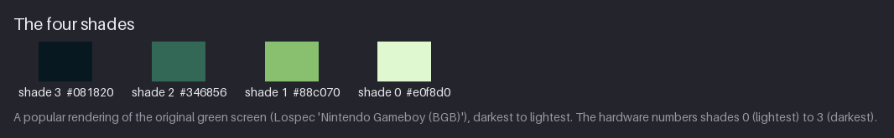
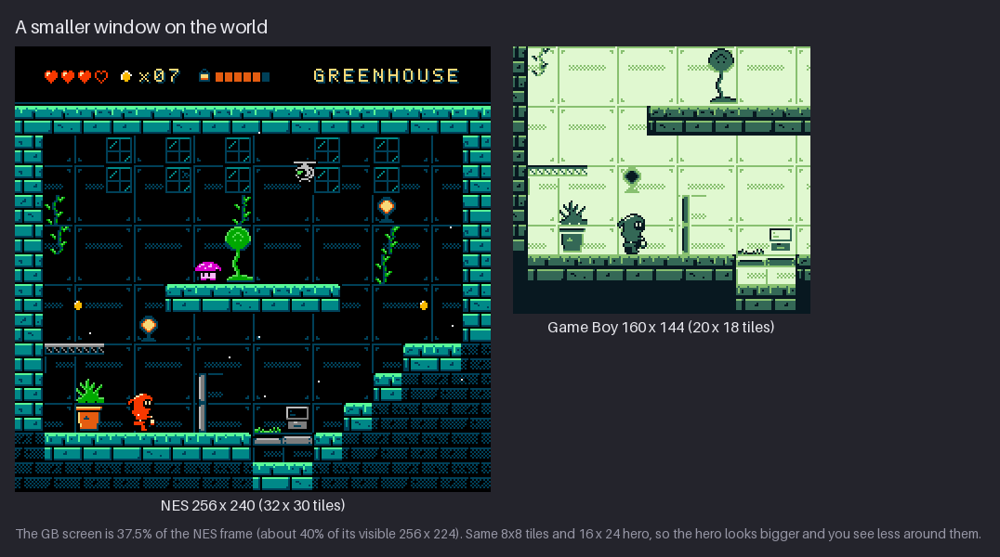
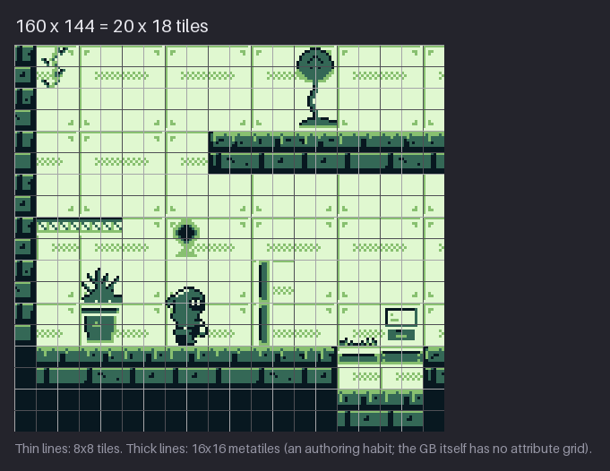
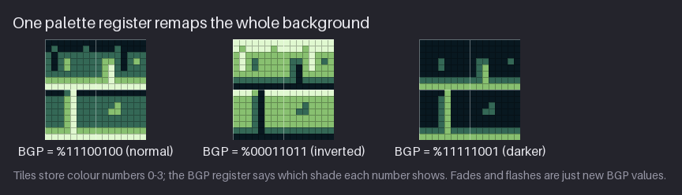
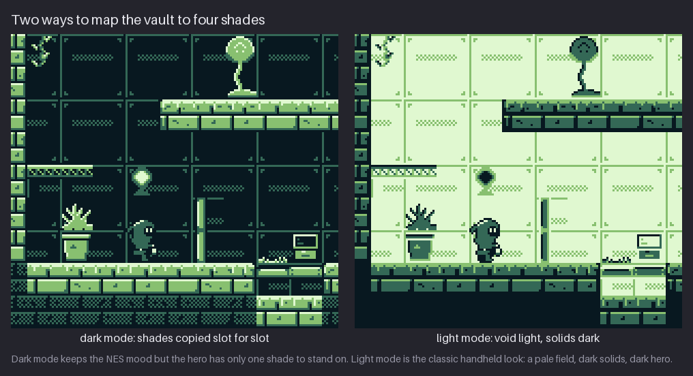
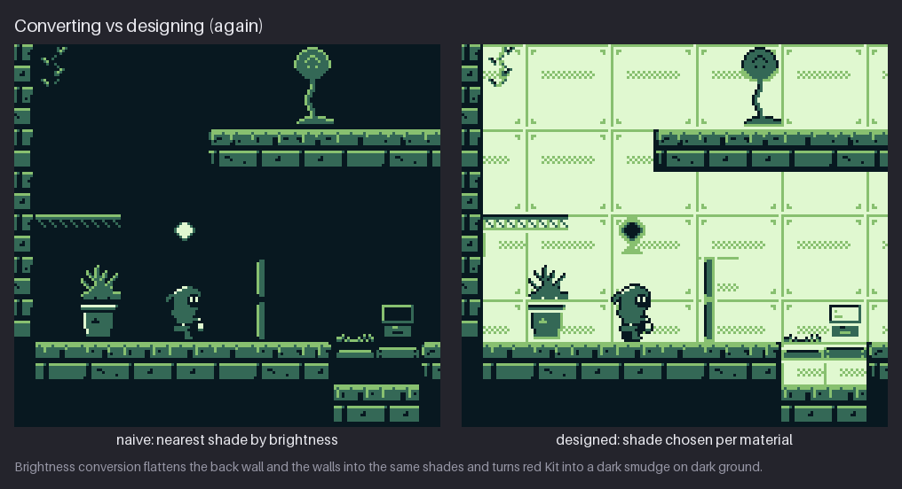
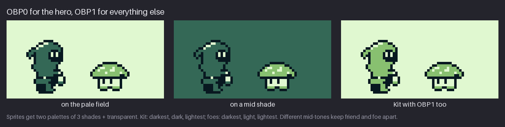
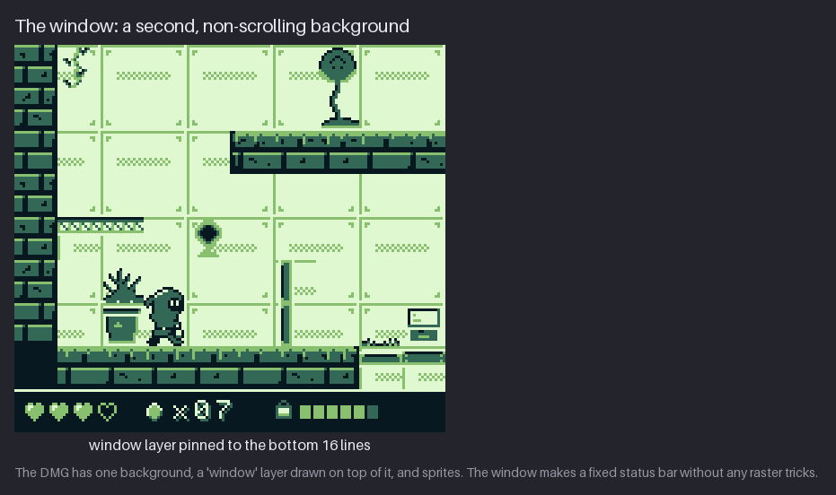
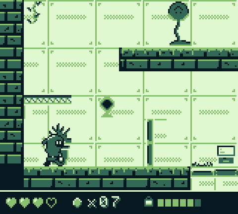
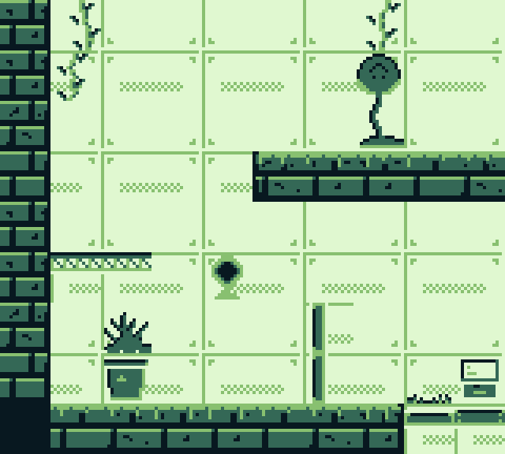

# Chapter 23 — Style: Game Boy (four shades)

The original Game Boy, often called the **DMG** after its model number, has a 160×144 screen,
four shades of green-grey and the same 8×8 tiles the NES uses. Those numbers look like a
smaller NES, but the style that grew from them is quite different. With four shades for the
whole screen, there are no colour areas, no hue for the hero and no separate palette for the
sky. Everything is decided by **value** and **layout**, and the small screen forces you to show
less of the world at a time.

In this chapter you will recompose a Greenhouse room for the smaller screen and learn how one
palette register controls the whole background, including how a fade is just a sequence of
register values. You will choose between a dark and a light way of mapping the vault, separate
hero and foe with the two sprite palettes, and pin a status bar to the screen with the window
layer. The result is a Game Boy-style Greenhouse in the stand-alone snapshot
[`project/ch23/`](project/ch23/README.md). If you want, you can take it further and make it
playable in GB Studio.

Previous: [Chapter 22](22-style-dithered-monochrome.md). Next: [Chapter 24](24-style-authentic-nes.md).

## What defines the style

Two well-known DMG games show the classic approach, and both are worth looking up:

- **The Legend of Zelda: Link's Awakening** (Nintendo, 1993). See
  [Link's Awakening](https://en.wikipedia.org/wiki/The_Legend_of_Zelda:_Link%27s_Awakening) on
  Wikipedia. Its overworld is mostly the lightest shade, a pale field of open ground. Trees,
  walls, cliffs and houses are drawn in the darker shades with strong dark outlines, and the
  hero is dark on light. Your eye finds paths instantly because "walkable" is pale and
  "blocked" is dark.
- **Kirby's Dream Land** (HAL Laboratory, 1992). See
  [Kirby's Dream Land](https://en.wikipedia.org/wiki/Kirby%27s_Dream_Land) on Wikipedia. Its
  backgrounds are mostly pale, Kirby is a pale round figure with a strong dark outline, and the
  ground and blocks carry the darker shades. Even busy scenes stay readable because outlines,
  not fills, separate the things that matter.

Both games invert the habit of the NES project, where the void is black and the walkable edges
are bright. On the DMG, the pale field is usually the empty space, and solid things are dark.
A likely reason is the screen itself. The original DMG screen had no backlight and blurred
anything that moved quickly, so dark shapes on a pale ground were the safest thing to read. The
style kept that look long after the hardware improved.

Many games use a dark look too, especially caves and night scenes. This chapter builds both and
compares them.

## The constraints

| Rule | Value | Where it comes from | What it means for you |
|---|---|---|---|
| Screen | 160×144 = 20×18 tiles | Pan Docs, Tile Data / Scrolling | You see much less of a room than on the NES. Recompose; do not just crop. |
| Shades | 4, in the course rendering #081820 #346856 #88c070 #e0f8d0 | Lospec "Nintendo Gameboy (BGB)" | Every pixel on screen is one of four values. Hue does no work. |
| BG palette | BGP: one register maps colour numbers 0–3 to shades for the whole background | Pan Docs, Palettes | Every background tile shares one mapping. Fades and flashes are new BGP values. |
| Sprite palettes | OBP0 and OBP1: 3 shades + transparent each | Pan Docs, Palettes | Two sprite looks: one for the hero, one for everything else. |
| Sprites | 40 in total, 10 per line, 8×8 or 8×16 | Pan Docs, OAM | Kit (16×24) is 6 objects of 8×8 and uses 2 of the 10 per line. |
| Tiles | 384 in VRAM, shared between background and sprites | Pan Docs, Tile Data | Repeat tiles. The background can address 256 of them at a time. |
| Layers | Background (scrolls) + window (does not scroll) + sprites | Pan Docs, Window | A fixed status bar is free if it sits at the bottom. |
| Attributes | None on the DMG: every BG tile uses BGP | Pan Docs, Palettes | No per-area palettes. Different materials need different colour *numbers* in the tiles. |

The palette files are [`project/ch23/palette/gameboy.gpl`](project/ch23/palette/gameboy.gpl) and
[`gameboy.hex`](project/ch23/palette/gameboy.hex).

## Four shades



The real DMG screen showed four tones of a greenish grey. There is no single "correct" RGB
value for them, because the colour depended on the screen, the light and the viewing angle.
Emulators and artists use various renderings. The course uses a popular one, Lospec's
"Nintendo Gameboy (BGB)", named after the BGB emulator. From darkest to lightest:

- **#081820**, the darkest shade, almost black with a blue-green cast;
- **#346856**, a dark teal-green;
- **#88c070**, a light leaf green;
- **#e0f8d0**, the lightest shade, a pale mint.

Note how the hardware numbers them. **Shade 0 is the lightest and shade 3 is the darkest.**
That is the opposite of the NES project, where slot 0 is the black backdrop. It matters as soon
as you write palette register values, so keep it in mind for the rest of the chapter.

Four shades also means that Chapter 4's value lessons apply directly. Every material,
character and effect has to be separated by one of only three value steps. Hue does not exist,
so "the hero must have a hue the room lacks" (Chapter 3) becomes "the hero must have a *value
pattern* the room lacks".

**Try it.** Set up a 4-colour indexed palette with the four shades and lock it. Draw a 16×16
rock with a light source from the upper left, using all four shades: a lightest highlight, a
light top, a dark side and a darkest outline at the bottom. Check that each shade covers a
clear, separate area.

## A smaller window

The NES frame is 256×240 pixels, 32×30 tiles. The DMG screen is 160×144, 20×18 tiles. That is
37.5% of the NES frame, or about 40% of the 256×224 that most NES televisions actually showed.
The tiles and the hero are the same size in pixels, so on the Game Boy the hero takes up a
much bigger share of the screen.



The consequences:

- **You see less of every room.** The NES room shows the whole greenhouse at once. The GB view
  shows a slice of it: the start ledge, a planter, a lamp and the pod above.
- **Rooms scroll more.** Where the NES project uses one screen per room, a GB version of the
  same room needs a camera that follows Kit.
- **The HUD costs more.** A 16-line status bar is 7% of the NES frame but 11% of the GB
  screen.

### Recompose, do not crop

Cropping the NES room is a start, but a good GB screen is **recomposed**. Move ledges closer,
drop a decoration that falls between two interesting things, and make sure each 160×144 view
has a clear place to stand, a clear way on and one thing to look at.



The grid shows the 20×18 tiles of the view. The thicker lines mark 16×16 metatiles. The DMG
has no attribute grid, so metatiles are only an *authoring* habit here. They are still worth
keeping, because they make the room easy to edit and reuse. Measured, this 160×144 view uses 88
unique 8×8 tiles out of its 360 tile positions. The whole light room (256×240) uses 112. Both
fit easily in the 256 tiles the background can address.

There is good news for scrolling, too. The GB background map is 32×32 tiles (256×256 pixels),
and two scroll registers, **SCX** and **SCY**, choose which 160×144 part of it is on screen. The
NES room, 32×30 tiles, fits inside that map whole. A Game Boy version can scroll across the
entire room just by changing SCX, with no new tiles to load.

**Try it.** Take one NES-sized room you have drawn (or the Greenhouse from
`project/ch20/scene/greenhouse.png`) and put a 160×144 selection on it. Move the selection until
the view contains a place to stand, an exit and one point of interest. Then list what you would
move or drop to make the view work better.

## One register, whole screen

A DMG background tile does not store shades. Like an NES tile, it stores **colour numbers** 0–3,
two bits per pixel, so each 8×8 tile is 16 bytes. A single register, **BGP** (address $FF47),
decides which shade each colour number shows. Its eight bits hold four 2-bit fields:

```
bit   7 6 | 5 4 | 3 2 | 1 0
      ID3 | ID2 | ID1 | ID0     each field = the shade (0 = lightest ... 3 = darkest)
```

The usual value is **%11100100**. Read it right to left: colour 0 → shade 0 (lightest), colour 1
→ shade 1, colour 2 → shade 2 and colour 3 → shade 3 (darkest).



The figure shows one brick metatile under three BGP values. The tile data is identical, and
only the register changes.

- **%11100100, normal.** The tile as drawn.
- **%00011011, inverted.** Each colour number gets the opposite shade. Light mortar becomes
  dark and the bricks turn pale. This is a "negative" flash, often used for hits and
  lightning.
- **%11111001, darker.** Each colour moves one shade darker (colour 0 → shade 1, colour 1 →
  shade 2, colours 2 and 3 → shade 3). The tile darkens as if a light went out.

Because there is only one BGP, the whole background changes at once. That limits you, since
you cannot darken one corner of the screen. It is also a tool. **Fades and flashes are just a
sequence of BGP values**, a few frames apart, with no extra art. A fade to white:

```
%11100100   normal
%10010000   every colour one shade lighter
%01000000   two shades lighter
%00000000   everything shade 0 (lightest)
```

A fade to black runs the other way: %11100100 → %11111001 → %11111110 → %11111111.

Note what the DMG lacks: **attributes**. On the NES, each 16×16 area picks one of four
background palettes. On the DMG, every background tile goes through the same BGP. If you want
two materials to map differently, you have to give them different colour numbers in the tile
data itself.

**Try it.** Draw one 8×8 tile using colour numbers 0–3 (paint it in the four shades in order,
lightest = 0). Make four copies and recolour each one as if BGP were %11100100, %10010000,
%01000000 and %00000000. Play them as a four-frame animation at about 100 ms per frame and you
have a fade to white.

## Dark mode vs light mode

There are two sensible ways to bring the vault to four shades.



**Dark mode** (left) copies the NES slots straight across: slot 0 → darkest, slot 1 → dark,
slot 2 → light and slot 3 → lightest. The mood of the NES room survives, with a dark vault and
bright edges. In register terms it is the NES tile data under the inverted BGP, %00011011. The
problem is the hero. Kit is drawn in darkest, dark and lightest, and in this room the void is
the darkest shade too. Kit's outline vanishes into the background, and only the body and the
eyes separate Kit from the wall. Measured, the dark room uses 119 unique tiles.

**Light mode** (right) is the classic handheld look:

- **The back wall becomes the pale field.** Slot 0 → lightest, 1 → light, 2 → dark, 3 →
  darkest. That is exactly the normal BGP, %11100100, applied to the NES tile data, so the back
  wall needs no redrawing at all.
- **Solid masses go dark.** The stone uses a separate mapping: slots 0 and 1 → darkest, slot 2
  → dark and slot 3 → light. The ledges become dark blocks with a lighter rim on top.
- **Kit is dark on light.** The hero now has a whole pale field to stand against. The darkest
  outline and the dark body read at a glance.

Measured, the light room uses 112 unique tiles.

Remember that the DMG has only one BGP. To give the stone a different mapping from the back
wall, a real DMG version would **renumber the colours in the stone tiles** instead of changing
a palette. That is a one-time edit to the tile art, and it is how DMG artists worked: the
material decision is baked into the tiles.

Light mode has a quirk worth seeing in the figure. The lamp on the wall was the brightest thing
in the NES room. In light mode it cannot be brighter than the pale field, so it becomes a dark
diamond. A light source on a pale field has to be shown by shape (a halo, a
ring or rays) because it cannot be shown by brightness.

**Try it.** Take a 32×32 piece of a dark NES-style room. Make the dark-mode version by copying
slots to shades, then the light-mode version by swapping the void to the lightest shade and
solids to the darkest. Put your hero in front of each. Which version keeps the outline?

## Converting is not designing (again)

As in Chapters 21 and 22, an automatic conversion fails in a way that teaches something.



The naive version picks the nearest of the four shades by brightness for every pixel. The
result:

- **The back wall disappears.** The NES back wall is black with dark-blue lines. Both are
  darker than the second shade, so they both become the darkest shade, and the panel frame is
  gone.
- **The walls and the back wall merge.** The teal stone falls to the same dark shades as its
  surroundings.
- **Kit becomes a dark smudge.** Red is a dark value, so the suit lands on the dark shade next
  to a darkest outline, against a darkest background.

The designed version (right) is the light-mode room. Every material got its shade by role: the
void is the pale field, the solids are dark, and Kit is dark on light. The converter only knew
how bright each pixel was. The designer knew what it was.

## Friend and foe

Sprites have their own two palette registers, **OBP0** and **OBP1** ($FF48 and $FF49). They work
like BGP, with one difference. Colour number 0 is always **transparent**, so its two bits are
ignored. Each sprite palette therefore has three shades plus transparency, and each sprite
picks one of the two.



The course splits them by role:

- **OBP0, for Kit**: darkest, dark, lightest. The outline is darkest, the suit is dark and the
  face is lightest. Measured, [`sprites/kit.png`](project/ch23/sprites/kit.png) has 106
  darkest, 118 dark and 15 lightest pixels.
- **OBP1, for everything else**: darkest, light, lightest. The hopper's cap is the light green,
  with darkest eyes and outline and lightest highlights. Measured,
  [`enemies/hopper.png`](project/ch23/enemies/hopper.png) has 54 darkest, 52 light and 28
  lightest pixels.

As register values: if the sprite tiles store the outline as colour 1, the body as colour 2 and
the light parts as colour 3, then OBP0 = %00101100 ($2C) and OBP1 = %00011100 ($1C). Bits 1–0
are unused because colour 0 is transparent.

The figure shows why the split matters:

- **On the pale field**, Kit is a dark figure and the hopper a lighter one. They differ at a
  glance even though they share the darkest outline.
- **On a mid shade** (the dark green), Kit's dark body nearly matches the background. The
  darkest outline still carries the silhouette, but it is weaker. The hopper's light cap
  stands out. Avoid placing the hero in front of large dark-shade areas.
- **With OBP1 for Kit too**, Kit's body turns light green and Kit becomes "one of the
  enemies". The one-shade difference in the body was the whole friend-or-foe signal.

So the rule is the 1-bit rule from Chapter 21 in four shades. The hero has its own value
pattern, and nothing else on screen uses it.

Kit is 16×24, drawn in a 24×24 cell. In 8×8 sprite mode the standing pose is 6 objects, 2 per
line, well under the 10-per-line limit. In 8×16 mode the same figure needs 4 objects covering
16×32. The extra 8 rows are transparent, but they still count toward the line limit on the
rows they cover.

**Try it.** Draw a 16×16 enemy and a 16×16 hero with the same darkest outline. Give the hero
OBP0 (darkest, dark, lightest) and the enemy OBP1 (darkest, light, lightest). Test the pair on
a lightest field and on a dark field. Then swap the palettes and see which version you prefer.

## The window

The DMG has one background, but it also has a second, non-scrolling background layer called
the **window**. Two registers, **WX** and **WY**, place its top-left corner at screen position
(WX − 7, WY). The window then covers everything from that corner to the bottom-right of the
screen, drawn over the background. Sprites can still appear on top of it.



That shape makes a **bottom status bar** free. Set WY to 128 and WX to 7, and the bottom 16
lines show the window while the background scrolls freely above it. The figure's bar is 160×16:
four hearts (three full), the seed icon with "x07" and the lantern bar. It uses all four shades,
with a lightest line at the top as a border. A **top** bar is harder, because the window always
extends to the bottom of the screen. Games that wanted a top bar had to hide the window again
partway down the frame, with a mid-frame register change.

Compare this with the NES project, which draws its HUD at the top of the screen, partly in
background tiles and partly in sprites (Chapter 20). On the DMG the window is a separate layer,
so the HUD takes no space in the room's background map, but it still covers 16 of the 144
lines.

**Try it.** Design a 160×16 status bar using only 8×8 tiles: one row of tiles plus a border.
Fit three pieces of information in it. Check it at 1× over both a pale and a dark room.

## Mini-project

The snapshot [`project/ch23/`](project/ch23/README.md) is **stand-alone**. It redraws the
Greenhouse, Kit and the hopper under the Game Boy's rules and is not part of the cumulative main
project. It contains:

- [`palette/gameboy.gpl`](project/ch23/palette/gameboy.gpl) and
  [`gameboy.hex`](project/ch23/palette/gameboy.hex): the four shades.
- [`rooms/greenhouse-light.png`](project/ch23/rooms/greenhouse-light.png) and
  [`rooms/greenhouse-dark.png`](project/ch23/rooms/greenhouse-dark.png): the whole room at
  256×240 in both modes.
- [`scene/screen-160x144.png`](project/ch23/scene/screen-160x144.png): one screen-sized view of
  the light room.
- [`sprites/kit.png`](project/ch23/sprites/kit.png),
  [`sprites/kit-walk.png`](project/ch23/sprites/kit-walk.png) (a 96×24 strip of four frames) and
  [`enemies/hopper.png`](project/ch23/enemies/hopper.png).
- Integer-scaled previews such as
  [`preview/screen-160x144-4x.png`](project/ch23/preview/screen-160x144-4x.png),
  [`preview/greenhouse-light-3x.png`](project/ch23/preview/greenhouse-light-3x.png),
  [`preview/greenhouse-dark-3x.png`](project/ch23/preview/greenhouse-dark-3x.png),
  [`preview/kit-8x.png`](project/ch23/preview/kit-8x.png),
  [`preview/hopper-8x.png`](project/ch23/preview/hopper-8x.png) and
  [`preview/kit-walk.gif`](project/ch23/preview/kit-walk.gif).



The GIF has 120 frames at 60 ms each, 7.2 seconds, shown at 3×. Kit walks from x = 24 to x =
144 in the room and back, one pixel every 30 ms. The 160×144 view follows Kit, scrolling up to
80 pixels across the 256-pixel room, as SCX would. The status bar stays fixed, as the window
does.



Here is how each asset was built. Follow the same steps with your own room.

1. **Pick the mode.** Light mode is the main version, because the hero reads best on a pale
   field. Dark mode is kept for comparison and for night or cave rooms.
2. **Map the back wall with the normal register.** The back wall's tiles keep their NES colour
   numbers. Under BGP %11100100 the void becomes the lightest shade and the wall lines the light
   shade. Nothing needs to be redrawn.
3. **Renumber the solids.** Stone and moss use their own mapping (slots 0 and 1 → darkest, 2 →
   dark, 3 → light), so the masses go dark and their lit rims become a light line. On a real
   DMG this means editing the colour numbers in those tiles, because there is only one BGP. In
   an editor: select the stone tiles and swap the colours with a palette remap.
4. **Frame the view.** Choose the 160×144 crop (here the left part of the room, rows 48 to 191)
   so that it shows a ledge to stand on, a planter, a lamp, the pod above and a way on.
5. **Redraw Kit for OBP0.** Outline → darkest, suit → dark, cream → lightest. Apply the same
   mapping to all four walk frames.
6. **Redraw the hopper for OBP1.** Outline and eyes → darkest, cap → light, highlights →
   lightest.
7. **Add the window.** A 160×16 status bar pinned to the bottom (WY = 128), with hearts, seeds and
   the lantern bar.
8. **Test at 1×.** Check Kit on the pale field and on every dark area they can reach, and the
   hopper next to Kit.

### Optional: make it playable in GB Studio

**GB Studio** is a free, open-source tool that builds real Game Boy ROMs from images and a
visual script editor. On Debian, install the `.deb` package from its installation page (see
Further study). Two details from its documentation matter for this art:

- Its background colours are four slightly different hex values (#071821, #306850, #86c06c,
  #e0f8cf). Other colours are matched to the nearest of the four, so images in the course
  palette import cleanly.
- In monochrome games, a background image may contain at most 192 unique 8×8 tiles. The
  mini-project's 160×144 view uses 88, and the whole light room uses 112, so both fit.

Import `rooms/greenhouse-light.png` as a background and Kit's walk strip as a sprite, and you
can walk through your own room on an emulator or a real Game Boy.

## Exercises

1. **Recompose for 20×18 tiles.** Take a NES-sized room (yours, or
   `project/ch20/scene/greenhouse.png`) and make one 160×144 screen from it. Decide what to cut,
   move or merge.

   **What to look for:**
   - The view has a place to stand, an exit and one point of interest.
   - You moved or dropped things rather than only cropping.
   - The hero, at the same pixel size, still has room to move.

   <details><summary>Example solution</summary>

   

   The GB view keeps the start ledge, the planter, a lamp and the pod above, and leaves the rest
   of the greenhouse to scrolling. The screen is 37.5% of the NES frame, so Kit looks much bigger
   in it. A full recomposition would also move the upper ledge closer.

   </details>

2. **A fade in register values.** Write the BGP values for a fade to white and for a fade to
   black, starting from %11100100. Then draw one tile in all the steps.

   **What to look for:**
   - Each step moves every colour by at most one shade.
   - The last step is %00000000 (all lightest) or %11111111 (all darkest).
   - Your drawn tiles match the values: the same tile data, only the mapping changes.

   <details><summary>Example solution</summary>

   

   Fade to white: %11100100 → %10010000 → %01000000 → %00000000. Fade to black: %11100100 →
   %11111001 → %11111110 → %11111111. The figure shows the first step of the fade to black
   (%11111001) next to the normal and inverted values.

   </details>

3. **Convert a room by material in light mode.** Map a dark NES-style room to four shades with
   a pale field, dark solids and a dark hero.

   **What to look for:**
   - The back wall's lines survive as a light shade on the lightest field.
   - Every walkable surface is dark with a lighter top rim.
   - Light sources are shown by shape, since they can no longer be the brightest thing.

   <details><summary>Example solution</summary>

   

   Light mode puts the back wall on the normal register, so its lines become light-green panels
   on a pale field, while the stone is renumbered to dark. Kit then stands out as a dark figure.
   In dark mode the mood is closer to the NES, but Kit's outline merges with the darkest void.

   </details>

4. **Two sprite palettes.** Give a hero and a foe different OBP palettes and test them on the
   pale field and on a mid shade.

   **What to look for:**
   - The hero and the foe differ by one shade in their main body, not just by shape.
   - Both read on the pale field.
   - You know which backgrounds the hero must avoid.

   <details><summary>Example solution</summary>

   

   Kit uses OBP0 (darkest, dark, lightest) and the hopper OBP1 (darkest, light, lightest). On
   the pale field both read and differ. On the dark shade Kit's body nearly vanishes, so the
   rooms keep large dark areas away from where Kit walks. With OBP1 on both, Kit looks like
   another enemy.

   </details>

## Recap

- The DMG shows **160×144 = 20×18 tiles**, 37.5% of the NES frame. Recompose rooms for it, and
  expect to scroll.
- **Four shades, numbered 0 (lightest) to 3 (darkest).** Value does all the work.
- **BGP** maps colour numbers to shades for the whole background. Fades and flashes are
  sequences of BGP values.
- With no attributes, per-material choices are made by **renumbering colours in the tiles**.
- **Light mode** (pale field, dark solids, dark hero) is the classic handheld look and gives
  the hero the most contrast. Dark mode keeps the NES mood but hides the hero's outline.
- **OBP0 for the hero, OBP1 for everything else.** A one-shade difference in the body separates
  friend from foe.
- The **window** layer gives a fixed bottom status bar for free.

## Further study

- **Palettes (Pan Docs, gbdev)**, https://gbdev.io/pandocs/Palettes.html. The BGP, OBP0 and OBP1
  registers bit by bit. Note that sprite colour 0 is always transparent.
- **Tile Data (Pan Docs, gbdev)**, https://gbdev.io/pandocs/Tile_Data.html. How 8×8 tiles are
  stored in 2 bits per pixel and how the 384 tiles of VRAM are shared.
- **OAM (Pan Docs, gbdev)**, https://gbdev.io/pandocs/OAM.html. The 40-sprite and 10-per-line
  limits, and 8×8 versus 8×16 mode.
- **Window (Pan Docs, gbdev)**, https://gbdev.io/pandocs/Window.html and **Scrolling (Pan Docs,
  gbdev)**, https://gbdev.io/pandocs/Scrolling.html. How WX, WY, SCX and SCY place the window
  and the view.
- **Nintendo Gameboy (BGB) palette (Lospec)**,
  https://lospec.com/palette-list/nintendo-gameboy-bgb. The four shades used here.
- **GB Studio installation (GB Studio)**, https://www.gbstudio.dev/docs/installation/ and
  **Backgrounds**, https://www.gbstudio.dev/docs/assets/backgrounds/. Install it on Debian with
  the `.deb`, then read the colour and tile limits before importing your rooms.
- **"Making pixel art for an ACTUAL Game Boy Cartridge! | GB Art Jam 2023" (Brandon James
  Greer)**, https://www.youtube.com/watch?v=YTy8RZoVdJg. Watch how he plans tiles and shades for
  real hardware limits.
- **Nintendo Entertainment System palette (Lospec)**,
  https://lospec.com/palette-list/nintendo-entertainment-system. The main project's palette,
  useful for comparing a NES room with its four-shade version.

Sources for this chapter: [REFERENCES.md](REFERENCES.md#chapter-23--style-game-boy-four-shades)
