# Chapter 24 — Style: Authentic NES — the Hardware in Depth

Chapters 1 to 20 drew `hollow-vault` under NES rules and called the result "NES-inspired": the
art obeys the colour, tile, attribute and sprite limits, but the course relaxed a few things an
artist rarely sees. This chapter goes fully authentic. It shows what the console actually stores
and does: pattern tables as bytes, the nametable, attribute bytes, palette RAM, sprite evaluation
and its overflow, flicker, the status-bar split, CHR bank animation and overlay sprites. Each
section ends with what the hardware fact means for the person holding the pencil.

By the end you can read and edit the Greenhouse as real NES data: a 4 KB pattern table, a 1 KB
nametable and a 32-byte palette that an NES graphics editor opens directly.

Previous: [Chapter 23](23-style-game-boy.md). Next: [Chapter 25](25-style-micro-res.md).

This chapter assumes Chapter 5 (sub-palettes), Chapter 14 (tiles, metatiles and attributes) and
Chapter 20 (the export). It repeats none of their drawing advice.

## What defines the style

"Authentic NES" means the art could run on the console unchanged. You see it in two kinds of
games.

- **The originals.** Mega Man 2 and 3, Castlevania, Kirby's Adventure and DuckTales were drawn
  by artists who worked inside the limits every day. Watch a busy Mega Man 2 fight and you see
  sprites shimmer when too many share a row. Watch almost any action game and you see a status
  bar that stays still while the level scrolls under it. Both are hardware effects, and both are
  in this chapter.
- **Modern homebrew.** Teams still ship new NES cartridges. Morphcat Games explain how they fit
  a whole game into 40 KB by reusing tiles ruthlessly (N15). Brad Smith shows how the modern
  game Alwa's Awakening was converted into real NES backgrounds, tile by tile (N18).

Shovel Knight is the opposite case: it looks NES and deliberately is not. Yacht Club Games list
the rules they broke and why, including extra colours, sprites with more than three colours, no
flicker and no attribute grid (N10). Read that article after this chapter; you will know exactly
what each broken rule would have cost.

## The constraints

| Item | Value | Where it comes from | What it means for you |
|---|---|---|---|
| Pattern tables | 2 × 4 KB = 2 × 256 tiles; 2 bits per pixel, planar, 16 bytes per tile | N4 | An area's background art is at most 256 unique 8×8 tiles; sprites have their own 256 |
| Nametable | 32×30 tile bytes (960) + 64 attribute bytes = 1 KB per screen | N5, N3 | A screen is a list of tile numbers, not a picture; reuse is free |
| Attributes | 1 byte per 32×32 block: four 2-bit values, one per 16×16 quarter | N3 | Colour changes only on the 16×16 grid |
| Palette RAM | 32 bytes: 4 BG + 4 sprite sub-palettes; $3F10 mirrors $3F00 | N2 | One shared backdrop; recolouring is 32 byte writes |
| Sprites | 64 in OAM; 8 per scanline; 8×8 or 8×16; per-sprite flip and priority | N6, N7 | Count sprites per row of the screen, not per screen |
| Scroll | one X/Y scroll per frame unless changed mid-frame (sprite-0 hit, mapper IRQ) | N1, N16 | A still status bar needs a split |
| CHR banking | cartridge mappers swap CHR banks | N15, N18 | Animated tiles and more than 256 tiles per level are possible, at a price |

"NES" in this chapter always means the NTSC console with the Ricoh 2C02 picture processing unit
(PPU), the chip that draws the picture.

## Converting is not designing

A picture can obey every colour rule and still be impossible on the console. Three ways it
fails:

1. **Too many unique tiles.** Every 8×8 block that differs by one pixel is a new tile. Hand-placed
   cracks, random grass and noise dithering burn through 256 tiles in one screen.
2. **Colour off the grid.** A sub-palette change inside a 16×16 area cannot be stored.
3. **Too many sprites on one line.** The ninth one is not drawn.

So authentic NES art is *designed* as tiles from the first sketch, not drawn as a picture and
cut up later. Brad Smith's video (N18) is the clearest demonstration: converting finished art
means redrawing it around the tile grid and the attribute grid, not running a filter. The
`hollow-vault` Greenhouse was built this way from Chapter 14 on, which is why the rest of this
chapter can treat it as real data.

## Two pattern tables

The PPU reads tile graphics from two pattern tables of 4 KB each, at PPU addresses $0000 and
$1000. One bit in a PPU control register picks the table for the background, another picks the
table for sprites. Most games use one table for each, and so does the course.

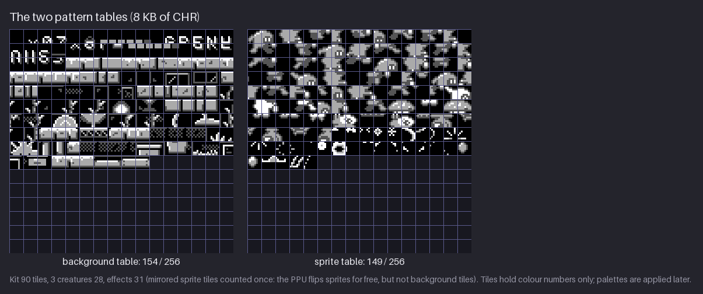

What the figure shows:

- **Left: background, 154 of 256.** These are all the unique tiles of the finished Greenhouse,
  including the HUD letters and digits at the top and the empty tile 0. Only the letters the HUD
  actually spells are there: an NES font costs tiles, so games store only the characters they
  need.
- **Right: sprites, 149 of 256.** Kit's animations take 90 tiles, the three creatures 28 and the
  effects 31. These are unique non-empty tiles, each frame cut from its own bounding box, with
  a tile and its horizontal mirror counted once. (Cut on their fixed 16×16 frame grid, the
  creatures would need 39.)
- **Grey, not colour.** A tile stores colour *numbers* 0–3, never colours. The figure draws them
  as four greys. The palette is chosen later, per 16×16 area for the background and per sprite
  for sprites. That is why the same stone tile can be teal in the Greenhouse and blue in the
  Cistern.

Mirrored sprite tiles are counted once. Every sprite has a horizontal-flip and a vertical-flip
bit, so Kit facing left costs no tiles at all. Background tiles have no flip bits on a standard
NES, so a left wall edge and a right wall edge are two tiles. This is a real reason NES
backgrounds lean on symmetric tiles and NES characters face both ways freely.

> **NES rule:** a tile is 8×8 pixels of colour numbers 0–3; each pattern table holds 256 of
> them. Authentic: the Greenhouse fits in 154 background tiles.

> **Try it (3 min).** Open any finished room of your own on an 8×8 grid. Find two tiles that
> differ by one or two pixels. Decide whether that difference is worth a tile. If not, make
> them identical.

## Tiles as bytes

Each tile is 16 bytes in two *bit planes*. The first 8 bytes hold bit 0 of each pixel, one byte
per row, leftmost pixel in the highest bit. The next 8 bytes hold bit 1. A pixel's colour number
is `bit1 × 2 + bit0`.

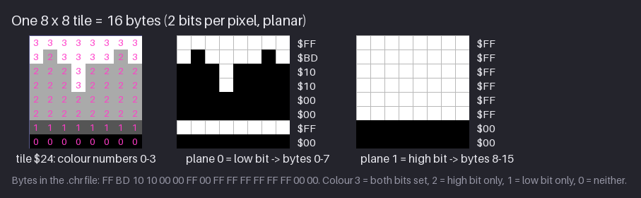

The figure uses tile $24 of the Greenhouse, the top of a mossy stone block. Read row 1:

- Colour numbers `3 2 3 3 3 3 2 3`.
- Bit 0 of each: `1 0 1 1 1 1 0 1` = %10111101 = **$BD**.
- Bit 1 of each: `1 1 1 1 1 1 1 1` = **$FF**.

Colour 3 (the moss highlight) has both bits set, colour 2 (stone) only the high bit, colour 1
(the area's shared dark) only the low bit, and colour 0 (the backdrop) neither. The 16 bytes in
the file are, in order:

```text
FF BD 10 10 00 00 FF 00   plane 0 (bit 0), rows 0-7
FF FF FF FF FF FF 00 00   plane 1 (bit 1), rows 0-7
```

256 tiles × 16 bytes = 4096 bytes, which is exactly the size of every `.chr` file in
`project/ch24/chr/`. Unused slots are filled with zeros, which is an empty tile.

Why planar? It let the PPU fetch one byte per plane and shift both out in parallel, one pixel per
clock. For you it means only this: colour numbers are not stored as digits, so you never edit
`.chr` files by hand. You draw in an editor and let it write the bytes.

> **Try it (4 min).** On squared paper, draw an 8×8 tile with all four colour numbers. Write the
> 16 bytes. Check one row with the rule "bit 0 → first 8 bytes, bit 1 → last 8 bytes".

## The nametable

A screen is not stored as a picture. It is a *nametable*: 32×30 = 960 bytes, one tile number per
8×8 cell, in reading order. The PPU looks up each number in the background pattern table.

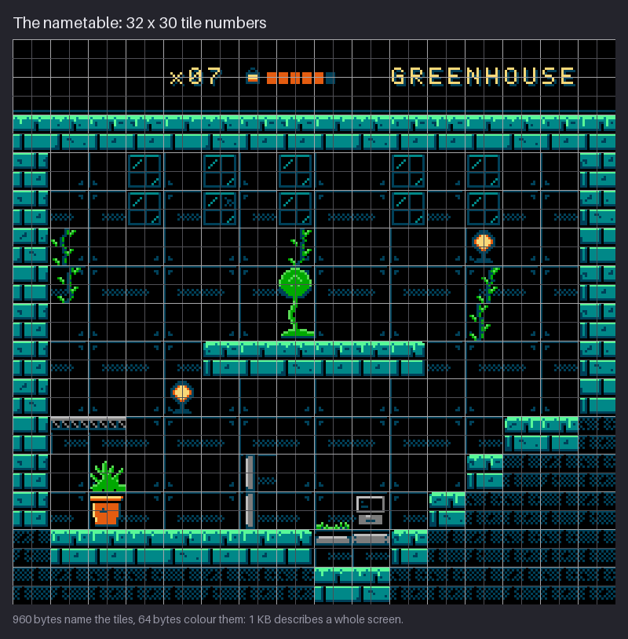

The Greenhouse nametable uses 154 different tile numbers across its 960 cells. Row 2 (the third
row of tiles, part of the HUD) starts like this in `greenhouse.nam`:

```text
00 00 00 00 00 00 00 00 14 15 16 00 17 18 19 1A 1B 1C 00 00 1D 1E 1F 1F 20 21 22 22 ...
```

Tile $00 is empty. Every repeated number is free art: the long stone ledges and the dark back
wall are a few tile numbers written many times. This is the whole economy of NES backgrounds. A
screen costs 960 bytes whether it is all one tile or 154 different ones; what costs is unique
tiles in the pattern table.

Right after the 960 tile bytes come the 64 attribute bytes, so a full screen is 1024 bytes:
the size of `nametable/greenhouse.nam`.

## Attribute bytes

Chapter 14 said "one sub-palette per 16×16 area". Here is how it is stored. The attribute table
is 8×8 = 64 bytes. Each byte covers a 32×32 block, and packs four 2-bit sub-palette numbers, one
for each 16×16 quarter:

```text
bit  7 6 | 5 4 | 3 2 | 1 0
     BR  | BL  | TR  | TL      (bottom-right, bottom-left, top-right, top-left)
```

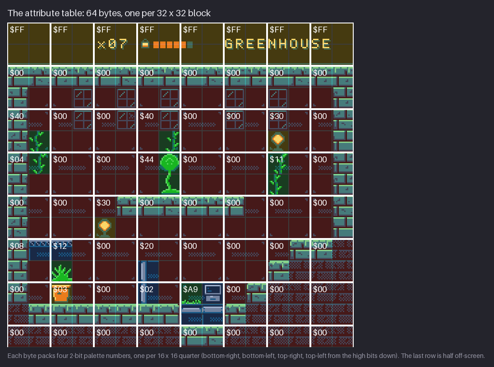

The tint is the sub-palette: red BG0 stone, green BG1 plants, blue BG2 metal, yellow BG3 warm.
The bytes come from `nametable/greenhouse-attributes.txt`:

```text
$FF $FF $FF $FF $FF $FF $FF $FF
$00 $00 $00 $00 $00 $00 $00 $00
$40 $00 $00 $40 $00 $00 $30 $00
$04 $00 $00 $44 $00 $00 $11 $00
$00 $00 $30 $00 $00 $00 $00 $00
$08 $12 $00 $20 $00 $00 $00 $00
$00 $03 $00 $02 $A9 $00 $00 $00
$00 $00 $00 $00 $00 $00 $00 $00
```

Three things to read from it:

- **Row 0 is all $FF.** %11 11 11 11: every quarter uses BG3, the warm sub-palette ($0F $0C $17
  $38). That is the HUD's cream text on black.
- **Most bytes are $00.** Stone and back wall use BG0, so most of the room needs no colour data
  at all. The interesting bytes sit exactly where a plant, a lamp or a machine is.
- **The last row is half off-screen.** 30 tile rows are 240 pixels, which is 7.5 blocks of 32.
  The eighth row of bytes covers lines 224–255; only its top quarters are visible.

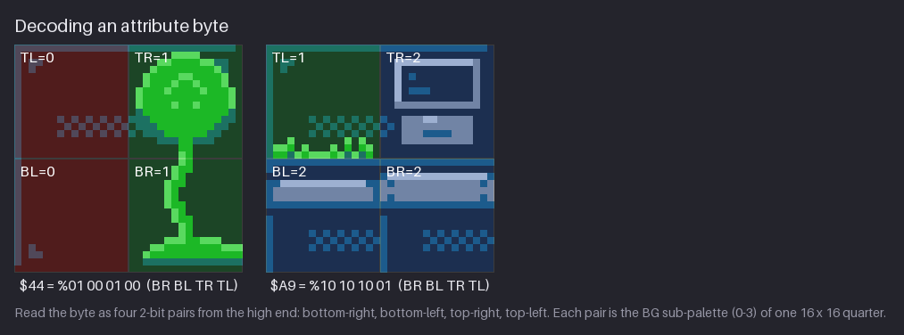

Two worked examples:

- **$44** = %01 00 01 00 → BR = 1, BL = 0, TR = 1, TL = 0. The right half holds the big seed
  plant (BG1 plants); the left half is plain wall (BG0).
- **$A9** = %10 10 10 01 → BR = 2, BL = 2, TR = 2, TL = 1. The terminal and the grate are metal
  (BG2); the grass tuft in the top-left is a plant (BG1).

Why such a coarse grid? 2 bits per 16×16 area is 64 bytes per screen. Colour per 8×8 tile would
have cost four times as much memory, and memory was the most expensive part of the console. The
16×16 metatile is the artist's answer: design in blocks that each use one sub-palette.

> **NES rule:** one sub-palette per 16×16 quarter, four quarters per attribute byte.
> Authentic in the whole course; `tools/nes.py` checks every room.

## Palette RAM

The PPU keeps the colours in 32 bytes of palette RAM at $3F00–$3F1F. `palette/greenhouse.pal` is
those 32 bytes:

```console
$ xxd project/ch24/palette/greenhouse.pal
00000000: 0f0c 1c2b 0f0c 1a2a 0f0c 0010 0f0c 1738  ...+...*.......8
00000010: 0f0f 1637 0f0f 1434 0f0f 2830 0f0f 102a  ...7...4..(0...*
```

Laid out by role:

| Address | Bytes | Sub-palette |
|---|---|---|
| $3F00 | $0F $0C $1C $2B | BG0 stone |
| $3F04 | $0F $0C $1A $2A | BG1 plants |
| $3F08 | $0F $0C $00 $10 | BG2 metal |
| $3F0C | $0F $0C $17 $38 | BG3 warm |
| $3F10 | $0F $0F $16 $37 | SP0 Kit |
| $3F14 | $0F $0F $14 $34 | SP1 creatures |
| $3F18 | $0F $0F $28 $30 | SP2 effects |
| $3F1C | $0F $0F $10 $2A | SP3 drone |

- **One backdrop.** Entry $3F00 is the colour of every background pixel with colour number 0,
  whatever its sub-palette. That is the hardware reason all four BG sub-palettes share black
  $0F (Chapter 5). The first byte of the other BG sub-palettes is not used for normal drawing.
- **Sprite colour 0 is transparent.** $3F10 is a mirror of $3F00, and colour 0 of a sprite is
  never drawn, so the course writes $0F there.
- **Whole-screen recolouring is cheap.** A game rewrites these 32 bytes between frames (during
  vertical blank, when the PPU is not drawing). Chapter 19's lighting and fades are exactly this:
  new palette bytes, no new tiles.
- **Never $0D.** It sits below the black level of the video signal and can upset some TVs (N2).
  The course writes black as $0F.

## Sprite overflow

Sprites live in OAM (object attribute memory): 64 entries of 4 bytes each, holding Y, tile
number, attributes (sub-palette, priority, horizontal and vertical flip) and X (N6). Before each
scanline the PPU scans OAM in order and picks the first 8 sprites that touch that line (N7).
Sprite 9 and later are simply not drawn on that line.

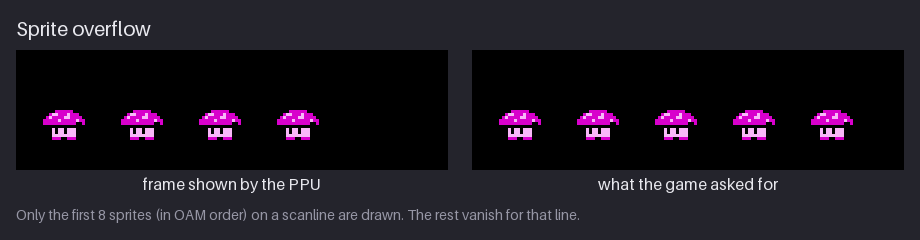

Each hopper is 16 pixels wide, so it is 2 sprites side by side. Five hoppers on the same rows
are 10 sprites; the first 8 in OAM order are drawn and the fifth hopper is missing. On real
hardware the cut happens per scanline, so a sprite that only partly shares the busy rows loses
only those rows.

What it means when you draw:

- **Width is the cost, not height.** Kit is 16×24: 6 sprites in total, but only 2 on any
  scanline. A 32-pixel-wide boss made of sprites is 4 per line, half the budget.
- **Count a row, not a screen.** Kit (2) plus three 16-pixel enemies (6) at the same height
  already fills a line. A spark from the lantern on that line is the ninth.
- **Stagger heights.** Put enemies on different floors and flying enemies above the walkers.
  The final `hollow-vault` scenes peak at 6 sprites per line: the Furnace, when rising embers
  cross the line Kit and the hopper share (5 in its first frame; Chapters 19 and 20).
- **Big bosses go in the background.** Many NES bosses are background tiles moved by scrolling,
  because a sprite boss would eat the whole line.

The PPU also has a sprite-overflow flag, but it is buggy (N7), so games count their own sprites.

> **NES rule:** at most 8 sprites per scanline; the 9th and later vanish on that line.
> Authentic in every `hollow-vault` scene figure.

## Flicker

Vanishing is worse than flickering. If the same enemy disappears every frame, the player cannot
see it at all. So games *rotate* the OAM order every frame: a different sprite lands in ninth
place each time, and everyone disappears now and then instead of one sprite all the time.

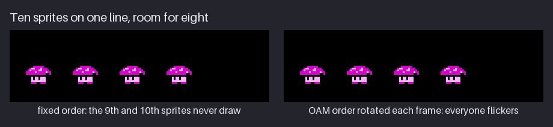

The figure runs at 50 ms per frame so you can follow it. On the left the order is fixed and the
fifth hopper never draws. On the right the start of the order moves by two sprites (one hopper)
each frame, so each hopper is missing in one frame out of five. At the real 60 frames per second
that reads as a fast shimmer, the look of busy scenes in many Mega Man-era games.

Flicker is a game-code decision, not a drawing, but it changes how you draw:

- **Flickering sprites look semi-transparent.** Strong silhouettes and black outlines survive it;
  thin, low-contrast details disappear.
- **Effects can flicker on purpose.** Sparks, smoke and a hurt Kit blinking every other frame
  are cheap on the line budget, because a sprite drawn only on even frames frees its slot on odd
  frames.
- **Priority follows OAM order.** When sprites overlap, the one earlier in OAM is in front.
  Rotating the order also rotates who is in front, so overlapping sprites can swap layers.

## The status-bar split

The PPU has one scroll position per frame. If the playfield scrolls, the HUD scrolls with it,
unless the game changes the scroll partway down the screen. That change is called a *split*.

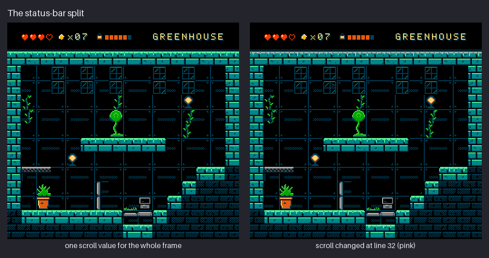

On the left there is one scroll value for the whole frame: the bar slides away with the room. On
the right the game waits until line 32 and then writes a new scroll value: the top 32 lines stay
put and everything below scrolls. The pink line marks the split.

How the game knows it has reached line 32:

- **Sprite-0 hit.** The PPU sets a flag the first time an opaque pixel of sprite 0 overlaps an
  opaque background pixel (N6). The game puts sprite 0 on the bottom edge of the bar, waits for
  the flag, then changes the scroll. Super Mario Bros. tucks its sprite 0 under the coin icon of
  its status bar.
- **Mapper IRQ.** Later cartridge chips (the MMC3 is the best known) count scanlines and
  interrupt the CPU at a chosen line.

What it means for the art:

- **Build the bar from background tiles.** Sprites in the bar cost line budget on those rows. In
  `hollow-vault` the hearts and seed icon are sprites, and they do count toward the limit on the
  HUD rows (Chapter 20).
- **Give the bar its own sub-palette.** Its attribute bytes are a whole row of $FF.
- **Put an opaque pixel where sprite 0 sits.** If the bar's bottom border is backdrop-coloured
  there, the hit never happens and the split never comes.
- **Leave a quiet band at the split.** The timing is rarely exact to the pixel. A plain black
  row of tiles on each side of the split hides a line of jitter.

> **NES rule:** one scroll value per frame unless the game splits the screen. The course
> draws the split but does not explain the interrupt code (the relaxation in Chapter 18).

## CHR bank animation

On cartridges with CHR ROM, a *mapper* chip decides which slice of the cartridge's graphics the
PPU sees as its pattern table. Change one mapper register and a whole bank of tiles is replaced
at once (N15, N18). Mappers differ in bank size; 1 KB (64 tiles) and 4 KB (256 tiles) are
common.

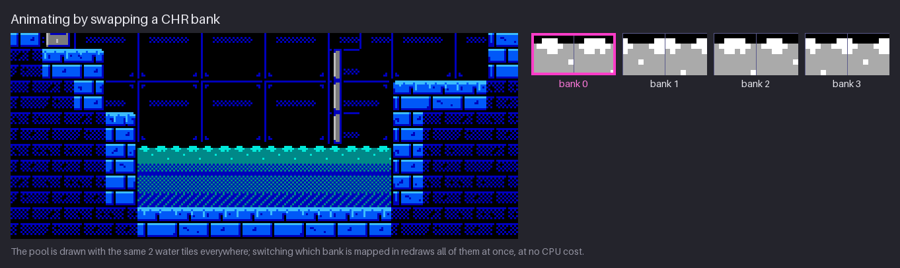

The Cistern pool is drawn with the same 2 water tiles everywhere. The cartridge holds 4 banks
that are identical except for those 2 tiles. Switching banks every 140 ms makes every water cell
on screen move together, with no tile writes and almost no CPU time.

How to draw for it:

1. Put all animated tiles in one bank-sized slot of the pattern table.
2. Draw each animation frame as a full copy of that bank. Only the animated tiles change.
3. Animate many cells with the same few tiles. Waves, conveyor belts, blinking lights and
   flowing lava all work, because every copy changes in step.

The price is cartridge space: 4 frames of a 1 KB bank are 4 KB of graphics ROM. Retro Game
Mechanics Explained (N16) shows the same trick used for parallax: background tiles that hold
pre-shifted copies of a distant layer.

Cartridges with CHR RAM work differently: the game copies new tile bytes into the pattern table
during vertical blank. That is flexible, but only a few tiles fit into each blank, so animated
tiles stay few.

## Overlay sprites

A sprite has 3 colours plus transparent. To get more, draw a second sprite with another
sub-palette exactly on top of the first (N12, N17).

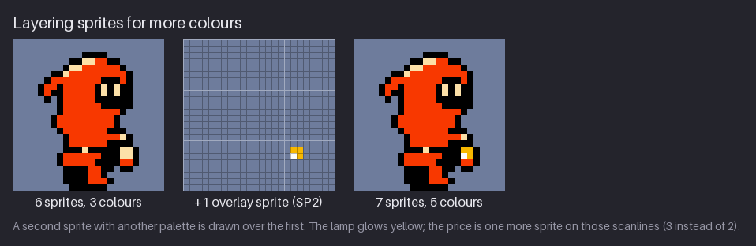

Kit's lantern gets a yellow and white glow from SP2 (effects: $28 and $30), on top of Kit's own
black, red and cream from SP0. The result has 5 colours. The price:

- **One more sprite on those 8 lines** (3 instead of 2), and one more of the 64 OAM entries.
- **It must move with Kit** every frame, flipped with Kit, or it slides off.
- **OAM order matters.** The overlay must come earlier in OAM than Kit's sprite, or it is drawn
  behind it.

The best-known use is a hero's face: a small skin-coloured sprite over a head drawn in the
outfit's palette, as in the Mega Man games. Spend overlays where the eye looks (faces, a glowing
item) and nowhere else.

A related tool is the *priority* bit. A sprite with it set is drawn behind background pixels
whose colour number is not 0, but in front of the backdrop. Kit can walk behind a tuft of grass
this way without any extra tiles.

## Where the course relaxed the rules

The main project is constraint-legal in colours, tiles, attributes and sprites per line. These
are the honest exceptions, from Chapter 1:

| Relaxation | The real thing |
|---|---|
| Square pixels | An NTSC NES pixel is 8:7 wide on a 4:3 TV; art drawn square looks slightly wider there |
| No CPU budget | Moving many sprites, updating tiles and splitting the screen all cost CPU time per frame |
| No scroll seams or nametable mirroring | A scrolling game writes new columns of tiles and attributes as the camera moves; attribute colours can glitch at the edge |
| Parallax splits drawn, not programmed (Ch. 18) | Each split needs sprite 0 or a mapper IRQ, and only horizontal bands can scroll separately |
| Lighting by whole-palette swaps (Ch. 19) | This one is authentic: palette writes between frames are exactly how NES games fade |
| HUD hearts and seed as sprites (Ch. 20) | Legal, but they use line budget on the HUD rows |

When is breaking a rule worth it? Shovel Knight's answer (N10) is a good test: break a rule when
the player would feel the limit as a flaw (flicker, colour glitches at the screen edge) and keep
it when the limit *is* the look (the small palette, the tile grid). If you go on to make an NES
ROM, test it on a hardware-accurate emulator such as Mesen; it shows sprite drop-outs and
attribute glitches the way a console does.

## Mini-project: the Greenhouse as NES data

`project/ch24/` is stand-alone: it is the Greenhouse from Chapter 20 written as authentic NES
data. See [project/ch24/README.md](project/ch24/README.md).

| File | Size | What it is |
|---|---|---|
| `chr/greenhouse-bg.chr` | 4096 B | background pattern table, 154 tiles used |
| `chr/greenhouse-bg.png` | 128×128 | the same table in four greys |
| `chr/kit.chr`, `chr/kit.png` | 4096 B | Kit's sprite tiles (89, cut on Kit's fixed 16×24 grid) |
| `chr/water-banks.png` | 64×16 | the four Cistern water frames, one per CHR bank |
| `nametable/greenhouse.nam` | 1024 B | 960 tile numbers + 64 attribute bytes |
| `nametable/greenhouse-attributes.txt` | — | the 64 attribute bytes as hex |
| `palette/greenhouse.pal` | 32 B | palette RAM $3F00–$3F1F |
| `palette/nes.{gpl,hex,png}`, `nes-grid.png` | — | the course's NES master palette |
| `scene/greenhouse.png` | 256×240 | what those bytes draw |

Kit's file holds 89 tiles while the figure counts 90: the file cuts every frame on the same
16×24 body grid, the figure cuts each frame from its own bounding box. Both are legal; a fixed
grid is what a game engine would use.

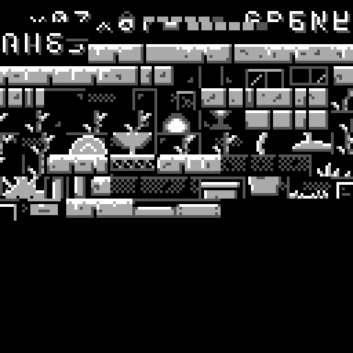

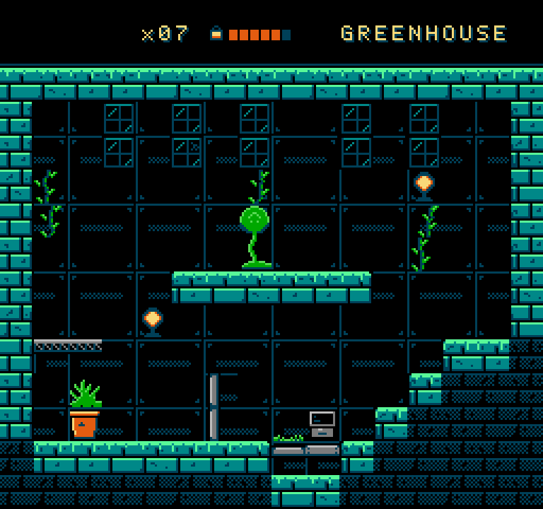

**Step 1: open the data.** NES graphics editors read these three formats directly. NEXXT by
FrankenGraphics (N20) and its ancestor NES Screen Tool by Shiru (N21) are both free Windows
programs that run under Wine on Debian (`sudo apt install wine`; optional). Load:

- `chr/greenhouse-bg.chr` as the pattern table (CHR),
- `nametable/greenhouse.nam` as the nametable or screen (the 1024-byte file includes the
  attributes),
- `palette/greenhouse.pal` as the palette.

Menu names differ between versions; look for "open CHR", "open nametable" and "open palette".
You should see the scene from `scene/greenhouse.png`. If the colours are wrong, the palette did
not load; if the picture is scrambled, the CHR loaded into the wrong table.

**Step 2: edit one metatile.** Replace the planter in the lower left (attribute byte $03 at block
row 6, column 1: its top-left quarter uses BG3 warm) with your own 16×16 prop:

1. Tiles $00–$99 are used, so $9A–$FF are free. Draw your 4 new tiles there, in colour numbers
   0–3.
2. Place them in the 2×2 cells where the planter was.
3. Pick the quarter's sub-palette in the attribute editor. Keep it BG3 for a warm prop or
   choose BG2 for metal; the other three quarters of byte $03 must not change.
4. Check that you did not cross the 16×16 boundary with a fifth colour.

**Step 3: save and compare.** Save the `.chr` and `.nam` under new names and export a PNG. The
tile count went from 154 to at most 158. If you reused tiles that already existed, it went up by
less; that is the authentic habit this chapter is about.

Without Wine you can still do the whole exercise on paper with the figures above: choose tile
numbers, write the attribute byte, and encode one new tile into 16 bytes. YY-CHR, the classic
CHR viewer, is another Windows option.

## Exercises

1. **Decode an attribute byte.** Decode `$44` by hand into four quarter values. Then encode a
   32×32 block whose top half is plants (BG1) and bottom half metal (BG2).

   What to look for:
   - You read the pairs from the high bits: BR, BL, TR, TL.
   - `$44` = %01 00 01 00 → BR = 1, BL = 0, TR = 1, TL = 0.
   - Top BG1, bottom BG2 → %10 10 01 01 = `$A5`.

   <details><summary>Example solution</summary>

   

   `$44` puts the seed plant's sub-palette on the right half of its block. For your own byte,
   write the four quarters in the order BR BL TR TL, then group the bits by four into hex. The
   full table is in `images/ch24-attribute-bytes.png`.
   </details>

2. **Hand-encode a tile.** Draw an 8×8 tile with all four colour numbers (for example a brick
   with a light top edge and a dark bottom line). Write its 16 bytes.

   What to look for:
   - The first 8 bytes are bit 0 of each row; the last 8 are bit 1.
   - The leftmost pixel is the highest bit of each byte.
   - A row of colour 3 is `$FF` in both planes; a row of colour 0 is `$00` in both.

   <details><summary>Example solution</summary>

   

   Tile $24 encodes as `FF BD 10 10 00 00 FF 00 FF FF FF FF FF FF 00 00`. Check your tile the
   same way, one row at a time. Its place in the full table is in
   `images/ch24-pattern-tables.png`.
   </details>

3. **Plan a flicker order.** Ten 8×8 sprites (five 16-pixel enemies) share a line. Write the OAM
   order for five frames so that no enemy is missing two frames in a row.

   What to look for:
   - Every frame, exactly 8 sprites are in the first 8 OAM places.
   - The two halves of an enemy stay together, so a whole enemy blinks, not half of one.
   - Each enemy is missing in one frame of five.

   <details><summary>Example solution</summary>

   

   Number the enemies A–E. Frame 0: A B C D | E. Frame 1: B C D E | A. Frame 2: C D E A | B,
   and so on: rotate the start by one enemy (two sprites) each frame. The figure does exactly
   this. Each enemy is visible 4 frames in 5.
   </details>

4. **Design a split status bar.** Sketch a 256×240 screen with a status bar of your own design
   that must stay still while the level scrolls. Mark the split line and where sprite 0 goes.

   What to look for:
   - The bar is made of background tiles; any sprites in it are counted per line.
   - The bar's attribute row uses one sub-palette.
   - Sprite 0 sits on an opaque pixel of the bar's bottom border.
   - There is a quiet band at the split line to hide timing jitter.

   <details><summary>Example solution</summary>

   

   The `hollow-vault` bar is 32 pixels tall (two metatile rows, attribute row $FF) and splits at
   line 32. A bottom-of-screen bar works the same way with the split line at its top edge.
   </details>

## Recap

- A pattern table is 256 tiles of 16 bytes: two bit planes, colour numbers 0–3, no colours. The
  Greenhouse uses 154 background tiles; sprites use 149 (Kit 90, creatures 28, effects 31).
- Sprites can flip, background tiles cannot. Mirrored sprite tiles cost nothing.
- A screen is a nametable: 960 tile numbers plus 64 attribute bytes, 1 KB. Repeating tiles is
  free; unique tiles are the cost.
- An attribute byte holds four 2-bit sub-palette numbers for the quarters of a 32×32 block, read
  from the high bits: BR, BL, TR, TL. `$FF` = all BG3; `$44` = right half BG1.
- Palette RAM is 32 bytes. $3F00 is the shared backdrop; sprite colour 0 is transparent; fades
  and lighting are palette writes between frames. Never $0D.
- The PPU draws the first 8 sprites per scanline in OAM order. Budget width per line; stagger
  heights; make big bosses from background tiles.
- Rotating the OAM order turns vanishing into flicker. Strong silhouettes survive flicker.
- A still status bar needs a split: sprite-0 hit or a mapper IRQ. Build the bar from BG tiles,
  give it its own attribute row, an opaque pixel for sprite 0 and a quiet band at the split.
- CHR bank switching animates every copy of a tile at once: design animated tiles as full bank
  copies.
- An overlay sprite adds a second 3-colour palette (Kit: 6 sprites/3 colours → 7 sprites/5
  colours) for one more sprite on those lines.

## Further study

- **NESdev wiki, "PPU"** (N1) — <https://www.nesdev.org/wiki/PPU> — The overview that links
  every page below. Start here when a detail in this chapter needs the full story.
- **NESdev wiki, "PPU palettes"** (N2) — <https://www.nesdev.org/wiki/PPU_palettes> — Palette RAM,
  the mirrors at $3F10, and why $0D is dangerous.
- **NESdev wiki, "PPU attribute tables"** (N3) —
  <https://www.nesdev.org/wiki/PPU_attribute_tables> — The bit layout used in this chapter, with
  the formula for finding the byte of any tile.
- **NESdev wiki, "PPU pattern tables"** (N4) — <https://www.nesdev.org/wiki/PPU_pattern_tables> —
  The planar 2bpp format with a worked tile.
- **NESdev wiki, "PPU nametables"** (N5) — <https://www.nesdev.org/wiki/PPU_nametables> — The
  32×30 layout and the four nametable slots behind scrolling and mirroring.
- **NESdev wiki, "PPU OAM"** (N6) — <https://www.nesdev.org/wiki/PPU_OAM> — The 4 bytes of a
  sprite, the flip and priority bits, and the exact sprite-0 hit rules.
- **NESdev wiki, "PPU sprite evaluation"** (N7) —
  <https://www.nesdev.org/wiki/PPU_sprite_evaluation> — How the 8 sprites per line are chosen,
  and why the overflow flag is unreliable.
- **"Breaking the NES"** — David D'Angelo, Yacht Club Games (N10) —
  <https://old.yachtclubgames.com/2014/07/breaking-the-nes/> — Which NES rules Shovel Knight broke
  and why. Read it as a list of decisions, each with a reason.
- **"Sprite Layering on the NES"** — James Deighan, Mega Cat Studios (N12) —
  <https://megacatstudios.com/blogs/retro-development/sprite-layering-on-the-nes> — Overlay
  sprites from a studio that ships NES games. Look at how they budget the extra sprites.
- **"NES Graphics Explained"** — NesHacker (N14) — <https://www.youtube.com/watch?v=7Co_8dC2zb8> —
  Pattern tables, nametables, attributes and palettes in one short video. Watch it once before and
  once after this chapter.
- **"How we fit an NES game into 40 Kilobytes"** — Morphcat Games (N15) —
  <https://www.youtube.com/watch?v=ZWQ0591PAxM> — Tile reuse and metatiles taken to the
  extreme. Watch for how few unique tiles build a whole level.
- **"NES Background Parallax Explained"** — Retro Game Mechanics Explained (N16) —
  <https://www.youtube.com/watch?v=wt73KPS_23w> — Scroll splits and CHR-bank parallax with clear
  diagrams. Watch for where each split line falls.
- **"5 Colors in One Sprite Explained"** — Retro Game Mechanics Explained (N17) —
  <https://www.youtube.com/watch?v=opoQdHqGEHg> — Sprite tricks beyond 3 colours, including
  overlays.
- **"Alwa's Awakening NES - Part 1: Backgrounds"** — Brad Smith (N18) —
  <https://www.youtube.com/watch?v=skaWRrvasW8> — Converting modern pixel art into real NES
  backgrounds. Watch for every compromise and the reason for it.
- **NEXXT** — FrankenGraphics (N20) — <https://frankengraphics.itch.io/nexxt> — A free NES
  graphics and nametable editor; open the files of this chapter's mini-project in it.
- **NES Screen Tool** — Shiru, readme mirror by arlm (N21) — <https://github.com/arlm/nesst> —
  The classic free NES screen editor that NEXXT grew from.

Sources for this chapter: [REFERENCES.md](REFERENCES.md#chapter-24--style-authentic-nes--the-hardware-in-depth)
