# Chapter 25 — Style: Micro-res (ESA-like, 160×120)

This chapter shrinks the world. The whole screen is 160×120 pixels, a quarter of the NES pixel
count, and Kit is 5 pixels wide. This is the look of Environmental Station Alpha (ESA, Arvi
"Hempuli" Teikari, 2015), the game that started this course: a tiny explorer in big, silent,
colour-washed rooms. The main project kept ESA's *mood* at NES resolution. Here you go down to
ESA's *resolution* and learn micro-res as a style of its own.

Micro-res is not "NES art, smaller". At 5 pixels there is no face, no hand and no shading. What
is left is shape, colour, a single bright pixel and the space around them. You will redraw the
Greenhouse at 160×120, cut Kit down to 5×7 pixels, give the room bright rims and a strict
colour budget, then build a second area by changing six colours. Everything goes into a
stand-alone snapshot, [`project/ch25/`](project/ch25/README.md). It is not part of the cumulative
main project.

Previous: [Chapter 24](24-style-authentic-nes.md). Next: [Chapter 26](26-style-hi-bit.md).

## What defines the style

ESA is a Metroidvania: a small robot explores an abandoned space station built around a
bio-dome (K3). Its native resolution is 160×120 (K2); the screenshots on the Steam page (K1) are
that image scaled up by whole numbers. Open the two trailers (K4 from 2012, K5 from the 2015
release) and watch them with the sound off. Look for these things, in this order:

- **How small the hero is.** The robot is a few pixels across, about the size of a letter on
  the screen. The rooms are huge around it, and that contrast is the feeling of the game:
  you are small and alone.
- **How dark the rooms are.** Most of each screen is black or one deep tone. The level shape
  is carried by big dark masses, not by detailed walls.
- **The bright edges.** Platforms and walls have a thin bright line along the edge you can
  stand on or bump into. Those lines are what you actually read when you play.
- **One hue per area.** Each part of the station is washed in its own colour family, so you
  know where you are before you read any map.
- **Things that drift.** Spores, bubbles, dust or sparks move slowly through the rooms. They
  are single pixels, and they make a still room feel alive.
- **Chunky, sharp pixels.** Every pixel is a clean square, scaled by a whole number.

Everything in this chapter is original art built on those observations. Do not trace or redraw
ESA screens or sprites; watch, describe in words, then design your own.

A relative worth knowing is PICO-8, a "fantasy console" whose screen is 128×128 with a fixed
16-colour palette. Many PICO-8 games solve the same problems you meet here, at a similar size.

The style has a known weakness, and you should design against it from the start. Some players of
ESA say that sprites and backgrounds can be hard to tell apart (Metacritic user reviews; see
Further study). At 5 pixels, readability does not happen by accident. Most rules in this chapter
exist to protect it.

## The constraints

| Rule | Value | Where it comes from | What it means for you |
|---|---|---|---|
| Screen | 160×120 = 20×15 tiles of 8×8 | ESA's native resolution (K2) | A screen is 300 tiles; one room per screen is plenty |
| Hero | Kit 5×7 (35 px, 22 drawn); 4 frames: stand, step, blink, jump | this course | Shape and colour only; one pixel for the eye |
| Palette | 9 colours per area: 6 tones of one hue family + Kit's two reds + cream | this course, ESA-like | The area owns the hue; Kit owns the red |
| Readability | 1 px bright rim on every standable or solid edge; the eye pixel gives facing | ESA-like | Rims are drawn before any decoration |
| Foes | drawn from the area's light tones; 5×4 hopper, 2 frames | this course | A hazard is "bright area colour", never red |
| Scaling | integer only: ×4 = 640×480, ×6 = 960×720, ×9 = 1440×1080 | pixel-art practice | Never smooth, never scale by 2.5 |

There are no tile, attribute or sprite limits: the palette is a free choice of 9 RGB colours,
not NES colours. The limits are self-imposed, and that is exactly why they need discipline.

## Converting is not designing

The tempting shortcut is to take the NES Greenhouse and shrink it.

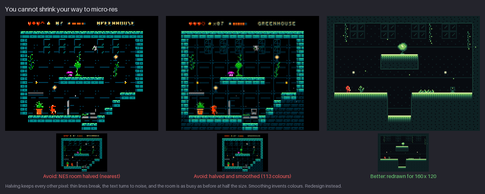

- **Halved, nearest neighbour (left).** Every other pixel is thrown away. One-pixel lines break
  into dashes, the HUD text turns to noise, and the room is exactly as busy as before at half the
  size.
- **Halved and smoothed (middle).** Averaging pixels invents colours: 113 of them, where the
  style allows 9. The edges go soft, which is the opposite of the chunky look.
- **Redrawn (right).** A different room with the same idea: fewer, bigger shapes, a lot of empty
  space, one hue family and bright rims. It shows *less* than the NES room and reads faster.

The NES room is 256×240 with a 16×24 hero. ESA-like rooms have far less detail per screen and
much more empty space. Both fit in the same screen area only because the micro pixels are
bigger. So you do not convert a scene to micro-res. You redesign it: decide what the room is
*for* (a floor, a pit, a ledge, a lamp, an exit), and draw only that.

## Same character, 11× fewer pixels

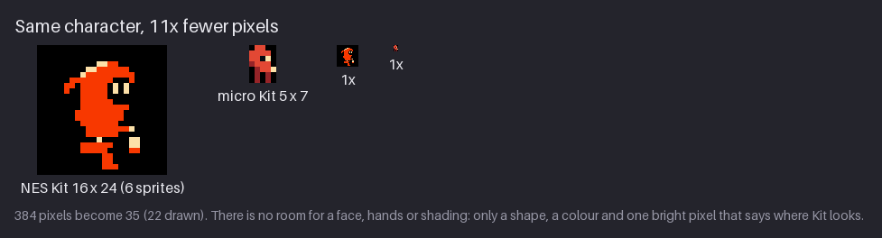

NES Kit has 384 pixels to spend; micro Kit has 35, and draws 22 of them. That is 11 times fewer
cells for the same character. At 1× (the small copies) the micro Kit is a red speck with one
bright dot, and that is enough.

What survives the cut, in priority order:

1. **The silhouette.** A round head and hood on top, a body, two legs. The hood's bump on the
   back of the head is the one shape cue NES Kit and micro Kit share.
2. **The colour.** Red, in a world that has no red (more below).
3. **One bright pixel** for the eye, so Kit has a front and a back.
4. **One more bright pixel** for the lantern at the hip.

What does not survive: the face, the hands, the cloak's folds, any shading beyond one dark red
for the back and legs. Read micro Kit's stand frame row by row (R red, r dark red, K black,
C cream, `.` transparent):

```text
.RR..    hood top
RRRR.    head
RRKC.    black socket + cream eye: Kit looks right
rRRR.    dark red back, red front
.rRRC    body; cream lantern at the hip
.r.r.    legs, dark red
.r.r.
```

The dark red goes on the back edge and the legs. That is the only shading Kit has, and it does
two jobs: it gives the body volume and separates the legs from the body.

> **Try it (4 min).** Take a hero of your own at any size. Write down the three things a player
> must see to recognise it (for Kit: hood, red, eye). Draw it in a 5×7 box with only those
> three. Judge it at 1× next to a 1× copy of the original.

## One pixel is a feature

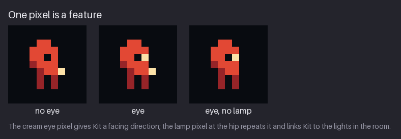

At this size, a single pixel is a whole feature. Compare the three panels:

- **No eye.** A red blob. You cannot tell which way it faces.
- **Eye.** A cream pixel at the front of the head, next to one black pixel. Kit now looks
  right; flip it and Kit looks left.
- **Eye, no lamp.** Still readable, but the lamp pixel was doing two more jobs. It repeats the
  facing direction lower down, and it shares the cream of the wall lamps, which ties Kit to the
  lights in the room.

Rules for one-pixel features:

- **Give it the strongest contrast available.** Cream on red is the brightest pairing in Kit.
  A mid-tone pixel would vanish.
- **Put a dark pixel next to it.** The black socket makes the eye pop; a bright pixel on a
  bright area reads as nothing.
- **Never put two features next to each other.** Two adjacent bright pixels read as one bigger
  blob, not as two features.
- **Animate the feature, not the body.** A blink is one pixel changing from cream to black for
  150 ms. That is the cheapest life a character can have.

## Four frames

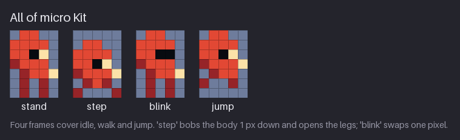

The whole of micro Kit is four 5×7 frames, saved side by side as a 20×7 strip
(`sprites/kit.png`):

| Frame | What changes | Used in |
|---|---|---|
| stand | — | idle, walk |
| step | the body drops 1 px and the legs spread to the outer columns | walk |
| blink | the cream eye pixel becomes black | idle |
| jump | the legs tuck up, the lamp moves up a row | jump and fall |

Timings:

- **Idle:** stand 600 ms, stand 600 ms, blink 150 ms, and repeat. A blink every 1.35 s keeps Kit
  alive without moving it.
- **Walk:** stand and step at 160 ms each. Two frames are a walk at this size: the 1 px bob and
  the open legs say "moving", and the position change does the rest.
- **Jump:** one held frame for the whole arc. The movement through the air is the animation.

Why so few? At 5 pixels, an in-between frame has nothing to show. Moving a leg pixel halfway is
impossible; it is either here or there. Extra frames only blur the pose. Spend the time you saved
on timing: a 1 px bob at the right moment beats a six-frame cycle.

> **Try it (3 min).** Draw your 5×7 hero's step frame. Move the whole body down 1 px and put the
> feet on the outer columns. Flip between stand and step at about 160 ms. If it looks like a
> shiver, not a step, make the legs change more and the body less.

## Friend and foe at 5 pixels

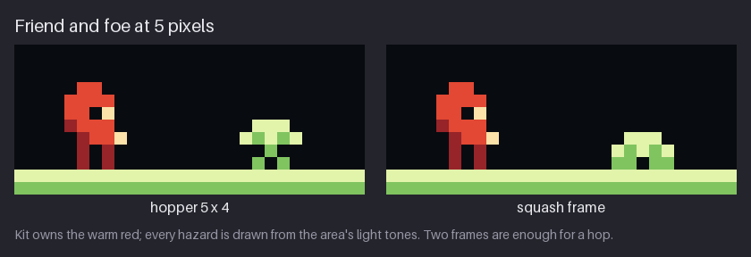

The spore hopper becomes a 5×4 mushroom: a pale cap with two light spots, two black eye pixels
on a light stem, and two feet. It has 2 frames, stand and squash, saved as a 10×4 strip
(`enemies/hopper.png`). Squash is the cap pushed down a row with the feet spread: the moment
before and after a hop. Two frames are enough for a hop because, again, the movement does the
work.

The hopper is drawn only from the area's light tones (in the Greenhouse, pale lime and lime),
plus black. That rule makes the foe:

- **bright**, so it reads against the dark room, and
- **the area's colour**, so it reads as part of the world, a thing that lives here.

Kit is the opposite: the only warm red on the screen.

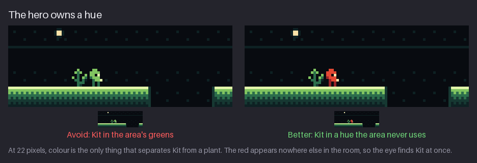

The left panel is the readability failure players report: a green Kit beside a green plant
is one shape at 1×. The right panel changes only Kit's colours. Nothing in the room is red, so
the eye goes to Kit at once, in any area.

The rule in one line: **the hero owns a hue that no area uses; hazards use the area's brightest
tones; scenery uses the rest.** A player can then sort every object on screen by colour alone,
before reading any shape.

## The room

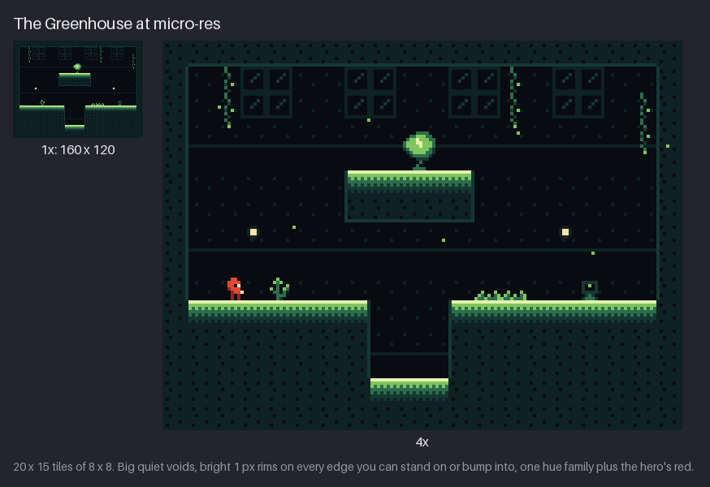

The micro Greenhouse is 20×15 tiles of 8×8, built from 16 hand-drawn tiles. The finished room
has 23 different 8×8 blocks, because rims and mirrored edges add variants. Read it from the outside in:

- **A thick dark frame** of solid ground, dotted with a few void-black pixels so it is not flat.
- **A void** (the dark back wall) with only the quietest detail: thin seams and four 2×2 groups
  of window panes.
- **Three standable surfaces:** the main floor, a raised ledge in the middle with a seed pod on
  top, and a low floor in a pit.
- **Every standable top has a bright rim.** Pale lime on top, lime, then mid green, fading into
  the dark ground over a few rows.
- **Two lamps** as cream points, the same cream as Kit's eye.
- **Life:** vines, a plant, a grass tuft, a terminal, and drifting spores.

### Build it in passes

Do not draw a micro room left to right. Draw it in layers, each with one job, and stop to check
at 1× after every pass.

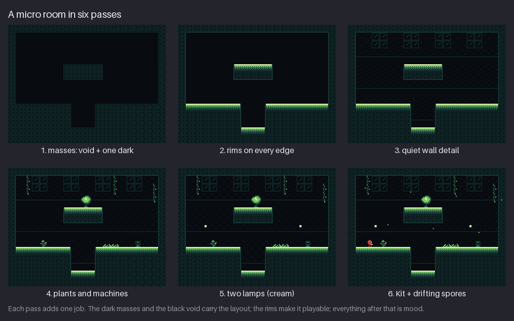

1. **Masses.** Only two colours: void black and one dark tone. Block in the solid ground and the
   ledge. This pass alone must show the level: where you can go and where you cannot.
2. **Rims.** Add a bright rim along every top you can stand on, and a dim line on the sides and
   undersides. Now the room is playable.
3. **Quiet wall detail.** Seams and windows in the two darkest tones only. If this pass draws
   your eye, it is too loud.
4. **Plants and machines.** Vines, plants and the terminal in the mid tones.
5. **Lamps.** The cream points. Use two or three per room, no more.
6. **Kit and particles.** Place the hero and the drifting spores last, and check that Kit is
   still the first thing you see.

Passes 1 and 2 are the level design; everything after is mood. If a room fails at pass 2, no
amount of decoration will save it.

### Rims tell you where you can stand

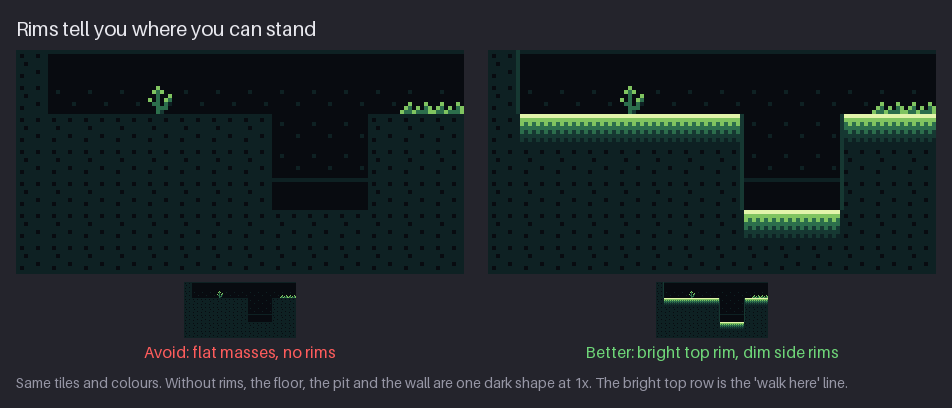

The left panel is the same floor, pit and wall without rims. At 1× (the small copies) floor and
wall merge into one dark shape, and you cannot see where the pit begins. The right panel adds:

- **A bright top rim** (pale lime over lime) on every surface Kit can stand on. That top row is
  the "walk here" line.
- **A dim side rim** (the third tone, one step above the dark ground) down the walls of the pit
  and around the ledge. It says "solid" without competing with the floor.

Make the top rim the brightest thing in the scenery. Then any bright horizontal line means
"floor", and the player learns the rule in the first room.

> **Try it (5 min).** Block out a 20×15-tile room in two colours only (void + one dark). Show it
> to someone at 1× for three seconds and ask where they would walk. Add rims, and ask again.

## Colour is a budget

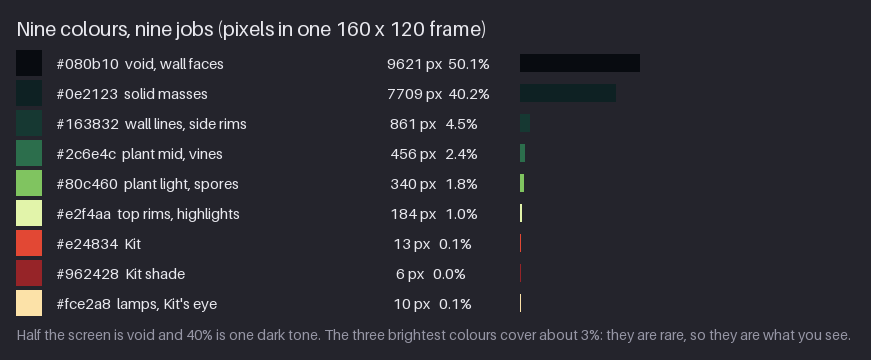

The figure counts every pixel of one frame of the Greenhouse with Kit in it:

| Colour | Job | Share of the screen |
|---|---|---|
| #080b10 void | the back wall, the black of eyes | 50.1% |
| #0e2123 dark | the solid masses | 40.2% |
| #163832 deep | wall seams, side rims | 4.5% |
| #2c6e4c mid | plant mid tones, vines | 2.4% |
| #80c460 light | plants, spores, the rim's second row | 1.8% |
| #e2f4aa pale | top rims, highlights | 1.0% |
| #e24834 red | Kit | 0.1% |
| #962428 dark red | Kit's back and legs | 0.0% (6 px) |
| #fce2a8 cream | the lamps and Kit's eye and lantern | 0.1% |

About 90% of the screen is the two darkest colours. The three brightest (pale, cream and
light) together cover about 3%, and Kit's red about 0.1%. That is the whole trick of the look: **brightness is rationed, so the
eye goes exactly where the bright pixels are.** If you light the walls up to show off detail,
the rims, the lamps and Kit stop standing out, and the screen turns into the noise the
readability complaint is about.

Give every colour one job and check the shares of your own room. A room where the top three
tones cover more than about 10% of the screen is probably too busy.

## Area palettes

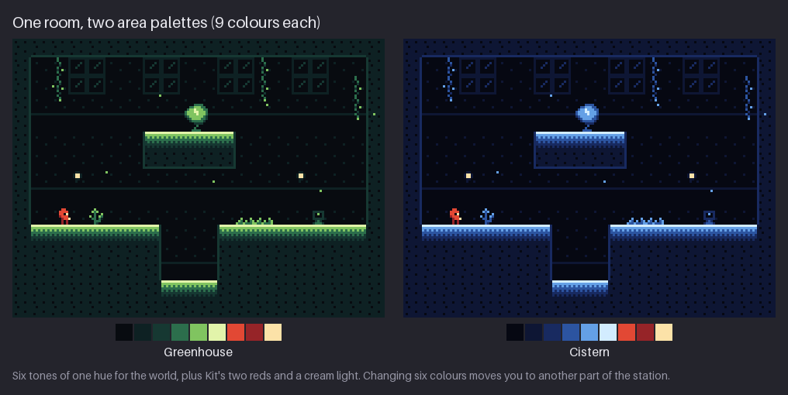

Each area is six tones of one hue family plus Kit's three colours. Only the six change between
areas:

| Job | Greenhouse | Cistern |
|---|---|---|
| void | #080b10 | #060812 |
| dark mass | #0e2123 | #0e1634 |
| deep | #163832 | #182a60 |
| mid | #2c6e4c | #2c54a0 |
| light | #80c460 | #64a0e6 |
| pale | #e2f4aa | #d2ecff |
| Kit | #e24834 #962428 #fce2a8 | same |

The same 160×120 room becomes another part of the station. Each room PNG uses 7 of its area's
9 colours: the room has no Kit, so the two reds are missing.

How to build a new area's six tones:

1. **Void.** Almost black, tinted towards the hue. Both voids here are near-black; the tint
   only shows next to true black.
2. **Dark mass.** A clearly visible step above the void, still very dark. This pair carries 90%
   of the screen, so test it first: the masses must separate from the void at 1×.
3. **Deep, mid, light.** A ramp that gets brighter and more saturated, so plants and vines glow
   out of the dark.
4. **Pale.** Nearly white, shifted towards yellow (Greenhouse) or cyan (Cistern). It is the rim
   and highlight colour, and it is the brightest thing in the area.
5. **Keep Kit's red out.** No area tone may be close to Kit's red. A warm area, such as a
   furnace, should go orange-yellow, so Kit stays the reddest thing on screen.

> **Try it (5 min).** Open `rooms/greenhouse-160x120.png` and replace its six world tones with
> a hue family of your own (purple, amber, teal). Check at 1× that the masses still separate
> from the void and that a red speck would still stand out.

## Micro vs NES

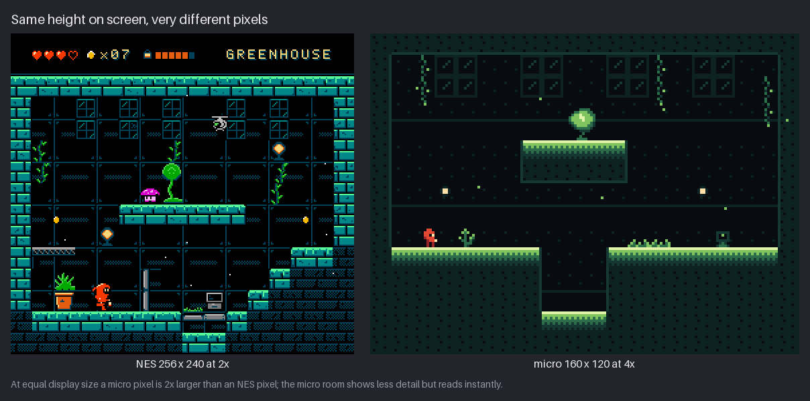

At the same height on screen (480 lines here), the NES room is shown at 2× and the micro room at
4×, so **a micro pixel is twice the size of an NES pixel**. Compare what each spends its pixels
on:

- **NES:** a HUD, brick texture, window frames, a potted plant, a terminal, a lantern with a
  glow, enemies with eyes. It is a detailed picture to explore.
- **Micro:** a frame, a void, three floors, two lamps, a few plants. It is a diagram of the
  level, and it reads in a glance.

Neither is better. Micro-res trades detail for clarity and speed of drawing. ESA was made largely by
one person (K3); at this size one person can draw a whole station.

### Integer scaling

160×120 is 4:3. Scale it only by whole numbers, so every pixel stays a square of equal size:

| Scale | Size | Fits |
|---|---|---|
| ×4 | 640×480 | small window |
| ×6 | 960×720 | a 1366×768 laptop screen |
| ×9 | 1440×1080 | a 1920×1080 screen, with black bars at the sides |
| ×12 | 1920×1440 | a 2560×1440 screen, with black bars at the sides |

If you want a 16:9 screen with no bars, pick a 16:9 micro size instead: 160×90 at ×12, or
192×108 at ×10, both give exactly 1920×1080. Choose the size before drawing the first room;
changing it later changes every room.

Show and judge your art at a whole-number scale, and post it that way too. A screenshot scaled
by 2.5 has pixels of two different sizes and looks blurred or uneven.

## Motion at micro-res

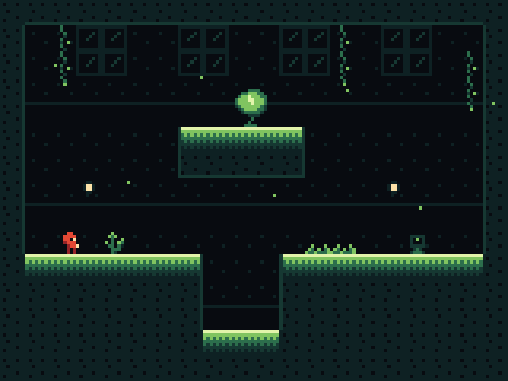

The GIF is 160 frames of 80 ms (12.8 s). Watch three things:

- **Kit moves in whole pixels**, 1 px every 160 ms, swapping stand and step each time. The demo
  is slowed down so you can follow it; in a game Kit would move faster, but still in whole
  pixels.
- **Kit turns at the pit edge.** Flipping the sprite moves the eye and the lamp to the other
  side, and that is the whole turn animation.
- **Seven spores drift up**, 1 px each, in the area's light green, rising 1 px every 60 ms.
  They never stop and never draw attention to themselves. They make a still room feel inhabited.

Rules for motion:

- **Move in whole pixels.** A position between pixels does not exist on screen; a hero that
  sometimes moves 1 px and sometimes 2 px per frame looks like it stutters.
- **Particles are slow and few.** Five to ten per room, a light tone, 1 px. Faster or brighter
  and they read as enemies or bullets.
- **Give each area its own particle.** Spores in the Greenhouse, bubbles or drips in the
  Cistern, sparks in a furnace. Like the hue, the particle tells the player where they are.
- **Let the camera be still.** One screen per room, with cuts between rooms, suits the style:
  the room is a composed picture, and scrolling would break it.

## The look in ten rules

This is the checklist for ESA-like micro-res. Pin it next to your canvas.

1. **A tiny hero in big rooms.** The hero is about 5 pixels wide in a 160-pixel screen.
2. **The void and one dark mass carry the layout.** Pass 1 alone must show the level.
3. **A bright rim on every standable edge** and a dim rim on solid sides.
4. **One hue family per area**: six tones, from near-black to near-white.
5. **The hero owns a hue** the areas never use. Here: warm red against cool worlds.
6. **Ration the bright colours.** About 90% of the screen is the two darkest tones.
7. **One-pixel features**: an eye, a lamp. Bright pixel, dark neighbour.
8. **Ambient particles per area**: few, slow, 1 px.
9. **Quiet walls** in the two darkest tones only.
10. **Few frames, whole-pixel motion, integer scaling.**

And one caution: test readability at 1× with someone who has not seen the room. Players have
said this style can make sprites and backgrounds hard to tell apart; rules 3, 5 and 6 exist to
prevent that.

## Mini-project

`project/ch25/` is stand-alone. See [project/ch25/README.md](project/ch25/README.md).

| File | Size | What it is |
|---|---|---|
| `palette/greenhouse-micro.hex` | 9 colours | the Greenhouse area palette |
| `palette/cistern-micro.hex` | 9 colours | the Cistern area palette |
| `sprites/kit.png` | 20×7 | Kit: stand, step, blink, jump |
| `enemies/hopper.png` | 10×4 | hopper: stand, squash |
| `rooms/greenhouse-160x120.png` | 160×120 | the Greenhouse room |
| `rooms/cistern-160x120.png` | 160×120 | the same room in the Cistern palette |
| `preview/*-4x.png`, `preview/*-12x.png` | — | integer-scaled previews |
| `preview/scene.gif` | 160×120 | Kit walking and spores drifting |

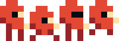

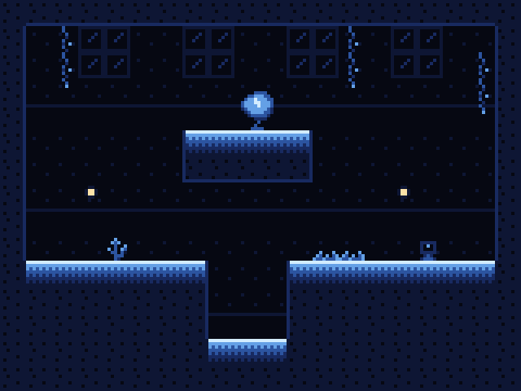

Your task: design one new micro room for a third area of the station, and put Kit and a foe in
it.

1. **Set up.** Make a 160×120 canvas with an 8×8 grid. Turn on whole-number zoom only.
2. **Choose the area and its six tones.** Follow the five steps in "Area palettes". Load
   Kit's three colours from either `.hex` file unchanged. Save your palette as a `.hex` file
   with one colour per line (six hex digits, no `#`), like the two in `palette/`.
3. **Pass 1, masses.** Void and dark mass only. Plan at least two standable heights and one
   obstacle (a pit, a wall, a ledge). Check at 1×.
4. **Pass 2, rims.** Bright top rims, dim side rims. Check at 1× again: can you trace the path
   from the left exit to the right exit?
5. **Passes 3 to 5.** Quiet wall detail, then a few props in the mid tones, then two lamps.
   Reuse tiles: a micro room needs 15 to 25 different 8×8 tiles, not 100.
6. **A foe.** Redraw the hopper, or design your own creature for the area, at most 6×6, in the
   area's light tones plus black. Two frames.
7. **Place Kit** from `sprites/kit.png` on a floor, and add 5 to 10 one-pixel particles.
8. **Check the budget.** Count colours: 9 at most. Estimate shares: the two darkest tones cover
   most of the screen and the bright tones only a few percent. Find Kit in under a second at 1×.
9. **Export** the room at 1× and a ×4 preview.

Compare your room with `rooms/greenhouse-160x120.png`. If yours is busier, take things out until
it reads as fast.

## Exercises

1. **Shrink a hero.** Reduce a hero of your own (or NES Kit) to at most 6×8 pixels.

   What to look for:
   - The silhouette still has the one shape cue that makes the hero recognisable.
   - The hero's colour is one no area uses.
   - One bright pixel gives a facing direction, with a dark pixel beside it.
   - It reads at 1×, not only when zoomed.

   <details><summary>Example solution</summary>

   

   Micro Kit keeps the hood bump, the red and a cream eye, and drops everything else: 22 pixels
   out of 384. The dark red is used only on the back and legs, to separate them from the body.
   </details>

2. **Rim-light a room.** Take a micro room with flat masses (draw one, or use pass 1 of your
   mini-project). Add rims to every standable and solid edge.

   What to look for:
   - Every surface the hero can stand on has a bright top rim.
   - Walls and undersides get a dim rim, never as bright as the floor.
   - At 1×, the floor, the pit and the wall read as separate shapes.

   <details><summary>Example solution</summary>

   

   Every floor top fades from pale through light and mid into the dark mass over a few rows; the
   pit walls and the ledge have a one-tone-up side rim. Compare `images/ch25-rims.png` for the
   same floor with and without rims.
   </details>

3. **Animate in three frames.** Make a 3-frame micro hero that can stand, walk and jump.

   What to look for:
   - Walk is stand plus one step frame, with a 1 px body bob or a clear leg change.
   - The jump frame has tucked legs, so it reads in the air.
   - The eye pixel stays in the same place relative to the head in every frame.
   - Every motion is a whole pixel.

   <details><summary>Example solution</summary>

   

   Kit uses stand, step and jump for movement; the fourth frame, blink, is only for idle. Step
   drops the body 1 px and spreads the legs; jump tucks them up and lifts the lamp a row.
   </details>

4. **Make a second area.** Take your room (or `rooms/greenhouse-160x120.png`) and change only
   the six world tones.

   What to look for:
   - The six tones are one hue family, from near-black to near-white.
   - The dark mass still separates from the void at 1×.
   - The rims are still the brightest scenery.
   - Nothing in the new palette is close to the hero's red.

   <details><summary>Example solution</summary>

   

   The Cistern replaces six greens with six blues and keeps Kit's two reds and cream. No tile
   changes, yet it is clearly another part of the station.
   </details>

## Recap

- Micro-res (160×120, 20×15 tiles) is a style of its own. Redesign rooms for it; never shrink
  or smooth a bigger picture.
- A 5×7 hero keeps three things: silhouette, colour, and one bright pixel for facing.
- One pixel is a feature: brightest contrast, a dark neighbour, never two side by side.
- Four frames are enough: stand, step (1 px bob), blink (one pixel), jump. Idle 600/600/150 ms;
  walk 160 ms per frame.
- The hero owns a hue that no area uses; foes are drawn from the area's light tones.
- Build rooms in passes: masses, rims, quiet walls, props, lamps, hero and particles. The first
  two passes are the level design.
- A bright top rim on every standable edge and a dim rim on solid sides.
- Colour is a budget: about 90% of the screen is the two darkest tones; the brightest three
  cover about 3%.
- An area is six tones of one hue family. Change six colours and you are somewhere else.
- At equal display size a micro pixel is 2× an NES pixel. Scale by whole numbers only.
- Motion is in whole pixels; particles are few, slow and 1 px.

## Further study

- **Environmental Station Alpha on Steam** — Hempuli Oy (K1) —
  <https://store.steampowered.com/app/350070/Environmental_Station_Alpha/> — What the game is,
  with screenshots. Judge each one for the ten rules: where is the hero, where are the rims,
  what is the hue?
- **Environmental Station Alpha** — Giant Bomb wiki (K2) —
  <https://www.giantbomb.com/wiki/Games/Environmental_Station_Alpha> — The source for the
  160×120 native resolution.
- **Environmental Station Alpha** — Wikipedia (K3) —
  <https://en.wikipedia.org/wiki/Environmental_Station_Alpha> — Credits and background: Arvi
  Teikari, made in Multimedia Fusion 2, released 2015.
- **"Environmental Station Alpha trailer"** — Hempuli (K4, 2012) —
  <https://www.youtube.com/watch?v=F3N6Di5iigc> — The early look in motion. Watch the hero's
  size against the rooms.
- **"Environmental Station Alpha Release Trailer"** — Hempuli (K5, 2015) —
  <https://www.youtube.com/watch?v=6GnMvsTU--E> — Area palettes, particles and the tiny hero.
  Pause on each area and name its hue family.
- **Environmental Station Alpha** — Metacritic —
  <https://www.metacritic.com/game/environmental-station-alpha/> — User reviews, including the
  point that sprites and backgrounds can be hard to tell apart. Read it as the risk this
  chapter's rules guard against.
- **Pixel Art Articles** — Pedro Medeiros (Saint11) — <https://saint11.art/pixel_articles/> —
  Short illustrated tutorials on sprites, animation and effects. Look for how few pixels carry
  each idea.
- **Pixel Overload** (YouTube channel) — <https://www.youtube.com/c/PixelOverloadChannel> —
  Short pixel-art technique videos. Use them for small-sprite and animation ideas.

Sources for this chapter: [REFERENCES.md](REFERENCES.md#chapter-25--style-micro-res-esa-like-160120)
