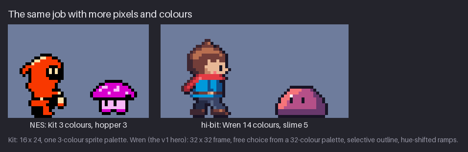
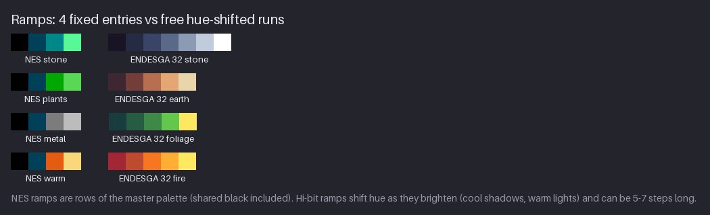
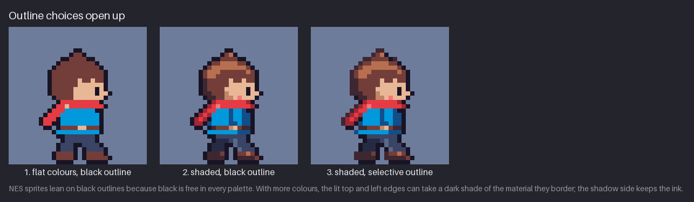
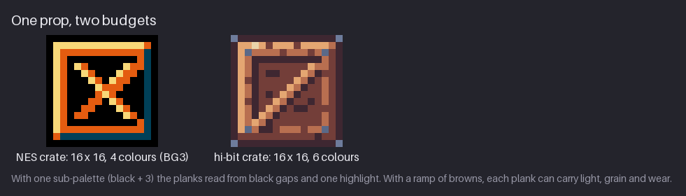

# Chapter 26 — Style: Hi-bit and Modern Detail

Every chapter so far has worked under a hardware budget: four colours per tile, three per sprite,
one sub-palette per 16×16 area, a 256×240 screen. **Hi-bit** pixel art keeps the pixel grid and
throws the hardware away. Sprites get bigger, palettes get longer, ramps shift hue, outlines can
change colour, and background layers slide over each other as freely as you like. This chapter
shows what changes when the rules go but the grid stays: a 16:9 320×180 frame, the 32-colour
ENDESGA 32 palette, hue-shifted ramps, selective outlines and anti-aliasing. It uses a finished
hi-bit pack as its reference: `mossy-ruins`, a forest-ruins set with a 32×32 hero called Wren, a
slime and a parallax scene. That pack was the art of an earlier, hi-bit edition of this course;
here it is condensed into one chapter and set next to `hollow-vault` so you can compare every
decision.

By the end you will know which NES habits to keep, which to drop, and how to spend a bigger
budget without losing the clarity the small one forced on you.

Previous: [Chapter 25](25-style-micro-res.md). Next: [Chapter 27](27-style-isometric.md).

## What defines the style

"Hi-bit" is a loose name for pixel art that looks like it could be from a console era but is not
bound by any console. The grid, the limited palette and the hand-placed pixels remain; the
resolution, colour and animation limits of old hardware do not. Three games show the range:

- **[Owlboy](https://store.steampowered.com/app/115800/Owlboy/)** (D-Pad Studio, 2016) is the
  textbook example. Characters are large and soft, with long hue-shifted ramps, coloured outlines,
  and a lot of anti-aliasing inside the shapes. Skies and clouds are painted in many layers that
  drift at different speeds. It still reads as pixel art because every pixel is placed on purpose
  and the image is scaled by whole numbers.
- **[Celeste](https://store.steampowered.com/app/504230/celeste/)** (Maddy Makes Games, 2018)
  sits at the other end: a small hero with very few colours, tight tiles, and a modern budget
  spent on effects, particles, lighting and many-layered backgrounds rather than on sprite
  detail. Hi-bit does not have to mean big sprites.
- **Shovel Knight** (Yacht Club Games, 2014) is the bridge between the two worlds. It looks NES,
  but its developers wrote openly about which NES rules they kept and which they broke: more
  colours, wider screens, sprites with more than three colours, no flicker. Their
  ["Breaking the NES"](https://old.yachtclubgames.com/2014/07/breaking-the-nes/) post is the best
  short explanation of why you might relax a rule.

## Rules you keep, rules you drop

Hi-bit is not "no rules". It keeps the rules that make pixel art read as pixel art and drops the
ones that existed only because of the hardware.

| Rule | Value in this chapter | Where it comes from | What it means for you |
|---|---|---|---|
| **Keep:** the pixel grid | every pixel square and placed by hand | the medium itself | no smooth brushes, no rotation or free scaling of finished art |
| **Keep:** integer scaling | 320×180 at ×4 (720p), ×6 (1080p), ×8 (1440p) | crisp display (Ch. 1) | 320×180 fills a 16:9 screen exactly at all three; 256×240 does not |
| **Keep:** a limited palette | ENDESGA 32: 32 colours for the whole pack | cohesion and speed | a fixed list of ramps; no new colours mixed per sprite |
| **Keep:** clean clusters | no orphans, no noise, no banding | readability at 1× (Ch. 6) | more colours make clutter *easier*, so this matters more |
| **Drop:** sub-palettes | any colour anywhere | NES palette RAM (Ch. 5) | a sprite or tile uses as many colours as it needs |
| **Drop:** attribute areas | no 16×16 colour grid | NES attribute table (Ch. 14) | colour can change at any pixel, not just at metatile edges |
| **Drop:** the tile budget | no 256-tile limit | NES pattern tables (Ch. 24) | unique tiles are cheap, but reuse still saves you time |
| **Drop:** 3 colours per sprite | one shared black is no longer "free" | NES sprite palettes (Ch. 5) | outlines can be coloured; shading can have 3–5 steps per material |
| **Drop:** 8 sprites per line | no flicker, no line counting | NES sprite evaluation (Ch. 24) | crowded scenes are fine, but still need a clear focal point |

The kept rules are about *perception*: your eye still sees every pixel, so clusters, silhouette and
value still decide whether an image reads. The dropped rules were about *memory*: they shaped NES
art, but nothing about human vision requires them.

## Same job, more pixels

The quickest way to see the change is to put a hero from each world side by side.

Both characters do the same job: the player must find them instantly, tell which way they face,
and read their pose in motion. Kit does it with 16×24 = 384 pixels and three colours (black $0F,
red $16, cream $37). Wren has a 32×32 = 1,024-pixel frame, about 2.7 times the area, and 14
colours. The enemy goes from three colours to five.

Where do Wren's 14 colours go? Into short ramps, one per material, plus one shared ink:

| Material | Colours (ENDESGA 32, dark → light) | Steps |
|---|---|---|
| hair, belt, boots | umber, brown, clay | 3 |
| skin | skin2, skin, salmon (the blush) | 3 |
| scarf | crimson, red | 2 |
| tunic | navy, blue | 2 |
| trousers | grey 5, grey 4, grey 3 | 3 |
| outline and eye | ink | 1 |

Notice what did *not* happen: Wren does not have 14 colours of noise. Each material has two or three
steps, exactly the "few values per form" rule from Chapter 4. Hair, belt and boots share one ramp,
which saves slots and makes the leather and hair feel like one family. The scarf is the only
saturated warm red, so it is the accent, the same job Kit's whole suit does in a cool vault.

### Converting is not designing

The tempting shortcut is to scale Kit up 2× and call it hi-bit. That gives you a 32×48 sprite made
of 2×2 blocks: four times the pixels and not one extra piece of information. Hi-bit means
*redrawing* at the new size. With 32 pixels you can give the face a nose and a mouth line, the hair
a tuft, the tunic a belt, the boots a sole. Every one of those is a decision. If a detail does not
help the reader recognise the character or read its pose, leave it out; the extra pixels are room
to breathe, not an obligation to fill.

**Try it.** Draw a 32×32 frame. Block in Kit's silhouette at that size (not by scaling: draw the
hood curve and the lantern again). Then add exactly three details that the 16×24 version could not
hold. Look at both at 1×. Is the bigger one easier to read, or just busier?

## Screens side by side

Compare the two screens:

- **Shape of the frame.** 256×240 is almost square; 320×180 is 16:9, the shape of modern monitors.
  A wide frame shows more of the level ahead and behind the player, and less above and below.
- **Colours on screen.** 16 on the NES screen, 27 on the hi-bit one. The NES screen's colours are
  locked into sub-palettes; the hi-bit screen spends its colours where the eye goes.
- **Tiles are still tiles.** The hi-bit ground, bridge and ruin are made of 16×16 tiles, just as
  the vault is made of 16×16 metatiles. Tiling never stopped being the cheapest way to build a
  level; it simply stopped being *required*.
- **Depth.** The NES room is one flat plane with a black backdrop. The hi-bit scene has five
  background layers (sky, clouds, mountains, treeline, forest), the play layer and a foreground of
  grass in front of it (see Soft parallax below).

What stays the same is why the hi-bit scene still reads: the play layer has the strongest contrast
on screen, and the hero's warm scarf stands out against a cool, green background.

**Try it.** Take any NES-style room you drew in Part III and crop or extend it to 320×180. What do
you add at the sides? What do you lose at the top and bottom? Where does the HUD go now?

## Ramps

On the NES a ramp is whatever the master palette's columns give you: pick a hue column and move
down a row for each darker step (Chapter 5). A background sub-palette holds the shared black plus
three colours, so a material has at most three steps, and the hue barely moves unless you
deliberately jump columns.

The left column is the four Greenhouse sub-palettes. Every one starts with black $0F and the shared
dark $0C, so each has only two colours of its own. (The best NES palettes still hue-shift where
they can: the stone row climbs from teal $1C at hue 180° to mint $2B at 144°, the "moss rim" step
from Chapter 5.) The right column is four ramps of ENDESGA 32, each five to seven steps long.

A hi-bit ramp has three properties, and you can measure all of them with a colour picker:

1. **Value rises steadily.** Each step is clearly lighter than the one before.
2. **Hue shifts along the ramp.** Shadows move toward blue or purple, lights toward yellow.
3. **Saturation peaks in the middle** and drops toward the ends, so the lightest step does not
   glare and the darkest does not turn to mud.

Here are two of the ramps, as hue / saturation / luminance (0–255):

| Earth | umber | brown | clay | tan | sand |
|---|---|---|---|---|---|
| Hue | 334° | 5° | 18° | 27° | 39° |
| Saturation | 37 % | 50 % | 57 % | 50 % | 27 % |
| Luminance | 47 | 77 | 129 | 179 | 214 |

| Foliage | deep | pine | green | leaf | yellow |
|---|---|---|---|---|---|
| Hue | 183° | 151° | 128° | 109° | 51° |
| Saturation | 60 % | 59 % | 55 % | 61 % | 62 % |
| Luminance | 50 | 73 | 107 | 155 | 223 |

Read them across. Luminance climbs by 23–68 per step, so every step is distinct. The earth ramp's
saturation peaks at clay. Both ramps travel a long way round the colour wheel: earth from a
purplish 334° to a yellowish 39°, foliage from teal to yellow.

Why does **hue shifting** work?

- **It matches outdoor light.** Direct sunlight is warm; the shadow side of a form is lit mostly by
  the blue sky. Lit planes really are warmer and shadow planes really are cooler.
- **It adds contrast without adding colours.** Neighbouring steps differ in value *and* hue, so
  the eye separates them more easily.
- **It keeps shadows alive.** A ramp made by adding black drags every material toward the same
  grey-brown. A shifted ramp keeps a shadowed leaf green-teal and a shadowed brick purple-red.

Two cautions. **Shift, do not swap**: the middle of the ramp must still read as the material, so a
green leaf whose shadow is pure blue reads as two materials. And **keep the value steps**: hue
shifting is added on top of a good value ramp; it never replaces one.

To build your own ramp: pick the middle step first (local colour, full saturation); step down in
value 20–40 luminance at a time, rotating the hue a little toward blue or purple; step up the same
way toward yellow (orange for reds); desaturate the whole row and fix any steps whose greys merge;
test it on a ball at 1×.

**Try it.** Make two 16-pixel balls with four steps each: one straight (one hue, only value
changes) and one that rotates about 15° per step, cooler in the shadow and warmer in the light.
Desaturate both; they should look almost identical in grey. Then compare the colour versions.

## One prop, two budgets

The same 16×16 prop, twice. The NES crate uses Greenhouse BG3: black $0F, dark $0C, rust $17,
cream $38. With one sub-palette there is no colour left for planks: the inside is black, the
frame gets a cream edge on the lit side and the shared dark on the shadow side, and the brace is an
X of rust with a cream highlight. It reads clearly as "crate", but not as wood.

The hi-bit crate has six colours: umber, brown, clay, tan, sand and grey 3. Look at how each one is
spent:

- **brown** is the local colour of the boards;
- **umber** is the gaps between boards, the grain lines and the outline;
- **clay** and **tan** are the lit frame and the lit edge of the brace;
- **grey 3** is four nail heads, one per corner: a second material, which is a strong cue for "built
  object";
- **sand** is a single highlight pixel on the top edge, near the lit corner.

The extra budget did not become more noise. It became *materials* (wood and iron) and *light*
(three steps on the lit frame). That is the right way to spend colours in hi-bit: first on the
distinctions the viewer needs, then on light, and only last on texture.

**Try it.** Take one NES metatile prop from Chapter 17 and redraw it with up to six colours. Write
down, for each new colour, what job it does. If you cannot name the job, remove the colour.

## Selective outline and anti-aliasing

NES sprites lean on black outlines for a hardware reason: slot 1 of every sprite palette in this
course is $0F, so black costs nothing and is always available. In hi-bit the outline is a choice.
There are four common styles:

- **Black outline.** Maximum readability, a bold cartoon look. It flattens the form a little,
  because the lit side gets the same heavy edge as the shadow side.
- **Coloured outline.** Each part of the outline takes the darkest colour of the material inside
  it: umber around the hair, crimson around the scarf.
- **Selective outline ("sel-out").** Coloured on the side facing the light, darkest ink on the
  shadow side. The outline itself shows where the light comes from.
- **No outline.** The edge is just the edge of the colour clusters. Good for large or background
  art; a gameplay sprite without an outline needs strong value contrast against every background.

Compare panels 2 and 3; only the outline changes. On the right, the top of the hair is outlined in
umber and the back of the scarf in crimson, so the lit side looks lit right up to the edge. The
bottom and the right side keep the ink, so the silhouette stays sealed on the shadow side, where a
background is most likely to blend into the sprite.

The pack's sel-out rule is mechanical enough to do by hand (light from the upper left):

1. Draw the sprite with a plain ink outline.
2. Walk along the **top and left** of the outline. Wherever an outline pixel touches a fill colour,
   replace it with the darkest step of that material's ramp (hair → umber, skin → brown,
   red scarf → crimson, blue tunic → navy, grey trousers → grey 5).
3. Leave the **bottom and right** in ink. Where a lit edge meets a shadow edge at a corner, keep
   ink, so the corner closes.
4. Check the sprite on a dark background and a light one. On the dark background the coloured
   outline must still be darker than the fill next to it, or the edge dissolves.

Lines *inside* the sprite follow the same idea: the line between arm and body is the darker colour
of the material, not ink. Ink inside a silhouette reads as a hole, so keep it for real gaps and tiny
dark details such as the eye.

> **Tool aside.** Several editors can add a uniform outline for you: Aseprite under
> Edit → FX → Outline, Pixelorama as an Outline image effect. Use it for step 1, then do the sel-out
> by hand. A **shading** tool (Aseprite's Shading ink, Pixelorama's Shading tool) steps the colour
> under the brush along the palette, which makes step 2 quick, but only if each ramp sits in
> order in your palette.

### Anti-aliasing

A line on a pixel grid is made of runs with steps between them (Chapter 2). Where a curve is drawn
with long runs, the corners of the steps stand out as **jaggies**. **Anti-aliasing** (AA) softens
them with pixels of an in-between colour at the step ends. On the NES you could rarely afford the
in-between colours; with a 32-colour palette you usually can.

The curve is a run of six, then four, three, two, one, one. On the right, each long run is extended
by one grey 3 pixel on the same row: the ideal curve would cover about half of that pixel, so it
gets a colour about halfway between ink and background. One grey 2 pixel under each step lightens
the inside corner a little. At 1× the eye averages them into a smoother edge. The last two steps
are single pixels, a 45° diagonal, and get no AA: they are already as smooth as a grid allows.

Rules for manual AA:

- **AA the long runs, not every step.** The longer the run, the more one AA pixel helps.
- **Use the colours you have.** AA colours come from the ramp between the line and its neighbour.
- **One or two AA pixels per step.** If the AA cluster grows as long as the run, you thickened the
  line instead of smoothing it.
- **Too much AA is blur.** Pixel art is crisp on purpose. If every edge is soft, the sprite looks
  out of focus at 1×.
- **AA inside the sprite freely, at the outer edge with care.**

That last rule needs a picture.

Inside a sprite you know the colours on both sides of an edge (hair and face, say), so the
in-between colour is well defined. At the outer edge the other colour is the background, and a game character
walks past sky, foliage and stone. AA pixels made for a light background become a bright halo on a
dark one. So in the pack, **the outer edge of every moving sprite stays hard**, and AA is used only
inside sprites and in background art drawn for one known backdrop.

**Try it.** Draw a quarter circle with a radius of 10 pixels in ink on a light background. Add one
in-between pixel at the end of the two longest runs and look at 1×. Then AA every step and look
again. Which version is crisper?

## Motion with more frames

Kit runs in 4 frames of 90 ms (a 360 ms cycle, Chapter 9). Wren runs in 6 frames of 80 ms
(480 ms). The GIF loops after 1.44 s, which is exactly four Kit cycles and three Wren cycles.

Why does the bigger sprite need more frames? Because the same pose change moves more pixels. Kit's
legs are short, so a swing from back to front crosses only a few pixels and the eye fills in the
gap. Wren's legs are longer and the same swing crosses many more; with only four poses the limbs
would jump, and the eye reads a jump as a "pop", not as motion. Six frames give each step three
poses:

| Frame | Pose | Body | Feet |
|---:|---|---|---|
| 1 | push | leaning, middle height | back boot pushing off, front leg reaching |
| 2 | flight | leaning, 1 px higher | both boots off the ground |
| 3 | land | leaning, 1 px lower | front boot planted, back leg folding |
| 4–6 | the same three poses with the other leg leading | | |

The flight frame, with both feet in the air, is what makes it a run rather than a fast walk. The
forward lean comes from three small offsets: the upper body moves 1 pixel forward over the legs,
the top of the tunic shifts so the shoulders sit ahead of the hips, and the head moves one more
pixel, 2 pixels ahead of its walk position. In a sprite this
size a few pixels of offset change the whole silhouette.

The cost of more frames is not only drawing time. Every frame must keep every ramp, cluster and
sel-out decision consistent, or the sprite shimmers as it moves. In hi-bit, that consistency check
is most of the work. A practical rule: finish one frame completely (the "key" contact pose), then
derive the others from copies of it, moving whole parts rather than repainting them.

**Try it.** Take a 4-frame walk or run you drew earlier. Add an in-between after each contact
frame, so it becomes 6 frames, and play it at 80 ms. Does it feel smoother, or just slower? (If it
feels slower, shorten the frame time.)

## Soft parallax

The GIF is 40 frames of 80 ms (3.2 s): the camera pans 160 pixels right and back. Each layer moves
by a **speed factor** times the camera movement:

| Layer | Speed |
|---|---|
| sky | 0 (fixed to the screen) |
| clouds | 0.08 |
| mountains | 0.15 |
| treeline | 0.3 |
| forest | 0.55 |
| play layer (ground, ruin, Wren) | 1.0 |
| grass foreground | 1.4 |

Each layer is roughly twice as fast as the one behind it; layers whose speeds are too close look
glued together. The foreground's step (1.0 to 1.4) is smaller, because a foreground that rushes
past is distracting.

On the NES, parallax costs real tricks: one scroll position per frame unless you change it in the
middle of the screen, so layers must be horizontal bands (Chapter 18). In hi-bit, layers can
overlap anywhere, have transparent holes and number as many as you like. Two rules remain:

- **Whole pixels only.** Round each layer's *total* offset every frame
  (`x = −round(camera × speed)`). A layer drawn at x = 12.4 either blurs or shimmers.
- **Distance means less contrast.** Far layers use a narrow slice of their ramps, shifted toward
  the sky colour (in the scene: blue-grey mountains, then darker greens nearer). Only the play layer
  gets the full range from ink to highlight. That keeps the play layer readable however busy the
  background gets.

**Try it.** Make four layers of a simple landscape and 8 animation frames. Move each layer by its
speed × 20 px × the frame number, rounded, using speeds 0, 0.15, 0.3 and 0.55. Play it and look for
layers that seem to stick together.

## When to choose hi-bit

Hi-bit is not "better NES". Each style in Part IV solves a different problem.

| If you want… | Choose | Because |
|---|---|---|
| the look of a real 1980s console game, or to make an NES ROM | NES (Ch. 5–20, 24) | the limits *are* the look, and they make you finish |
| a huge world drawn by one person | micro-res (Ch. 25) or 1-bit (Ch. 21) | fewer pixels and colours per asset means more assets |
| strong mood with very little colour | dithered mono (Ch. 22) or Game Boy (Ch. 23) | light and pattern carry everything |
| expressive characters with readable faces and acting | hi-bit | 32 px and more give room for faces, hands and secondary motion |
| a wide, deep, painterly world | hi-bit | free layers, long ramps, 16:9 framing |
| top-down or tactical play with height | isometric (Ch. 27) | depth on both axes |

The honest cost of hi-bit is time. Wren's 32×32 frame has 2.7 times the pixels of Kit's, every
material has a longer ramp, and every animation has more frames. A small team can easily draw a
hi-bit hero and then run out of time for the world. If you choose it, decide your sprite size and
palette first and keep them fixed.

## Mini-project: the hi-bit reference pack

The snapshot [`project/ch26/`](project/ch26/README.md) is stand-alone. It is not part of the
`hollow-vault` pack; it holds the hi-bit reference art that this chapter compares against:

- `palette/endesga-32.{gpl,hex,png}` — the palette (GIMP format, plain hex list, 32×1 image);
- `sprites/wren-stand.png` — 32×32, 14 colours;
- `sprites/wren-run.png` — 6 frames in a 192×32 strip, 15 colours;
- `enemies/slime-idle.png` — 4 frames in a 96×24 strip, 5 colours;
- `scene/mossy-ruins.png` — the 320×180 scene, 27 colours;
- `preview/` — integer-scaled copies and `wren-run.gif`.

### How Wren was built

Wren went through the same pipeline you used for Kit, with a longer last stage:

1. **Brief.** Side-view platformer hero in a 32×32 cell, feet on a fixed row, facing right (left
   is a mirror); one free-moving feature, the scarf tail.
2. **Silhouette.** Round head with a two-pixel tuft (never a lone pixel), a nose pixel that shows
   facing, a wedge of scarf behind the shoulders, legs clearly apart.
3. **Values.** A study in a few greys before any colour, so head, scarf, body and legs separate
   by value alone.
4. **Flat colours.** One local colour per material, close in luminance to its grey (panel 1 of the
   sel-out figure).
5. **Ramps and shading.** Two or three steps per material, lit from the upper left; the far arm and
   leg one step darker than the near ones.
6. **Outline.** Ink first, then sel-out on the top and left (panel 3).

The slime uses one ramp (plum, mauve, salmon), ink and a single white glint. Its idle is squash and
stretch with a nearly constant area: the body goes from 16 wide and 9 tall to 18 wide and 8 tall
and back, at 180 ms and 140 ms per frame, with a blink on the fourth frame.

### Your turn: Kit, hi-bit

Redraw Kit as a hi-bit hero in a 32×32 frame with ENDESGA 32:

1. Keep what makes Kit Kit: the hood and its tail, the cream face, the lantern, the red suit.
2. Draw the silhouette at 32×32 from scratch, then the value study.
3. Pick ramps: the dark end of the fire ramp or Wren's crimson and red for the suit; sand and tan
   for the cream face and hood rim; the light end of the fire ramp for the lantern glow.
4. Shade from the upper left, then sel-out.
5. Put your Kit into `mossy-ruins.png` next to Wren. Does it read as one world?

## Exercises

### 1. Redraw your hero at 32×32

Take your NES hero (or Kit) and redraw it in a 32×32 frame with at most 12 colours from ENDESGA 32.

**What to look for:**

- Redrawn, not scaled: no 2×2 pixel blocks.
- Two or three steps per material, with materials sharing ramps where they can.
- The silhouette still reads when filled with one solid colour.
- One accent colour, used on one part only.

Example solution

Wren is the model: 14 colours, of which only the scarf is a saturated warm accent. Hair, belt and
boots share one brown ramp. A good 12-colour hero usually merges two materials the same way.

### 2. A 6-step hue-shifted ramp

Choose a material (moss, copper, sea water) and make a ramp of six colours from shadow to
highlight.

**What to look for:**

- Every step clearly lighter than the one before (check in greyscale).
- The hue moves toward blue or purple in the shadows and toward yellow in the lights.
- Saturation highest in the middle steps.
- The middle step still reads as the material.

Example solution

The ENDESGA stone ramp is seven blue-greys whose saturation falls toward white; the foliage ramp
travels from teal to yellow. Your ramp does not need to shift that far; 10–20° per step is plenty
for a subtle style.

### 3. From black outline to sel-out

Take a shaded sprite with a black outline and give it a selective outline for light from the
upper left.

**What to look for:**

- Top and left outline pixels use the darkest colour of the material they touch.
- Bottom and right stay ink, and so do the corners where lit and shadow edges meet.
- The sprite still separates from a dark background.

Example solution

Compare panels 2 and 3: the only change is the umber edge on the hair and the crimson edge on the
scarf. The shadow side and the boots keep the ink.

### 4. Re-budget a prop from 4 to 6 colours

Take a four-colour NES prop and redraw it at the same size with six colours.

**What to look for:**

- Each new colour has a named job (a second material, a light step, a gap colour).
- The clusters are as clean as in the four-colour version.
- It still reads at 1×.

Example solution

The hi-bit crate spends its two extra colours on iron (grey nail heads) and light (a third step on
the lit frame), not on texture noise.

## Recap

- Hi-bit keeps the grid, integer scaling, a limited palette and clean clusters; it drops
  sub-palettes, attributes, tile budgets, 3-colour sprites and the scanline limit.
- 320×180 is the hi-bit counterpart of 256×240: 16:9, and it scales exactly to 720p (×4),
  1080p (×6) and 1440p (×8).
- More pixels must be *redrawn*, not scaled. Spend them on recognisable details and readable
  poses.
- More colours go into short ramps per material (2–3 steps on a 32 px sprite). Ramps rise evenly in
  value, shift hue (cool shadows, warm lights) and peak in saturation in the middle.
- Outlines become a choice: black, coloured, selective or none. Sel-out: darkest material colour on
  the lit top and left, ink on the shadow side and corners.
- AA long runs with in-between colours, never single-pixel steps, and never the outer edge of a
  moving sprite.
- Bigger sprites need more frames (Wren's run: 6 × 80 ms against Kit's 4 × 90 ms), and more frames
  need strict consistency.
- Parallax layers can overlap freely; keep whole-pixel offsets and lower contrast with distance.
- Hi-bit costs time. Choose it for expressive characters and deep, wide worlds.

## Further study

- Neville Kitala, **"A Beginner's Guide to Creating High-bit Pixel Art Character Designs"**
  (Medium) —
  <https://medium.com/@nevillekitala/a-beginners-guide-to-creating-high-bit-pixel-art-character-designs-974ec6fccad9>.
  What "hi-bit" means; watch how character design changes once console limits are gone.
- Lospec, **"ENDESGA 32"** — <https://lospec.com/palette-list/endesga-32>. The palette of this
  chapter; look at how its ramps share their end colours.
- Raymond Schlitter (Slynyrd), **"Pixelblog 1 – Color Palettes"** —
  <https://www.slynyrd.com/blog/2018/1/10/pixelblog-1-color-palettes>. Building a palette from
  hue-shifted ramps; watch how far each ramp rotates.
- Brandon James Greer, **"Hue Shifting in Pixel Art (Color Tutorial)"** (YouTube) —
  <https://www.youtube.com/watch?v=PNtMAxYaGyg>. Watch where he stops the shift so the material
  still reads.
- AdamCYounis, **"Pixel Art Class - Lighting & Shading Basics"** (YouTube) —
  <https://www.youtube.com/watch?v=u7v4uEDwW9o>. Shading larger sprites from one light.
- Pedro Medeiros (saint11), **"5 - Anti-Alias and Banding"** —
  <https://saint11.art/pixel_art_articles/article5/>. Where AA pixels go, and how banding sneaks in.
- David D'Angelo (Yacht Club Games), **"Breaking the NES"** —
  <https://old.yachtclubgames.com/2014/07/breaking-the-nes/>. Which NES rules Shovel Knight kept,
  which it broke, and why.

Sources for this chapter: [REFERENCES.md](REFERENCES.md#chapter-26--style-hi-bit-and-modern-detail)
