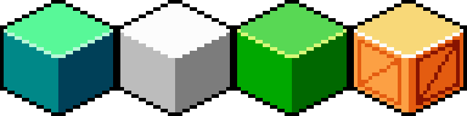
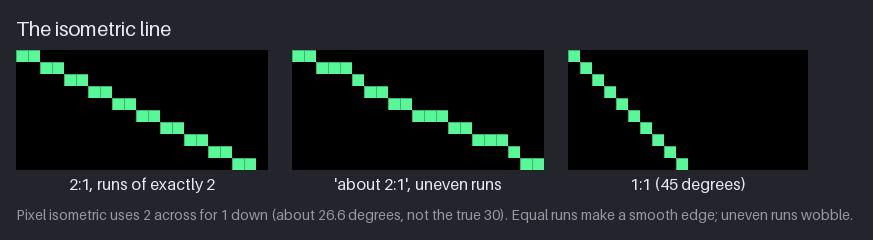
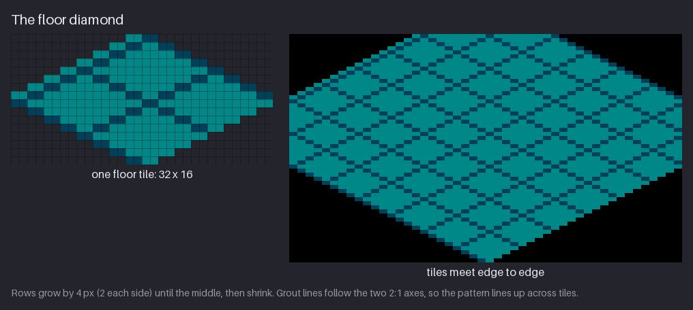
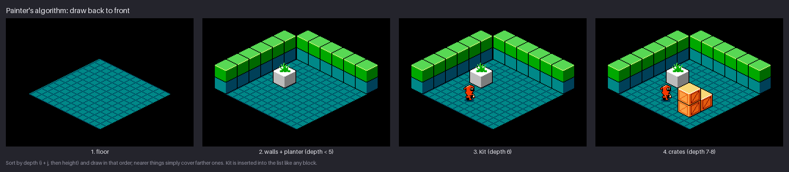

# Chapter 27 — Style: Isometric

Everything in `hollow-vault` so far is seen from the side: the floor is a line, walls are flat
rectangles, and Kit moves left, right, up and down. **Isometric** pixel art tilts the camera so you
see the floor *and* two walls at once. Every object shows three faces (a top, a left and a right),
and characters walk across a floor of diamonds. This chapter rebuilds a corner of the Greenhouse in
2:1 pixel isometric: the line, the floor diamond, three-face blocks, a small room, and the draw
order that keeps near things in front of far ones. It reuses the NES colours and Kit too, but
relaxes the sub-palette rules, as the constraints table explains.

By the end you will be able to draw clean iso lines, tile a floor, shade a block for any light
direction and stack objects in the right order.

Previous: [Chapter 26](26-style-hi-bit.md). Next: [Appendix A](appendix-a-cheatsheet.md).

## What defines the style

Isometric games look at the world from above and at an angle, along a diagonal of the floor grid.
Two games show the range:

- **[Solstice](https://en.wikipedia.org/wiki/Solstice_(1990_video_game))** (Software Creations,
  1990) was the first isometric game on the NES, following home-computer games such as Knight Lore.
  Each room is one screen: a diamond floor, two back walls, and blocks, traps and items. Look at
  how every room is built from a small set of repeated blocks, and how the floor grid tells you
  where each object stands.
- **[Into the Breach](https://subsetgames.com/itb.html)** (Subset Games, 2018) is a modern tactics
  game on an 8×8 board of isometric tiles. Mountains, buildings and mechs stand up from the floor,
  and the tilted view lets you see every tile at once while still reading height. Notice how every
  unit is drawn so its footprint is obvious: in a grid game the player must always know which
  tile something stands on.

In both, look for the same three things: the angle of the floor edges, which face of each block is
lightest, and what happens when one object is in front of another.

## The rules of the projection

True isometric projection puts the floor axes at 30° to the horizontal. Pixel art does not use
30°. It uses a **2:1 line**: two pixels across for every pixel down. Strictly, that is a
*dimetric* projection, but everyone calls it isometric.

| Rule | Value | Where it comes from | What it means for you |
|---|---|---|---|
| Line | 2:1, runs of exactly 2 px (about 26.6°, not 30°) | the pixel grid: only whole-number ratios give even runs (Ch. 2) | every floor edge and block edge uses identical 2-px steps |
| Floor tile | 32×16 diamond | a 2:1 diamond is twice as wide as it is tall | tiles meet edge to edge; a cell is offset by (i − j)·16 across and (i + j)·8 down |
| Block | 32×32: a 32×16 top and 16-px sides | convention: side height = tile height | a stack of two blocks is 48 px tall on screen |
| Light | from the upper left: top lightest, left mid, right darkest | one light for the whole world (Ch. 4) | three values per material, assigned by face |
| Outline | black on the silhouette only | readability against any floor | no line inside the block; faces separate by value |
| Draw order | painter's algorithm: sort by i + j, then height | a 2D image has no depth buffer | the list order decides what covers what |
| Colour | NES master palette, 16 colours in the room; sub-palettes relaxed | `hollow-vault`'s palette (Ch. 5) | the crate alone needs black plus 5 colours, more than one sub-palette holds |

The last row deserves a sentence. A real NES game would need each 16×16 attribute area of the
background in one sub-palette, and 2:1 edges cross those areas at every possible angle. That is a
big reason why NES isometric games were rare and simple. Here we keep the NES *colours* and Kit's
sprite palette, but let any colour sit next to any other.

### Converting is not designing

The shortcut is to take a side-view tile, rotate it 45° and squash it to half height. The result
is a diamond of the right size, but every edge comes out with uneven runs, and the texture smears
into stray pixels, because rotation and squashing resample the grid. Isometric art is drawn
*on* the 2:1 grid from the start: the outline with 2-px runs, then the texture along the two iso
axes. The same goes for characters: a side-view sprite pasted into an iso room (as this chapter
does with Kit) is a shortcut, not a design. More on that in "Side view vs isometric" below.

## The line

Chapter 2 showed that a pixel line looks smooth when all its runs have the same length. Only a few
slopes give equal runs: 1:1 (45°), 2:1, 3:1 and so on. The true isometric angle of 30° has a slope
of about 1:1.73, so a 30° line needs a mix of runs of 1 and 2 and it wobbles, like the middle line
in the figure. The 2:1 line (atan ½ ≈ 26.6°) is the nearest slope with perfectly even runs.

Rules for the line:

- **Runs of exactly two.** Count them. One run of three or one lone pixel is visible at 1×.
- **Start and end on a full run.** A line that starts with a single pixel looks cut off.
- **The four directions mirror.** Down-right, down-left, up-right and up-left are all the same
  staircase flipped. Draw one, mirror the rest.
- **Verticals stay vertical.** Isometric has three axes: the two 2:1 floor axes and the true
  vertical for heights. There are no other angles on a block.

> **Tool aside.** Turn on your editor's pixel-perfect mode for the pencil (Aseprite, Pixelorama
> and LibreSprite all have it) so a freehand stroke does not leave double corners. Pixelorama also
> has an **isometric grid** type in its grid settings; sized to match a 32×16 tile, it draws the
> diamond grid for you. In any editor, a 2×1 rectangular grid makes the steps easy to count.

**Try it.** Draw a 2:1 line 20 runs long, then a 1:1 line next to it. Then draw a line freehand at
"about 30°" and count its runs. How many runs of a different length did you get?

## The floor diamond

The floor tile is 32×16 and uses two colours: $1C for the surface and $0C for the grout. Build it
row by row:

| Row | Width | Note |
|---:|---:|---|
| 0 | 4 | the top point: 4 px, not 1 or 2, so the point is not too sharp |
| 1 | 8 | each row adds 2 px on each side: a 2:1 step |
| … | … | |
| 7 | 32 | the full width |
| 8 | 32 | two middle rows, so the side points are 2 px tall |
| 9–15 | 28 down to 4 | the mirror of rows 0–6 |

Because each row adds exactly 2 pixels per side, the four edges are perfect 2:1 lines. The two full
middle rows are what make tiles fit: the next tile to the right starts 16 px across and 8 px down,
and its edge sits exactly against this one without a gap or overlap.

The grout follows the same two axes as the edges, every 16 pixels, which divides each tile into
four small diamonds. Grout that ran horizontally or vertically would cut across the iso grid and
flatten the floor; grout that follows the axes makes the floor recede.

To place tile (i, j) of a grid, offset it by **x = (i − j) × 16** and **y = (i + j) × 8**. Moving
one cell along i goes down-right; one cell along j goes down-left. That pair of formulas is the
whole of isometric layout; everything else in this chapter uses it.

**Try it.** Draw one 32×16 diamond, then tile it 3×3 using the formulas above. Look for
1-pixel gaps or double edges where tiles meet; if you see any, the two middle rows are wrong.

## Blocks

A block is a 32×16 top diamond with two 16-px sides hanging from its front edges: 32×32 in total.
With light from the upper left, each face gets one value:

| Material | Top | Left face | Right face | Edge highlight |
|---|---|---|---|---|
| stone | $2B | $1C | $0C | $3B |
| metal | $30 | $10 | $00 | $30 |
| moss | $2A | $1A | $0A | $39 |
| crate | $38 | $27 | $17 | $30 |

The top faces the light most directly, so it is lightest. The left face is turned toward the light
but at a steeper angle, so it is the middle value; the right face is turned away and is darkest.
That fixed **top > left > right** order is what makes a block read as solid, and it must hold for
every object in the world.

The outline follows the rule from the table: **silhouette only**.

- **Black** around the outside: the two back edges of the top, the two outer verticals and the
  two bottom edges.
- **A 1-px highlight** along the two front edges of the top, where the lit top turns down into the
  sides. It is the brightest colour on the block and gives it a crisp, bevelled edge.
- **No line** on the front vertical edge, where the left and right faces meet. The value change
  from left to right face is the edge.

The crate shows how to add detail without breaking the faces. Its planks and brace are drawn in a
darker step of each face's own colour ($17 on the left face, $07 on the right), and every plank
line runs along an iso axis or the vertical. The brace is the one diagonal across each face.

### Moving the light

If the light moves to the upper right, the top stays lightest and the two side faces swap. Because
a block is symmetric, that is just a horizontal mirror. (For an asymmetric object, swap the face
colours instead, or the details end up on the wrong side.) Choose the light direction once for the
whole game and never change it per object.

**Try it.** Draw a stone block with the colours above. Then draw a second one 16 px taller (a
pillar) and check that the side faces still meet the top at the same 2:1 edges.

## The room

The room is 256×176 and uses **16 NES colours**:

| Use | Colours |
|---|---|
| outline and background | $0F |
| floor and stone walls | $1C $0C |
| moss | $2A $1A $0A $39 |
| metal planter | $30 $10 $00 |
| crates | $38 $27 $17 $07 ($30 highlight) |
| fern | Greenhouse BG1: $0F $0C $1A $2A |
| Kit | SP0: $0F $16 $37 |

The palette is the Greenhouse's, which is why the corner still feels like `hollow-vault`. The stone
top colours $2B and $3B are in the palette but hidden: the moss row sits on top of the stone. Kit
is the same 16×24 sprite as in the side-view game, standing on a small shadow ellipse in solid $0C.
The shadow does two jobs. It anchors Kit to the floor (without it, a sprite in an iso room seems to
float), and it shows which tile Kit is on. It is a solid colour, not a transparent blend, so the room
stays inside the palette.

The room is built from items, each with a grid cell (i, j) and a height z:

- 36 floor tiles (a 6×6 grid);
- 24 wall blocks: two back walls of 6 blocks, each two blocks high (stone at z = 0, moss at z = 1);
- a metal block at (1, 2) with a fern on top;
- three crates: one at (4, 3), and a stack of two at (4, 4);
- Kit at (2, 4).

## Draw order

There is no depth buffer in a pixel image: whatever you draw last covers what is underneath. So
iso scenes use the **painter's algorithm**: sort every item from back to front and draw it in that
order. In 2:1 iso, "back" means small i + j (the top of the screen), "front" means large i + j.

The room's draw list uses one number per item, its **depth**:

| Item | Depth | Why |
|---|---|---|
| floor tile (i, j) | i + j − 20 | the floor is always behind everything, so it is pushed far back |
| wall block | i + j (−1 to 4), + 0.01 for the moss row | walls sit outside the floor, at i = −1 or j = −1 |
| metal block at (1, 2) | 3 | |
| fern on top of it | 3.01 | same cell, one level up: drawn just after its base |
| Kit at (2, 4) | 6.005 | after ground objects of the same depth, before anything stacked on them |
| crate at (4, 3) | 7 | |
| crates at (4, 4) | 8 and 8.01 | the upper crate is drawn after the lower one |

So the rule is: sort by i + j, then by height. Things that move, like Kit, use their *current*
position, including fractions: Kit at i = 2.6 has depth 6.6 + 0.005 and slides into the list
between items as they walk.

Where the painter's algorithm breaks:

- **Objects larger than one cell.** A 2×1 table has two depths; whichever you pick, something can be
  drawn in the wrong order next to it. Split large objects into one-cell pieces, each with its own
  depth.
- **Tall objects next to moving ones.** A character standing in the cell just behind a tall pillar
  must be drawn first, and the pillar then covers them. That is correct, but it hides the player;
  many games make the front object semi-transparent or cut away when the player is behind it.
- **Floors and decals.** Anything painted flat on the floor (a rug, a shadow) must sort with the
  floor, not with the objects, or it ends up on top of a crate.

**Try it.** On paper, list six objects with their (i, j, z): two crates in a stack, a planter, Kit,
a wall block and a rug. Give each a depth with the rule above, sort them and draw them in that
order. Did anything cover something it should not?

## Side view vs isometric

Put the two Greenhouses side by side and count the cost:

- **Faces.** A side-view crate is one 16×16 face. The iso crate is three faces in a 32×32 block,
  four times the pixels, and its light and detail must agree on all three.
- **Space.** The side-view crop (256×112) shows platforms, a planter, a console and Kit. An iso
  crop of about the same size holds only a 6×6 room. Iso suits small, dense spaces, not long
  levels.
- **Movement.** The side view has one walking axis. The iso floor has two, and the player can walk
  along either one, in four directions. That is the whole point of the view: real depth to explore.
- **Facings.** A side-view character needs one facing, mirrored. An iso character walks along
  diagonals, so it needs at least **down-right** (a three-quarter front view) and **up-right** (a
  three-quarter back view), each mirrored for the left-hand directions. Games with free movement
  draw eight facings.

The figure and the walk GIF below cheat on the last point. Kit is their side-view sprite, so they
look right when they walk down-right along the i axis, mirrored when they come back, and they only
ever walk along that one axis. If they walked along j, they would need a facing the side-view game
never drew. A real isometric Kit would need at least the two three-quarter views.

**Try it.** Sketch Kit facing down-right in a three-quarter front view at 16×24: the hood turned
so you see the cream face and one side, the lantern in the near hand. Mirror it. Then do the back
view.

## Mini-project: the Greenhouse corner

The GIF is 40 frames of 80 ms (3.2 s). Kit walks along the i axis on the front row (j = 5) from
i = 0.3 to i = 4.7 and back, while Kit's own 4-frame walk cycle plays at 140 ms per frame. Moving
along i means 16 px across for every 8 px down, the same 2:1 slope as the floor, so the path runs
parallel to the grout lines. Kit's position is rounded to whole pixels every frame.

The snapshot [`project/ch27/`](project/ch27/README.md) is stand-alone. It redraws a piece of the
Greenhouse under this chapter's rules and is not part of the cumulative `hollow-vault` pack:

- `tiles/floor.png` — the 32×16 floor tile, 2 colours;
- `tiles/blocks.png` — stone, metal, moss and crate in a 128×32 strip, 16 colours;
- `rooms/greenhouse-iso.png` — the 256×176 room with Kit, 16 colours;
- `preview/` — `floor-8x.png`, `blocks-6x.png`, `greenhouse-iso-3x.png` and `walk.gif`, a shorter
  16-frame walk at 120 ms.

Build your own corner in this order:

1. **Floor.** Draw the 32×16 tile and lay out a 6×6 floor with the offset formulas.
2. **Blocks.** Draw the stone block, then recolour it into metal and moss with the face table.
   Recolouring, not redrawing, guarantees that every block has the same edges.
3. **Crate.** Copy a block, then add the plank frames and brace in the darker face colours.
4. **Room list.** Write down every item with (i, j, z) and its depth, sorted.
5. **Draw.** Paste the items in list order. Add Kit's shadow before Kit.
6. **Check.** At 1×: are all edges 2:1? Is every top lighter than its left face, and every left
   face lighter than its right? Does anything cover something it should not?

Then extend it: a rug (sorted with the floor), a second planter, a doorway in one wall (leave out
a stone block and its moss block, and draw the dark inside face of the opening).

## Exercises

### 1. Clean lines

Draw a 2:1 line and a 1:1 line, each about 40 pixels across. Then take an uneven "about 2:1" line
and fix it.

**What to look for:**

- Every run of the 2:1 line is exactly 2 pixels; every run of the 1:1 line is exactly 1.
- The fixed line starts and ends on a full run.
- No double pixels at the corners of the steps.

Example solution

The uneven line in the middle has runs of 2, 3, 1, 2, 2 and 3. To fix it, redraw it as six runs of
2; it ends up slightly shorter, so extend it by one run if it must reach a fixed point.

### 2. A 3×3 floor

Draw one 32×16 floor tile with grout, then tile it 3×3.

**What to look for:**

- Rows grow by 4 px (2 each side) from a 4-px top to two full 32-px middle rows.
- Tiles placed at (i − j)·16, (i + j)·8 meet with no gap and no overlap.
- The grout makes one continuous pattern across tile borders.

Example solution

The grout lines lie every 16 px along both axes, so they meet the grout of the next tile exactly.
If yours break at the tile border, the grout spacing does not divide the tile size.

### 3. Light from the other side

Shade a stone block for light from the upper right.

**What to look for:**

- The top is still the lightest face.
- The right face now takes the middle value and the left face the darkest.
- The 1-px highlight stays on the two front top edges, and the outline is still black on the
  silhouette only.

Example solution

For a symmetric block, mirroring is enough: $1C moves to the right face, $0C to the left. For an
object with details on one side, keep the drawing and swap only the face colours.

### 4. Sort and draw

Place six objects in a 4×4 room (for example two stacked crates, a planter, Kit, a wall block and a
rug). Give each a depth, sort them and draw them in that order.

**What to look for:**

- Depth is i + j, plus a small step per height level.
- The rug sorts with the floor; Kit's shadow is drawn before Kit.
- Nothing nearer is covered by something farther away.

Example solution

The figure draws the room's list in four batches. Kit (depth 6.005) is drawn after the planter (3)
and before the crates (7 and up), so wherever they overlap Kit covers the planter and the crates
cover Kit.

## Recap

- Pixel isometric uses the **2:1 line** (runs of exactly 2, about 26.6°), not the true 30°, because
  only whole-number slopes give even runs.
- The floor tile is a **32×16 diamond**: rows grow 4 px at a time to two full middle rows. Tile
  (i, j) goes at x = (i − j)·16, y = (i + j)·8.
- A block is a 32×16 top plus 16-px sides. Light from the upper left: **top > left > right**.
- Outline the **silhouette only**; highlight the two front top edges; leave the front vertical
  edge to the change of value.
- Draw with the **painter's algorithm**: sort by i + j, then height; moving objects use their
  current position.
- Split large objects into cells; sort floor decals with the floor; anchor characters with a
  shadow.
- Iso characters need diagonal facings. The GIF's Kit walks one axis only, as a side-view sprite.
- The iso Greenhouse uses 16 NES colours with sub-palette rules relaxed; a real NES iso room would
  have to fight the 16×16 attribute grid.

## Further study

- Raymond Schlitter (Slynyrd), **"Pixelblog 41 - Isometric Pixel Art"** —
  <https://www.slynyrd.com/blog/2022/11/28/pixelblog-41-isometric-pixel-art>. 2:1 lines, cubes and
  circles; watch how every shape is built from the same three axes.
- Raymond Schlitter (Slynyrd), **"Pixelblog 54 - More Isometric Pixels"** —
  <https://www.slynyrd.com/blog/2025/1/23/pixelblog-54-isometric-pixel-art>. Trees and organic
  shapes on the 2:1 grid, beyond blocks.
- AdamCYounis, **"Pixel Art Class - Isometric Tile Basics!"** (YouTube) —
  <https://www.youtube.com/watch?v=OqwQBWEzcxU>. Building iso tiles step by step; watch how he
  keeps the edges at exact 2-px runs.
- Raymond Schlitter (Slynyrd), **"Pixelblog 4 – Graphical Projection 2"** —
  <https://www.slynyrd.com/blog/2018/4/12/pixelblog-4-graphical-projection-part-2>. Isometric and
  its relatives side by side; useful for choosing a projection.
- Slynyrd, **Pixelblog catalogue** — <https://www.slynyrd.com/pixelblog-catalogue>. The full list
  of posts, including the other projection articles.

Sources for this chapter: [REFERENCES.md](REFERENCES.md#chapter-27--style-isometric)
