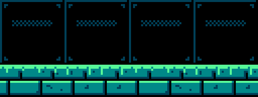
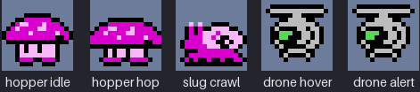
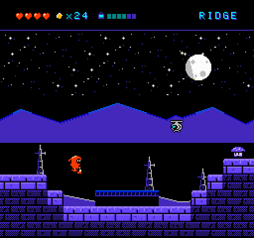
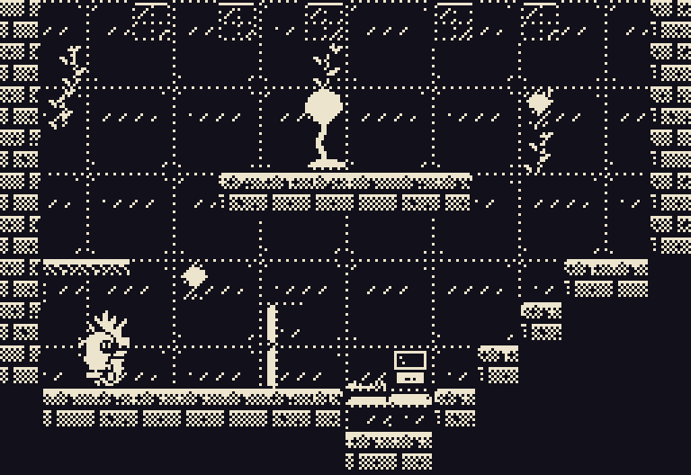
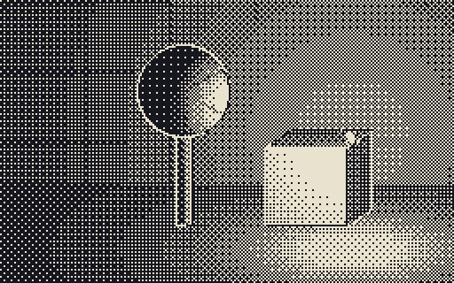
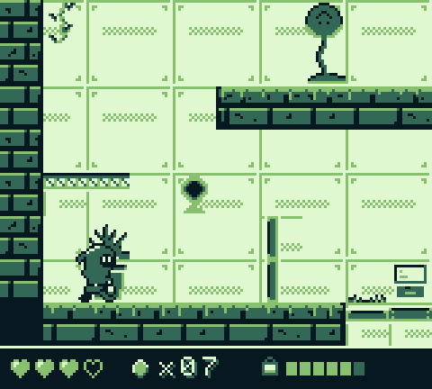
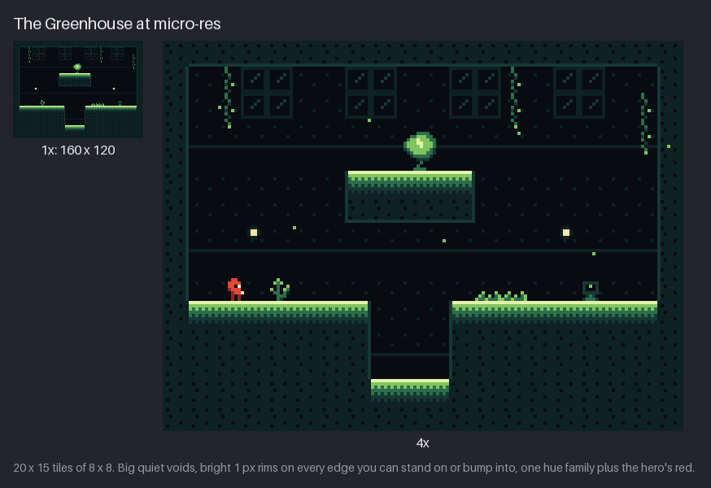
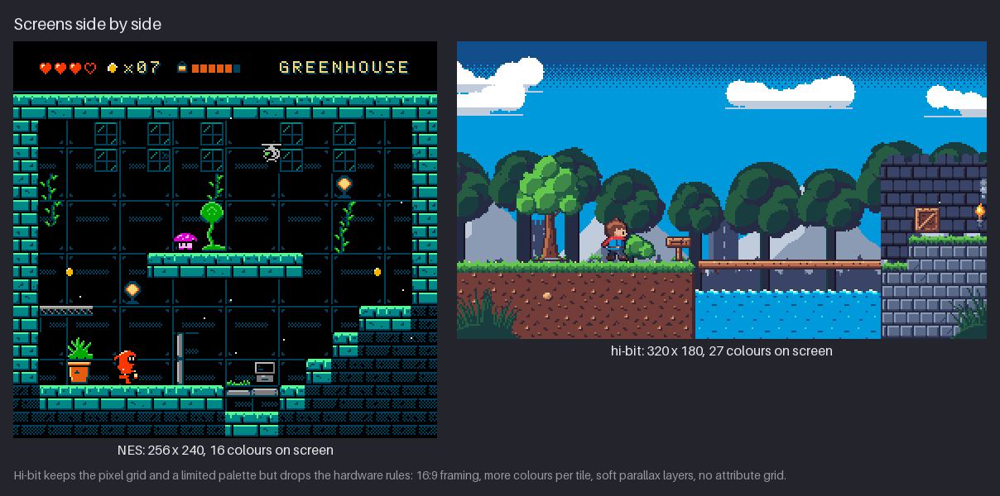
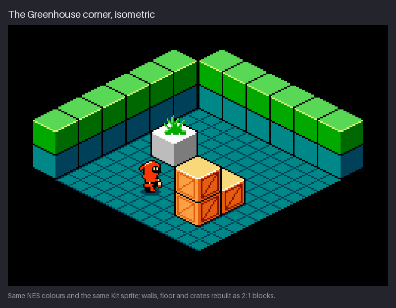

# Learn Pixel Art by Building `hollow-vault`

**Fundamentals of pixel art in the NES style — sprites, animation, tiles and backgrounds — plus
six other styles.**


This course teaches pixel art from first principles while you build one real piece of game art:
**`hollow-vault`**, an original asset pack for a small exploration game set in an abandoned seed
vault overgrown by plants. You learn the fundamentals (line, shape, value, light, colour,
shading, texture and motion) and use them to draw environments, parallax backgrounds and animated
sprites. The art is **NES-inspired**: the screen is 256×240, the tiles are 8×8, every colour
comes from the NES master palette and every tile has 3 colours plus the shared black. The course
keeps the real hardware limits by default and names each place it relaxes one (square pixels,
no scrolling code, no CPU budget). The mood comes from *Environmental Station Alpha*: a tiny
explorer in a quiet, colour-coded world full of black voids. Part IV then redraws the same
material in six other styles, from 1-bit to isometric. All art in this repository is original.

| Kit's walk | Three creatures | Antenna Ridge |
|---|---|---|
|  |  |  |

## Who it is for

Anyone who wants to draw game-ready pixel art: environments and tilesets, props, backgrounds and
animated character sprites, in particular in the NES style or at other low resolutions. No
drawing experience is assumed; the first seven chapters teach the drawing fundamentals in pixels.
No programming is required: every chapter is about drawing.

By the end you can design and draw your own environments, backgrounds and animated sprites inside
real hardware limits, judge them with a fixed professional checklist, and export them as sprite
sheets, Tiled maps and real NES data.

## Requirements

- **Any pixel-art editor.** The course is tool-agnostic (see below). If you have no preference,
  install **Pixelorama** 1.1 or newer from Flathub: it is open source, has an indexed colour mode
  and tilemap layers, and handles everything in the course. **LibreSprite** is the runner-up for an
  Aseprite-like workflow, and Aseprite works if you own it. All the open-source options for
  Debian, with install commands, are in [Appendix B — Tools on Debian](appendix-b-tools.md).
- **Tiled** (optional, Chapters 15 and 20): `sudo apt install tiled`.
- **A mouse** is enough; a pen tablet is welcome (switch pressure off for opacity).
- **About 30 minutes to a few hours per chapter**, including the exercises.

On Debian, the recommended set-up is three commands:

```console
$ sudo apt install flatpak tiled
$ flatpak remote-add --if-not-exists flathub https://dl.flathub.org/repo/flathub.flatpakrepo
$ flatpak install flathub com.orama_interactive.Pixelorama
```

Krita, GIMP, GrafX2 and mtPaint are one `sudo apt install krita gimp grafx2 mtpaint` away. To
rebuild the figures yourself you need only [`uv`](https://docs.astral.sh/uv/) (see
[Regenerating the figures and the pack](#regenerating-the-figures-and-the-pack)).

## Start here if your goal is NES-style / low-res

If you want to make NES-style or low-res game art as fast as possible, read these 12 chapters in
order, do every **Try it**, and skip the exercises on the first pass:

| Step | Chapter | Why |
|---|---|---|
| 1 | [1 Pixels, Tools, and the NES Screen](01-pixels-and-the-nes-screen.md) | the 256×240 canvas, 8×8 grid, integer zoom |
| 2 | [3 Shape, Silhouette, and Readability](03-shape-silhouette-and-readability.md) | a hero that reads at 16×24 |
| 3 | [5 Colour: the NES Palette and Sub-palettes](05-the-nes-palette-and-sub-palettes.md) | 3 colours + transparent, shared black |
| 4 | [6 Shading Craft: Clusters, Outlines, and Black](06-shading-clusters-and-black.md) | clusters, black, the professional checklist |
| 5 | [8 Animation Basics and the Idle](08-animation-basics-and-idle.md) | few frames, held poses |
| 6 | [9 Walk and Run Cycles](09-walk-and-run.md) | the 4-frame cycle |
| 7 | [14 Tiles, Metatiles, and Attributes](14-tiles-metatiles-and-attributes.md) | the NES background system |
| 8 | [16 Rooms and Composition](16-rooms-and-composition.md) | one screen = one room |
| 9 | [19 Light, Atmosphere, and Mood](19-light-atmosphere-and-mood.md) | areas through palettes (ESA's lesson) |
| 10 | [20 The Final Area and Export](20-final-area-and-export.md) | rule check, sheets, CHR/nametable |
| 11 | [24 Style: Authentic NES](24-style-authentic-nes.md) | if you want real hardware limits |
| 12 | [25 Style: Micro-res (ESA-like)](25-style-micro-res.md) | if you want to go even smaller, at 160×120 |

Going **micro-res first** (like ESA)? Read 1 → 3 → 5 → 25, then come back to 16 and 19.

## One course, any tool

The chapters never say "click menu X in program Y". They name tools by what they do: **pencil**,
**eraser**, **fill**, **line**, **selection**, **layers**, **colour picker**, **palette**,
**symmetry**, **tile mode**, **onion skin**, **timeline**. Every pixel-art editor has these, often
under another name. Chapter 1 introduces the generic tool set, and
[Appendix B](appendix-b-tools.md#generic-tool--editor) maps each generic name to its name and
shortcut in Pixelorama, LibreSprite/Aseprite, GrafX2, Krita and GIMP. Appendix B also covers
working under hardware limits: indexed colour, palette locking, tile and grid modes, and the
NES-native tools NEXXT and NES Screen Tool.

The skills transfer completely: a clean 2:1 line, a readable silhouette and a good walk cycle are
the same in every program. **Pick a tool** from [Appendix B](appendix-b-tools.md#which-one-to-pick)
and move on.

## How to use this course

1. Read the chapters in order. Each one builds on the previous chapters and adds to the project.
2. Do the **Try it** boxes as you read: 2–5 minute drawing drills.
3. Do the four **exercises** at the end of each chapter. Each one says what to look for, and has
   an example solution hidden in a collapsible block. Draw first, then compare.
4. Build your own version of the project step by step. The course's version of the pack at the
   end of every chapter is in [`project/`](project/), so you can compare, or pick up from any
   chapter.
5. Read the **NES rule** boxes: each one states a hardware limit, why it existed, and whether the
   course keeps it or relaxes it.
6. Keep [Appendix A — Cheat Sheet](appendix-a-cheatsheet.md) open while you draw.

Every chapter ends with a recap, further study (articles and videos) and a link to its section of
[REFERENCES.md](REFERENCES.md).

## What you'll build

Parts I–III build the `hollow-vault` pack, one chapter at a time:

- **Kit**, a small vault keeper in a hooded suit who carries a lantern: a 16×24 sprite in 23
  frames (idle, walk, run, jump, attack, hurt);
- **3 creatures**: the hopper, the slug and the drone, each with area colour variants;
- **7 effects** (dust, spark, smear, hit, poof, seed, splash), plus animated water and molten
  tiles;
- **4 areas** — the Greenhouse, the Cistern, the Furnace and Antenna Ridge — each with its tiles,
  props, sub-palettes and rooms;
- the **Antenna Ridge parallax** sky;
- **exports**: sprite sheets with JSON, Tiled maps, and real NES `.chr`, `.nam` and `.pal` files.


## Styles (Part IV)

Part IV takes the finished pack into six other styles, one chapter each, plus a deeper look at
the real NES. Each chapter states the style's defining rule and redraws a piece of
`hollow-vault` inside it.

| Ch. | Style | Resolution | Colours | Defining rule | Mini-project |
|---|---|---|---|---|---|
| [21](21-style-one-bit.md) | 1-bit | 256×240 | 2 | fill (solid/pattern/empty) replaces value | Greenhouse + Kit in ink/paper |
| [22](22-style-dithered-monochrome.md) | Dithered mono (Obra Dinn-like) | 256×160 | 2 | light in grey first, threshold map last | lit vault alcove |
| [23](23-style-game-boy.md) | Game Boy | 160×144 | 4 shades | BGP/OBP palette registers, window layer | Greenhouse light/dark mode |
| [24](24-style-authentic-nes.md) | Authentic NES | 256×240 | 25 max on screen | CHR banks, OAM, flicker, splits | Greenhouse as `.chr/.nam/.pal` |
| [25](25-style-micro-res.md) | Micro-res (ESA-like) | 160×120 | 9 per area | 1 px features, rims, one hue family | 5×7 Kit, two areas |
| [26](26-style-hi-bit.md) | Hi-bit | 320×180 | 32 (ENDESGA 32) | keep the grid, drop the hardware | the `mossy-ruins` forest scene |
| [27](27-style-isometric.md) | Isometric | 256×176 room | 16 NES colours | 2:1 lines, three faces, draw order | Greenhouse corner in iso |

| 1-bit | Dithered mono | Game Boy |
|---|---|---|
|  |  |  |
| **Micro-res** | **Hi-bit** | **Isometric** |
|  |  |  |

## Table of contents

**Part I — Foundations**

1. [Chapter 1 — Pixels, Tools, and the NES Screen](01-pixels-and-the-nes-screen.md)
2. [Chapter 2 — Lines and Curves](02-lines-and-curves.md)
3. [Chapter 3 — Shape, Silhouette, and Readability](03-shape-silhouette-and-readability.md)
4. [Chapter 4 — Value, Light, and Contrast](04-value-light-and-contrast.md)
5. [Chapter 5 — Colour: the NES Palette and Sub-palettes](05-the-nes-palette-and-sub-palettes.md)
6. [Chapter 6 — Shading Craft: Clusters, Outlines, and Black](06-shading-clusters-and-black.md)
7. [Chapter 7 — Texture, Materials, and Dithering on Tiles](07-texture-and-dithering.md)

**Part II — Sprites and motion**

8. [Chapter 8 — Animation Basics and the Idle](08-animation-basics-and-idle.md)
9. [Chapter 9 — Walk and Run Cycles](09-walk-and-run.md)
10. [Chapter 10 — Jump, Fall, and Land](10-jump-and-fall.md)
11. [Chapter 11 — Attacks, Effects, and Hits](11-attacks-effects-and-hits.md)
12. [Chapter 12 — Enemies and Creatures](12-enemies-and-creatures.md)
13. [Chapter 13 — Secondary Motion and a Living World](13-secondary-motion-and-life.md)

**Part III — Environments**

14. [Chapter 14 — Tiles, Metatiles, and Attributes](14-tiles-metatiles-and-attributes.md)
15. [Chapter 15 — Tilesets and Autotiling](15-tilesets-and-autotiling.md)
16. [Chapter 16 — Rooms and Composition](16-rooms-and-composition.md)
17. [Chapter 17 — Props and Foliage](17-props-and-foliage.md)
18. [Chapter 18 — Backgrounds and Parallax](18-backgrounds-and-parallax.md)
19. [Chapter 19 — Light, Atmosphere, and Mood](19-light-atmosphere-and-mood.md)
20. [Chapter 20 — The Final Area and Export](20-final-area-and-export.md)

**Part IV — Styles**

21. [Chapter 21 — Style: 1-bit](21-style-one-bit.md)
22. [Chapter 22 — Style: Dithered Monochrome (Obra Dinn-like)](22-style-dithered-monochrome.md)
23. [Chapter 23 — Style: Game Boy (four shades)](23-style-game-boy.md)
24. [Chapter 24 — Style: Authentic NES — the Hardware in Depth](24-style-authentic-nes.md)
25. [Chapter 25 — Style: Micro-res (ESA-like, 160×120)](25-style-micro-res.md)
26. [Chapter 26 — Style: Hi-bit and Modern Detail](26-style-hi-bit.md)
27. [Chapter 27 — Style: Isometric](27-style-isometric.md)

**Appendices**

- [Appendix A — Cheat Sheet](appendix-a-cheatsheet.md)
- [Appendix B — Tools on Debian](appendix-b-tools.md)
- [Appendix C — Project Reference](appendix-c-project-reference.md)
- [References](REFERENCES.md)

## Repository layout

```text
README.md                    this file
01-…md … 27-…md              the chapters
appendix-a-cheatsheet.md     rules, numbers and timings on one page
appendix-b-tools.md          editors on Debian, generic tool names, hardware-limit tools
appendix-c-project-reference.md   every file of hollow-vault, area by area
REFERENCES.md                every source, by chapter, with archive links
images/                      every figure (chNN-*.png / .gif)
project/ch01 … ch20/         the hollow-vault pack as it stands after each chapter (cumulative)
project/ch21 … ch27/         the Part IV style folders (stand-alone)
tools/
  nes.py, pix.py             NES palette, tile and attribute rules; drawing helpers
  vault/                     the hollow-vault art: Kit, creatures, effects, tiles, props, rooms
  styles/                    the Part IV conversions (1-bit, dither, micro-res, isometric)
  art/                       the Chapter 26 hi-bit scene
  figures/chNN_*.py          one script per chapter's figures
  build_project.py           writes project/
  build_figures.sh           rebuilds everything
```

Each `project/chNN/` folder has a `README.md` that lists what changed in that chapter.
[Appendix C](appendix-c-project-reference.md) describes the final pack file by file.

### Regenerating the figures and the pack

You never need to run code to follow the course. The figures and the pack are generated, though,
so every picture in the chapters is a real file, checked against the NES limits the text
describes, and you can rebuild them after changing the art in `tools/vault/`. You need
[`uv`](https://docs.astral.sh/uv/), which fetches Python 3.12 and Pillow 13.0.0 on first use:

```console
$ tools/build_figures.sh            # all figures, then all project snapshots (about a minute)
$ tools/build_figures.sh ch07       # only the figures of one chapter
$ tools/build_figures.sh project    # only project/
```

Without `uv`, install Pillow (`python3 -m pip install --user pillow==13.0.0`) and run
`PY=python3 tools/build_figures.sh`. The output is deterministic: two runs produce byte-identical
files.

## Resources

The ten sources to bookmark first:

- [Lospec — Nintendo Entertainment System palette](https://lospec.com/palette-list/nintendo-entertainment-system) — the NES colours used throughout.
- [NESdev wiki — PPU](https://www.nesdev.org/wiki/PPU) — the NES picture hardware, in full.
- [Breaking the NES (Yacht Club Games)](https://old.yachtclubgames.com/2014/07/breaking-the-nes/) — how *Shovel Knight* kept and broke the NES rules.
- [Pixelblog catalogue (Slynyrd)](https://www.slynyrd.com/pixelblog-catalogue) — step-by-step posts on palettes, tiles, light, animation and parallax.
- [Pixel Art Articles (Pedro Medeiros, Saint11)](https://saint11.art/pixel_articles/) — short illustrated lessons.
- [AdamCYounis](https://www.youtube.com/adamcyounis) — the Pixel Art Class, critiques and speed paintings.
- [Brandon James Greer](https://www.youtube.com/c/BJGpixel/videos) — clear concept explanations.
- [MortMort](https://www.youtube.com/@MortMort) — beginner-friendly techniques and workflows.
- [Environmental Station Alpha on Steam](https://store.steampowered.com/app/350070/Environmental_Station_Alpha/) — the game whose mood this course borrows.
- [Pan Docs](https://gbdev.io/pandocs/) — the Game Boy hardware reference (Chapter 23).

Everything else, by chapter and with archive links, is in [REFERENCES.md](REFERENCES.md).

## Credits

- NES colours: the Lospec
  [Nintendo Entertainment System](https://lospec.com/palette-list/nintendo-entertainment-system)
  palette.
- Hi-bit palette (Chapter 26): [ENDESGA 32](https://lospec.com/palette-list/endesga-32) by
  ENDESGA.
- Game Boy shades (Chapter 23): the Lospec
  [Nintendo Gameboy (BGB)](https://lospec.com/palette-list/nintendo-gameboy-bgb) palette.
- Inspirations, described and never copied: *Environmental Station Alpha* (Hempuli), *Shovel
  Knight* (Yacht Club Games), and NES-era games by Capcom, Konami and HAL.

All art in this repository is original: every figure and every project file was made for this
course with the scripts in `tools/`. This course is not affiliated with Nintendo or any studio.

Start with [Chapter 1 — Pixels, Tools, and the NES Screen](01-pixels-and-the-nes-screen.md).
